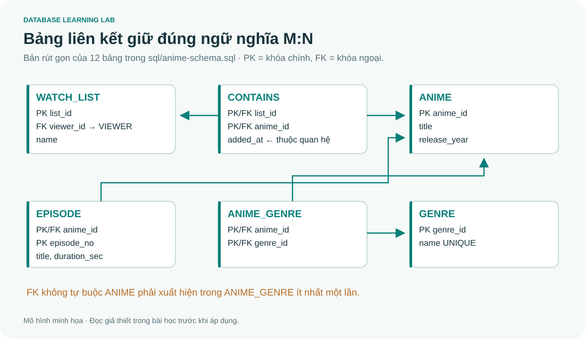

# Database Learning Lab

**Học Database bằng tiếng Việt: hiểu bản chất, nhìn ví dụ, chạy SQL và tự giải bài.**

Một project học tập dựa trên **9 file Markdown CO2013** và **hai PowerPoint SQL 4A/4B** do người dùng cung cấp, kết hợp bài đọc đầy đủ với hướng dẫn, sơ đồ, lab và công cụ tương tác. Phù hợp để tự học, ôn cuối kỳ và luyện thiết kế CSDL cho dự án.



## Bắt đầu trong một phút

1. Tải/clone project và mở **[docs/index.html](docs/index.html)** bằng trình duyệt.
2. Chọn chương hoặc **Xưởng tương tác → SQL chạy thật**.
3. Để chạy các lab và kiểm tra bằng Python:

```bash
python tools/check.py
python tools/lab.py --exercise Q07
```

Trình đọc chạy **offline**, gồm cả Mermaid, công thức KaTeX và SQLite WebAssembly. Không cần cài Node, npm, Docker, pip hoặc database server để sử dụng. Lab Python cần Python 3.10+ có `sqlite3`. Nếu máy dùng `python3`/`py`, thay tên lệnh tương ứng.

Có thể phục vụ qua localhost (tùy chọn):

```bash
python -m http.server 8000 --bind 127.0.0.1 --directory docs
```

Sau đó mở `http://127.0.0.1:8000`. Không cần localhost nếu mở trực tiếp index.html được bình thường.

## Có gì bên trong?

| Thành phần | Nội dung |
|---|---|
| 9 tài liệu gốc | **18.148 dòng**, giữ nguyên từng byte trong `materials/` |
| Trình đọc | 164 phần nguồn, 37 trang hướng dẫn/lab; tìm kiếm không dấu, mục lục, tiến độ, in từng bài |
| 8 hướng dẫn nền tảng | Motivation, ví dụ, bảng so sánh, bài tập và lời giải |
| Sơ đồ | 14 SVG biên soạn mới + Mermaid; COMPANY, JOIN, NULL, grouping, trigger nhiều dòng |
| SQL Playground | SQLite chạy thật; xem trực tiếp bảng, cấu trúc PK/FK, lọc/phân trang; dữ liệu tự cập nhật sau SQL |
| Khóa SQL chi tiết | **18 bài theo 157 slide**, 43 ví dụ sửa/chạy ngay trong bài, 20 bài tổng hợp có lời giải |
| SQL Server | 9 script: setup, biến, procedure, function, trigger, cursor, lỗi, self-check và phân quyền |
| SQL exercises | 40 đề, query lời giải, expected rows và giải thích |
| Bộ câu hỏi | 50 câu có phản hồi, giải thích, bộ lọc và tiến độ cá nhân |
| FD tools | Bao đóng từng bước, mọi candidate key; CLI có minimal cover |
| Storage tools | bfr, số block, các mức sparse index, chi phí truy cập theo giả thiết |
| Hai fixture | COMPANY và Anime Streaming capstone |
| Kiểm tra | 31 Python test methods; 40 bài Q + 43 ví dụ S có expected độc lập; browser kiểm offline |

## Lộ trình nội dung

| Bài | Đọc hướng dẫn | Nguồn đầy đủ |
|---|---|---|
| 1. Nền tảng & kiến trúc | [Hướng dẫn](lessons/01-foundations.md) | [DB-Chapter1](materials/DB-Chapter1.md) |
| 2. ER / Chen | [Hướng dẫn](lessons/02-er.md) | [DB-Chapter2](materials/DB-Chapter2.md) |
| 3. EER | [Hướng dẫn](lessons/03-eer.md) | [DB-Chapter3](materials/DB-Chapter3.md) |
| 4. Relational mapping | [Hướng dẫn](lessons/04-mapping.md) | [DB-Chapter4](materials/DB-Chapter4.md) |
| 5. Đại số quan hệ | [Hướng dẫn](lessons/05-algebra.md) | [DB-Chapter5](materials/DB-Chapter5.md) |
| 6. SQL | [Hướng dẫn](lessons/06-sql.md) | [DB-Chapter6](materials/DB-Chapter6.md) |
| 7. FD & Normalization | [Hướng dẫn](lessons/07-normalization.md) | [DB-Chapter7](materials/DB-Chapter7.md) |
| 8. Storage & Index | [Hướng dẫn](lessons/08-storage.md) | [DB-Chapter8](materials/DB-Chapter8.md) |
| Security & Advanced | [Hướng dẫn](lessons/09-security-advanced.md) | [DB-Final](materials/DB-Final.md) |
| Ôn cuối kỳ | [Lộ trình + tự luận mẫu](lessons/10-exam-roadmap.md) | [50 câu có lời giải](labs/07-mock-exam.md) |

Trong trình đọc, mỗi chương mở bằng hướng dẫn bổ sung; cuối hướng dẫn có toàn bộ mục lục các phần nguồn. Đọc Markdown trực tiếp trên GitHub vẫn được: [danh mục tài liệu](INDEX.md).

## Học SQL theo hai bộ slide mới

Mở **docs/index.html → SQL chi tiết · 18 bài mới** hoặc chọn Chương 6. Trên GitHub, bắt đầu ở **[mục lục SQL](lessons/06-sql.md)**.

- Bài 01–08: kiểu dữ liệu, DDL/constraint, SELECT, JOIN, NULL, GROUP BY/HAVING, query con/ANY/ALL, DML/transaction.
- Bài 09–16: view/assertion, quyền, biến/batch/vòng lặp, procedure, scalar/TVF, trigger nhiều dòng, cursor và xử lý lỗi.
- Bài 17: 20 bài tổng hợp với lời giải và phản ví dụ. Bài 18: đối chiếu từng trang của 157 slide cùng hiệu đính.
- Nút **Chạy ví dụ** chạy SQLite thật ngay dưới mã. **Sửa SQL để thử** mở editor; mỗi lần chạy tạo COMPANY mới, độc lập Playground. Có bảng kết quả và báo khớp mẫu.
- Code **SQL Server · T-SQL** cần SQL Server riêng: xem [hướng dẫn và 9 script](sql/sqlserver/README.md). Project chưa thực thi T-SQL trong CI; không giả lập procedure/cursor bằng SQLite.

```bash
python tools/sql_course.py --example S23
python tools/sql_course.py --check
```

## Chạy các lab

```bash
# Query tự viết / toàn bộ lời giải
python tools/lab.py --query "SELECT Fname, Salary FROM EMPLOYEE ORDER BY Fname"
python tools/lab.py --file sql/solutions.sql

# Fixture anime
python tools/lab.py --database anime --query "SELECT * FROM anime"
python tools/capstone.py

# Lý thuyết có trace
python tools/fd.py --attrs A,B,C --fds "A->B;B->A" --start A
python tools/storage.py

# Quan sát thực nghiệm
python tools/transaction_demo.py
python tools/index_demo.py
```

Bắt đầu từ [Lab 01](labs/01-setup.md). CLI tạo database mới mỗi lần; SQL Playground giữ state trong tab đến khi reset/reload. Thay đổi dữ liệu không được lưu thành file database. Tiến độ đọc và quiz lưu bằng localStorage của trình duyệt, không đồng bộ giữa máy.

## Xem database ngay cạnh ô SQL

Trong **Xưởng tương tác → SQL chạy thật**, phần **Khám phá database** đọc trực tiếp từ cùng database đang dùng cho ô SQL:

1. Chọn COMPANY hoặc ANIME, rồi bấm tên bảng để xem các hàng dữ liệu.
2. Nhãn **PK/FK** đánh dấu khóa chính/khóa ngoại; mở **Cấu trúc & khóa** để xem cột, liên kết và SQL tạo bảng. Bấm liên kết FK để mở bảng cha.
3. Dùng ô tìm kiếm và nút trang trước/tiếp (25 hàng/trang). **Nạp SELECT \*** chỉ điền truy vấn vào editor; bạn vẫn quyết định khi chạy.
4. Chạy INSERT/UPDATE/DELETE hoặc CREATE/ALTER/DROP: bảng và danh sách bảng tự làm mới. Nếu một script lỗi giữa chừng, trình xem vẫn phản ánh các thay đổi đã xảy ra; nó không tự commit hoặc rollback.
5. Bấm **Reset dữ liệu** để trở về mẫu ban đầu. Cả SQL và trình xem đều chạy offline trong RAM của tab.

Để cập nhật bản đã tải ZIP trước đây, tải ZIP mới từ repo và giải nén vào một thư mục mới, rồi mở `docs/index.html`.

## Phân biệt phần học và phần chạy được

- Bài gốc có SQL chuẩn và ví dụ của nhiều DBMS; không phải mọi code block đều chạy trên SQLite.
- `sql/company-*.sql`, `sql/anime-*.sql`, 40 lời giải SQL, 43 ví dụ S và các script Python là phần SQLite được kiểm thử; `sql/sqlserver/` dùng engine riêng.
- `WITH CHECK OPTION`, GRANT/REVOKE, procedure/function/cursor/T-SQL trigger/THROW dùng SQL Server trong phần mới; ASSERTION/domain chuẩn được giải thích kèm giới hạn hỗ trợ.
- Trọng số/hình thức thi trong DB-Final phản ánh ghi chú người dùng cung cấp; project không có thông báo gốc để xác nhận cho kỳ hiện tại.
- Một số điểm dễ nhầm đã có **[chú giải & nguồn chính thức](lessons/11-corrections-and-sources.md)**. Hai PPTX 4A/4B đã được đối chiếu; các PDF/quiz khác được dẫn tên trong tài liệu chưa được cung cấp.

## Cấu trúc project

| Thư mục | Vai trò |
|---|---|
| `materials/` | 9 nguồn nguyên bản và manifest SHA-256 |
| `lessons/` | Hướng dẫn; `lessons/sql/` chứa khóa SQL chi tiết và mục lục course.json |
| `labs/` | Bài tập, thực nghiệm và capstone |
| `sql/` | Schema, seed, đề, lời giải và expected outputs |
| `tools/` | Build, lab runner, thuật toán và demo Python |
| `tests/` | Python và kiểm tra trình duyệt |
| `docs/` | Trình đọc tĩnh offline; có thể dùng GitHub Pages |
| `.github/workflows/` | CI kiểm source, SQL và thuật toán |

## Repository và GitHub Pages

Repo chính: **[thinhlc137/Database_learning](https://github.com/thinhlc137/Database_learning)**, nhánh `main`.

Xem **[PUBLISHING.md](PUBLISHING.md)** để clone, push thay đổi và bật Pages từ branch `main`, folder `/docs` cho mọi người đọc bằng đường dẫn web. Bản offline mở trực tiếp từ `docs/index.html` sau khi clone hoặc tải ZIP.

## Sửa bài và đóng góp

```bash
python tools/diagrams.py
python tools/build.py
python tools/check.py
```

Build sử dụng Python standard library; các thư viện trình duyệt đã đóng gói trong `docs/vendor/`. Sửa `lessons/`, `labs/`, `sql/` rồi rebuild; không sửa trực tiếp content.js. Xem [CONTRIBUTING.md](CONTRIBUTING.md), [SOURCE-MAP.md](SOURCE-MAP.md) và [THIRD-PARTY.md](THIRD-PARTY.md).
