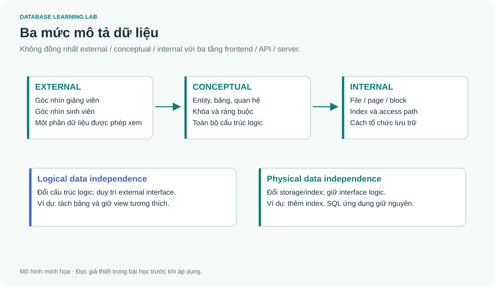

# 01 · Từ file rời đến một hệ cơ sở dữ liệu

> Đọc cùng **DB-Chapter1.md**. Mục tiêu của buổi học: giải thích được vì sao cần DBMS, phân biệt schema với state và chỉ ra đúng tầng bị thay đổi khi sửa hệ thống.



## Một vấn đề cụ thể trước khi học thuật ngữ

Phòng đào tạo có `students.csv`, thư viện có `borrowers.csv`. Cả hai đều lưu tên và email của cùng sinh viên. Khi sinh viên đổi email, một phòng cập nhật và phòng kia quên. Đây là **inconsistency**. Việc lưu cùng một sự kiện nhiều lần tạo **redundancy**, nhưng dư thừa không tự động có nghĩa là sai: sao lưu và bản sao phục vụ đọc vẫn có ích nếu có cơ chế đồng bộ.

Nếu hai người cùng đọc số chỗ trống bằng 1 rồi cùng ghi bằng 0, hệ thống có thể bán hai suất cuối. Đây là vấn đề **concurrency**; chỉ gom các CSV vào một thư mục chung không giải quyết được. DBMS cung cấp cơ chế quản lý truy cập, ràng buộc, giao dịch và phục hồi. Ứng dụng vẫn phải chọn transaction và isolation phù hợp.

| Khái niệm | Câu hỏi nó trả lời | Ví dụ |
|---|---|---|
| Database | Dữ liệu liên quan nào đang được lưu? | Sinh viên, môn, đăng ký |
| DBMS | Phần mềm nào quản lý chúng? | SQLite, PostgreSQL |
| Schema | Những cấu trúc và quy tắc nào được khai báo? | `Student(id, name)` |
| State / instance | Hiện tại có những hàng nào? | `(1, 'An'), (2, 'Bình')` |
| Metadata | Dữ liệu được mô tả thế nào? | Tên cột, kiểu, khóa, index |

## Ba tầng: đừng nhầm với frontend, backend và database

**External schema** mô tả góc nhìn của một nhóm người dùng, chẳng hạn giảng viên chỉ xem sinh viên trong lớp mình. **Conceptual schema** mô tả toàn bộ cấu trúc logic của CSDL. **Internal schema** mô tả cách tổ chức lưu trữ và đường truy cập. Đây là ba mức mô tả dữ liệu, không phải ba máy chủ.

Thêm index để truy vấn nhanh hơn là thay đổi tầng internal. Nếu ứng dụng vẫn chạy cùng SQL và thấy cùng dữ liệu, đó là **physical data independence**. Tách bảng nhưng duy trì view tương thích cho ứng dụng cũ minh họa **logical data independence**; thực hiện điều này thường khó hơn.

```sql
-- SQLite; chạy trên COMPANY bằng python tools/lab.py --query "..."
SELECT name, type FROM sqlite_master
WHERE type IN ('table', 'index') ORDER BY type, name;
```

Truy vấn trên đọc catalog, không đọc danh sách nhân viên. `CREATE TABLE` là DDL, `INSERT/UPDATE/DELETE/SELECT` thuộc nhóm thao tác dữ liệu theo cách phân loại dùng ở đây; `GRANT/REVOKE` là DCL, `COMMIT/ROLLBACK` là TCL. Một số giáo trình đặt SELECT vào DQL: khác biệt nhãn gọi không làm thay đổi hành vi câu lệnh.

## Lần theo một yêu cầu từ người dùng đến đĩa

Người dùng muốn xem nhân viên phòng Research. Ứng dụng gửi SQL; parser kiểm tra cú pháp, hệ thống kiểm tra tên/kiểu/quyền; optimizer chọn một kế hoạch tương đương; execution engine thao tác qua buffer và storage manager. Đây là cách giải thích khái quát, không phải thứ tự bắt buộc của mọi bước trong mọi DBMS.

```sql
SELECT e.Fname, e.Lname
FROM EMPLOYEE AS e JOIN DEPARTMENT AS d ON d.Dnumber=e.Dno
WHERE d.Dname='Research' ORDER BY e.Fname;
```

Kết quả gồm Franklin, John, Joyce, Ramesh. `ORDER BY` làm thứ tự có thể đối chiếu; nếu bỏ nó, đừng dựa vào thứ tự hiển thị tình cờ.

## Bài tập tự giải trước khi mở đáp án

1. Thêm `CREATE INDEX ix_employee_dno ON EMPLOYEE(Dno)` có thay đổi conceptual schema không?
2. Thêm cột `Email` và buộc mọi chương trình phải sửa có chứng minh logical independence không?
3. Hai hệ thống cùng lưu email có nhất thiết là thiết kế sai không?
4. Chỉ ra schema và state trong một bảng điểm.

<details><summary>Lời giải và cách lập luận</summary>

1. Theo mô hình ba mức, index thuộc thiết kế vật lý/đường truy cập; có thể đạt physical independence.
2. Không. Tình huống này cho thấy ứng dụng đang bị ảnh hưởng bởi thay đổi logic.
3. Không. Có thể là replication chủ đích; cần xác định nguồn chuẩn và cơ chế nhất quán.
4. Schema là các cột, miền giá trị, khóa và ràng buộc; state là các bản ghi điểm tại một thời điểm.

</details>

## Điểm tự kiểm tra

Bạn nên giải thích được bằng ví dụ riêng: redundancy ≠ inconsistency, schema ≠ state, logical ≠ physical independence. Sau đó mở bài gốc để học các vai trò DBA, data model và framework quản lý dữ liệu đầy đủ.
