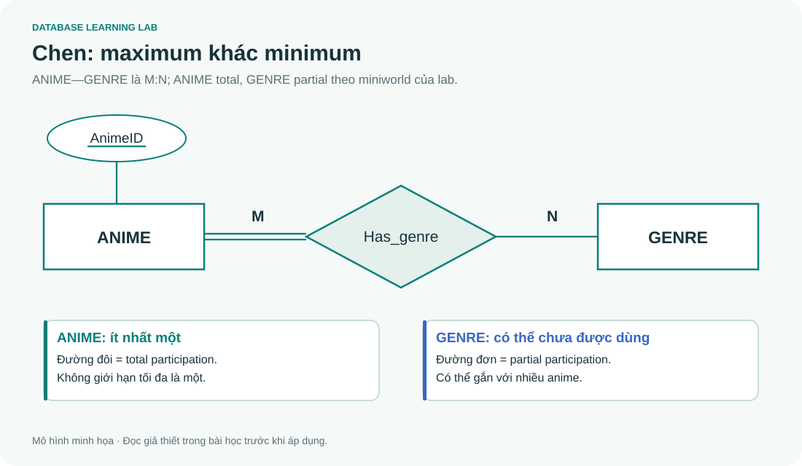

# 02 · Đọc nghiệp vụ và vẽ ER theo Chen

> Đọc cùng **DB-Chapter2.md**. ER mô tả ngữ nghĩa nghiệp vụ trước khi lựa chọn bảng và khóa ngoại.

## Bắt đầu từ miniworld, không bắt đầu từ tên bảng

“Mỗi anime có mã, tên và năm phát hành. Anime thuộc ít nhất một thể loại. Một thể loại có thể chưa có anime. Một anime có nhiều tập; số tập chỉ duy nhất trong cùng anime.”

Bước 1: chọn **ANIME**, **GENRE**, **EPISODE** là các loại thực thể. Bước 2: tách thuộc tính khỏi quan hệ. Tên thể loại có thực thể riêng vì thể loại được tái sử dụng. Bước 3: viết câu theo hai chiều. Một anime có nhiều genre; một genre có nhiều anime, nên **Has_genre là M:N**. Bước 4: hỏi điều kiện tối thiểu. ANIME tham gia toàn phần vì mỗi anime có ít nhất một genre; GENRE tham gia bộ phận vì có thể chưa được dùng.

## Cardinality và participation trả lời hai câu khác nhau

| Trục | Câu hỏi | Ví dụ |
|---|---|---|
| Cardinality ratio | Tối đa bao nhiêu? | ANIME—GENRE là M:N |
| Participation | Có bắt buộc xuất hiện ít nhất một lần? | ANIME total, GENRE partial |

Trong Chen, **đường đôi** biểu diễn total participation. Nhãn `1`, `N`, `M` biểu diễn tỷ lệ số lượng tối đa. Không suy total chỉ từ nhãn N; cũng không suy M:N chỉ vì hai phía đều total.

Với min–max đặt sát thực thể, `(1,N)` ở ANIME nghĩa là mỗi anime tham gia từ một đến N instance của quan hệ. Đừng đọc nhầm vị trí này với ký hiệu “one/many” ở đầu bên kia của một cạnh Crow's Foot. Chú giải luôn phải nói rõ hệ ký hiệu đang dùng.

## Thuộc tính: hỏi nó mô tả cái gì

`AnimeID` là khóa, gạch chân; `Title` là thuộc tính đơn. `Address(Street, City)` minh họa thuộc tính phức hợp. `Phone` có nhiều giá trị là oval đôi. `Age` tính từ `BirthDate` là thuộc tính dẫn xuất, oval nét đứt.

Ngày thêm anime vào watch list phụ thuộc vào **cặp (watch list, anime)**, nên `AddedAt` thuộc quan hệ **Contains**. Không đặt vào ANIME: cùng anime có thể được hai người thêm vào hai ngày khác nhau. Không đặt vào WATCH_LIST: mỗi danh sách chứa nhiều anime với thời điểm khác nhau.

## Thực thể yếu: thiếu khóa độc lập, không chỉ “có FK”

EPISODE có `EpisodeNo`, nhưng số 1 có thể xuất hiện ở nhiều anime. Khóa đầy đủ sau mapping là `(AnimeID, EpisodeNo)`. Trong Chen, EPISODE dùng hình chữ nhật đôi; identifying relationship dùng hình thoi đôi; partial key `EpisodeNo` gạch chân nét đứt. EPISODE phải tham gia toàn phần vào quan hệ định danh.

Nếu thay nghiệp vụ bằng “mỗi tập có EpisodeID duy nhất toàn hệ thống”, có thể mô hình hóa thành thực thể mạnh. Quyết định dựa vào cách định danh, không dựa vào việc giao diện có cho tạo tập khi chưa chọn anime hay không.

## Một lỗi thiết kế rất thực tế

Có DEPARTMENT—EMPLOYEE và DEPARTMENT—PROJECT không tự động suy được nhân viên nào **thực sự làm** dự án nào. Cùng phòng không có nghĩa là cùng dự án: đây là kiểu suy diễn đường nối gây fan trap. Nếu cần dữ liệu phân công, phải có quan hệ WORKS_ON. Đường nối giữa hai entity chỉ có ích khi ngữ nghĩa của toàn đường đi phù hợp câu hỏi.

## Bài tập

1. Watch list và anime liên kết theo tỷ lệ nào? `AddedAt` ở đâu?
2. Mỗi anime phải có ít nhất một studio: Produced_by là 1:N hay M:N?
3. Genre chưa có anime có vi phạm total của ANIME không?
4. Vì sao không gọi mọi bảng chứa FK là thực thể yếu?

Lời giải

1. M:N; `AddedAt` thuộc Contains, và trở thành cột của bảng liên kết khi mapping.
2. Điều kiện “ít nhất một” chỉ nói minimum, chưa đủ để kết luận maximum. Nếu nhiều studio cùng sản xuất một anime và mỗi studio sản xuất nhiều anime thì M:N.
3. Không. Total được xét riêng từng phía; GENRE đang được phép partial.
4. Thực thể yếu cần owner key để định danh; bảng con có khóa riêng vẫn có thể là thực thể mạnh.

## Deliverable của buổi học

Viết một trang miniworld, liệt kê entity/key, quan hệ/role, maximum và minimum theo từng chiều. Vẽ Chen từ danh sách đó. Chưa cần SQL; chương 4 sẽ chuyển chính xác những quyết định này thành bảng.
