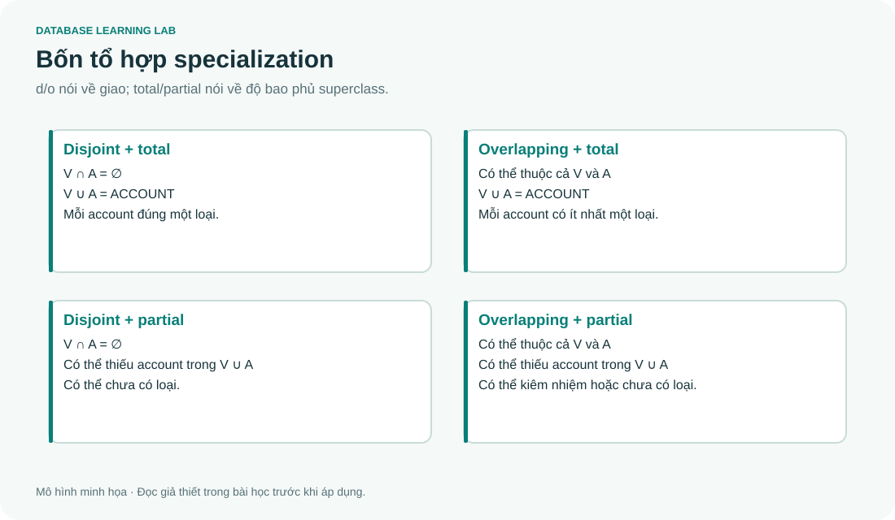

# 03 · EER: hiểu lớp con bằng tập hợp

> Đọc cùng **DB-Chapter3.md**. Hai trục disjoint/overlapping và total/partial độc lập với nhau.



## Một người dùng có thể vừa xem vừa quản trị

Xét ACCOUNT là superclass; VIEWER và CONTENT_ADMIN là subclass. Một đối tượng VIEWER **vẫn là cùng account**, kế thừa định danh và thuộc tính chung. Subclass không phải một tài khoản thứ hai liên kết 1:1 ngẫu nhiên với tài khoản thứ nhất.

Nếu tài khoản Chi vừa xem anime vừa quản trị nội dung, hai subclass **overlapping**. Nếu mọi account bắt buộc phải là viewer hoặc admin (hoặc cả hai), specialization **total**. “Hoặc” trong yêu cầu này không có nghĩa là “chỉ một”.

| Trường hợp | Điều kiện tập hợp | Ví dụ |
|---|---|---|
| Disjoint + total | `V ∩ A = ∅`, `V ∪ A = ACCOUNT` | Mỗi tài khoản đúng một vai trò |
| Overlapping + total | `V ∪ A = ACCOUNT` | Mọi tài khoản có ít nhất một vai trò |
| Disjoint + partial | `V ∩ A = ∅`, union có thể thiếu | Có tài khoản chưa nhận vai trò |
| Overlapping + partial | Có thể giao, có thể thiếu | Vai trò tùy chọn, có thể kiêm nhiệm |

Total không yêu cầu từng subclass đều có phần tử. Nếu hôm nay tất cả account là viewer và admin đang rỗng, total vẫn đúng.

## Generalization và specialization

**Specialization** đi từ ACCOUNT xuống các vai trò có thuộc tính/quan hệ riêng. **Generalization** đi từ những loại có điểm chung lên superclass. Hai hướng là cách tiếp cận thiết kế; kết quả có thể giống nhau.

Không phải cứ có cột `role` là phải vẽ EER. Nếu chỉ cần nhãn phân loại và mọi loại có cùng thuộc tính, một attribute có thể đủ. Nếu admin có `Department`, quyền riêng và quy tắc riêng, subclass giúp diễn đạt rõ hơn.

## Shared subclass khác category

SHARED_SUBCLASS ⊆ CLASS_A ∩ CLASS_B: một teaching assistant phải đồng thời là student và employee; có thể kế thừa từ cả hai. CATEGORY ⊆ PERSON ∪ COMPANY: một owner là person hoặc company, không cần đồng thời là cả hai. Dấu **giao** và **hợp** là điểm phân biệt nên viết trước khi vẽ.

Với category, các superclass có thể dùng khóa khác miền: `CitizenID` và `TaxID`. Khi mapping thường thêm surrogate `OwnerID`, nhưng vẫn cần ràng buộc xác định owner đang đại diện loại nào và entity gốc nào. Chỉ tạo một số ID mới không tự bảo đảm ngữ nghĩa category.

## Mapping thử để thấy điều gì chưa được bảo đảm

```sql
CREATE TABLE account(account_id INTEGER PRIMARY KEY, username TEXT NOT NULL UNIQUE);
CREATE TABLE viewer(account_id INTEGER PRIMARY KEY REFERENCES account(account_id));
CREATE TABLE content_admin(
 account_id INTEGER PRIMARY KEY REFERENCES account(account_id), department TEXT NOT NULL
);
```

PK/FK của hai bảng con bảo đảm mỗi hàng con thuộc một account. Chúng cho phép cùng ID xuất hiện ở cả hai bảng, phù hợp overlapping. Nhưng chúng cũng cho phép account không xuất hiện trong bảng con nào, nên **chưa bảo đảm total**.

Trong capstone, quy tắc này được kiểm tra bằng query vi phạm và transaction trong tầng nghiệp vụ. SQLite không có deferred constraint trigger cho ràng buộc nhiều bảng này; không nên thêm trigger chạy ngay sau INSERT ACCOUNT rồi kết luận đã giải quyết, vì lúc đó các hàng subclass có thể chưa được tạo.

## Bài tập có lời giải

1. Hệ thống có Guest chưa được gán viewer/admin. Total hay partial?
2. Có người vừa là student vừa employee. Có bắt buộc mọi employee là student không?
3. Đưa shared subclass xuống hai bảng có FK có tự bảo đảm entity mang cùng định danh không?

<details><summary>Lời giải</summary>

1. Nếu Guest cũng là ACCOUNT mà không thuộc subclass nào trong specialization đang xét thì partial, hoặc phải bổ sung Guest vào một specialization total có đủ lớp.
2. Không. Overlap chỉ cho phép giao khác rỗng, không tạo bao hàm giữa hai lớp.
3. Phải thiết kế thống nhất định danh và ràng buộc. Hai FK tùy ý trỏ đến hai người khác nhau không chứng minh đó là cùng entity.

</details>
