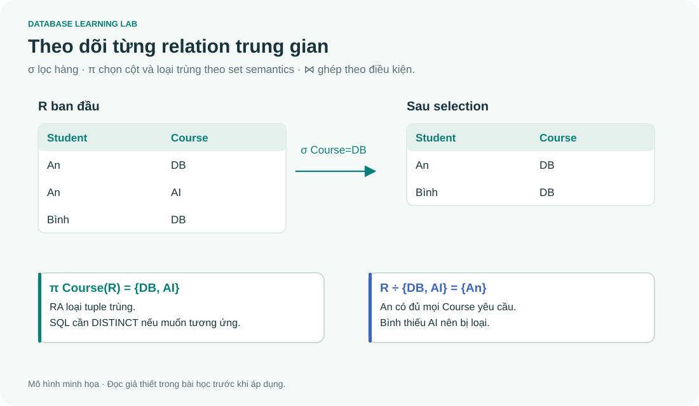

# 05 · Đại số quan hệ: nhìn từng bảng trung gian

> Đọc cùng **DB-Chapter5.md**. Trước khi rút gọn biểu thức, hãy xác định cột đầu ra, điều kiện lọc và đường nối.



## Dịch một câu tiếng Việt thành kế hoạch tính

“Tên nhân viên phòng Research” cần EMPLOYEE và DEPARTMENT. Chúng nối qua `Dno = Dnumber`, không qua tên cột giống nhau.

$$\pi_{Fname,Lname}\left(\sigma_{Dname='Research'}(EMPLOYEE\bowtie_{Dno=Dnumber}DEPARTMENT)\right)$$

Bước 1 nối nhân viên với phòng; bước 2 giữ hàng Research; bước 3 chỉ giữ tên. Có thể đẩy selection trên Dname xuống DEPARTMENT trước khi join. Điều này giữ cùng kết quả với inner join trong ví dụ này và có thể giảm dữ liệu trung gian; optimizer thực tế quyết định execution plan.

```sql
SELECT DISTINCT e.Fname, e.Lname
FROM EMPLOYEE AS e JOIN DEPARTMENT AS d ON e.Dno=d.Dnumber
WHERE d.Dname='Research' ORDER BY e.Fname;
```

`DISTINCT` phản ánh projection theo **set semantics**. SQL mặc định là bag: hai nhân viên khác nhau có cùng tên vẫn có thể tạo hai dòng giống nhau nếu không DISTINCT. Khi cần giữ định danh, project thêm Ssn.

## Bộ dữ liệu nhỏ để không bị ký hiệu che mất ý nghĩa

| R.Student | R.Course |
|---|---|
| An | DB |
| An | AI |
| Bình | DB |

Với S(Course) = {DB, AI}, `R ÷ S` trả {An}. Không phải “An có số dòng lớn nhất”, mà vì An có quan hệ với **mọi** course trong S.

```sql
-- Nhân viên làm TẤT CẢ dự án do phòng 5 quản lý.
SELECT e.Fname
FROM EMPLOYEE AS e
WHERE NOT EXISTS (
 SELECT 1 FROM PROJECT AS p
 WHERE p.Dnum=5 AND NOT EXISTS (
  SELECT 1 FROM WORKS_ON AS w WHERE w.Essn=e.Ssn AND w.Pno=p.Pnumber
 )
) ORDER BY e.Fname;
```

Fixture không có ai làm đủ cả 3 dự án của phòng 5, nên kết quả rỗng. Nếu chỉ xét các dự án 1 và 2 thì John và Joyce thỏa. Hãy kiểm tra **một phản ví dụ**: Franklin không làm dự án 1 nên bị loại, dù Franklin là trưởng Research.

## “Không có” khác “có một cái không thỏa”

“Không làm dự án nào ở Houston” là lấy tất cả nhân viên **trừ** những người làm ít nhất một dự án ở Houston. Không thể lấy “nhân viên có dự án ngoài Houston”: một người có thể làm cả hai nơi.

Trong relational calculus, mẫu “với mọi” được đổi thành “không tồn tại phản ví dụ”. Đây là nền tảng của double NOT EXISTS. Biểu thức calculus còn phải **safe/range restricted** để không phụ thuộc một miền vô hạn ngoài database.

## Natural join phải biết nó đang nối cột nào

EMPLOYEE có `Dno`, DEPARTMENT có `Dnumber`; natural join không hiểu đây là FK. Nếu không có tên cột chung, natural join trở thành tích Descartes. Nếu có cột chung nhưng sai ngữ nghĩa, nó có thể lọc mất hàng ngoài dự kiến. Trong code ứng dụng, viết `JOIN ... ON` thường giúp review điều kiện rõ hơn.

| Toán tử | Kiểm tra trước khi dùng |
|---|---|
| Union / difference / intersection | Hai đầu vào union-compatible |
| Cartesian product | Có bao nhiêu cặp? `|R| × |S|` |
| Theta join | Điều kiện nối cụ thể là gì? |
| Projection | Đã loại trùng theo set semantics chưa? |
| Division | Tập yêu cầu “mọi” nằm ở quan hệ nào? |

## Bài tập

1. Với R ở trên, projection Course có bao nhiêu dòng trong RA? SQL SELECT thường có bao nhiêu?
2. Viết “nhân viên chưa được phân công dự án nào”.
3. Nếu tập dự án yêu cầu rỗng, double NOT EXISTS trả ai?

<details><summary>Lời giải</summary>

1. RA có 2 tuple: DB và AI. SQL không DISTINCT có 3 dòng.
2. Dùng `NOT EXISTS(SELECT 1 FROM WORKS_ON w WHERE w.Essn=e.Ssn)`; fixture trả Mai.
3. Trả mọi nhân viên trong tập ứng viên EMPLOYEE: không có phản ví dụ trong tập rỗng. Lưu ý division thuần thường lấy tập ứng viên từ projection của quan hệ bị chia; SQL lấy từ EMPLOYEE có thể bao gồm cả người chưa xuất hiện trong WORKS_ON.

</details>
