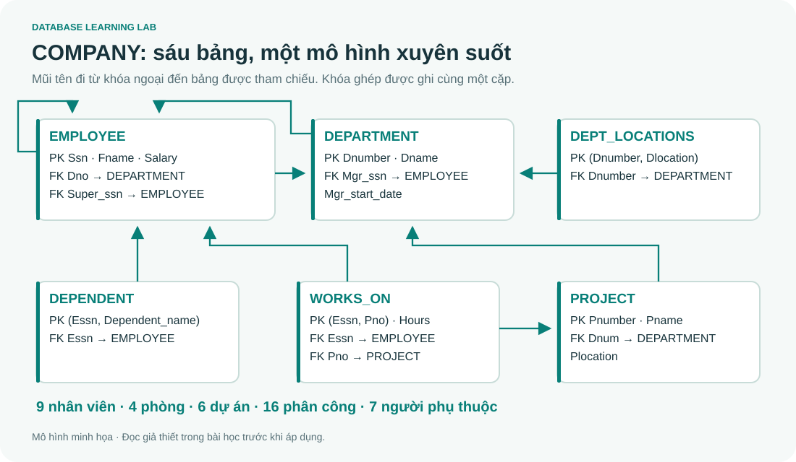

# 06 · SQL: khóa học chi tiết từ hai bộ slide

> Bản mở rộng dựa trên **4A_SQL.pptx (107 slide)** và **4B_AdvancedSQL.pptx (50 slide)**, kết hợp DB-Chapter6.md. 18 bài dưới đây giải thích các chủ đề trong hai bộ slide, bổ sung dữ liệu minh họa, phản ví dụ, bài tập và lời giải. Đây là phạm vi hai tài liệu được cung cấp, không phải toàn bộ chuẩn SQL hay cam kết phạm vi đề thi.



## Học thế nào để hiểu và dùng được?

Đọc mục tiêu, xem đầu vào, tự đoán kết quả rồi chạy. Ví dụ có nút **Chạy ví dụ · SQLite** dùng database mẫu mới cho mỗi lần chạy; có thể sửa code và xem bảng kết quả ngay trong bài. Database ví dụ độc lập với Playground. Code T-SQL được ghi rõ SQL Server và có script riêng.

Bài 01–08 tạo nền truy vấn; 09–10 thêm view/toàn vẹn/quyền; 11–16 học lập trình T-SQL; 17 tự kiểm tra; 18 đối chiếu từng slide và nguồn chính thức. 40 bài Q01–Q40 cũ vẫn giữ để luyện thêm.

## Phần A · Dữ liệu và truy vấn

| Bài | Mở bài chi tiết | Sau bài cần tự làm được | Slide chính |
|---|---|---|---|
| 01 | [Ngôn ngữ, kiểu dữ liệu và COMPANY](sql/01-language-data-types.md) | Chọn kiểu, đọc 6 bảng, phân biệt dialect/domain | 4A 1–12,17–19,27 |
| 02 | [DDL và ràng buộc](sql/02-ddl-constraints.md) | CREATE/ALTER/DROP, PK/FK/CHECK, FK actions | 4A 6–25 |
| 03 | [SELECT, biểu thức và tập hợp](sql/03-select-expressions-sets.md) | WHERE, LIKE, DISTINCT, UNION/INTERSECT/EXCEPT, ORDER BY | 4A 27–44,55,71–73 |
| 04 | [JOIN bằng bảng trung gian](sql/04-joins.md) | Inner/outer/self/natural join, điều kiện ON/WHERE | 4A 32–39,56–62 |
| 05 | [NULL và logic ba giá trị](sql/05-null-logic.md) | Tính UNKNOWN, giải thích NOT IN và CHECK | 4A 45,51–54,64–65 |
| 06 | [Aggregate, GROUP BY và HAVING](sql/06-aggregation.md) | Đếm phòng rỗng, nhóm đúng grain, tránh nhân tổng | 4A 63–73 |
| 07 | [Query con, lượng từ và phép chia](sql/07-subqueries-quantifiers.md) | IN/EXISTS/ANY/ALL, tương quan, “mọi dự án” | 4A 47–55 |
| 08 | [DML và transaction](sql/08-dml-transactions.md) | INSERT SELECT, UPDATE/DELETE, rollback/savepoint | 4A 74–83 |

## Phần B · Đối tượng và lập trình SQL Server

| Bài | Mở bài chi tiết | Sau bài cần tự làm được | Slide chính |
|---|---|---|---|
| 09 | [View, inline view và assertion](sql/09-views-assertions.md) | Phân biệt view/bảng chụp, cập nhật view, bất biến liên bảng | 4A 84–85,92–94 |
| 10 | [GRANT, REVOKE và đường quyền](sql/10-permissions.md) | Vẽ grant graph, quyền cấp tiếp và đường thay thế | 4A 95–105 |
| 11 | [Biến, batch và điều khiển luồng](sql/11-tsql-programming.md) | DECLARE/SET/SELECT, IF, WHILE, BREAK, CONTINUE | 4B 1–12 |
| 12 | [Stored procedure](sql/12-procedures.md) | Tham số vào/ra, EXEC, OUTPUT khác RETURN | 4B 13–17 |
| 13 | [Function và TVF](sql/13-functions.md) | Scalar, inline TVF, multi-statement TVF, giới hạn UDF | 4B 18–23 |
| 14 | [Trigger xử lý nhiều dòng](sql/14-triggers.md) | inserted/deleted, AFTER/INSTEAD OF, audit, tuổi | 4A 86–91;4B 24–30 |
| 15 | [Cursor](sql/15-cursors.md) | Vòng đời, FETCH_STATUS, cleanup, set-based | 4B 31–36 |
| 16 | [Xử lý lỗi và rollback](sql/16-error-handling.md) | THROW/RAISERROR, TRY/CATCH, XACT_STATE | 4B 37–49 |
| 17 | [20 bài tổng hợp có lời giải](sql/17-practice-exam.md) | Tự giải, dự đoán và phản biện query/routine | Tổng hợp |
| 18 | [Đối chiếu 157 slide và hiệu đính](sql/18-slide-map-and-references.md) | Tra từng slide, chỗ chỉnh và nguồn chính thức | Cả hai bộ |

## Phần nào chạy ở đâu?

| Nội dung | Web offline | SQL Server |
|---|---|---|
| SELECT/JOIN/NULL/grouping/query con thông dụng | SQLite thật, bảng kết quả | Có, lưu ý cú pháp nhỏ |
| DDL/DML/view/transaction | Cú pháp SQLite được đánh dấu | Cú pháp T-SQL tương ứng |
| ANY/ALL, quyền user | Bài giải thích và query tương đương khi phù hợp | Thực hành SQL Server |
| CREATE ASSERTION/domain chuẩn | Học khái niệm, không giả lập là có | Không hỗ trợ nguyên cú pháp chuẩn này |
| Procedure/UDF/cursor/T-SQL trigger/lỗi | Đọc mã, bảng trace và lời giải | Script trong sql/sqlserver/ |

Mở [hướng dẫn SQL Server](../sql/sqlserver/README.md) trước khi chạy routine. Cài SSMS riêng chưa đủ: cần database engine đang hoạt động. Các script T-SQL được soát và đối chiếu tài liệu; kiểm thử tự động của project thực thi SQLite, chưa thực thi SQL Server.

## Dữ liệu để tự kiểm chứng

COMPANY có 9 nhân viên, 4 phòng và 6 dự án. So với ví dụ COMPANY quen thuộc trong slide, thêm Mai (Salary NULL, chưa có phân công) và Innovation (phòng rỗng). Output khác số trong slide chưa có nghĩa query sai: trước hết đối chiếu fixture, schema và giả thiết.

```bash
python tools/lab.py --exercise Q01
python tools/sql_course.py --example S16
python tools/sql_course.py --check
```

Mở terminal tại thư mục project chứa tools/,docs/,sql/. CLI tạo database mới mỗi lần. Web Playground giữ trạng thái trong tab; mỗi ví dụ trong bài có database riêng. Database RAM không lưu qua lần đóng tab.

## Lộ trình gợi ý

| Buổi | Nội dung | Sản phẩm tự làm |
|---|---|---|
| 1 | 01–02 | 3 bảng có composite PK và FK actions |
| 2 | 03–04 | 8 query lọc/join, giải thích từng hàng |
| 3 | 05–06 | Bảng chân trị, báo cáo phòng rỗng, sửa double-count |
| 4 | 07–08 | IN/EXISTS/ALL và script rollback |
| 5 | 09–10 | View và sơ đồ cấp/thu hồi quyền |
| 6 | 11–13 | Trace WHILE, procedure OUTPUT, một TVF |
| 7 | 14–16 | Trigger hai hàng, cursor và lỗi transaction |
| 8 | 17–18 | Tự giải bộ tổng hợp và tra phần chưa chắc |

Khi ôn thi, hãy giải thích vì sao query đúng với NULL, tập rỗng và nhiều hàng. Khi ứng dụng, bổ sung transaction, binding, quyền và kiểm thử các ca lỗi.
