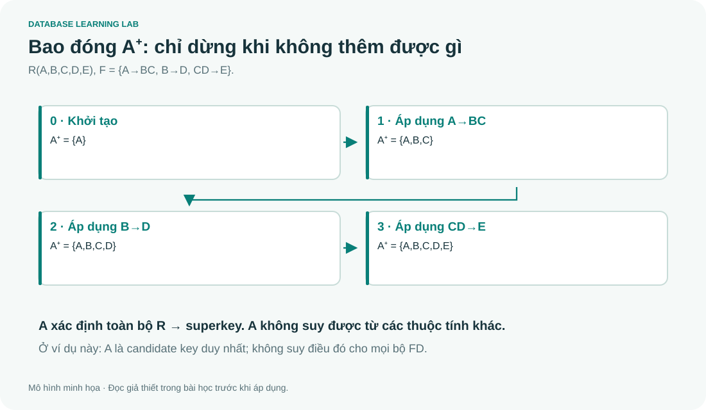

# 07 · FD và chuẩn hóa: tính trước, kết luận sau

> Đọc cùng **DB-Chapter7.md**. Công cụ **Bao đóng & khóa** cho phép quan sát từng vòng suy diễn; kết quả máy chỉ hỗ trợ lập luận.

## FD là ràng buộc của mọi state hợp lệ

`A → B` nghĩa là hai tuple có cùng A thì bắt buộc cùng B. Một bảng hiện tại tình cờ không lặp A chưa đủ chứng minh nghiệp vụ có FD đó. Ngược lại, chỉ cần hai hàng cùng A nhưng khác B là một phản ví dụ bác bỏ FD trên state đang xét.

Ba luật Armstrong: reflexivity (`Y⊆X ⇒ X→Y`), augmentation (`X→Y ⇒ XZ→YZ`) và transitivity (`X→Y, Y→Z ⇒ X→Z`). **Full dependency** có nghĩa không thể bỏ bớt thuộc tính vế trái mà vẫn xác định vế phải; không đồng nghĩa tuyệt đối với “direct dependency”.

## Ví dụ tính bao đóng có đủ từng vòng

Cho `R(A,B,C,D,E)` và `F={A→BC, B→D, CD→E}`.

| Vòng | FD dùng | Tập đang biết |
|---|---|---|
| 0 | Khởi tạo A | A |
| 1 | A→BC | ABC |
| 2 | B→D | ABCD |
| 3 | CD→E | ABCDE |
| 4 | Không thêm gì | Dừng |

A xác định toàn R, nên là superkey. A là một thuộc tính và rỗng không xác định được toàn R, nên A là candidate key. Không có FD nào sinh A, vì vậy mọi key phải chứa A: A là candidate key duy nhất.

Chú ý “minimal key” là tối thiểu theo **bao hàm**, không phải chỉ chọn những key có số thuộc tính ít nhất. Có thể đồng thời tồn tại một candidate key một thuộc tính và một candidate key hai thuộc tính.

## Minimal cover phải kiểm tra tương đương

Cho `F={A→BC, B→C, A→B, AB→C}`. Tách RHS thành từng thuộc tính. Loại bản sao A→B. `A→C` suy được qua A→B và B→C nên có thể bỏ. AB→C cũng dư vì B→C. Một minimal cover là `{A→B, B→C}`. Trình tự giản lược khác có thể tạo biểu diễn khác; tiêu chí là tương đương, không phải giống từng dòng đáp án.

## Định nghĩa chuẩn để tránh học mẹo sai

| Dạng chuẩn | Điều kiện chính xác dùng khi làm bài FD |
|---|---|
| 1NF | Mỗi ô nhận một giá trị thuộc miền đã chọn; không nhóm lặp/nested relation trong mô hình đang xét |
| 2NF | 1NF; không nonprime attribute phụ thuộc vào proper subset của bất kỳ candidate key nào |
| 3NF | Mỗi FD không tầm thường `X→a` trong F⁺: X là superkey **hoặc** a là prime |
| BCNF | Mỗi FD không tầm thường `X→a` trong F⁺: X là superkey |

Một thuộc tính prime nếu thuộc **ít nhất một** candidate key. “Khóa chính chỉ có một cột nên tự động 2NF” không an toàn nếu còn candidate key ghép khác. Mọi key đều phải được xét.

## 3NF nhưng không BCNF: TEACH

`R(Student,Course,Instructor)`, FD `{Student,Course}→Instructor`, `Instructor→Course`. Hai candidate key là `{Student,Course}` và `{Student,Instructor}`; cả ba thuộc tính đều prime. Instructor không là superkey nhưng Course prime, nên FD thứ hai thỏa 3NF và vi phạm BCNF.

Phân rã `R1(Instructor,Course)`, `R2(Student,Instructor)`. Giao là Instructor và Instructor→R1, nên **lossless**. Nhưng ràng buộc mỗi cặp Student–Course chỉ có một Instructor không còn kiểm tra riêng trong từng bảng: có thể mất **dependency preservation**.

Không viết “mọi decomposition thành BCNF đều lossless”. **Thuật toán phân rã BCNF chuẩn** bảo đảm lossless; việc tùy ý cắt bảng rồi thấy mỗi bảng BCNF không chứng minh phép join khôi phục đúng.

## Ví dụ phân rã thật từ FD ban đầu

Với `R(A,B,C,D,E)` phía trên, chọn B→D để tách `BD` và `ABCE`. Trong ABCE có BC→E (do B→D và CD→E), nên tách `BCE` và `ABC`. Trong ABC, A→BC nên A là key. BD và BCE có B, BC là key tương ứng. Ba bảng đều BCNF và mỗi bước là lossless. Đây là một phương án; khi cần bảo toàn FD, phải kiểm riêng chứ không kết luận từ BCNF.

## Bài tập

1. Với `R(A,B,C)` và `F={A→B,B→A}`, tìm mọi candidate key.
2. `R1(AB),R2(BC)` có luôn lossless không?
3. FD tầm thường có làm vi phạm BCNF không?

Lời giải

1. AC và BC. C không nằm RHS nên bắt buộc có trong key; thêm A hoặc B sẽ xác định thuộc tính còn lại.
2. Không. Cần `(R1∩R2)→R1` hoặc `→R2` suy được từ F, tức B→A hoặc B→C trong ví dụ.
3. Không. Định nghĩa xét FD **không tầm thường**. Nếu quên điều kiện này, A→A có thể dẫn đến kết luận sai.

