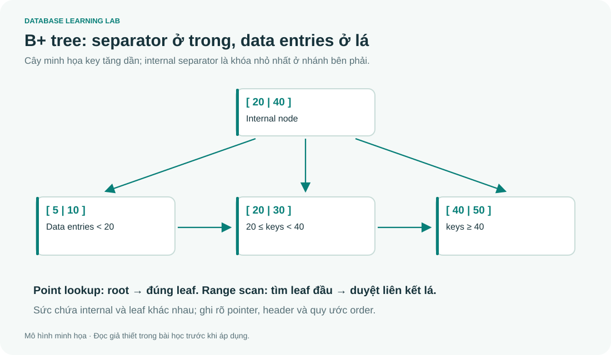

# 08 · Storage và index: tính đúng đơn vị

> Đọc cùng **DB-Chapter8.md**. Mọi công thức dưới đây là mô hình bài tập; không dùng chúng như benchmark của SSD hoặc DBMS thực tế.



## Bài tính xuyên suốt

File có `r=30.000` record, mỗi record `R=100 B`, block `B=4096 B`. Record unspanned, bỏ qua header và pointer liên kết.

$$bfr=\lfloor4096/100\rfloor=40,\quad b=\lceil30000/40\rceil=750.$$

Mỗi block thừa 96 byte, nhưng block cuối còn có thể chưa đầy. Nếu spanned và không có overhead thì `ceil(rR/B)=733` block. Thêm header hoặc pointer làm thay đổi dung lượng hữu dụng; không trừ pointer hai lần.

## Không có index thì đọc bao nhiêu block?

Heap linear search tìm một record tồn tại và phân bố đều: kỳ vọng xấp xỉ b/2 = 375 block; worst case 750. Không tìm thấy phải quét hết. Binary search trên **file được sắp theo khóa tìm** mất cỡ ceil(log2 750)=10 block theo mô hình đếm của bài; chi tiết cộng/trừ một lần đọc phụ thuộc cách đặt giả thiết.

Binary search không áp dụng cho heap chỉ vì cột tìm kiếm là primary key. Key là ràng buộc logic; thứ tự vật lý là chuyện khác.

## Tạo sparse primary index

Key 8 byte, block pointer 8 byte, entry 16 byte. Một index block chứa `floor(4096/16)=256` entry. Sparse primary index có một entry cho mỗi data block, nên 750 entry chiếm `ceil(750/256)=3` block. Mức trên của multilevel index có 3 entry, chiếm 1 block.

Nếu không cache: đọc root index, một index block ở mức dưới, rồi data block = **3 block accesses**. Nếu root được cache, số physical I/O có thể giảm; không tự động trừ đi khi đề chưa nói.

| Loại index theo giáo trình | File được sắp theo trường đó? | Entry điển hình |
|---|---|---|
| Primary | Có, ordering key | Một block anchor mỗi data block |
| Clustering | Có, ordering nonkey | Một entry mỗi giá trị phân biệt, trỏ tới cluster |
| Secondary | Không theo trường index | Dense theo record hoặc key + bucket/posting list |

“Primary index” ở bảng này không đồng nghĩa mọi index DBMS tạo cho PRIMARY KEY. SQLite và PostgreSQL có thiết kế lưu trữ riêng; đọc thuật ngữ theo ngữ cảnh.

## B+ tree: lá mới chứa các data entries trong mô hình chuẩn

Internal node giữ separator và child pointers. Tìm bằng cách đi từ root xuống đúng nhánh. Lá được nối để range scan duyệt liên tiếp sau khi tìm lá đầu tiên. B-tree thông thường có thể giữ data pointer cả ở node trong. Quy ước **order** khác nhau giữa giáo trình, nên khi tính sức chứa cần bắt đầu từ kích thước entry/pointer thay vì nhớ một con số p không có định nghĩa.

Với internal fan-out p, key V và pointer P:

$$(p-1)V+pP\le B.$$

Với leaf có q cặp key–record-pointer và một next-leaf-pointer:

$$q(V+P_r)+P_{next}\le B.$$

Đây là hai công thức khác nhau. Nếu đề cho occupancy 69% hoặc header, phải đưa vào mô hình rõ ràng.

## Index trong thực tế: đo kế hoạch, không đo niềm tin

```bash
python tools/index_demo.py
```

Script sinh 20.000 hàng, chạy `EXPLAIN QUERY PLAN` trước/sau tạo index và xác nhận kết quả truy vấn như nhau. Nó in thời gian tham khảo nhưng không assert “phải nhanh gấp N lần”: cache, dữ liệu nhỏ và phần cứng làm thời gian biến động.

Index giúp đọc trong các điều kiện phù hợp, nhưng cần không gian và chi phí cập nhật. Cột có ít giá trị không tự động vô dụng: độ chọn lọc của predicate, covering index, phân bố và kế hoạch đều quan trọng.

## RAID và giới hạn mô hình

RAID 0 striping không dự phòng; RAID 1 mirroring; RAID 5 chịu lỗi một đĩa; RAID 6 hai đĩa theo mô hình chuẩn. RAID 10 chịu được nhiều lỗi tùy vị trí các đĩa hỏng. **RAID không thay thế backup**: xóa nhầm hoặc mã độc có thể được phản ánh ngay trên các bản sao.

## Bài tập

1. Tính lại bfr, b khi có pointer liên kết 8 byte/block.
2. Secondary dense index 30.000 entry, mỗi entry 16 byte, chiếm bao nhiêu block?
3. Đọc ba mức index và data block, khi chưa cache, tốn bao nhiêu accesses?

<details><summary>Lời giải</summary>

1. `floor((4096−8)/100)=40`; b=750. Không phải mọi overhead đều làm thay đổi floor ở cùng một bộ số.
2. `ceil(30000/256)=118` block (giả sử entry không spanned, không header).
3. 4. Phân biệt số mức index với tổng số block đọc.

</details>
