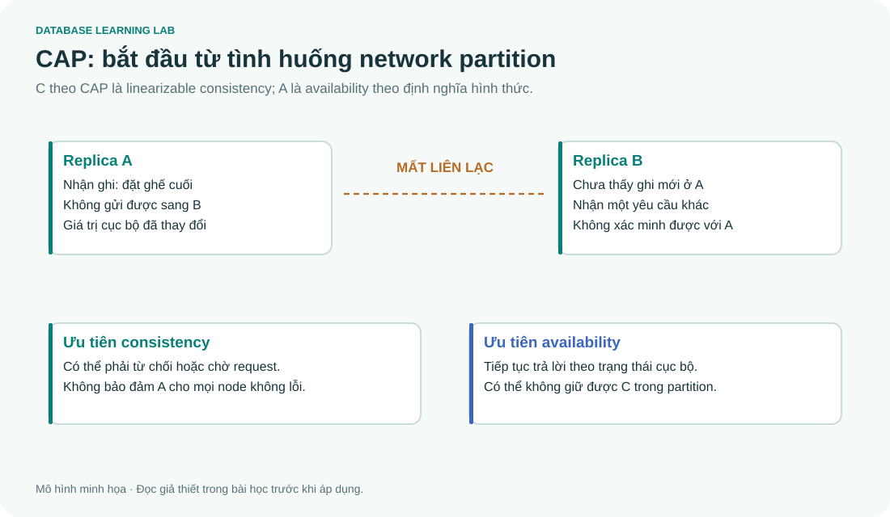

# 09 · Security, giao dịch và các chủ đề mở rộng

> Nguồn học chính: phần Security và Advanced Topics trong **DB-Final.md**. Các phần dưới bổ sung cách nối lý thuyết với ứng dụng; chúng không thay thế toàn bộ phần gốc.



## Bảo mật: xác thực, phân quyền và truy vết

**Authentication** xác định bạn là ai; **authorization** quyết định bạn được làm gì; **auditing** ghi lại hành vi để có thể điều tra. Không đồng nhất đăng nhập thành công với được phép đọc mọi bảng.

DAC dựa trên quyền được cấp bởi chủ thể có thẩm quyền; RBAC gom quyền theo role; ABAC xét thuộc tính subject/resource/context. Bell–LaPadula tập trung vào **confidentiality** với “no read up, no write down” trong mô hình mức bảo mật đơn giản. Nó không tự giải quyết integrity hay mọi luồng rò rỉ trong ứng dụng.

Ví dụ user `viewer` chỉ cần xem catalog và sửa watch list của mình, không cần quyền DDL. Trong SQLite lab không có GRANT/REVOKE theo user như server DBMS; ví dụ phân quyền SQL Server/PostgreSQL trong nguồn thuộc phần đọc lý thuyết.

## SQL injection: parameter binding và giới hạn

```python
# Giá trị đầu vào được truyền riêng, không nối vào SQL.
row = con.execute('SELECT account_id FROM account WHERE username=?', (username,)).fetchone()
```

Input `an' OR 1=1 --` được hiểu như một chuỗi username, không trở thành biểu thức SQL. Binding không chọn hộ tên bảng an toàn, không thay thế phân quyền và không sửa được mọi lỗi nghiệp vụ. Xem script chạy được ở lab 05.

## ACID qua một hành vi cụ thể

Chuyển 100 đơn vị từ A sang B gồm hai UPDATE trong cùng transaction. **Atomicity**: cả hai cùng thành công hoặc cùng rollback. **Consistency**: transaction và constraints giữ các bất biến nghiệp vụ. **Isolation**: tương tác giữa các transaction tuân theo mức cô lập đã chọn. **Durability**: commit tồn tại qua sự cố theo các bảo đảm lưu trữ/cấu hình của hệ.

SQLite serialize các thao tác ghi theo cơ chế của nó; bản demo một connection chỉ minh họa commit/rollback, không chứng minh mọi isolation anomaly của hệ phân tán. `tools/transaction_demo.py` cố tình gây lỗi giữa hai UPDATE và kiểm tra tổng tiền được giữ.

## CAP: viết điều kiện partition trước khi chọn C hay A

Hai replica A/B mất liên lạc. A nhận ghi “đặt ghế cuối”. B có thể từ chối/chờ để giữ consistency, hoặc tiếp tục trả lời theo trạng thái cục bộ và có nguy cơ lệch. **Khi có network partition**, không thể bảo đảm đồng thời linearizable consistency và availability theo định nghĩa của CAP cho mọi request ở các node không lỗi. Câu “chọn 2 trong 3” chỉ là ghi nhớ sơ lược, không phải ba nút tùy ý tắt mở.

Consistency trong CAP khác chữ C trong ACID. BASE không phải chứng minh rằng hệ không có transaction. SQL/NoSQL cũng không quyết định một hệ luôn AP hay CP; phải xét operation, topology và cấu hình.

## OLTP, OLAP và data warehouse

OLTP xử lý thao tác nghiệp vụ ngắn như thêm watch list, đánh giá phim. OLAP phân tích nhiều hàng như tổng giờ xem theo tháng và thể loại. Star schema có fact ở một grain đã định nghĩa và các dimension; grain sai tạo double-count khi join.

Ví dụ fact `DailyAnimeViews(date_id,anime_id,view_count)` có một hàng mỗi ngày–anime. Nếu join với nhiều genre rồi SUM(view_count), anime có hai genre xuất hiện hai lần. Phải quyết định phân bổ số lượt cho các thể loại hay báo cáo theo grain nào, không sửa bằng DISTINCT một cách máy móc.

## Distributed DB và 2PC

Fragmentation chia dữ liệu; replication sao chép. 2PC có pha prepare và quyết định commit/abort để các participant thống nhất kết quả transaction trong mô hình tương ứng. Đây không phải Two-Phase Locking, và không tự chứng minh serializability. Coordinator/participant gặp lỗi có thể làm các bên chờ trong giao thức cơ bản.

## NoSQL, graph và quyền riêng tư

Key–value hợp tra bằng khóa; document hợp aggregate dữ liệu theo tài liệu; wide-column phục vụ các access pattern được thiết kế; graph hợp truy vấn đường đi/quan hệ. Đây là định hướng mô hình, không phải bảng xếp hạng tốc độ chung.

k-anonymity gom quasi-identifiers để mỗi nhóm có ít nhất k bản ghi theo mô hình đang xét. Nó không bảo đảm bí mật sensitive attribute nếu cả nhóm cùng một giá trị; l-diversity và t-closeness giải quyết các khía cạnh khác. Differential privacy đặt bảo đảm lên cơ chế công bố ngẫu nhiên, không đơn giản là “xóa tên rồi thêm noise bất kỳ”.

## Bài tập thảo luận có đáp án

1. “Đã dùng prepared statements nên user được SELECT mọi bảng cũng không sao.” Đúng không?
2. Đếm view sau khi join anime–genre có thể tăng vì sao?
3. Một node không liên lạc được phần còn lại nhưng vẫn phục vụ một số user có đủ chứng minh availability trong định nghĩa CAP không?

<details><summary>Lời giải</summary>

1. Sai. Injection prevention và least privilege xử lý các loại rủi ro khác nhau.
2. Join M:N nhân một fact thành nhiều hàng; cần xác định grain và cách tổng hợp.
3. Không. CAP availability xét mọi request hợp lệ tới node không lỗi theo định nghĩa, không chỉ “đa số user vẫn dùng được”.

</details>
