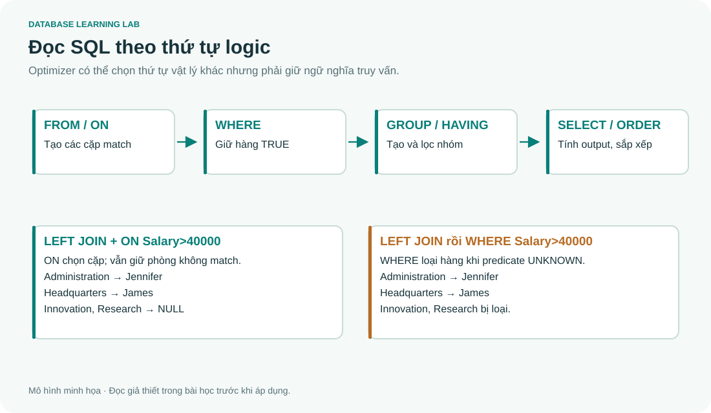

# SQL 03 · SELECT, biểu thức, lọc, sắp xếp và phép tập hợp

> Nguồn: **4A slide 27–44, 55, 71–73**. Mục tiêu: dịch câu hỏi tiếng Việt thành SELECT, hiểu vì sao có hàng trùng và dự đoán chính xác phép UNION/INTERSECT/EXCEPT.

## 1. Đọc SELECT theo từng nhiệm vụ

```sql
-- @lab S06
SELECT Fname, Lname, Salary, ROUND(Salary*1.10,2) AS ProposedSalary
FROM EMPLOYEE
WHERE Dno=5 AND Salary>=30000
ORDER BY Salary DESC, Ssn ASC;
```

| Fname | Lname | Salary | ProposedSalary |
|---|---|---:|---:|
| Franklin | Wong | 40000 | 44000 |
| Ramesh | Narayan | 38000 | 41800 |
| John | Smith | 30000 | 33000 |

`FROM` chọn nguồn, `WHERE` giữ hàng phù hợp, `SELECT` chọn/tính cột, `ORDER BY` sắp kết quả. `AS ProposedSalary` chỉ đặt tên cột kết quả. Truy vấn này **không tăng lương trong bảng**; muốn ghi thay đổi phải UPDATE.

Trong đại số quan hệ, phép chọn σ gần với WHERE, phép chiếu π gần với danh sách SELECT. Câu ở slide 27 rằng SQL SELECT giống “SELECT operation” đại số phải đọc cùng slide 31: một câu SELECT có thể phối hợp chọn, chiếu, join, grouping. Nó không chỉ là σ.

### Thứ tự viết và thứ tự logic



| Bước để lập luận | Đang có dữ liệu gì? | Lỗi thường gặp |
|---|---|---|
| FROM và ON | Tập hàng sau join | Quên điều kiện ghép |
| WHERE | Hàng thỏa điều kiện TRUE | Lọc bằng AVG ngay tại đây |
| GROUP BY | Các nhóm | Chọn cột không đại diện một nhóm |
| HAVING | Những nhóm được giữ | Dùng thay mọi WHERE |
| SELECT | Các biểu thức đầu ra | Tưởng alias lúc nào cũng có trong WHERE |
| DISTINCT | Các hàng đầu ra đã khử trùng | Dùng để che lỗi join |
| ORDER BY | Kết quả có thứ tự | Tưởng thứ tự chèn là thứ tự trả về |

Đây là mô hình logic để hiểu truy vấn; optimizer có thể đổi thứ tự vật lý mà vẫn giữ ngữ nghĩa. SQL Server không cho dùng alias SELECT cùng mức trong WHERE. Dù SQLite có một số mở rộng, nên viết biểu thức gốc hoặc dùng bảng dẫn xuất.

## 2. WHERE và biểu thức điều kiện

Các toán tử thường dùng: `=`, `<>`, `<`, `<=`, `>`, `>=`, `AND`, `OR`, `NOT`, `BETWEEN`, `IN`, `LIKE`, `IS NULL`. `BETWEEN a AND b` gồm cả hai đầu. AND có ưu tiên hơn OR; viết ngoặc để thể hiện ý định.

```sql
-- @lab S07
SELECT Fname, Dno, Salary
FROM EMPLOYEE
WHERE Dno IN (4,5) AND Salary BETWEEN 25000 AND 30000
ORDER BY Fname;
```

Kết quả Ahmad, Alicia, John, Joyce. Mai không xuất hiện vì so sánh Salary=NULL cho UNKNOWN. `Pno=1 AND Pno=2` trên cùng một hàng không tìm được ai “làm cả hai dự án”; cần xét hai hàng khác nhau, học ở bài 07.

### LIKE, ký tự đặc biệt và escape

| Mẫu | Ý nghĩa |
|---|---|
| `'J%'` | Bắt đầu bằng J |
| `'%ston%'` | Có đoạn ston |
| `'_a%'` | Ký tự thứ hai là a |
| `'___'` | Đúng 3 ký tự theo quy tắc chuỗi của hệ |
| `'%!_%' ESCAPE '!'` | Chứa dấu gạch dưới thật |

`%` khớp từ 0 ký tự trở lên; `_` khớp một ký tự. Muốn tìm dấu `%` hoặc `_` thật cần escape phù hợp. Phân biệt hoa/thường phụ thuộc collation/DBMS; SQLite LIKE mặc định có quy tắc riêng cho ASCII, không bảo đảm không phân biệt mọi chữ Unicode.

```sql
-- @lab S08
SELECT Fname,Address
FROM EMPLOYEE
WHERE Fname LIKE 'J%' AND Address LIKE '%Houston%'
ORDER BY Fname;
```

Kết quả James, John, Joyce. Địa chỉ fixture rút gọn là `Houston`, khác địa chỉ đầy đủ trong slide; mẫu `'%Houston,TX%'` sẽ không khớp fixture này. Chuỗi dùng nháy đơn. Muốn chứa một nháy đơn, dùng `'O''Brien'`.

## 3. Số học, CASE và ép kiểu

Các phép `+ - * /` tác động lên biểu thức. SQLite/SQL Server có phép chia số nguyên trong các trường hợp hai toán hạng nguyên: `5/2` là 2; dùng `5.0/2` để có phần lẻ. Độ chính xác và quy tắc kiểu kết quả cần đọc theo DBMS.

```sql
-- @lab S09
SELECT Fname,
       CASE WHEN Salary IS NULL THEN 'Chua biet'
            WHEN Salary>=40000 THEN 'Cao'
            ELSE 'Thong thuong' END AS SalaryBand
FROM EMPLOYEE
WHERE Ssn IN ('111222333','123456789','333445555')
ORDER BY Ssn;
```

Kết quả Mai → Chua biet, John → Thong thuong, Franklin → Cao. CASE tạo giá trị trong query; IF của T-SQL điều khiển thực thi câu lệnh. `COALESCE(x,0)` lấy giá trị đầu tiên không NULL; `NULLIF(denominator,0)` có thể tránh chia cho 0 nhưng kết quả NULL vẫn cần được hiểu về nghiệp vụ.

## 4. Dấu * và alias

`SELECT *` lấy mọi cột. `SELECT e.*` chỉ lấy cột của alias e. Khi join, dùng tên tường minh để tránh cột trùng tên và hạn chế phụ thuộc khi schema đổi. Alias bảng giúp phân vai: `EMPLOYEE e` là nhân viên, `EMPLOYEE s` là supervisor. Nếu cả DEPARTMENT và DEPT_LOCATIONS đều có Dnumber, phải ghi `d.Dnumber` hay `l.Dnumber`.

Không có WHERE nghĩa là không lọc hàng. Với một bảng: lấy mọi hàng. Với nhiều bảng không điều kiện ghép: có thể thành tích Descartes. Đây không phải lỗi cú pháp, nhưng thường sai nghiệp vụ.

## 5. SQL thường là bag, không tự khử trùng

Ba nhân viên có Salary=25000. `SELECT Salary` giữ cả ba lần. `SELECT DISTINCT Salary` giữ một lần. DISTINCT xét **toàn bộ tuple đầu ra**, không riêng cột đầu tiên.

```sql
-- @lab S10
SELECT DISTINCT Salary FROM EMPLOYEE
ORDER BY Salary IS NULL, Salary;
```

Kết quả: 25000, 30000, 38000, 40000, 43000, 55000, NULL. Trong khử trùng/grouping, các NULL được gom theo quy tắc riêng dù `NULL=NULL` trong biểu thức điều kiện cho UNKNOWN. Đây là hai ngữ cảnh khác nhau.

`SELECT DISTINCT Dno,Salary` vẫn giữ hai hàng cùng Salary nếu Dno khác. Thêm DISTINCT để “query hết bị trùng” có thể làm mất thông tin hợp lệ và che việc join sai.

## 6. UNION, INTERSECT và EXCEPT

Hai vế phải cùng số cột; các cột cùng vị trí phải tương thích kiểu theo DBMS. Tên cột đầu ra thường lấy từ vế đầu. Tên cột giống nhau chưa đủ, thứ tự và ý nghĩa phải phù hợp.

| Toán tử | Giữ gì? | Ví dụ A=[1,1,2], B=[1,3] |
|---|---|---|
| UNION | Có ở ít nhất một phía, bỏ trùng | 1,2,3 |
| UNION ALL | Nối các hàng, giữ số lần xuất hiện | 1,1,2,1,3 |
| INTERSECT | Có ở cả hai, bỏ trùng | 1 |
| EXCEPT | Có ở trái, không có ở phải, bỏ trùng | 2 |

SQLite/SQL Server hỗ trợ UNION ALL nhưng không hỗ trợ EXCEPT ALL/INTERSECT ALL như một số hệ khác. Trong mô hình multiset, số lần của EXCEPT ALL là max(m−n,0), INTERSECT ALL là min(m,n). Không đổi UNION thành UNION ALL nếu bài yêu cầu “mỗi dự án một lần”.

```sql
-- @lab S11
SELECT Pnumber AS project_id
FROM PROJECT p JOIN DEPARTMENT d ON p.Dnum=d.Dnumber
JOIN EMPLOYEE m ON d.Mgr_ssn=m.Ssn
WHERE m.Lname='Smith'
UNION
SELECT w.Pno
FROM WORKS_ON w JOIN EMPLOYEE e ON e.Ssn=w.Essn
WHERE e.Lname='Smith'
ORDER BY project_id;
```

Đây là câu trong slide 42: dự án có Smith tham gia với vai trò nhân viên hoặc quản lý phòng kiểm soát. Vế quản lý rỗng trong fixture; vế nhân viên có 1 và 2, nên kết quả 1,2. Slide có chỗ dùng Pnumber trong vế chỉ join WORKS_ON/EMPLOYEE, thiếu PROJECT; dùng Pno như trên hoặc join thêm PROJECT.

## 7. ORDER BY và giới hạn kết quả

`ORDER BY Dname ASC,Lname DESC,Fname ASC` ưu tiên Dname trước, hòa mới xét Lname rồi Fname. Khi cần kết quả ổn định để phân trang, thêm một khóa duy nhất làm tiêu chí cuối. SQL không bảo đảm thứ tự nếu thiếu ORDER BY.

SQLite: `ORDER BY Salary DESC,Ssn LIMIT 3`. SQL Server: `SELECT TOP (3) ... ORDER BY ...` hoặc `OFFSET ... FETCH`. TOP không ORDER BY không xác định “cao nhất”. NULL mặc định nằm đâu khi sort khác nhau giữa DBMS; dùng CASE khi cần chính sách tường minh, ví dụ `ORDER BY CASE WHEN Salary IS NULL THEN 1 ELSE 0 END, Salary`.

## 8. Tự giải trước khi xem

1. Viết query chọn tên và lương đề xuất tăng 5% cho phòng 4, chưa thay đổi dữ liệu.
2. Vì sao DISTINCT Dno,Salary không tương đương DISTINCT Salary?
3. A có 2 lần 1, B có 3 lần 1. UNION ALL có bao nhiêu lần 1? UNION thì sao?
4. “Ba nhân viên lương cao nhất” cần ORDER BY gì để hòa lương vẫn ổn định?

<details><summary>Đáp án</summary>

```sql
SELECT Fname,Salary,Salary*1.05 AS Proposed
FROM EMPLOYEE WHERE Dno=4 ORDER BY Ssn;
```

Mai vẫn có Proposed=NULL. DISTINCT xét toàn bộ hàng nên Dno ảnh hưởng kết quả. UNION ALL giữ 5 lần 1, UNION giữ 1 lần. Với top 3, dùng Salary DESC rồi Ssn ASC và giới hạn đúng dialect; nếu muốn mọi người đồng hạng vị trí thứ 3, cần chính sách khác (WITH TIES/window function), không tự suy từ LIMIT 3.

</details>
