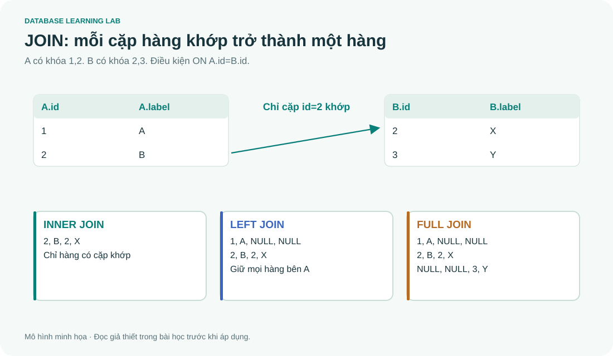

# SQL 04 · JOIN qua các bảng trung gian

> Nguồn: **4A slide 32–39, 56–62**. Sau bài này, bạn phải vẽ được mỗi hàng đầu ra đến từ những hàng nào, phân biệt inner/outer/self/natural join và phát hiện join làm nhân số hàng.

## 1. JOIN ghép hàng, không chỉ ghép tên bảng

Một câu “tên nhân viên thuộc Research” cần tên từ EMPLOYEE, còn tên phòng nằm ở DEPARTMENT. Điều kiện `e.Dno=d.Dnumber` mô tả **cặp hàng nào khớp**.

```sql
-- @lab S12
SELECT e.Fname,e.Lname,d.Dname
FROM EMPLOYEE e
JOIN DEPARTMENT d ON e.Dno=d.Dnumber
WHERE d.Dname='Research'
ORDER BY e.Fname;
```

Kết quả Franklin Wong, John Smith, Joyce English, Ramesh Narayan. Mỗi người có một Dno và Dnumber ở cha là PK nên mỗi hàng nhân viên ghép tối đa một hàng phòng. Không được suy mọi JOIN luôn giữ nguyên số hàng.

### Tích Descartes và điều kiện ghép

Với A có 2 hàng, B có 3 hàng, CROSS JOIN có 6 cặp. COMPANY có 9 nhân viên × 4 phòng = 36 cặp trước khi xét quan hệ đúng. INNER JOIN theo FK chỉ còn 9 cặp.

| Nhân viên | Phòng đang thử ghép | Dno=Dnumber? | INNER JOIN giữ? |
|---|---|---|---|
| John (5) | Administration (4) | FALSE | Không |
| John (5) | Research (5) | TRUE | Có |
| John (5) | Innovation (9) | FALSE | Không |
| Mai (4) | Administration (4) | TRUE | Có |

Viết cũ `FROM EMPLOYEE e, DEPARTMENT d WHERE e.Dno=d.Dnumber` có thể diễn đạt cùng inner join. Viết JOIN ... ON tách rõ ghép với lọc nghiệp vụ, giảm nguy cơ quên điều kiện.

## 2. Join ba bảng: dự án ở Stafford và quản lý phòng

```sql
-- @lab S13
SELECT p.Pnumber,p.Pname,d.Dname,m.Fname AS Manager,m.Bdate,m.Address
FROM PROJECT p
JOIN DEPARTMENT d ON p.Dnum=d.Dnumber
JOIN EMPLOYEE m ON d.Mgr_ssn=m.Ssn
WHERE p.Plocation='Stafford'
ORDER BY p.Pnumber;
```

| Pnumber | Pname | Dname | Manager | Bdate | Address |
|---:|---|---|---|---|---|
| 10 | Computerization | Administration | Jennifer | 1941-06-20 | Bellaire |
| 30 | Newbenefits | Administration | Jennifer | 1941-06-20 | Bellaire |

Đường đi là PROJECT → phòng kiểm soát → nhân viên quản lý. Nếu ghép `p.Dnum=m.Dno`, ta lấy **mọi nhân viên của phòng**, không phải riêng quản lý. Hai query có thể đều chạy mà trả lời hai câu hỏi khác nhau.

## 3. Self join: một bảng đóng hai vai

```sql
-- @lab S14
SELECT e.Fname AS Employee,s.Fname AS Supervisor
FROM EMPLOYEE e
LEFT JOIN EMPLOYEE s ON e.Super_ssn=s.Ssn
ORDER BY e.Fname;
```

| Employee | Supervisor |
|---|---|
| Ahmad | Jennifer |
| Alicia | Jennifer |
| Franklin | James |
| James | NULL |
| Jennifer | James |
| John | Franklin |
| Joyce | Franklin |
| Mai | Jennifer |
| Ramesh | Franklin |

Hai alias e/s không tạo hai bản sao vật lý của bảng. Chúng tạo hai vai trò để viết điều kiện giữa các hàng của cùng quan hệ. INNER JOIN sẽ loại James vì Super_ssn=NULL không khớp. LEFT JOIN giữ James để báo cáo đủ nhân viên.

## 4. Outer join bằng bảng nhỏ



Giả sử bên trái có `(1,A),(2,B)` và bên phải có `(2,X),(3,Y)`:

| JOIN theo id | Hàng đầu ra |
|---|---|
| INNER | (2,B,2,X) |
| LEFT | (1,A,NULL,NULL), (2,B,2,X) |
| RIGHT | (2,B,2,X), (NULL,NULL,3,Y) |
| FULL | (1,A,NULL,NULL), (2,B,2,X), (NULL,NULL,3,Y) |

```sql
-- @lab S15
WITH a(id,label) AS (VALUES(1,'A'),(2,'B')),
     b(id,label) AS (VALUES(2,'X'),(3,'Y'))
SELECT a.id AS left_id,a.label AS left_label,
       b.id AS right_id,b.label AS right_label
FROM a FULL OUTER JOIN b ON a.id=b.id
ORDER BY COALESCE(a.id,b.id);
```

SQLite hiện đóng gói trong project hỗ trợ RIGHT/FULL JOIN; các bản SQLite trước 3.39 không hỗ trợ. Nếu cần tương thích bản cũ, RIGHT có thể viết bằng LEFT và đảo hai phía. Mô phỏng FULL cần LEFT JOIN UNION ALL phần anti join của phía còn lại; UNION ALL tránh mất số lần xuất hiện hợp lệ.

## 5. ON và WHERE khác nhau với outer join

Muốn “liệt kê mọi phòng và nhân viên lương trên 40000, kể cả phòng chưa có ai đạt”:

```sql
-- @lab S16
SELECT d.Dname,e.Fname,e.Salary
FROM DEPARTMENT d
LEFT JOIN EMPLOYEE e ON e.Dno=d.Dnumber AND e.Salary>40000
ORDER BY d.Dname,e.Fname;
```

| Dname | Fname | Salary |
|---|---|---:|
| Administration | Jennifer | 43000 |
| Headquarters | James | 55000 |
| Innovation | NULL | NULL |
| Research | NULL | NULL |

ON quyết định những cặp khớp; LEFT JOIN sau đó bổ sung hàng NULL cho phòng không có cặp khớp. Nếu chuyển `e.Salary>40000` xuống WHERE, các hàng NULL cho UNKNOWN và bị loại. Khi đó chỉ còn Administration và Headquarters.

`WHERE e.Salary>40000 OR e.Ssn IS NULL` cũng **không luôn sửa đúng**: Research đã có nhân viên khớp FK, nên LEFT JOIN không sinh hàng NULL cho nó; tất cả nhân viên của nó bị WHERE loại. Muốn giữ phòng theo ý trên, hãy đặt điều kiện lương trong ON.

## 6. NATURAL JOIN, USING và equijoin

**Equijoin** dùng phép bằng trong điều kiện ghép. `JOIN ... USING(Dnumber)` ghép theo cột cùng tên ở hai phía và định hình đầu ra theo quy tắc USING. SQL Server không hỗ trợ USING/NATURAL JOIN như SQLite.

NATURAL JOIN tự ghép **mọi cột trùng tên**. EMPLOYEE có Dno, DEPARTMENT có Dnumber: chúng không tự ghép chỉ vì hai cột có cùng ý nghĩa. Nếu không có tên chung, SQLite NATURAL JOIN trở thành tích Descartes. Slide đổi tên Dnumber thành Dno trong một bảng dẫn xuất trước khi NATURAL JOIN; bước đổi tên này rất quan trọng.

NATURAL JOIN còn nhạy với thay đổi schema. Nếu thêm cột `Status` ở cả hai bảng, điều kiện ghép tự thêm `a.Status=b.Status`. Với code ứng dụng cần dễ bảo trì, viết ON tường minh thường rõ ý định hơn.

## 7. Join M:N và hiện tượng nhân số hàng

John có 2 phân công và 3 người phụ thuộc. Nếu join EMPLOYEE → WORKS_ON và EMPLOYEE → DEPENDENT cùng lúc, có **2×3=6** hàng của John. SUM(Hours) có thể bị nhân 3 lần. DISTINCT Hours không sửa đúng vì hai dự án có thể trùng số giờ thật.

Cách sửa phụ thuộc câu hỏi: tổng hợp WORKS_ON theo Essn trước rồi join; hoặc dùng EXISTS nếu chỉ cần biết có người phụ thuộc; hoặc viết hai subquery độc lập. Trước mỗi phép SUM, xác định **mỗi hàng hiện đại diện cho điều gì**.

## 8. Bài tập và giải thích

1. Research có 4 nhân viên, Innovation có 0. LEFT JOIN từ DEPARTMENT sang EMPLOYEE có bao nhiêu hàng cho hai phòng này?
2. Vì sao self inner join mất James?
3. Join hai bảng A/B bằng một cột không unique ở cả hai, A có 2 hàng mã 7, B có 3 hàng mã 7. Có bao nhiêu cặp mã 7?
4. Hãy viết query tìm phòng **không có nhân viên**.

<details><summary>Lời giải</summary>

1. 4 hàng Research và 1 hàng đệm NULL cho Innovation, tổng 5.
2. NULL không bằng một Ssn theo điều kiện ON nên không có cặp khớp.
3. 2×3=6. Join không tự suy “lấy một hàng đại diện”.
4. Có thể dùng anti join:

```sql
SELECT d.Dname FROM DEPARTMENT d
LEFT JOIN EMPLOYEE e ON e.Dno=d.Dnumber
WHERE e.Ssn IS NULL;
```

Dùng PK e.Ssn để phát hiện không khớp, vì e.Salary có thể NULL ngay ở nhân viên thật (Mai). Kết quả chỉ Innovation. NOT EXISTS cũng là lời giải tốt.

</details>
