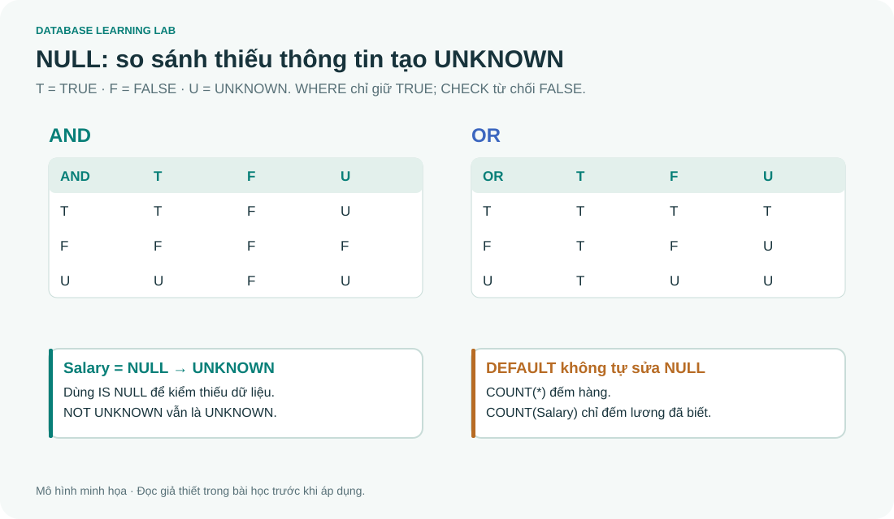

# SQL 05 · NULL và logic ba giá trị

> Nguồn: **4A slide 45, 51–54, 64–65**. Đây là phần nên học trước truy vấn lồng. Mục tiêu: tính TRUE/FALSE/UNKNOWN, giải thích NOT IN, aggregate và CHECK khi gặp NULL.

## 1. NULL biểu diễn thiếu thông tin

Trong fixture, Salary của Mai là NULL. Điều đó không nói lương bằng 0; chỉ nói chưa có giá trị lương đã biết. NULL có thể dùng cho chưa biết/không áp dụng theo thiết kế, nhưng một cột NULL không tự cho biết lý do thiếu. Nếu nghiệp vụ cần phân biệt, lưu thêm trạng thái.

`NULL+10`, `NULL>40000`, `NULL=NULL` đều không cho giá trị thông thường bạn kỳ vọng. So sánh với NULL thường cho **UNKNOWN (U)**. Kiểm tra bằng `IS NULL` hoặc `IS NOT NULL`.

```sql
-- @lab S17
SELECT Fname,Salary,Salary+100 AS Plus100,
       Salary=NULL AS WrongComparison,Salary IS NULL AS Missing
FROM EMPLOYEE WHERE Ssn='111222333';
```

Kết quả: `Mai, NULL, NULL, NULL, 1`. SQLite hiển thị giá trị logic chưa biết bằng NULL, TRUE bằng 1, FALSE bằng 0. T-SQL không cho đặt mọi predicate trực tiếp trong SELECT như vậy; dùng CASE khi cần cột 0/1.

## 2. Bảng chân trị đầy đủ



| AND | TRUE | FALSE | UNKNOWN |
|---|---|---|---|
| TRUE | TRUE | FALSE | UNKNOWN |
| FALSE | FALSE | FALSE | FALSE |
| UNKNOWN | UNKNOWN | FALSE | UNKNOWN |

| OR | TRUE | FALSE | UNKNOWN |
|---|---|---|---|
| TRUE | TRUE | TRUE | TRUE |
| FALSE | TRUE | FALSE | UNKNOWN |
| UNKNOWN | TRUE | UNKNOWN | UNKNOWN |

| x | NOT x |
|---|---|
| TRUE | FALSE |
| FALSE | TRUE |
| UNKNOWN | UNKNOWN |

Bạn có thể suy các ô thay vì học vẹt: FALSE AND x chắc chắn FALSE; TRUE OR x chắc chắn TRUE. Nhưng TRUE AND UNKNOWN chưa đủ thông tin, nên UNKNOWN.

| Nơi dùng predicate | Khi TRUE | Khi FALSE | Khi UNKNOWN |
|---|---|---|---|
| WHERE / HAVING | Giữ | Loại | Loại |
| ON | Cặp khớp | Không khớp | Không khớp |
| CHECK | Cho qua | Từ chối | Thường cho qua theo quy tắc CHECK |

Vì vậy `WHERE Salary<=40000 OR Salary>40000` không giữ Mai. Luật loại trừ trung gian quen trong logic hai giá trị không thể áp dụng máy móc với UNKNOWN. Nếu muốn cả người chưa biết lương, thêm `OR Salary IS NULL`.

## 3. NOT IN và NULL: phân tích từng bước

```sql
-- @lab S18
SELECT Fname FROM EMPLOYEE
WHERE Ssn NOT IN (SELECT Super_ssn FROM EMPLOYEE)
ORDER BY Fname;
```

Kết quả **0 hàng**. Tập supervisor có NULL từ James. Với John không trùng supervisor đã biết, điều kiện tương đương chuỗi `John<>Franklin AND John<>Jennifer AND John<>James AND John<>NULL`. Ba so sánh đầu TRUE, cuối UNKNOWN, toàn bộ UNKNOWN nên WHERE loại. Với Franklin đã trùng một giá trị thì có FALSE, cũng bị loại.

```sql
-- @lab S19
SELECT e.Fname FROM EMPLOYEE e
WHERE NOT EXISTS (
 SELECT 1 FROM EMPLOYEE s WHERE s.Super_ssn=e.Ssn
)
ORDER BY e.Fname;
```

Kết quả **Ahmad, Alicia, John, Joyce, Mai, Ramesh**. EXISTS chỉ hỏi query có hàng không, luôn cho TRUE hoặc FALSE; giá trị NULL trong cột được SELECT không làm EXISTS trở thành UNKNOWN. `EXISTS(SELECT NULL)` vẫn TRUE nếu SELECT đó tạo một hàng.

Nếu lọc NULL khỏi subquery NOT IN, ví dụ `WHERE Super_ssn IS NOT NULL`, có thể giải quyết bẫy RHS NULL này. Nhưng nếu biểu thức phía ngoài cũng có thể NULL, vẫn cần xác định chính sách cho nó. NOT EXISTS thường bộc lộ quan hệ “không có hàng liên quan” rõ hơn.

## 4. Aggregate không biến NULL thành 0

```sql
-- @lab S20
SELECT COUNT(*) AS N,COUNT(Salary) AS Known,
       SUM(Salary) AS Total,AVG(Salary) AS AvgKnown,
       ROUND(AVG(COALESCE(Salary,0)),2) AS AvgZeroFilled
FROM EMPLOYEE;
```

| N | Known | Total | AvgKnown | AvgZeroFilled |
|---:|---:|---:|---:|---:|
| 9 | 8 | 281000 | 35125 | 31222.22 |

AVG(Salary) = 281000/8; AVG(COALESCE(...)) = 281000/9. Hai mẫu số khác nhau thể hiện hai giả định nghiệp vụ khác nhau. `COUNT(*)` đếm hàng, `COUNT(expr)` đếm những hàng expr không NULL. SUM/MIN/MAX/AVG bỏ qua NULL nhưng nếu không có giá trị nào thì thường trả NULL; COUNT trả 0.

## 5. NULL trong DISTINCT, GROUP BY và khóa

GROUP BY gom các hàng NULL cùng khóa nhóm; DISTINCT giữ một NULL trong tập kết quả một cột. Cơ chế so nhóm/khử trùng không được diễn giải bằng `NULL=NULL` trong WHERE. UNIQUE và NULL có khác biệt dialect, xem bài 02. PRIMARY KEY theo mô hình SQL không cho NULL; SQLite có một số ngoại lệ lịch sử nên fixture khai báo NOT NULL tường minh ở khóa chuỗi/ghép.

### COALESCE, NULLIF và CASE

`COALESCE(Salary,0)` chỉ nên dùng khi 0 là diễn giải có chủ ý, không phải mẹo làm “hết NULL”. `COALESCE(Fname,'(unknown)')` hợp với nhãn hiển thị. `NULLIF(a,b)` trả NULL khi hai giá trị bằng nhau, ngược lại trả a. CASE có thể đưa “chưa biết” thành nhóm riêng mà không thay dữ liệu gốc.

## 6. Bài tập tính tay

1. FALSE OR UNKNOWN? NOT UNKNOWN? TRUE AND UNKNOWN?
2. `CHECK(Salary>0)` có bảo đảm mọi nhân viên có lương không?
3. Tập query con rỗng: `x IN (...)` và `x NOT IN (...)` cho gì trong SQLite, kể cả x=NULL?
4. `EXISTS(SELECT Salary FROM EMPLOYEE WHERE Fname='Mai')` cho gì?

<details><summary>Lời giải</summary>

1. UNKNOWN, UNKNOWN, UNKNOWN.
2. Không. CHECK cho UNKNOWN qua; thêm NOT NULL và quy tắc lương hợp lý.
3. IN tập rỗng FALSE, NOT IN tập rỗng TRUE. Đừng lẫn với tập chứa một NULL. Một số dialect có khác biệt cú pháp với danh sách literal rỗng `IN ()`, nên dùng subquery trả 0 hàng để học.
4. TRUE vì có một hàng của Mai. Giá trị Salary không ảnh hưởng kiểm tra tồn tại.

</details>
