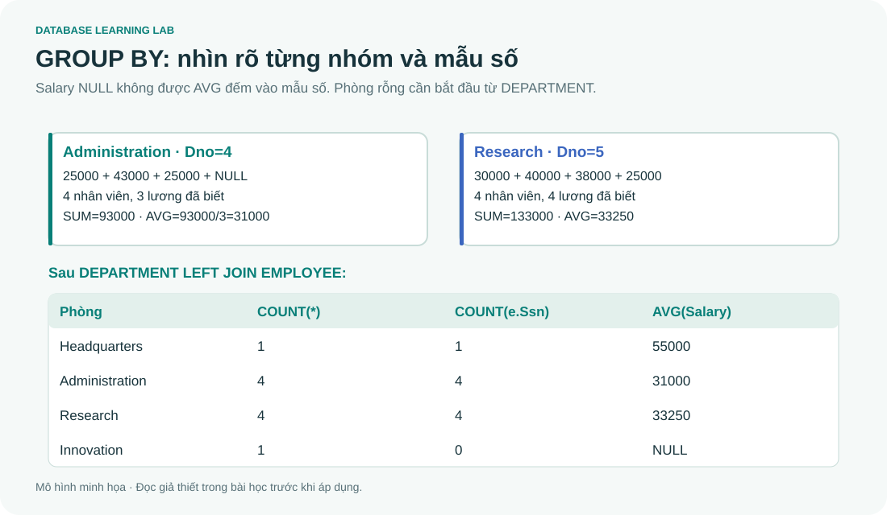

# SQL 06 · COUNT, SUM, AVG, GROUP BY và HAVING

> Nguồn: **4A slide 63–73**, kể cả ảnh minh họa nhóm ở slide 68. Mục tiêu: từ hàng chi tiết lập bảng nhóm, giữ phòng rỗng và phát hiện double-count.

## 1. Một hàng báo cáo đại diện cho cái gì?

Query không GROUP BY mà có aggregate thường cho một hàng tổng hợp cả tập đã lọc. Query GROUP BY Dno cho một hàng mỗi phòng có nhân viên trong tập nguồn. `WHERE Dno=5` trước aggregate chỉ lấy nhân viên Research.

```sql
-- @lab S21
SELECT MIN(Salary) AS Lowest,MAX(Salary) AS Highest,
       COUNT(*) AS Employees,COUNT(Salary) AS Known,AVG(Salary) AS Mean
FROM EMPLOYEE WHERE Dno=5;
```

Kết quả `25000,40000,4,4,33250`. Nếu WHERE không giữ hàng nào, COUNT=0, MIN/MAX/AVG=NULL; query tổng hợp không GROUP BY vẫn có một hàng. Với GROUP BY trên tập rỗng không có nhóm nào nên không có hàng đầu ra.

## 2. Nhìn từng nhóm như slide 68



| Dno | Các Salary đầu vào | COUNT(*) | COUNT(Salary) | SUM | AVG |
|---:|---|---:|---:|---:|---:|
| 1 | 55000 | 1 | 1 | 55000 | 55000 |
| 4 | 25000,43000,25000,NULL | 4 | 3 | 93000 | 31000 |
| 5 | 30000,40000,38000,25000 | 4 | 4 | 133000 | 33250 |

```sql
-- @lab S22
SELECT Dno,COUNT(*) AS N,COUNT(Salary) AS Known,
       SUM(Salary) AS Total,AVG(Salary) AS Mean
FROM EMPLOYEE GROUP BY Dno ORDER BY Dno;
```

Không có Dno=9 vì EMPLOYEE không có hàng thuộc Innovation. GROUP BY không tự sinh những giá trị chưa xuất hiện. Để có mọi phòng, phải xuất phát từ DEPARTMENT.

## 3. LEFT JOIN và COUNT: vì sao COUNT(*) có thể sai?

```sql
-- @lab S23
SELECT d.Dnumber,d.Dname,COUNT(*) AS JoinedRows,
       COUNT(e.Ssn) AS Employees,COUNT(e.Salary) AS Known,AVG(e.Salary) AS Mean
FROM DEPARTMENT d
LEFT JOIN EMPLOYEE e ON e.Dno=d.Dnumber
GROUP BY d.Dnumber,d.Dname ORDER BY d.Dnumber;
```

| Dnumber | Dname | JoinedRows | Employees | Known | Mean |
|---:|---|---:|---:|---:|---:|
| 1 | Headquarters | 1 | 1 | 1 | 55000 |
| 4 | Administration | 4 | 4 | 3 | 31000 |
| 5 | Research | 4 | 4 | 4 | 33250 |
| 9 | Innovation | 1 | 0 | 0 | NULL |

Innovation có một hàng đệm NULL do LEFT JOIN. COUNT(*) đếm hàng đó; COUNT(e.Ssn) bỏ NULL và đếm đúng 0 nhân viên. COUNT(e.Salary) không thể dùng thay số nhân viên vì lương của người thật có thể NULL.

## 4. Cột nào được xuất hiện trong SELECT?

Sau GROUP BY Dno, mỗi nhóm có nhiều Fname. `SELECT Dno,Fname,AVG(Salary) ... GROUP BY Dno` không xác định tên đại diện nào về mặt bài toán. SQL Server từ chối. SQLite có mở rộng bare columns và một số quy tắc riêng cho min/max; không dựa vào đó khi cần truy vấn đúng và di chuyển được.

Cách viết rõ: cột không aggregate cần thuộc GROUP BY, hoặc có phụ thuộc hàm mà DBMS hỗ trợ nhận biết. Trong khóa học dùng `GROUP BY d.Dnumber,d.Dname` khi chọn cả hai. Câu slide “grouping attributes must appear in SELECT” là cách viết thường thấy của ví dụ, **không phải quy tắc bắt buộc mọi query**: có thể GROUP BY một cột mà không xuất nó. Điều cần tránh là chọn cột không xác định trong nhóm.

## 5. WHERE lọc hàng; HAVING lọc nhóm

```sql
-- @lab S24
SELECT p.Pnumber,p.Pname,COUNT(*) AS WorkerCount
FROM PROJECT p JOIN WORKS_ON w ON w.Pno=p.Pnumber
GROUP BY p.Pnumber,p.Pname
HAVING COUNT(*)>2
ORDER BY p.Pnumber;
```

| Pnumber | Pname | WorkerCount |
|---:|---|---:|
| 2 | ProductY | 3 |
| 10 | Computerization | 3 |
| 20 | Reorganization | 3 |
| 30 | Newbenefits | 3 |

COUNT(*) tính sau join. Không viết `WHERE COUNT(*)>2` cùng cấp vì lúc WHERE chưa có nhóm. Ngược lại, nếu cần chỉ đếm phân công Hours>=10, đặt điều kiện đó trong WHERE trước GROUP BY. Nếu muốn dự án có **tổng giờ**>=50, dùng `HAVING SUM(Hours)>=50`.

So sánh hai câu hỏi: “phòng có lương trung bình >35000” khác “lương trung bình của những người có lương >35000 trong từng phòng”. Câu đầu HAVING AVG(Salary)>35000; câu sau WHERE Salary>35000 rồi AVG.

## 6. Tổng hợp có điều kiện

```sql
-- @lab S25
SELECT d.Dname,COUNT(e.Ssn) AS Employees,
 SUM(CASE WHEN e.Salary>=40000 THEN 1 ELSE 0 END) AS HighPaid,
 SUM(CASE WHEN e.Ssn IS NOT NULL AND e.Salary IS NULL THEN 1 ELSE 0 END) AS MissingPay
FROM DEPARTMENT d LEFT JOIN EMPLOYEE e ON e.Dno=d.Dnumber
GROUP BY d.Dnumber,d.Dname ORDER BY d.Dname;
```

Administration: 4 người, 1 lương cao, 1 thiếu lương. Headquarters: 1,1,0. Innovation: 0,0,0. Research: 4,1,0. Điều kiện e.Ssn IS NOT NULL giúp không đếm hàng đệm của phòng rỗng là nhân viên thiếu lương.

## 7. Double-count sau khi join nhiều nhánh

John có 2 phân công, tổng 40 giờ, và 3 người phụ thuộc. Join cả hai bảng con tạo 6 hàng, SUM(Hours)=120. `SUM(DISTINCT Hours)` tình cờ có thể cho 40 ở John nhưng thất bại khi một người có hai phân công cùng số giờ. Cần tổng hợp mỗi nhánh tại grain mong muốn:

```sql
-- @lab S26
WITH hours_per_employee AS (
 SELECT Essn,SUM(Hours) AS TotalHours FROM WORKS_ON GROUP BY Essn
), dependents_per_employee AS (
 SELECT Essn,COUNT(*) AS Dependents FROM DEPENDENT GROUP BY Essn
)
SELECT e.Fname,h.TotalHours,COALESCE(d.Dependents,0) AS Dependents
FROM EMPLOYEE e
LEFT JOIN hours_per_employee h ON h.Essn=e.Ssn
LEFT JOIN dependents_per_employee d ON d.Essn=e.Ssn
WHERE e.Ssn='123456789';
```

Kết quả John,40,3. CTE chỉ đặt tên các query để đọc dễ hơn; không mặc định là bảng vật lý đã được lưu.

## 8. Bài tập

1. Đếm mọi phòng có ít nhất 4 nhân viên, kể cả phòng rỗng trong bước báo cáo ban đầu.
2. “Không có nhân viên” khác “không có nhân viên đã biết lương” ở đâu?
3. Hai phép SUM trước/sau join có luôn bằng nhau không?

<details><summary>Lời giải</summary>

1. Dùng query S23, thêm HAVING COUNT(e.Ssn)>=4: Administration và Research. Đặt HAVING trước ORDER BY.
2. So COUNT(e.Ssn)=0 với COUNT(e.Salary)=0; một phòng có nhân viên nhưng tất cả Salary NULL đáp ứng điều kiện thứ hai, không đáp ứng thứ nhất.
3. Không. Join có thể nhân một hàng thành nhiều bản hoặc loại hàng không khớp. Phải xét cardinality và grain trước khi tổng hợp.

</details>
