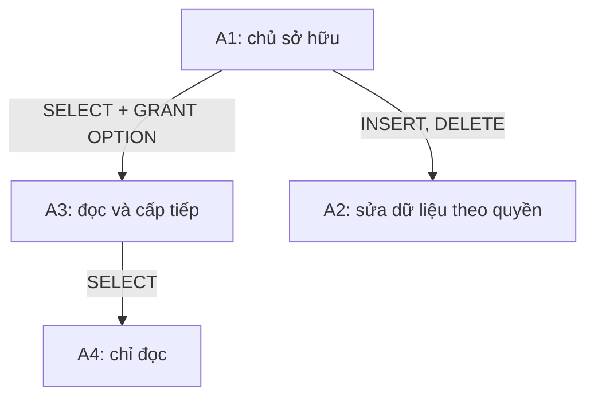

# SQL 10 · GRANT, REVOKE và đường truyền quyền

> Nguồn: **4A slide 95–105**. Bài này dùng SQL Server/khái niệm SQL; SQLite trong browser không có user/role và GRANT/REVOKE để thực thi. Mục tiêu: vẽ được ai cấp quyền cho ai, phân biệt sử dụng quyền với cấp tiếp và tránh suy sai sau REVOKE.

## 1. Principal, object và permission

Một quyền gồm **chủ thể** nhận quyền, **đối tượng** được tác động và **hành động** được phép. Ví dụ A2 được SELECT trên course.EMPLOYEE. SQL Server phân biệt login ở server, user trong database, role gom các user. Mô hình trong slide A1/A2/A3/A4 đơn giản hóa các chi tiết đăng nhập để tập trung vào cấp quyền.

| Quyền | Cho phép gì? | Không suy được gì? |
|---|---|---|
| SELECT | Đọc dữ liệu thuộc phạm vi được cấp | Không tự được UPDATE |
| INSERT | Thêm hàng | Không tự được DELETE |
| UPDATE | Sửa dữ liệu | Không tự được ALTER schema |
| DELETE | Xóa hàng | Không phải DROP TABLE |
| REFERENCES | Tạo tham chiếu theo phạm vi cho phép | Không có nghĩa được đọc toàn bảng |
| EXECUTE | Gọi routine được phép | Không tự được sửa định nghĩa routine |

Người gọi còn cần quyền phù hợp để tìm hàng qua predicate/query; các tình huống ownership chaining và module execution context có quy tắc riêng. Khi học cơ bản, hãy ghi rõ ai sở hữu đối tượng và quyền cấp trực tiếp nào đang xét.

## 2. GRANT và nguyên tắc đủ dùng

Muốn thực hành bằng user thật trong database học, chạy tùy chọn [08-permissions.sql](../../sql/sqlserver/08-permissions.sql) sau setup. Script tạo các user CourseA2/A3/A4 **WITHOUT LOGIN** chỉ trong database học, dùng EXECUTE AS/REVERT để quan sát đường cấp và thu hồi. Nó không tạo tài khoản đăng nhập server. Cần quyền quản trị tương ứng trong database đó.

```tsql
-- Chạy với tài khoản có thẩm quyền, user/role đã tồn tại
GRANT SELECT ON OBJECT::course.EMPLOYEE TO A2;
GRANT INSERT,DELETE ON OBJECT::course.DEPARTMENT TO A2;
GRANT UPDATE (Salary) ON OBJECT::course.EMPLOYEE TO A4;
```

Slide dùng cú pháp cấp trên nhiều relation trong một câu theo cách trình bày SQL tổng quát. T-SQL cần cấp theo đối tượng bằng cú pháp của SQL Server. `GRANT CREATETAB` trong slide không phải lệnh T-SQL hiện đại; quyền CREATE TABLE trong database và quyền trên schema cần được xét riêng.

Trong SQL Server, một số quyền có thể cấp ở mức cột, gồm SELECT/UPDATE/REFERENCES (và UNMASK tùy phiên bản/tính năng). Vì vậy câu slide “SELECT không attribute-specific” không đúng nếu coi là quy tắc chung của SQL Server. INSERT không cấp mức cột theo cú pháp GRANT OBJECT của SQL Server như cách slide mô tả tổng quát.

## 3. WITH GRANT OPTION tạo đường cấp tiếp



```tsql
GRANT SELECT ON OBJECT::course.EMPLOYEE TO A3 WITH GRANT OPTION;
-- Lệnh sau do A3, hoặc đúng ngữ cảnh cấp quyền của A3, thực hiện:
GRANT SELECT ON OBJECT::course.EMPLOYEE TO A4;
```

A3 có thể dùng và cấp tiếp SELECT. A4 không có GRANT OPTION nên không được cấp tiếp chỉ từ đường này. GRANT OPTION không đồng nghĩa quyền sở hữu và cũng không tự cấp mọi quyền khác.

| Người | SELECT | Cấp tiếp SELECT | INSERT/DELETE từ sơ đồ |
|---|---|---|---|
| A1 | Có theo sở hữu/thẩm quyền | Có | Có theo sở hữu/thẩm quyền |
| A2 | Chưa được cấp trong sơ đồ | Không | Có |
| A3 | Có | Có | Chưa được cấp |
| A4 | Có | Không | Chưa được cấp |

## 4. REVOKE phải xét đường thay thế

Mô hình slide: nếu A1 thu hồi đường SELECT của A3, quyền của A4 chỉ dựa vào A3 cũng phải xử lý theo chính sách cascading. Trong T-SQL, không giả định câu REVOKE không hậu tố sẽ tự xử lý mọi đường; cần cú pháp CASCADE khi có quyền đã cấp tiếp:

```tsql
REVOKE SELECT ON OBJECT::course.EMPLOYEE FROM A3 CASCADE;
```

Nếu chỉ muốn thu quyền **cấp tiếp**, giữ quyền sử dụng của A3, xem `REVOKE GRANT OPTION FOR ...` và yêu cầu CASCADE theo tình huống. Đọc tài liệu đúng dialect trước khi thay đổi quyền thật.

**REVOKE không đồng nghĩa DENY.** REVOKE gỡ một GRANT/DENY tường minh trong phạm vi tương ứng; user vẫn có thể có quyền qua role, quyền ở schema/database hoặc một đường cấp khác. DENY là quyết định từ chối tường minh theo quy tắc quyền của SQL Server, có những tương tác và ngoại lệ riêng. Không dùng sơ đồ một đường để kết luận về cả tài khoản thực tế.

Nếu A1 cũng cấp SELECT trực tiếp cho A4, việc mất đường qua A3 không đủ để suy A4 mất mọi quyền đọc. Khi giải bài, liệt kê tất cả cạnh, đánh dấu cạnh có GRANT OPTION, rồi xét các đường còn lại theo mô hình đề.

## 5. Dùng view để giới hạn hàng và cột

```tsql
CREATE OR ALTER VIEW course.ResearchPublic AS
SELECT Fname,Lname,Bdate,Address
FROM course.EMPLOYEE WHERE Dno=5;
GO
GRANT SELECT ON OBJECT::course.ResearchPublic TO A3;
GO
```

View bỏ Salary/Ssn và chỉ giữ Research. Nếu A3 đồng thời được SELECT trực tiếp toàn EMPLOYEE qua role, giới hạn view không còn chặn đường đọc kia. View cũng không tự che mọi thông tin suy diễn; đây là minh họa phân quyền, không phải hệ ẩn danh hoàn chỉnh.

Tách việc xác thực (bạn là ai), ủy quyền (được làm gì), audit (đã làm gì). Procedure nhận tham số hay view tiện dùng đều phải kết hợp quyền đúng phạm vi.

## 6. Bài tập vẽ quyền

1. A1 → A3 SELECT+GO; A3 → A4 SELECT. A4 có cấp tiếp được không?
2. Thu quyền A3, A4 còn SELECT trực tiếp từ A1. Có thể kết luận A4 không đọc được không?
3. A4 chỉ được UPDATE Salary. Có được DROP TABLE không?
4. Chỉ cấp SELECT view giới hạn nhưng A3 thuộc role đọc toàn schema. View có giới hạn mọi đường không?

<details><summary>Lời giải</summary>

1. Không, đường đến A4 không có GRANT OPTION.
2. Không, còn đường trực tiếp. Xét đúng cơ chế thu hồi của DBMS và các đường khác.
3. Không. UPDATE dữ liệu khác DDL xóa đối tượng.
4. Không. Phải rà cả role/quyền ở mức cao hơn. Least privilege là thiết kế toàn bộ quyền hiệu lực, không chỉ một câu GRANT.

</details>

Tham khảo: [GRANT OBJECT](https://learn.microsoft.com/en-us/sql/t-sql/statements/grant-object-permissions-transact-sql?view=sql-server-ver17), [REVOKE OBJECT](https://learn.microsoft.com/en-us/sql/t-sql/statements/revoke-object-permissions-transact-sql?view=sql-server-ver17).
