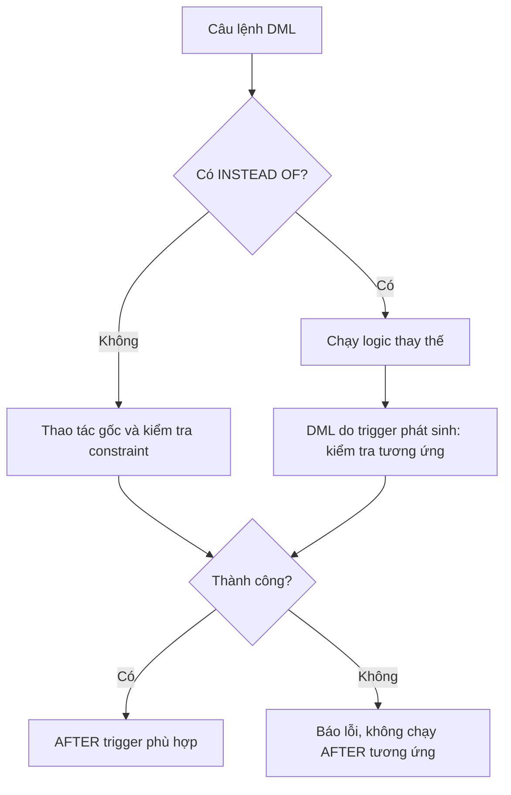
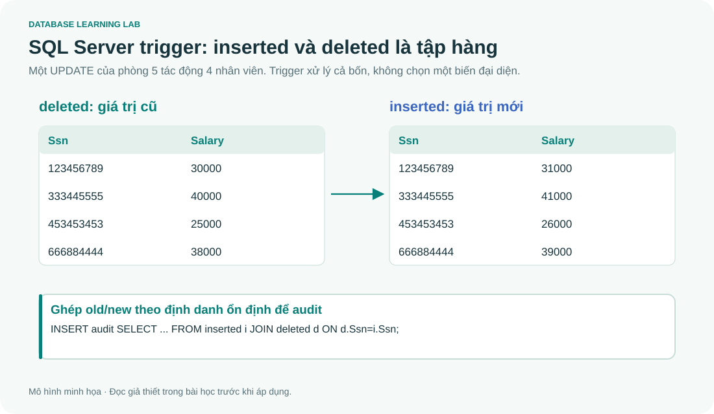

# SQL 14 · Trigger, inserted/deleted và xử lý nhiều dòng

> Nguồn: **4A slide 86–91, 4B slide 24–30**. Mục tiêu: giải thích lúc trigger chạy, viết theo tập hàng và phân biệt trigger SQL Server với SQLite.

## 1. Trigger tự phản ứng với sự kiện

Procedure được gọi tường minh bằng EXEC. Trigger gắn với sự kiện nên DBMS tự gọi. SQL Server có DML trigger (INSERT/UPDATE/DELETE), DDL trigger (những sự kiện định nghĩa đối tượng tương ứng), logon trigger. Khóa học thực hành chủ yếu DML trigger; DDL/logon không chạy trong SQLite.

Trigger dùng để audit, giữ một số quy tắc nghiệp vụ hoặc ánh xạ cập nhật view. Nếu PK/FK/UNIQUE/CHECK diễn đạt được quy tắc, dùng constraint thường rõ hơn và phủ các đường DML dễ hơn. Trigger dài có thể làm thao tác ghi chậm, giữ khóa lâu và khó lần theo tác động.

## 2. AFTER/FOR và INSTEAD OF

```tsql
CREATE OR ALTER TRIGGER course.TriggerName
ON course.EMPLOYEE
AFTER INSERT,UPDATE
AS
BEGIN
 SET NOCOUNT ON;
 -- xử lý tập hàng inserted/deleted
END;
GO
```

Với DML trigger SQL Server, FOR có nghĩa AFTER trong ngữ cảnh này. INSTEAD OF thay thế thao tác kích hoạt bằng logic do bạn viết, thường hữu ích cho view; không phải “AFTER nhưng chạy sớm hơn” đơn thuần.



Đây là mô hình học một đường DML đơn giản theo slide, không liệt kê mọi nested trigger/cascade/recursion. AFTER chỉ chạy khi thao tác và kiểm tra constraint tương ứng đã thành công, nhưng vẫn ở trong transaction: trigger ném lỗi có thể làm giao dịch thất bại.

Nếu có nhiều AFTER trigger cho cùng sự kiện, không dựa vào thứ tự ngẫu nhiên. SQL Server có cơ chế đặt first/last cho các trường hợp được hỗ trợ, còn các trigger ở giữa không có thứ tự chung bảo đảm. Trigger ghi lại bảng mình gắn còn cần hiểu recursion/nesting và cấu hình.

## 3. inserted và deleted là bảng, không phải một hàng



| DML | inserted | deleted |
|---|---|---|
| INSERT | Giá trị mới của các hàng | Rỗng |
| UPDATE | Giá trị sau sửa | Giá trị trước sửa |
| DELETE | Rỗng | Giá trị cũ |

Một UPDATE tác động 1000 hàng có thể kích hoạt trigger một lần với 1000 hàng trong inserted/deleted. Cả statement tác động 0 hàng cũng là tình huống cần tính đến. Không viết trigger bằng giả định “mỗi lần chỉ có một row”.

### Vì sao ví dụ Check_Dnumber trong 4A cần sửa?

Slide viết `SELECT @dnum=Dnumber FROM inserted` rồi kiểm @dnum. Nếu một statement thêm nhiều phòng, biến chỉ nhận một giá trị cuối không được dựa vào thứ tự, nên có thể bỏ sót hàng sai. Hơn nữa biên slide dùng `<0 OR >20` cho phép 0, còn CHECK ở slide 14 dùng `>0 AND <21` không cho 0. Cần chọn chính sách rõ; dưới đây chọn 1..20.

```tsql
CREATE OR ALTER TRIGGER course.Check_Dnumber
ON course.DEPARTMENT AFTER INSERT,UPDATE
AS
BEGIN
 SET NOCOUNT ON;
 IF EXISTS(SELECT 1 FROM inserted WHERE Dnumber<1 OR Dnumber>20)
 BEGIN
  THROW 51001,N'Dnumber phải thuộc 1..20.',1;
 END;
END;
GO
```

Ở đây CHECK(Dnumber BETWEEN 1 AND 20) trên cột thường thích hợp hơn trigger. Ví dụ dùng để học xử lý inserted đúng theo tập. Thử chèn hai phòng 10 và 99 trong **cùng statement**: phải từ chối cả statement, không chỉ 99.

## 4. CHECK_AGE theo slide 4B

```tsql
CREATE OR ALTER TRIGGER course.CHECK_AGE
ON course.EMPLOYEE AFTER INSERT,UPDATE
AS
BEGIN
 SET NOCOUNT ON;
 IF EXISTS (
  SELECT 1 FROM inserted
  WHERE Bdate IS NULL
     OR DATEADD(year,18,Bdate)>CONVERT(date,GETDATE())
 )
 BEGIN
  THROW 51000,N'Nhân viên phải có ngày sinh và đủ 18 tuổi.',1;
 END;
END;
GO
```

Slide chỉ kiểm DATEADD(...), nên Bdate=NULL không bị phát hiện. Phiên bản này chọn chính sách ngày sinh bắt buộc và kiểm ngày đủ 18 tuổi. Nếu nghiệp vụ cho NULL, bỏ nhánh đó có chủ ý. Dùng date thay vì so với giờ hiện tại khi quy tắc theo ngày. Ngày 29/2 cần chính sách sinh nhật rõ vì cộng năm có quy tắc xử lý cuối tháng.

`DATEDIFF(year,Bdate,GETDATE())>=18` chỉ đếm ranh giới năm, có thể cho người chưa đến sinh nhật đủ tuổi. Ngoài ra trigger chỉ chạy khi có DML phù hợp, không tự thức dậy mỗi ngày; quy tắc tuổi tối thiểu không xấu đi khi thời gian tăng, nhưng quy tắc có hạn hết hiệu lực cần cơ chế khác.

Không tự ROLLBACK rồi tiếp tục code như bình thường. Trigger và caller chia sẻ transaction; THROW với XACT_ABORT mặc định ON trong trigger có tương tác rollback cần caller xử lý. Bài 16 trình bày mẫu CATCH/transaction, tránh ghi “RAISERROR tự rollback mọi thứ”.

## 5. Audit UPDATE bằng join old/new

```tsql
CREATE OR ALTER TRIGGER course.AuditSalary
ON course.EMPLOYEE AFTER UPDATE
AS
BEGIN
 SET NOCOUNT ON;
 INSERT INTO course.SalaryAudit(Ssn,OldSalary,NewSalary)
 SELECT i.Ssn,d.Salary,i.Salary
 FROM inserted i JOIN deleted d ON d.Ssn=i.Ssn
 WHERE i.Salary<>d.Salary
    OR (i.Salary IS NULL AND d.Salary IS NOT NULL)
    OR (i.Salary IS NOT NULL AND d.Salary IS NULL);
END;
GO
```

Script đi kèm tạo SalaryAudit với AuditId và thời điểm UTC. Ghép theo Ssn ở ví dụ giả định thao tác này không đổi Ssn. Nếu khóa có thể đổi, cần định danh ổn định khác hoặc thiết kế audit phù hợp. `UPDATE(Salary)` chỉ nói cột có trong thao tác UPDATE, không chứng minh mọi giá trị thực sự khác. Predicate trên so giá trị và xét cả chuyển NULL↔số.

Audit trong cùng transaction cũng rollback cùng thay đổi nghiệp vụ. Nếu mục đích là lưu cả các lần thử thất bại, bảng audit transaction này không tự làm được; phải có cơ chế ghi phù hợp khác.

## 6. INSTEAD OF trên view

Một view đơn giản chỉ bộc lộ Ssn/Salary có thể dùng INSTEAD OF UPDATE để ánh xạ cập nhật xuống EMPLOYEE. Body phải xử lý **toàn bộ inserted**, join theo khóa, xác định cột được sửa và từ chối các thao tác không được hỗ trợ. Với view nhiều bảng, tự quyết định bảng đích/chính sách, không kỳ vọng DBMS suy ý định.

Ví dụ 4A slide 89 dùng bảng EmpID/Name khác schema COMPANY. Không dán nguyên vào EMPLOYEE có Ssn/Fname/Lname. Cốt lõi của ví dụ là INSTEAD OF INSERT ghi lại dữ liệu đúng cách, sau đó AFTER phù hợp mới xuất hiện khi thao tác cơ sở thành công.

## 7. SQLite: NEW/OLD và FOR EACH ROW

```sql
-- @lab S43
CREATE TABLE SalaryAuditDemo(Ssn TEXT,OldSalary REAL,NewSalary REAL);
CREATE TRIGGER AuditPay AFTER UPDATE OF Salary ON EMPLOYEE
FOR EACH ROW WHEN OLD.Salary IS NOT NEW.Salary
BEGIN
 INSERT INTO SalaryAuditDemo VALUES(NEW.Ssn,OLD.Salary,NEW.Salary);
END;
UPDATE EMPLOYEE SET Salary=Salary+1000 WHERE Dno=5;
SELECT Ssn,OldSalary,NewSalary FROM SalaryAuditDemo ORDER BY Ssn;
```

Có 4 hàng audit với lương 30000→31000,40000→41000,25000→26000,38000→39000 theo Ssn. SQLite có row trigger và NEW/OLD; SQL Server có statement trigger với inserted/deleted. Hai cú pháp và mô hình không thay nhau được. SQLite có RAISE trong trigger, không có THROW/RAISERROR của T-SQL.

## 8. Bài tập phản ví dụ

1. Vì sao biến @dnum trong trigger slide có thể bỏ sót lỗi?
2. UPDATE Salary=Salary có nhất thiết tạo một hàng audit theo predicate trên không?
3. Trigger sửa lương có đủ enforce “nhân viên không vượt lương quản lý” nếu đổi Mgr_ssn ở DEPARTMENT không?
4. Audit transaction có giữ lại khi caller ROLLBACK không?

<details><summary>Lời giải</summary>

1. inserted có nhiều hàng, scalar assignment không kiểm mọi phần tử. Dùng EXISTS/GROUP BY/join theo tập.
2. Không, giá trị không thay đổi thì predicate FALSE. UPDATE(Salary) có thể vẫn TRUE.
3. Không. Cần xét mọi đường phá bất biến liên bảng và concurrency, xem bài 09.
4. Không trong thiết kế này, audit rollback cùng transaction.

</details>

Tham khảo: [Multirow DML triggers](https://learn.microsoft.com/en-us/sql/relational-databases/triggers/create-dml-triggers-to-handle-multiple-rows-of-data?view=sql-server-ver17), [CREATE TRIGGER](https://learn.microsoft.com/en-us/sql/t-sql/statements/create-trigger-transact-sql?view=sql-server-ver17).
