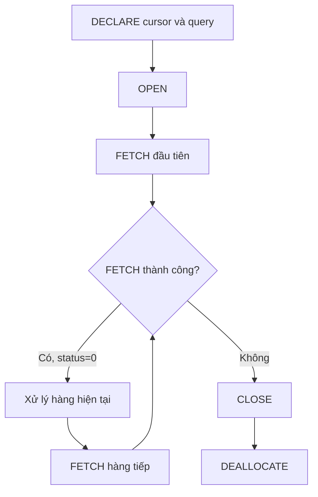

# SQL 15 · Cursor: vòng đời và cách xử lý từng hàng

> Nguồn: **4B slide 31–36**. Mục tiêu: viết cursor có FETCH khởi đầu/cập nhật, giải thích trạng thái và biết lúc nào một SELECT/UPDATE theo tập đơn giản hơn.

## 1. Cursor giải quyết thao tác từng hàng

SQL thường làm trên tập: một UPDATE thay đổi mọi hàng thỏa WHERE. Cursor cung cấp cơ chế lấy từng hàng từ result set để xử lý theo trình tự. Ví dụ cần gọi một thao tác theo từng đối tượng với logic tuần tự riêng. Không dùng cursor chỉ vì đã quen vòng for; nhiều bài cộng tổng, lọc và cập nhật có lời giải set-based ngắn hơn.



DECLARE định nghĩa; OPEN chuẩn bị/mở tập; FETCH đưa cột vào biến; CLOSE đóng result set; DEALLOCATE bỏ tham chiếu/tài nguyên cursor theo quy tắc. CLOSE và DEALLOCATE có vai trò khác nhau, nên học đủ cả hai.

## 2. Ví dụ tương thích schema COMPANY

```tsql
CREATE OR ALTER PROCEDURE course.PrintEmployee_Cursor
AS
BEGIN
 SET NOCOUNT ON;
 DECLARE @ssn char(9),@name nvarchar(70),@counter int=0;
 DECLARE EmployeeCursor CURSOR LOCAL FAST_FORWARD FOR
  SELECT Ssn,CONCAT(Fname,N' ',Lname)
  FROM course.EMPLOYEE ORDER BY Ssn;

 OPEN EmployeeCursor;
 FETCH NEXT FROM EmployeeCursor INTO @ssn,@name;
 WHILE @@FETCH_STATUS=0
 BEGIN
  IF @counter=0 PRINT N'EmployeeSSN'+NCHAR(9)+N'Name';
  PRINT @ssn+NCHAR(9)+@name;
  SET @counter=@counter+1;
  FETCH NEXT FROM EmployeeCursor INTO @ssn,@name;
 END;
 CLOSE EmployeeCursor;
 DEALLOCATE EmployeeCursor;
 SELECT @counter AS PrintedRows;
END;
GO
EXEC course.PrintEmployee_Cursor;
GO
```

Fixture mới in 9 dòng nhân viên, header một lần và PrintedRows=9. SSN giữ CHAR(9), khác slide dùng @v_empID INT cho SSN; chuỗi bảo toàn số 0 đầu. Dùng ORDER BY Ssn để trình tự dễ kiểm chứng. Không có ORDER BY thì không hứa thứ tự in.

LOCAL giới hạn phạm vi; FAST_FORWARD phù hợp duyệt tới và chỉ đọc. Không lấy cursor này để thử FETCH PRIOR/FIRST/LAST; muốn các hướng đó cần cursor hỗ trợ SCROLL và loại thích hợp.

## 3. Những trạng thái trong slide 35

| Thành phần | Ý nghĩa | Cần nhớ |
|---|---|---|
| FETCH NEXT | Hàng sau vị trí hiện tại | Dùng với forward-only |
| FETCH PRIOR | Hàng trước | Cần loại cursor hỗ trợ |
| FETCH FIRST/LAST | Hàng đầu/cuối | Không dùng tùy ý với FAST_FORWARD |
| @@FETCH_STATUS=0 | Lần FETCH gần nhất thành công | Kiểm ngay sau FETCH |
| @@FETCH_STATUS=-1 | FETCH thất bại hoặc vượt result set | Vòng lặp thông thường dừng |
| @@FETCH_STATUS=-2 | Hàng được fetch bị thiếu theo tình huống cursor | Không coi là một hàng hợp lệ |
| @@FETCH_STATUS=-9 | Chưa thực hiện FETCH theo trạng thái tương ứng | Không dùng thay lần fetch đầu |
| @@CURSOR_ROWS | Thông tin số hàng của cursor mở gần nhất | Có thể âm/0 tùy loại/trạng thái, không luôn tổng chính xác |
| CURSOR_STATUS(...) | Trạng thái theo tên/phạm vi cursor | Khác @@FETCH_STATUS |

@@FETCH_STATUS phản ánh FETCH gần nhất của **bất kỳ cursor trên connection**. Nếu body gọi procedure khác và procedure đó FETCH cursor riêng, trạng thái có thể đổi. Không kiểm một giá trị đã bị FETCH khác ghi đè rồi tưởng là trạng thái của cursor hiện tại.

## 4. Trace ba lỗi hay gặp

| Lỗi | Hậu quả | Cách sửa |
|---|---|---|
| Thiếu FETCH đầu tiên | Chưa có hàng hiện tại đúng để xử lý | FETCH trước WHILE |
| Thiếu FETCH ở cuối body | Lặp mãi cùng hàng/trạng thái | Tiến cursor mỗi lượt |
| INTO sai số cột/thứ tự/kiểu | Lỗi hoặc chuyển đổi sai dữ liệu | Query 2 cột thì cần 2 biến phù hợp |
| CONTINUE trước FETCH tiếp | Có thể lặp vô hạn | Bảo đảm mọi nhánh tiến cursor |
| Lỗi giữa vòng nhưng không cleanup | Giữ tài nguyên lâu hơn cần thiết | Cleanup trong nhánh lỗi và ném lại |

Nếu SELECT không có hàng, FETCH đầu thất bại và WHILE không chạy; không phải một lượt xử lý biến NULL. Header đặt trong body cũng không xuất hiện ở result set rỗng; nếu muốn luôn có header, in trước OPEN/loop.

## 5. So sánh set-based

Thay vì cursor cộng 10% cho từng người Research:

```tsql
UPDATE course.EMPLOYEE SET Salary=Salary*1.10 WHERE Dno=5;
```

Thay vì cursor chỉ in danh sách để người dùng xem:

```tsql
SELECT Ssn,CONCAT(Fname,N' ',Lname) AS FullName
FROM course.EMPLOYEE ORDER BY Ssn;
```

Hai query này dễ đọc và DBMS có thể tối ưu theo tập. Cursor có thêm chi phí từng FETCH/xử lý và cần cleanup; không đưa cursor vào trigger để thay thế một phép SUM/join theo tập khi không có lý do.

## 6. Cleanup khi lỗi

Script `05-cursor.sql` bọc thao tác OPEN/FETCH/loop trong TRY...CATCH. Khi có lỗi, kiểm CURSOR_STATUS để CLOSE nếu đang mở, DEALLOCATE nếu còn cursor hợp lệ, rồi THROW lại. Không gọi CLOSE mù khi cursor chưa OPEN và làm mất lỗi ban đầu bằng lỗi cleanup mới.

## 7. Bài tập

1. Cursor SELECT 0 hàng thì body chạy bao nhiêu lần?
2. Vì sao CLOSE chưa diễn tả cùng việc với DEALLOCATE?
3. FETCH NEXT thành công rồi gọi procedure FETCH cursor khác, @@FETCH_STATUS còn chắc thuộc cursor đầu không?
4. Dùng FAST_FORWARD rồi FETCH LAST có đúng không?

<details><summary>Lời giải</summary>

1. 0 lần nếu mẫu FETCH đầu/WHILE đúng.
2. CLOSE đóng tập đang mở; DEALLOCATE bỏ tham chiếu cursor và giải phóng theo cơ chế của hệ.
3. Không. Đó là trạng thái global trên connection cho lần FETCH gần nhất.
4. Không, FAST_FORWARD chỉ duyệt tới, cần loại hỗ trợ hướng di chuyển đó.

</details>

Tham khảo: [@@FETCH_STATUS](https://learn.microsoft.com/en-us/sql/t-sql/functions/fetch-status-transact-sql?view=sql-server-ver17), [DECLARE CURSOR](https://learn.microsoft.com/en-us/sql/t-sql/language-elements/declare-cursor-transact-sql?view=sql-server-ver17), [@@CURSOR_ROWS](https://learn.microsoft.com/en-us/sql/t-sql/functions/cursor-rows-transact-sql?view=sql-server-ver17).
