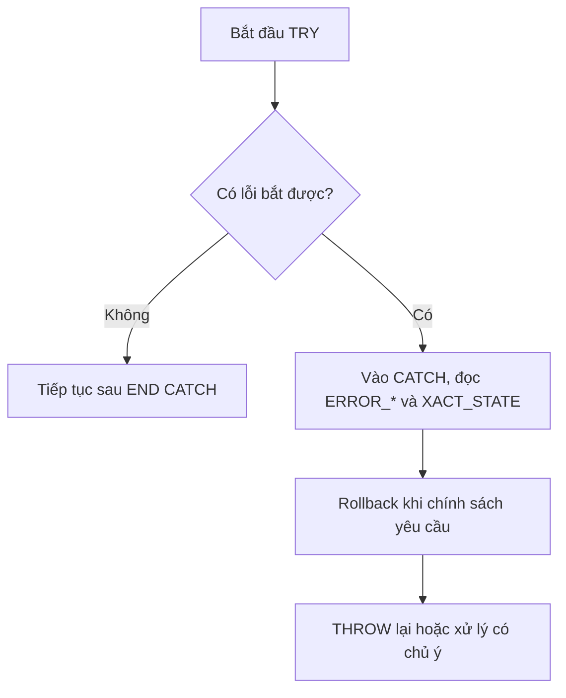

# SQL 16 · THROW, RAISERROR, TRY...CATCH và rollback

> Nguồn: **4B slide 37–49**, gồm bảng ở dạng ảnh slide 39–40, 47–48. Mục tiêu: phân biệt thông báo và exception, giữ nguyên lỗi gốc, xử lý transaction còn mở/không thể commit.

## 1. Lỗi và thông báo không giống nhau

PRINT chủ yếu gửi thông điệp cho client. Nó không tự ngăn dữ liệu sai hay báo exception theo hợp đồng của caller. RAISERROR cho nhiều mức severity; THROW tạo/ném lại exception theo cú pháp riêng. CATCH không tự đồng nghĩa rollback.



Không phải mọi lỗi đều bị bắt ở cùng cấp: lỗi biên dịch/cú pháp tại cấp đó, hủy từ client, lỗi làm ngắt kết nối... có những giới hạn. TRY/CATCH phải ở cùng batch; không chèn GO giữa TRY và CATCH. END TRY phải nối trực tiếp với BEGIN CATCH tương ứng.

## 2. THROW tạo lỗi mới

```tsql
THROW 50010,N'Student ID cannot be NULL.',1;
```

| Tham số | Quy tắc |
|---|---|
| error_number | INT từ 50000 đến 2147483647 khi tạo lỗi mới |
| message | NVARCHAR tối đa theo giới hạn THROW (2048 ký tự) |
| state | 0..255, giúp phân biệt vị trí/ngữ cảnh |

Câu lệnh trước THROW phải kết thúc bằng dấu chấm phẩy; nên kết thúc mọi statement rõ ràng. THROW tạo lỗi mới có severity 16. Không cần đăng ký error_number trong sys.messages. Message không nhận printf placeholder để tự thay `%d`; dùng FORMATMESSAGE/ghép chuỗi theo cách phù hợp trước rồi truyền biến.

```tsql
BEGIN TRY
 DECLARE @studentID int=NULL;
 IF @studentID IS NULL
  THROW 50010,N'Student ID cannot be NULL.',1;
END TRY
BEGIN CATCH
 SELECT ERROR_NUMBER() AS ErrorNumber,
        ERROR_MESSAGE() AS ErrorMessage,ERROR_STATE() AS ErrorState;
END CATCH;
```

Trả 50010, thông báo đã đặt, state 1. Vì CATCH xử lý và không THROW lại, caller không còn nhận lỗi theo cùng cách như exception không xử lý. Nếu ứng dụng cần biết thất bại, phải báo lại bằng hợp đồng tường minh.

## 3. THROW; giữ lỗi gốc

```tsql
BEGIN TRY
 DECLARE @x int=10/0;
END TRY
BEGIN CATCH
 SELECT ERROR_NUMBER() AS ErrorNumber,ERROR_MESSAGE() AS Message;
 THROW;
END CATCH;
```

Lỗi chia cho 0 được ghi thông tin rồi ném lại. `THROW;` không tham số chỉ dùng khi có lỗi đang xử lý trong CATCH, giữ thông tin lỗi gốc. Ngoài CATCH, `THROW;` không có exception để ném lại. `THROW 50001,...` trong CATCH tạo lỗi mới, khác ném lại nguyên lỗi.

## 4. RAISERROR: cú pháp và tùy chọn

```tsql
RAISERROR(N'Không tìm thấy nhân viên %s.',16,1,'000000000');
RAISERROR(N'Đang xử lý bước %d.',10,1,2) WITH NOWAIT;
```

| Thành phần | Ý nghĩa |
|---|---|
| msg_str | Chuỗi message với placeholder như %s/%d |
| msg_id | ID đã có trong sys.messages nếu chọn cách này |
| severity | 0..25 theo quy tắc/quyền hạn |
| state | 0..255, phân biệt vị trí lỗi |
| arguments | Giá trị thay placeholder |
| WITH NOWAIT | Gửi message cho client ngay theo cơ chế của hệ |
| WITH SETERROR | Đặt @@ERROR/ERROR_NUMBER theo cơ chế RAISERROR kể cả mức thông báo tương ứng |
| WITH LOG | Ghi log theo cơ chế server, cần quyền phù hợp |

Ví dụ `sp_addmessage @msgnum=50001,@severity=16,@msgtext=N'Student ID %d not found.';` đăng ký message ở phạm vi server, cần quyền thích hợp; không nên chạy mù trên server dùng chung. Sau đăng ký có thể `RAISERROR(50001,16,2,1001)`. Azure SQL Database có khác biệt hỗ trợ so với SQL Server cài riêng.

### Severity cần hiểu theo điều kiện

| Mức | Cách đọc phục vụ bài học |
|---|---|
| 0–10 | Thông tin/cảnh báo, không chuyển vào CATCH chỉ vì RAISERROR mức này |
| 11–16 | Lỗi thường do user/ứng dụng, có thể bắt khi ở TRY và không ngắt connection |
| 17–18 | Lỗi tài nguyên/phần mềm tương ứng; không gộp mọi mức này thành “chỉ sysadmin được raise” |
| 19 | Mức nghiêm trọng, có điều kiện quyền/log khi RAISERROR |
| 20–25 | Fatal, có thể chấm dứt connection; không kỳ vọng CATCH còn chạy nếu kết nối đã mất |

RAISERROR mức 19–25 cần quyền cao và WITH LOG theo tài liệu SQL Server; không tạo demo fatal trong lab. Bảng slide 40 gộp 17–19 về quyền quá rộng. Bảng slide 48 ghi RAISERROR severity>=11 ngoài TRY như luôn dừng batch cũng quá đơn giản: **RAISERROR 16 ngoài TRY không tự là bảo đảm dừng mọi lệnh sau hoặc rollback transaction**.

Ngoài ra `RAISERROR(ERROR_MESSAGE(),16,1)` như ảnh slide không phải mẫu cú pháp nên dùng trực tiếp; gán ERROR_MESSAGE() vào biến rồi RAISERROR biến, hoặc dùng THROW; để giữ lỗi gốc.

## 5. So sánh để chọn đúng

| Điểm | RAISERROR | THROW |
|---|---|---|
| Error ID mới | msg_str thường báo 50000; msg_id phải đăng ký | ID>=50000 không cần sys.messages |
| Định dạng message | Có printf-style arguments | Chuẩn bị message trước |
| Severity | Chọn mức theo quyền | Mới:16; rethrow giữ severity gốc |
| Rethrow giữ đủ lỗi gốc | Tạo lại thường đổi number/line | THROW; trong CATCH |
| SET XACT_ABORT | Không tuân theo như THROW | Tuân theo |
| Thông điệp tiến độ NOWAIT | Có thể dùng | Không phải chức năng tiến độ |

Với code mới cần ném exception và rethrow, tài liệu Microsoft hướng đến THROW. RAISERROR vẫn quan trọng để đọc code/thi và gửi thông tin có severity phù hợp.

## 6. Sáu hàm thông tin lỗi

| Hàm | Nội dung |
|---|---|
| ERROR_NUMBER() | Mã lỗi |
| ERROR_SEVERITY() | Severity |
| ERROR_STATE() | State |
| ERROR_PROCEDURE() | Procedure/trigger nơi lỗi xảy ra, có thể NULL |
| ERROR_LINE() | Dòng phát sinh lỗi theo ngữ cảnh |
| ERROR_MESSAGE() | Chuỗi message đã định dạng |

Đọc trong CATCH để ghi/chẩn đoán. @@ERROR khác: nó phản ánh lỗi của statement vừa thực hiện và có thể bị câu tiếp theo thay đổi; nếu dùng thì lưu ngay. Đừng thực hiện một PRINT/SELECT rồi mới đọc @@ERROR của lệnh trước.

## 7. Transaction và XACT_STATE

| XACT_STATE() | Tình trạng | Có thể làm gì? |
|---:|---|---|
| 0 | Không có user transaction đang hoạt động | Không COMMIT/ROLLBACK như có transaction |
| 1 | Transaction còn có thể commit | Quyết định commit/rollback theo chính sách |
| -1 | Transaction không thể commit | Cần rollback toàn bộ; không tiếp tục ghi/commit |

TRY/CATCH chỉ chuyển điều khiển; transaction có thể vẫn mở hoặc uncommittable. `SET XACT_ABORT ON` ảnh hưởng cách lỗi runtime hủy transaction; THROW tuân theo, RAISERROR không tuân theo tương tự. Không viết mọi trường hợp thành “có lỗi là rollback tự động rồi”.

### Mẫu procedure sở hữu transaction

```tsql
CREATE OR ALTER PROCEDURE course.InsertDept
 @DNumber int,@DName nvarchar(30),
 @MgrSSN char(9)=NULL,@MgrStartDate date=NULL
AS
BEGIN
 SET NOCOUNT ON;
 SET XACT_ABORT ON;
 -- Hợp đồng ví dụ: gọi độc lập, không bên trong transaction của caller
 IF @@TRANCOUNT<>0
  THROW 50020,N'Hãy gọi InsertDept ngoài transaction đang mở.',1;
 BEGIN TRY
  BEGIN TRAN;
  INSERT INTO course.DEPARTMENT(Dname,Dnumber,Mgr_ssn,Mgr_start_date)
  VALUES(@DName,@DNumber,@MgrSSN,@MgrStartDate);
  COMMIT;
 END TRY
 BEGIN CATCH
  IF XACT_STATE()<>0 ROLLBACK;
  THROW;
 END CATCH;
END;
GO
```

Slide InsertDept bắt lỗi rồi RAISERROR lại message; mẫu này giữ error number/line bằng THROW. Liệt kê cột tránh phụ thuộc thứ tự. Hợp đồng không nhận ambient transaction là lựa chọn có chủ ý để minh họa quyền sở hữu ranh giới.

**Nếu phải chạy trong transaction caller:** cần theo dõi @@TRANCOUNT khi vào, chỉ BEGIN/COMMIT khi mình sở hữu, dùng savepoint khi phù hợp, xử lý XACT_STATE=-1 và truyền lỗi cho caller. Nested BEGIN TRAN trong SQL Server không tạo các transaction độc lập; một ROLLBACK không tên có thể rollback toàn bộ transaction ngoài. Không copy mẫu ROLLBACK mù vào thư viện dùng chung.

## 8. Checklist lập luận và bài tập

Trước một đoạn code, xác định: lỗi gì, severity, ở TRY hay ngoài, CATCH có rethrow không, transaction do ai mở và XACT_STATE còn gì. Không cần nhớ một câu khẩu hiệu cho mọi tình huống.

1. RAISERROR severity 10 trong TRY có vào CATCH không?
2. THROW; khác THROW 50001,N'...',1 trong CATCH thế nào?
3. Chỉ thêm TRY/CATCH có bảo đảm UPDATE trước lỗi bị hoàn tác không?
4. XACT_STATE=-1 có COMMIT được không?
5. Dùng RAISERROR lại ERROR_MESSAGE có giữ error number gốc không?

<details><summary>Lời giải</summary>

1. Không chỉ vì message severity 10, đây là thông tin.
2. THROW; rethrow lỗi hiện tại, còn dạng ba tham số tạo lỗi mới.
3. Không. Cần ranh giới transaction, cơ chế xử lý lỗi và rollback có chủ ý.
4. Không, phải rollback toàn bộ transaction không thể commit.
5. Không mặc định; RAISERROR chuỗi thường tạo số lỗi 50000 và vị trí mới. Dùng THROW; khi mục tiêu là giữ lỗi gốc.

</details>

Nguồn đối chiếu: [THROW](https://learn.microsoft.com/en-us/sql/t-sql/language-elements/throw-transact-sql?view=sql-server-ver17), [RAISERROR](https://learn.microsoft.com/en-us/sql/t-sql/language-elements/raiserror-transact-sql?view=sql-server-ver17), [TRY...CATCH](https://learn.microsoft.com/en-us/sql/t-sql/language-elements/try-catch-transact-sql?view=sql-server-ver17), [XACT_ABORT](https://learn.microsoft.com/en-us/sql/t-sql/statements/set-xact-abort-transact-sql?view=sql-server-ver17).
