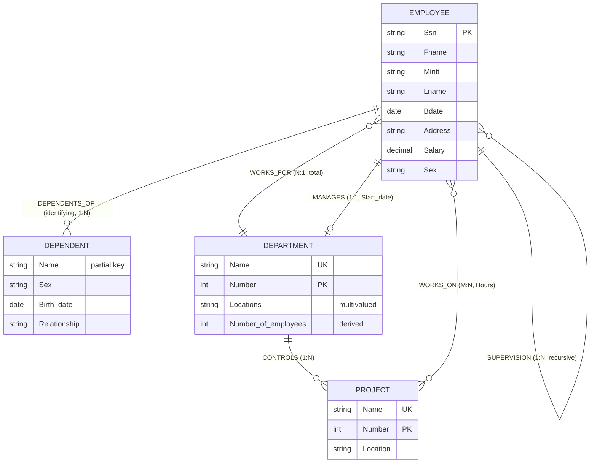

# Chương 2: Mô hình Thực thể–Mối liên kết — Entity-Relationship (ER) Model

> **Nguồn:** CO2013 Database Systems, HCMUT — Giảng viên: TS. Trần Minh Quang
> **Giáo trình tham khảo:** Elmasri & Navathe, *Fundamentals of Database Systems*, 7th Edition (chương 7).
> **Số slide trong PDF gốc:** 91. Slide Contents lặp lại (slide 2, 3, 4, 11, 17, 20, 54, 69, 79, 88) đã được gộp thành 1 mục lục duy nhất.
> **Mục tiêu:** Sinh viên năm 2 chưa từng học CSDL — đọc bản này một mạch là hiểu được toàn bộ chương ER, vẽ được ERD, sẵn sàng làm Lab 1 và phần ER của BTL1, KHÔNG cần mở slide gốc hay sách Elmasri.

---

## 0. Trước khi bắt đầu

### 0.1. Bạn cần biết gì trước? (Prerequisite)

Chương ER đứng trên vai chương 0 và 1. Hãy nhớ lại nhanh các concept sau:

| Concept | Nhớ trong 1 câu | Vì sao cần cho chương 2? |
|---|---|---|
| **Database (CSDL)** | Tập dữ liệu liên quan logic, dùng chung — không phải file Excel rời. | ERD quyết định *dữ liệu nào* cần lưu. |
| **DBMS** | Phần mềm trung gian giữa user và dữ liệu (PostgreSQL, MySQL…). | ERD chưa phụ thuộc DBMS — đó là điểm mạnh. |
| **Schema vs Instance** | Schema = bản thiết kế; Instance = dữ liệu cụ thể. | ERD chính là một *conceptual schema*. |
| **3-level architecture** | External / Conceptual / Internal. | Chương này chỉ làm việc ở tầng **Conceptual**. |
| **Set theory & logic** (toán rời rạc) | Tập, phần tử ∈ tập, tích Descartes. | *Entity set* và *relationship set* về bản chất là tập. |
| **Lập trình cơ bản** (C/C++/Python) | Quen `struct` / `class`. | Entity ≈ "struct trừu tượng" trước khi biết lưu thế nào. |

> 💡 **Hiểu đơn giản:** Chương 1 cho biết "CSDL là gì, kiến trúc tổng thể"; chương 2 này cho biết **bước đầu tiên khi tự thiết kế** một CSDL: vẽ "bản phối cảnh" — tức ER diagram — trước khi gõ một dòng SQL nào.

### 0.2. Sau chương này bạn sẽ làm được gì? (Learning Outcomes)

Sau khi đọc xong, bạn có thể:

1. Phân biệt **Database design** vs **Application design**.
2. Đọc thuộc 4 pha thiết kế CSDL: **Requirements → Conceptual → Logical → Physical**, biết ER nằm ở pha nào.
3. Đọc một đoạn requirements (Anh/Việt) và **identify** entities, attributes, relationships, constraints.
4. Phân biệt 4 loại attribute: **simple / composite / multi-valued / derived** (+ complex).
5. Phân biệt **entity / entity type / entity set**, biết cách xác định **key**.
6. Vẽ được ERD đúng quy ước Elmasri-Navathe (chữ nhật, oval, hình thoi, gạch chân khóa, đường đôi).
7. Phân biệt **strong vs weak entity**, biết khi nào dùng **identifying relationship** + **partial key**.
8. Hiểu **degree** của relationship (binary / ternary / n-ary), **recursive relationship** với role names.
9. Đặt được **cardinality ratio** (1:1, 1:N, M:N) và **participation constraint** (total/partial).
10. Sử dụng **(min, max) notation** thay cho cardinality ratio truyền thống.
11. Đọc được **UML class diagram** và biết tương ứng với ER thế nào.
12. Nhận diện và sửa **Fan Trap** + **Chasm Trap** — hai cái bẫy thiết kế kinh điển.

### 0.3. Lộ trình đọc đề xuất

| Section | Mức | Phút | Ưu tiên |
|---|---|---:|---|
| 1. Database Design Process | CORE | 15 | Phải đọc — biết ER ở pha nào |
| 2. Sample DB COMPANY | CORE | 15 | Schema chạy XUYÊN SUỐT cả môn |
| 3. ER Model — What & Why | CORE | 10 | Định nghĩa & motivation |
| 4. ER Model Concepts | **CORE NẶNG NHẤT** | 60 | ~50% chương — đọc thật kỹ |
| 5. ER Diagram & Naming + Case studies | CORE | 25 | Vẽ thực hành |
| 6. Alternative Notations | CORE | 20 | (min,max) chắc ra thi |
| 7. Problems with ER Models | CORE | 20 | Fan/Chasm trap — phân biệt cao |
| TH2-TH4 (Bảng tra nhanh, Sai lầm, Bài tập) | EXAM | 30 | Trước thi cuối kỳ |

Tổng: ≈ 195 phút (≈ 3h15'). Lần đầu đọc, đừng cố nhớ mọi notation — đọc hết section 4 thật kỹ trước, các section 5–7 sẽ tự nhiên trực quan.

---

## 1. Overview of Database Design Process — Tổng quan quy trình thiết kế CSDL

### 1.1. Tại sao có quy trình này? (Motivation)

Khi một công ty nói "tôi muốn quản lý nhân viên, phòng ban, dự án", nếu lập trình viên nhảy thẳng vào `CREATE TABLE` thì 90% trường hợp phải đập đi xây lại: thiếu bảng, sai khóa, sai cardinality. → Cần một **quy trình** chia thiết kế thành các pha rõ ràng, mỗi pha có *deliverable* và mức độ phụ thuộc DBMS khác nhau. **ER model** là công cụ chính của pha "Conceptual Design".

### 1.2. Hai luồng song song

- **Database design** — thiết kế *conceptual schema* (slide 5).
- **Applications design** — thiết kế *programs and interfaces* truy cập database; coi là một phần của software engineering (slide 5).

Hai luồng gặp nhau khi triển khai. Trong môn này ta học luồng *database design*.

### 1.3. Diagram quy trình tổng thể

> 📊 **Hình 1.1 — Database Design Process (slide 6–10):**

```
                     ┌───────────┐
                     │ Miniworld │
                     └─────┬─────┘
                           ▼
              ┌────────────────────────────┐
              │ REQUIREMENTS – COLLECTION  │
              │       & ANALYSIS           │
              └──┬───────────────────┬─────┘
                 │ Functional req.   │ Data requirements
                 ▼                   ▼
       ┌──────────────────┐ ┌─────────────────┐
       │ FUNCTIONAL       │ │ CONCEPTUAL      │ ◄── ER MODEL ở đây!
       │ ANALYSIS         │ │ DESIGN          │
       └────────┬─────────┘ └────────┬────────┘
                │                    │ Conceptual schema
                │                    ▼
                │           ┌──────────────────┐
                │           │ LOGICAL DESIGN   │  DBMS-independent ↑
                │           │ (DATA MODEL      │ ─────────────────
                │           │  MAPPING)        │  DBMS-specific ↓
                │           └────────┬─────────┘
                │                    │ Database schema
                ▼                    ▼
       ┌──────────────────┐ ┌──────────────────┐
       │ APPLICATION      │◄│ PHYSICAL DESIGN  │
       │ PROGRAM DESIGN   │ └────────┬─────────┘
       └────────┬─────────┘          │ Internal schema
                ▼                    ▼
       ┌──────────────────┐
       │ TRANSACTION      │
       │ IMPLEMENTATION   │
       └────────┬─────────┘
                ▼
         Application program
```

> 📊 **Đọc diagram:** Cột phải = thiết kế CSDL; cột trái = thiết kế chương trình. Đường ngang đứt nét chia 2 vùng: trên — *DBMS-independent* (không phụ thuộc Oracle/MySQL/Postgres), dưới — *DBMS-specific* (đã chọn DBMS rồi). **ER model phục vụ pha Conceptual Design**: input là Data requirements, output là **Conceptual schema** (chính là ER diagram).

### 1.4. Bốn pha — đặc điểm và ví dụ

| Pha | Slide | Đầu vào | Đầu ra | Đặc điểm |
|---|---:|---|---|---|
| **1. Requirements collection & analysis** | 7 | Phỏng vấn user | Data req. + Functional req. | Ngôn ngữ tự nhiên |
| **2. Conceptual design** | 8 | Data requirements | Conceptual schema (ERD) | Mô tả entity types, relationships, constraints — **DBMS-independent** |
| **3. Logical design (Data Model Mapping)** | 9 | Conceptual schema | Database schema (relational) | Thường được auto/semi-auto bởi tool |
| **4. Physical design** | 10 | Database schema | Internal schema | Storage structure, indexes, access path |

> 💡 **Ví dụ 1.1 — Cùng một câu yêu cầu chạy qua 4 pha:**
> Câu: *"The company is organized into departments."*
> - **Pha 1 (Requirements):** ghi nhận: công ty có "phòng ban" — chưa nói gì về DBMS hay bảng.
> - **Pha 2 (Conceptual):** tạo entity type `DEPARTMENT` với `Dname`, `Dnumber`, `Locations`; tạo relationship `MANAGES` giữa EMPLOYEE và DEPARTMENT.
> - **Pha 3 (Logical):** map sang quan hệ `DEPARTMENT(Dname, Dnumber, Mgr_ssn, Mgr_start_date)` — đã chọn relational model.
> - **Pha 4 (Physical):** tạo `B-tree index trên Dnumber` (vì hay query theo số phòng); chọn file organization phù hợp.
>
> **Kết quả:** một câu yêu cầu trừu tượng đi tận đến index cụ thể, qua 4 pha riêng biệt.

> 💡 **Hiểu đơn giản:** Quy trình giống xây nhà:
> - Pha 1 = nói chuyện với chủ nhà xem cần phòng gì.
> - Pha 2 = vẽ phối cảnh & layout (ERD = bản phối cảnh).
> - Pha 3 = vẽ bản vẽ kỹ thuật (relational schema).
> - Pha 4 = chọn vật liệu xây thật (file organization, index).
>
> Đập đi vẽ lại pha 2 thì rẻ; đập đi xây lại pha 4 thì rất đắt → **đầu tư công vào pha conceptual**.

> 📝 **Tóm lại section 1:**
> - Database design ≠ application design (2 luồng song song).
> - 4 pha: **Requirements → Conceptual → Logical → Physical**.
> - **ER thuộc pha Conceptual** — DBMS-independent.
> - **Một câu ghi nhớ:** *"ER là bản vẽ phối cảnh — vẽ trước khi đào móng."*

> ❓ **Tự kiểm tra section 1:**
> 1. Pha nào phụ thuộc DBMS cụ thể? Pha nào không?
> 2. Phân biệt "Data requirements" và "Functional requirements".
> 3. Nếu đổi từ MySQL sang PostgreSQL, ERD có phải vẽ lại không? Vì sao?

---

## 2. A Sample Database Application — CSDL mẫu COMPANY

### 2.1. Tại sao có section này?

Slide 12 nói thẳng: thiết kế database cho COMPANY (nhân viên, phòng ban, dự án) → Requirements collection. Đây không phải ví dụ ngẫu nhiên — schema **COMPANY** chạy **xuyên suốt** từ chương 2 → 7 (ER, EER, mapping sang relational, RA, SQL, FD). Học một lần, dùng cả môn.

### 2.2. Yêu cầu CSDL COMPANY

Sau khi phỏng vấn user, ta thu được Data requirements gồm 4 nhóm: **Entities, Attributes, Relationships, Constraints** (slide 12).

**Tóm tắt requirements (slide 13–14):**

- COMPANY tổ chức thành **DEPARTMENTs**. Mỗi department có: **tên duy nhất, số duy nhất**, một employee *manages* department, **start date** của manager, có thể có nhiều **locations**.
- Mỗi department *controls* các **PROJECTs**. Mỗi project có: tên duy nhất, số duy nhất, một single location.
- Lưu **EMPLOYEE**: name, SSN, address, salary, sex, birth date. Mỗi employee thuộc *một* department (assigned), có thể *làm trên nhiều* projects (không nhất thiết do cùng department kiểm soát). Lưu **số giờ/tuần** mỗi employee làm trên mỗi project. Lưu **direct supervisor** của mỗi employee.
- Lưu **DEPENDENTs** của mỗi employee: first name, sex, birth date, relationship.

### 2.3. Phân tích requirements

| Loại | Rút từ | Trên COMPANY |
|---|---|---|
| **Entity type** | Danh từ in hoa | EMPLOYEE, DEPARTMENT, PROJECT, DEPENDENT |
| **Attribute** | Tính chất mô tả | Name, Ssn, Salary, Locations, Hours |
| **Relationship type** | Động từ liên hệ | WORKS_FOR, MANAGES, CONTROLS, WORKS_ON, SUPERVISION, DEPENDENTS_OF |
| **Constraint** | Từ "unique", "must", "may", "several" | Dnumber duy nhất; mỗi employee thuộc đúng 1 phòng |

### 2.4. ERD COMPANY hoàn chỉnh (figure huyền thoại — slide 15, 22, 34, 48, 53, 59)

Đây là figure xuất hiện ~6 lần trong chương — chính là Figure 7.2 trong Elmasri 7e. Tái tạo bằng Mermaid + bảng.

**Entity types:**

| Entity | Loại | Attributes |
|---|---|---|
| **EMPLOYEE** | Strong | Ssn (key), Name (composite: Fname, Minit, Lname), Bdate, Address, Salary, Sex |
| **DEPARTMENT** | Strong | Name (key), Number (key — 2 candidate keys), Locations (multivalued), Number_of_employees (derived) |
| **PROJECT** | Strong | Name (key), Number (key), Location |
| **DEPENDENT** | **Weak** | Name (partial key), Sex, Birth_date, Relationship |

**Relationship types:**

| Relationship | Giữa | Cardinality | Participation | Attribute |
|---|---|---|---|---|
| **WORKS_FOR** | EMPLOYEE — DEPARTMENT | N : 1 | Total cả hai | — |
| **MANAGES** | EMPLOYEE — DEPARTMENT | 1 : 1 | EMPLOYEE partial, DEPARTMENT total | Start_date |
| **CONTROLS** | DEPARTMENT — PROJECT | 1 : N | DEPARTMENT partial, PROJECT total | — |
| **WORKS_ON** | EMPLOYEE — PROJECT | M : N | Total cả hai | Hours |
| **SUPERVISION** | EMPLOYEE — EMPLOYEE (recursive) | 1 : N | Cả hai partial | role: Supervisor / Supervisee |
| **DEPENDENTS_OF** | EMPLOYEE — DEPENDENT | 1 : N | DEPENDENT total (identifying) | — |



> 📊 **Đọc diagram này thế nào:**
> - 4 ô chữ nhật = 4 entity types. **DEPENDENT có viền đôi** (weak entity).
> - Oval gắn vào ô chữ nhật = attribute. **Oval gạch chân** = key (Ssn, Number).
> - **Oval nét đôi** = multivalued (Locations). **Oval nét đứt** = derived (Number_of_employees).
> - **Oval nối oval** = composite (Name → {Fname, Minit, Lname}).
> - 6 hình thoi = 6 relationship types. **DEPENDENTS_OF có viền đôi** (identifying).
> - Số `N`, `1`, `M` cạnh hình thoi = cardinality ratio.
> - **Đường đôi** = total participation; **đường đơn** = partial.
> - **SUPERVISION** nối EMPLOYEE với chính nó (recursive); 2 vai: `Supervisor` + `Supervisee`.

### 2.5. Case study Group A & Group B (slide 16)

- **GROUP A:** course registration của HCMUT.
- **GROUP B:** Library của một University.

Hai case này sẽ được dùng lại ở slide 35 (identify entity types), slide 60 (vẽ ERD).

> 📝 **Tóm lại section 2:**
> - Schema **COMPANY** = ví dụ chạy xuyên suốt môn. Phải thuộc 4 entity + 6 relationship.
> - Mọi ví dụ minh họa từ chương này trở đi nên dùng schema COMPANY thay vì bịa.
> - **Một câu ghi nhớ:** *"COMPANY có 4 entity và 6 relationship — thuộc trước, học sau."*

> ❓ **Tự kiểm tra section 2:**
> 1. DEPENDENT là strong hay weak entity? Vì sao?
> 2. Cardinality của MANAGES là gì? Participation 2 phía thế nào?
> 3. Tại sao `Hours` nằm trên relationship `WORKS_ON` mà không gắn vào EMPLOYEE hay PROJECT?

---

## 3. What is ER Model? And Why?

### 3.1. Tại sao có ER Model?

Bạn đã có Data requirements bằng tiếng Anh tự nhiên. Vấn đề: tiếng Anh **mơ hồ**. Câu "an employee works on several projects" — *several* là 2? 3? 100? *Mọi* nhân viên hay chỉ một số? Cần một **ngôn ngữ có cấu trúc** vừa đủ chính xác cho máy đọc, vừa trực quan cho stakeholder. Đó là ER model.

### 3.2. Định nghĩa (slide 18)

| Thuật ngữ | Tiếng Việt | Định nghĩa |
|---|---|---|
| **Entity-Relationship (ER) model** | Mô hình thực thể-mối liên kết | High-level conceptual data model phổ biến — *logical organisation* of data trong database system |
| **ER Diagram (ERD)** | Sơ đồ ER | Diagrammatic notation đi kèm ER model — tập ký hiệu hình học (ô vuông, oval, hình thoi…) |
| **Conceptual Design** | Thiết kế ý niệm | Quá trình *Data requirements → Conceptual Schema (ERD)* |

### 3.3. Tại sao dùng ER? — 5 lý do (slide 19)

1. User requirements được *specified formally & unambiguously* (đặc tả hình thức và không nhập nhằng).
2. *Easily understood* bởi ordinary users (non-technical).
3. *An effective bridge* giữa user requirements và logical database design / implementation.
4. *Independent of any particular DBMS* (không phụ thuộc DBMS cụ thể).
5. *Does not involve any physical or implemental details* (không dính chi tiết vật lý).

### 3.4. Ví dụ minh họa & Analogy

> 💡 **Ví dụ 3.1:** Câu "Nhân viên làm việc cho phòng ban".
> - Tiếng Anh: *"An employee works for a department."*
> - ER: `EMPLOYEE ──(N)── WORKS_FOR ──(1)── DEPARTMENT`, đường đôi cả 2 phía.
> - **Đọc lại từ ER:** "Mỗi employee bắt buộc thuộc đúng 1 department; mỗi department bắt buộc có ≥ 1 employee." — đã hết mơ hồ.

> 💡 **Hiểu đơn giản:** ER model giống **bản phối cảnh kiến trúc** trong xây nhà — đủ trực quan để chủ nhà ngắm và sửa, đủ chính xác để kỹ sư biến thành bản vẽ kỹ thuật. Hoặc giống **bản đồ metro**: không cần biết đường ray xây thế nào, chỉ cần biết ga nào nối ga nào.

> 📝 **Tóm lại section 3:**
> - ER = high-level conceptual data model.
> - ERD = diagrammatic notation.
> - Conceptual Design = "dịch" requirements text → ERD.
> - 5 ưu điểm: formal, dễ hiểu, cầu nối, độc lập DBMS, không vướng physical detail.
> - **Một câu ghi nhớ:** *"ER chính xác cho máy, trực quan cho người."*

> ❓ **Tự kiểm tra section 3:**
> 1. ER thuộc pha thiết kế nào?
> 2. ER có phụ thuộc Oracle/MySQL/PostgreSQL không? Tại sao đây là ưu điểm?
> 3. "ER model" và "ER diagram" khác nhau thế nào?

---

## 4. ER Model Concepts

> Đây là **section dài nhất, quan trọng nhất** của chương. ER model mô tả dữ liệu bằng 3 trụ cột: **Entities, Attributes, Relationships** (slide 21). Ghim 3 từ này vào đầu — mọi thứ sau đều xoay quanh chúng.

### 4.1. Entity (thực thể) — slide 23

#### 4.1.1. Tại sao có concept này?

Khi mô tả thế giới, ta luôn nói về *các thứ*: con người, cái xe, đơn hàng. Mỗi *thứ* có thể tồn tại độc lập, ta muốn nhớ thông tin của nó. **Entity** là cách CSDL gọi tên một "thứ" như vậy. Không có concept entity, ta chỉ có những trường dữ liệu rời — không cách nào ràng buộc "Salary này thuộc người nào".

#### 4.1.2. Định nghĩa

- **Entity** = thing in real world with **independent existence**.
- Có thể là:
  - **Physical existence**: a person, a car, a house, an employee.
  - **Conceptual existence**: a company, a job, a university course.
- Examples in COMPANY: EMPLOYEE *John Smith*, *Research* DEPARTMENT, *ProductX* PROJECT.

> 💡 **Hiểu đơn giản:** Entity ≈ một danh từ riêng có thể "cầm nắm" về mặt khái niệm. "John Smith" là entity; "55 tuổi" thì không — "55 tuổi" chỉ là *thuộc tính*. Cách phân biệt nhanh: **nếu không thể tồn tại độc lập, đó không phải entity.**

### 4.2. Attribute (thuộc tính) — slide 24

#### 4.2.1. Định nghĩa

- **Attributes** = properties described an entity.
- Một specific entity sẽ **có một giá trị** cho mỗi attribute.
- Mỗi attribute có **a value set / data type** đi kèm.

#### 4.2.2. Hình minh họa (slide 25)

> 📊 **Hình 4.1 — Two entities and their attributes:**

```
   EMPLOYEE e1                         COMPANY c1
   ─────────────                       ──────────────
   Name        = John Smith            Name         = Sunco Oil
   Address     = 2311 Kirby            Headquarters = Houston
                 Houston, TX 77001     President    = John Smith
   Age         = 55
   Home_phone  = 713-749-2630
```

> 📊 **Đọc diagram:** mỗi entity là 1 chấm; các đường tỏa ra là attribute với giá trị cụ thể. Đây là *instance*, không phải *type*. Sunco Oil's President (= John Smith) cũng là 1 entity khác — gợi ý sớm cho relationship.

### 4.3. Types of Attributes — 4 (+1) loại (slide 26)

| Loại | Định nghĩa | Ví dụ slide | Ký hiệu ERD |
|---|---|---|---|
| **Simple** | Một giá trị atomic duy nhất | SSN, Sex | Oval thường |
| **Composite** | Gồm nhiều thành phần | Name (Fname, Middle, Lname) | Oval nối với oval con |
| **Multi-valued** | Có nhiều giá trị | Colors of a Car {Color}, Phones {Phone} | Oval nét **đôi** |
| **Derived** | Suy ra từ attribute khác | Number of students in a class | Oval nét **đứt** |
| **Complex** | Tổ hợp composite + multi-valued | {Phone(CountryCode, Number)} | Kết hợp |

> 💡 **Hiểu đơn giản:**
> - **Simple** = 1 ô Excel.
> - **Composite** = 1 ô bị tách thành ô con (Họ – Đệm – Tên).
> - **Multi-valued** = 1 ô chứa list ({bóng đá, đọc sách, code}).
> - **Derived** = công thức Excel `=COUNT(...)` — không lưu, tính khi cần.
> - **Complex** = phối hợp 2 cái trên.

> 💡 **Ví dụ bổ sung trên COMPANY:** EMPLOYEE có Name (composite), Salary (simple), Phone (multivalued nếu cho phép nhiều số), Age (derived từ Bdate). Một entity có đủ 4 loại.

### 4.4. Entity Type vs Entity Set — slide 27

- **Entity Type** = collection / set of entities cùng attributes.
- Tập tất cả entity của 1 type tại 1 thời điểm = **Entity Set** (hay *Extension*).

> 📊 **Hình 4.2 — Entity Type vs Entity Set (slide 27):**

```
Entity Type:    EMPLOYEE                          COMPANY
Attributes:     Name, Age, Salary                 Name, Headquarters, President

Entity Set:
                ┌─────────────────────────┐      ┌──────────────────────────┐
                │ e1 ● (John Smith,55,80k)│      │ c1 ● (Sunco Oil, Houston,│
                │ e2 ● (Fred Brown,40,30K)│      │       John Smith)        │
                │ e3 ● (Judy Clark,25,20K)│      │ c2 ● (Fast Computer,     │
                │ ...                     │      │       Dallas, Bob King)  │
                └─────────────────────────┘      └──────────────────────────┘
```

> 💡 **Tương tự OOP:** Entity Type ≈ class definition; Entity ≈ object instance; Entity Set ≈ list-of-objects hiện tại.

### 4.5. Keys — Khóa (slide 28)

#### 4.5.1. Tại sao cần key?

Trong entity set có thể có hàng nghìn entity — làm sao chỉ đích xác **một** entity? Phải có (một hoặc nhiều) attribute mà giá trị **không trùng** giữa hai entity. Đó là *key*. Không có key → không thể nói "sửa tuổi của *nhân viên này*" mà không nhầm.

#### 4.5.2. Định nghĩa

- **Key / uniqueness constraint**: attributes có values **distinct** cho mỗi entity. Tính chất phải đúng cho **mọi** entity set của type (mọi instance — không chỉ tại 1 thời điểm).
- Một entity type có thể có **more than one key**. Ex: STUDENT có **Citizen ID** *và* **Student ID**.

> 💡 **Hiểu đơn giản — Primary Key:** giống **Số CCCD/CMND** — định danh duy nhất một công dân; ngay cả khi đổi tên, đổi địa chỉ, số CCCD vẫn cố định và duy nhất.

#### 4.5.3. Notation cho Entity Type, Attribute, Key (slide 29)

| Khái niệm | Ký hiệu trên ERD |
|---|---|
| **Entity type** | Hình chữ nhật |
| **Simple attribute** | Oval |
| **Composite attribute** | Oval nối oval con |
| **Multi-valued attribute** | Oval **viền đôi** |
| **Derived attribute** | Oval **viền đứt** |
| **Key attribute** | Oval với **tên gạch chân** |

#### 4.5.4. Ví dụ entity type CAR (slide 30)

> 📊 **Hình 4.3 — Entity Type CAR with two keys:**

```
                  ┌─────────────────────────┐
                  │ Registration            │  ← composite key
                  │   ┌─────────┬─────────┐ │     (gạch chân nguyên cụm)
                  │   │  State  │ Number  │ │
                  │   └─────────┴─────────┘ │
                  └─────────────────────────┘
                              │
   (Year)──────────────  ┌────────┐  ─────────────(Model)
                         │  CAR   │
   (Color) ═══════════   └────────┘   ──────────────(Make)
   ↑ multi-valued                     (Vehicle_id) ← simple key (gạch chân)
```

CAR(**Registration**(Number, State), **Vehicle_id**, Make, Model, Year, {Color})

| Instance | Registration | Vehicle_id | Make | Model | Year | Color |
|---|---|---|---|---|---:|---|
| CAR₁ | (ABC 123, TEXAS) | TK629 | Ford | Mustang, convertible | 2004 | {red, black} |
| CAR₂ | (ABC 123, NEW YORK) | WP9872 | Nissan | Maxima, 4-door | 2005 | {blue} |
| CAR₃ | (VSY 720, TEXAS) | TD729 | Chrysler | LeBaron, 4-door | 2002 | {white, blue} |

> 📊 **Đọc diagram:** CAR có **2 keys**. Hai dòng đầu cùng `Number = "ABC 123"` nhưng khác State (Texas vs New York) — không vi phạm uniqueness, vì key là *cặp* (Number, State). `Color` viền đôi → multi-valued (1 xe có thể có nhiều màu).

### 4.6. Identify Entity Types & Attributes (case COMPANY) — slide 31–35

Đây là phần *thực hành*. Đọc lại requirements ở slide 31, 32 (giống slide 13, 14 nhưng được highlight bằng màu):

- **Đỏ in hoa** (DEPARTMENTs, EMPLOYEE, PROJECTs, DEPENDENTs) → ứng viên Entity type.
- **Gạch chân xanh** ("unique name", "unique number", "Social Security number") → ứng viên Key.
- **Đậm xanh** (start date, address, salary, …) → ứng viên Attribute.

#### Initial Conceptual Design (slide 33) — Bản nháp ban đầu

Bản nháp có 4 entity vẽ riêng, **chưa có relationship**, nhưng có một số attribute "đáng ngờ" được khoanh đỏ — đó là attribute thực ra là *reference đến entity khác*:

| Entity nháp | Attribute thường | Attribute "đáng ngờ" (sẽ thành relationship) |
|---|---|---|
| EMPLOYEE | Name, Ssn, Sex, Salary, Birth_date, Address | **Department** (FK → DEPARTMENT), **Works_on/Project/Hours** (M:N → PROJECT), **Supervisor** (recursive) |
| DEPARTMENT | Name, Number, Locations | **Manager**, **Manager_start_date** (→ EMPLOYEE) |
| PROJECT | Name, Number, Location | **Controlling_department** (→ DEPARTMENT) |
| DEPENDENT | Dependent_name, Sex, Birth_date, Relationship | **Employee** (→ EMPLOYEE) |

> 📊 **Đọc diagram:** đây là *giai đoạn 1* — liệt kê tất cả attributes ngây thơ theo lời user. *Giai đoạn 2* (Final ERD slide 34) là khi nhận ra attributes khoanh đỏ thực ra là **mối liên kết** với entity khác, và refactor chúng thành relationship type. Đây là motivation tự nhiên cho phần Relationship sắp tới.

> 📝 **Tóm lại 4.1–4.6:**
> - **Entity** = "thứ" có sự tồn tại độc lập.
> - **Attribute** = thuộc tính, có 4+1 loại.
> - **Entity Type** = lớp; **Entity Set** = tập instance hiện tại.
> - **Key** = uniqueness constraint, có thể có nhiều keys/entity type.
> - **Quá trình "identify"** = liệt kê ngây thơ → refactor reference thành relationship.
> - **Một câu ghi nhớ:** *"Danh từ → Entity, Tính từ → Attribute, Động từ → Relationship."*

> ❓ **Tự kiểm tra:**
> 1. Phân biệt entity vs entity type vs entity set qua John Smith / EMPLOYEE / {e1, e2, …}.
> 2. Multi-valued attribute và Composite attribute khác nhau chỗ nào? Cho 1 ví dụ mỗi loại trên COMPANY.
> 3. Một entity type có thể có 0 key được không? Vì sao?

### 4.7. Relationships and Relationship Types — slide 36

#### 4.7.1. Tại sao có concept này?

Sau khi có entity + attribute, vấn đề tiếp theo: làm sao biểu diễn "John Smith *làm việc cho* phòng Research"? Nếu chỉ có entity, ta không có cách "nối" John Smith và Research — trừ khi nhồi `DepartmentName="Research"` vào EMPLOYEE (bản nháp slide 33). Cách đó sai vì "Research" không phải dữ liệu *của* nhân viên Lan, nó là *liên kết* tới một entity khác. → Cần concept tách biệt: **Relationship**.

#### 4.7.2. Định nghĩa

- **Relationship type R among n entity types E₁, …, Eₙ**: defines a set of associations (relationship set R) among entities.
- **Relationship instances rᵢ**: each rᵢ associates *n* individual entities (e₁, …, eₙ).
- **Examples:**
  - WORKS_FOR between EMPLOYEEs and DEPARTMENTs (relationship type).
  - EMPLOYEE *John Smith* **works on** PROJECT *ProductX* (relationship instance).

> 💡 **Tương tự với Entity:** *Relationship type* (WORKS_FOR) chứa *relationship instances* (John Smith works on ProductX) — chỉ khác là instance là một "cặp/bộ liên kết" thay vì 1 thực thể.

#### 4.7.3. Hình minh họa binary relationship (slide 37)

> 📊 **Hình 4.4 — Example WORKS_FOR (binary):**

```
   EMPLOYEE          WORKS_FOR        DEPARTMENT
   ─────────         ─────────        ──────────
     e1 ●─────r1───────────────────●  d1
     e2 ●─────r2───────────────────●  d1
     e3 ●─────r3───────────────────●  d2
     e4 ●─────r4───────────────────●  d2
     e5 ●─────r5───────────────────●  d2
     e6 ●─────r6───────────────────●  d3
     e7 ●─────r7───────────────────●  d3
                                            A binary relationship
```

> 📊 **Đọc diagram:** 3 oval lớn = 3 set: EMPLOYEE bên trái, WORKS_FOR ở giữa, DEPARTMENT bên phải. Mỗi `rᵢ` = "cặp liên kết" gồm 1 employee + 1 department. Binary vì mỗi instance gồm 2 entity.

#### 4.7.4. Degree of relationship type (slide 38)

- **Degree** = số entity types tham gia: **Binary** (2), **Ternary** (3), **n-ary** (n).
- Có thể có **nhiều hơn một relationship type** giữa cùng tập entity types: vd `EMPLOYEE—Works-for—DEPARTMENT` *và* `EMPLOYEE—Manages—DEPARTMENT`.

#### 4.7.5. Hình minh họa ternary (slide 39)

> 📊 **Hình 4.5 — Ternary SUPPLY:**

```
   SUPPLIER         SUPPLY            PROJECT
                                      ────────
     s1 ●        r1 ━━━━━━━━━━━●       j1
                 r2 ━━━━━━━━━━━●       j2
     s2 ●        r3 ━━━━━━━━━━━●       j3
                 r4 ━━━━━━━━━━━
                 r5 ━━━━━━━━━━━
   PART          r6 ━━━━━━━━━━━
   ────          r7 ━━━━━━━━━━━
     p1 ●
     p2 ●
     p3 ●  ← Mỗi rᵢ nối 3 entity: 1 supplier + 1 part + 1 project
```

#### 4.7.6. Recursive relationship + Role names (slide 40, 41)

- **Recursive** = same entity type tham gia *more than once* ở **các vai khác nhau**.
- Bắt buộc chỉ định **role**.
- Ex: SUPERVISION — EMPLOYEE (vai *supervisor/boss*) + (another) EMPLOYEE (vai *subordinate/worker*).

> 📊 **Hình 4.6 — Recursive SUPERVISION (slide 41):**

```
   EMPLOYEE                       SUPERVISION
   ────────
     e1 ─── vai 2 ───┐            r1
                     ├────────────●
     e1 ─── vai 1 ───┘
     e2 ─── vai 2 ───┐            r2
                     ├────────────●
     e3 ─── vai 1 ───┘
     e4 ─── vai 1 ───┐            r3
                     ├────────────●
     e1 ─── vai 2 ───┘

     1: supervisor (vai sếp)        2: supervisee (vai nhân viên dưới)
```

> 📊 **Đọc diagram:** cùng entity `e1` xuất hiện 2 lần — một lần ở vai supervisor, một lần ở vai supervisee. Tình huống recursive: "John Smith vừa là sếp của Mary, vừa là nhân viên của Bob".

> 💡 **Hiểu đơn giản:** recursive relationship giống mối quan hệ "*bố–con*" trong gia phả — cùng entity type Person, nhưng mỗi cặp có 2 vai khác nhau.

### 4.8. Constraints on Binary Relationship Type (slide 42, 45)

#### 4.8.1. Tại sao cần?

ER vẽ ra "có liên kết WORKS_FOR" là chưa đủ. User cần biết: 1 nhân viên thuộc *bao nhiêu* phòng? Có *bắt buộc* thuộc phòng nào không? Không trả lời 2 câu này, schema vẫn mơ hồ.

#### 4.8.2. Hai loại constraint

**Structural constraints** = cách *express semantics of relationship*. Gồm:
1. **Cardinality ratio** (tỉ số lượng).
2. **Participation constraint** (ràng buộc tham gia).

#### 4.8.3. Cardinality ratio (slide 42)

Specifies **maximum number** of relationship instances that an entity can participate in.

| Loại | Ý nghĩa |
|---|---|
| **one-to-one (1:1)** | A liên kết tối đa 1 B, B tối đa 1 A |
| **one-to-many (1:N)** / **many-to-one (N:1)** | A liên kết nhiều B; mỗi B chỉ 1 A (hoặc ngược lại) |
| **many-to-many (M:N)** | A liên kết nhiều B; B liên kết nhiều A |

#### 4.8.4. Hình 1:1 — MANAGES (slide 43)

> 📊 **Hình 4.7 — One-to-one MANAGES:**

```
   EMPLOYEE          MANAGES         DEPARTMENT
     e1 ●
     e2 ●           r1 ●─────────────●  d1
     e3 ●─────●
     e4 ●           r2 ●─────────────●  d2
     e5 ●─────●     r3 ●─────────────●  d3
     e6 ●─────●
     e7 ●
```

> 📊 **Đọc:** chỉ một số ít EMPLOYEE (e3, e5, e6) tham gia (ai làm sếp); mỗi DEPARTMENT có **đúng 1** manager → 1:1.

#### 4.8.5. Hình M:N — WORKS_ON (slide 44)

> 📊 **Hình 4.8 — Many-to-many WORKS_ON:**

```
   EMPLOYEE        WORKS_ON         PROJECT
     e1 ●─────r1──────────────●  p1
                              ●  p2
     e2 ●─────r2──────────────●  p3
                              ●  p4
     e3 ●─────r3──────────────●
              r4..r7
```

> 📊 **Đọc:** e2 liên kết với nhiều project (p1, p3); p3 lại nhận nhiều employee (e2, e3) → M:N.

#### 4.8.6. Participation constraint (slide 45)

| Loại | Ý nghĩa | Ký hiệu |
|---|---|---|
| **Mandatory / Total** | Every instance **must** participate | Đường **đôi** |
| **Optional / Partial** | Not every instance must participate | Đường **đơn** |

#### 4.8.7. Notation tích hợp (slide 46)

> 📊 **Hình 4.9 — WORKS_FOR notation tổng hợp:**

```
                Cardinality ratio
                                       Participation constraint
   ┌──────────┐  N    ╔══════════╗  1   ┌────────────┐
   │ EMPLOYEE │═══════║  Works-for ║─────│ DEPARTMENT │
   └──────────┘       ╚══════════╝       └────────────┘
   ═══ : đường ĐÔI = total           ─── : đường ĐƠN = partial

   Diễn nghĩa:
   • Cardinality:   An EMPLOYEE works for ONE DEPARTMENT.
                    A DEPARTMENT has MANY EMPLOYEEs.
   • Participation: An EMPLOYEE MUST work for a DEPARTMENT (đường đôi).
                    A DEPARTMENT MAY have NO EMPLOYEE (đường đơn).
```

> 💡 **Hiểu đơn giản:** Cardinality nói **được/tối đa bao nhiêu**; Participation nói **có bắt buộc tham gia không**.

### 4.9. Attributes of Relationship Types (slide 47)

- Relationship type **có thể có attribute** (ex: `HoursPerWeek` của WORKS_ON).
- Quy tắc migrate attribute relationship sang entity:

| Cardinality | Migrate về đâu? | Vì sao |
|---|---|---|
| **1:1** | Một trong hai bên (đều OK) | Mỗi bên gắn tối đa 1 bên kia |
| **1:N** | **Chỉ phía N** | Mỗi entity phía N gắn với 1 entity phía 1 |
| **M:N** | **KHÔNG migrate được** | Attribute phụ thuộc *từng cặp* |

> 💡 **Hiểu đơn giản:** Hours là số giờ employee X làm cho project Y — gắn vào ai? Không thể gắn EMPLOYEE (cùng employee có nhiều project, mỗi project khác giờ); cũng không gắn PROJECT. **M:N thì attribute phải nằm trên relationship.** Ngược lại, `Start_date` của MANAGES (1:1) có thể migrate vào EMPLOYEE hoặc DEPARTMENT.

### 4.10. Weak Entity Types (slide 49)

#### 4.10.1. Tại sao có weak entity?

Có những "thứ" tồn tại *nhờ* một thứ khác — vd: con của nhân viên, line item của hóa đơn. Tự thân chúng không có key. Nếu cố ép key duy nhất toàn cục, sẽ phải bịa ID không có nghĩa thực tế. → ER cho phép loại entity đặc biệt: weak entity, được định danh **kết hợp** với entity "chủ".

#### 4.10.2. Định nghĩa

- **Weak Entity Types**:
  - **Do not have key attributes of their own**.
  - Identified by being related to specific entities from another entity type.
- **Identifying relationship**: relates a weak entity type to its **owner**.
- **Always has total participation** từ phía weak.
- Entities identified by **combination of**:
  - **A partial key** (or *discriminator*) of weak entity type.
  - The particular owner entity.

#### 4.10.3. Notation cho weak entity (slide 50)

| Khái niệm | Ký hiệu |
|---|---|
| **Weak entity type** | Hình chữ nhật **viền đôi** |
| **Identifying relationship** | Hình thoi **viền đôi** |
| **Partial key** | Oval với **gạch chân nét đứt** |

> 📊 **Hình 4.10 — Weak Entity DEPENDENT:**

```
       (Name) ← gạch chân ĐỨT (partial key)         (SSN) ← gạch chân (PK)
          │                                            │
   ╔══════════════╗  N  ╔═════╗   1   ┌──────────┐
   ║  DEPENDENT   ║═════║ Of  ║───────│ EMPLOYEE │  ← Owner / Identifying entity type
   ║              ║     ╚═════╝       └──────────┘
   ╚══════════════╝
   ↑ viền ĐÔI (weak)         ↑ identifying relationship
                              (hình thoi viền đôi)
```

> 📊 **Đọc:** DEPENDENT viền đôi (weak); Name partial key (gạch nét đứt). Khóa thực sự định danh dependent là cặp `(SSN của EMPLOYEE chủ, Name)`. Hai con cùng tên "An" của 2 employee khác nhau là 2 dependent khác nhau.

> 💡 **Hiểu đơn giản:** Weak entity giống **đăng ký tạm trú** — không có số sổ duy nhất toàn quốc; chỉ định danh được khi gắn với **chủ hộ** + **tên/số phòng** trong nhà chủ hộ. Hoặc giống **người phụ thuộc trong hồ sơ bảo hiểm**: tên con chưa đủ — phải kèm nhân viên chủ hồ sơ.

> 📝 **Tóm lại section 4 (toàn bộ):**
> - **3 trụ cột**: Entity, Attribute, Relationship.
> - 4 loại attribute: simple / composite / multi-valued / derived (+ complex).
> - Entity Type vs Entity Set (≈ class vs set-of-objects).
> - Key = uniqueness; có thể nhiều keys/entity type.
> - Relationship: **degree** (binary / ternary / n-ary), có thể **recursive** với role; có thể có **attribute** (Hours, Start_date).
> - 2 structural constraints: **cardinality ratio** + **participation**.
> - **Weak entity** = không key riêng, định danh nhờ identifying relationship + partial key + owner.
> - Migrate attribute relationship: 1:1 đi đâu cũng được; 1:N chỉ phía N; M:N KHÔNG migrate.
> - **Một câu ghi nhớ:** *"Entity sống độc lập, weak entity sống ký sinh; cardinality nói có bao nhiêu, participation nói có bắt buộc không."*

> ❓ **Tự kiểm tra section 4:**
> 1. M:N relationship có Hours là attribute. Tại sao không thể migrate Hours sang EMPLOYEE?
> 2. SUPERVISION có degree mấy? Có recursive không? Vì sao phải có role names?
> 3. Tại sao DEPENDENT là weak entity? Identifying relationship của nó là gì?
> 4. CONTROLS giữa DEPARTMENT và PROJECT là 1:N — phía nào là "1", phía nào là "N"?

---

## 5. ER Diagram and Naming Conventions

### 5.1. Tại sao có quy ước? (slide 55)

ERD có thể vẽ đúng nhưng đặt tên dở khiến nó thành câu đố ngược. "T1 ──R1── T2" thì máy hiểu nhưng người đọc sẽ chửi. → Cần quy ước thống nhất + hướng đọc trái-phải / trên-dưới để diagram tự kể chuyện.

### 5.2. Naming Conventions (slide 55)

- Choose names that **convey meanings**.
- **Nouns** → entity type names. (Danh từ → entity.)
- **Verbs** → relationship type names. (Động từ → relationship.)
- Choose binary relationship names sao cho ER diagram đọc được **left-to-right và top-to-bottom**.

> 💡 **Ví dụ áp dụng:**
> - "EMPLOYEE *Works-for* DEPARTMENT" — đọc trái-phải hợp lý.
> - "DEPARTMENT *Controls* PROJECT" — đọc trái-phải / trên-dưới hợp lý.
> - Đặt sai: "EMPLOYEE *Department* DEPARTMENT" — vô nghĩa, "Department" không phải động từ.

> 💡 **Quy trình làm bài ERD — 5 bước "đánh dấu":**
> Khi đọc 1 đoạn requirements (Hospital, OSU, Library, …), thực hành:
> 1. **Gạch danh từ** → ứng viên Entity type.
> 2. **Gạch động từ** → ứng viên Relationship type.
> 3. **Gạch tính chất / tính từ** → ứng viên Attribute.
> 4. **Gạch các từ khoá ràng buộc**: *unique*, *one*, *several*, *may*, *must*, *exactly* → constraint.
> 5. **Đối chiếu lại từng câu** đề với ERD đã vẽ — câu nào không trả lời được thì còn thiếu.

### 5.3. Cheat-sheet ký hiệu ERD (slide 56)

**Bảng ký hiệu để học thuộc lòng:**

| Symbol | Meaning |
|---|---|
| `▭` Hình chữ nhật đơn | **ENTITY** (strong) |
| `▭▭` Hình chữ nhật **viền đôi** | **WEAK ENTITY** |
| `◇` Hình thoi đơn | **RELATIONSHIP** |
| `◇◇` Hình thoi **viền đôi** | **IDENTIFYING RELATIONSHIP** |
| Oval đơn nối entity bằng đường nét liền | **ATTRIBUTE** |
| Oval với tên **gạch chân** | **KEY ATTRIBUTE** |
| Oval **viền đôi** | **MULTIVALUED ATTRIBUTE** |
| Oval cha nối nhiều oval con | **COMPOSITE ATTRIBUTE** |
| Oval **viền đứt** | **DERIVED ATTRIBUTE** |
| Đường **đôi** (`══`) | **TOTAL PARTICIPATION** |
| Đường **đơn** (`──`) | **PARTIAL PARTICIPATION** |
| Số `1`, `N`, `M` cạnh đường nối | **CARDINALITY RATIO** |

> 📊 **Cheat-sheet ASCII:**

```
   ▭         ENTITY                 ◇         RELATIONSHIP
   ▭▭        WEAK ENTITY            ◇◇        IDENTIFYING RELATIONSHIP
   ─◯        ATTRIBUTE              ─◯─◯─    COMPOSITE ATTRIBUTE
   ─Ⓞ       KEY (gạch chân tên)     ─◌◌─     MULTIVALUED ATTRIBUTE
                                     ─⤬⤬─    DERIVED ATTRIBUTE (nét đứt)
   E1 ─◇─ E2          ← partial cả hai
   E1 ═◇─ E2          ← E1 total, E2 partial
   E1 ═◇═ E2          ← total cả hai
   E1 ─1─ ◇ ─N─ E2    ← cardinality 1:N
```

### 5.4. Vẽ ERD COMPANY (slide 57–59)

Slide 57, 58, 59 lặp lại requirements COMPANY rồi in **Final ERD** đầy đủ — chính là figure huyền thoại đã mô tả ở section 2.4. Đối chiếu requirement ↔ ERD:

| Requirement (slide 57, 58) | Phần tử ERD (slide 59) |
|---|---|
| "DEPARTMENT có unique name, unique number" | DEPARTMENT có 2 keys: Name, Number (gạch chân) |
| "department has start date" (của manager) | Start_date là attribute của relationship MANAGES |
| "department may have several locations" | Locations là multivalued attribute của DEPARTMENT |
| "department controls a number of projects" | CONTROLS giữa DEPARTMENT (1) — PROJECT (N) |
| "PROJECT có unique name, unique number" | PROJECT có 2 keys: Name, Number |
| "EMPLOYEE có SSN" | Ssn là key của EMPLOYEE |
| "employee assigned to one department" | WORKS_FOR: EMPLOYEE (N) — DEPARTMENT (1) |
| "may work on several projects" | WORKS_ON: EMPLOYEE (M) — PROJECT (N), attribute Hours |
| "direct supervisor of each employee" | SUPERVISION recursive trên EMPLOYEE, role Supervisor / Supervisee |
| "DEPENDENTs với first name, sex, birth date, relationship" | DEPENDENT là weak entity, Name (partial key), Sex, Birth_date, Relationship |

### 5.5. Case study — Hospital (slide 61)

**Đề bài (rút gọn):**
- Hospital có nhiều physicians, mỗi physician có **physician_number duy nhất** + **≥ 1 specialty**.
- Patients được **admit** vào hospital bởi physicians; patient có **patient_id duy nhất**, name, address.
- Patient được admitted phải có **đúng 1** admitting physician. Sau khi admit, phải được **treat bởi ≥ 1** physician.
- Một physician **có thể treat 0..N** patients. Mỗi treatment có **date và time**.

> 💡 **Ví dụ 5.1 — Giải case Hospital step-by-step:**
> **Ý tưởng:** đọc text 3 lần — lần 1 tìm danh từ (entity), lần 2 tìm động từ (relationship), lần 3 tìm "unique/must/may" (constraint).
>
> **Bước 1 — Entities & Attributes:**
> - PHYSICIAN: physician_number (key), specialty (multivalued — vì "≥ 1 specialty")
> - PATIENT: patient_id (key), name, address
>
> **Bước 2 — Relationships:**
> - **ADMITS** (PHYSICIAN — PATIENT): "patient phải có đúng 1 admitting physician" → cardinality 1:N (1 physician — N patient). PATIENT total ("must have"). PHYSICIAN partial.
> - **TREATS** (PHYSICIAN — PATIENT): "patient must be treated by ≥ 1 physician; physician may treat 0..N" → M:N. PATIENT total, PHYSICIAN partial. Attribute: `treatment_date_time`.
>
> **Bước 3 — ERD:**
> ```mermaid
> erDiagram
>   PHYSICIAN ||--o{ PATIENT : "ADMITS (1:N, PATIENT total)"
>   PHYSICIAN }o--|{ PATIENT : "TREATS (M:N, PATIENT total, attr date_time)"
>   PHYSICIAN { string physician_number PK; string specialty "multivalued" }
>   PATIENT { string patient_id PK; string name; string address }
> ```
> **Tại sao đúng:** mỗi câu trong đề được map sang đúng 1 phần tử ERD; không bịa thêm phần tử nào.

### 5.6. Case study — OSU University (slide 62–66)

**Tóm tắt requirements (slide 62–65):** OSU University có MAJOR (chuyên ngành), STUDENT (ID 7 chữ số, 2 đầu = năm vào), TEACHER (ID 5 chữ số, 2 đầu = department), COURSE (course_id, prerequisites, credits, no_of_classes derived, no_of_students derived), CLASS (class_id, days, periods, room — có thể online). Mỗi major có 1 teacher leader. 3 phases registration: phase 1 (chỉ chọn course không giới hạn), phase 2 (cấp class cụ thể, có thể đổi class), phase 3 (giống phase 2 nhưng không remove được class). Last-year students có graduation project, mỗi project có nhóm students + 1 teacher giám sát. Student học 11–25 credits/semester.

**Đáp án ERD (slide 66) — diễn giải:**

| Entity | Attributes chính | Loại |
|---|---|---|
| **USER** | ID (key), Name, DateOfBirth, HashKey | Strong (parent qua specialization → STUDENT/TEACHER) |
| **STUDENT** | Program, CurrentCredit (derived) | Subclass |
| **TEACHER** | AcademicQualifications | Subclass |
| **MAJOR** | MajorID (key), MajorName | Strong |
| **COURSE** | CourseID (key), CourseName, Credit, Program, No.Classes (derived), No.Students (derived) | Strong |
| **CLASS** | ClassID (key), Semester, Day, RoomNumber, IsOnline, No.Periods | Strong |

**Một số relationship đáng chú ý:**
- **IS_PREREQUISITES** recursive trên COURSE.
- **CAN_TAKE** giữa MAJOR — COURSE (M:N, attribute isMandatory).
- **REGISTERS / CANCELS / LEAVES / JOINS P2 / JOINS P3 / STUDIES** giữa USER — COURSE/CLASS — phản ánh 3 phases.
- **DIVIDES** giữa COURSE — CLASS (1:N).
- Specialization disjoint `d` từ USER → {STUDENT, TEACHER} (kiến thức chương 3 EER).

> 📊 **Ý nghĩa case này:** ERD thực tế dễ có 5–7 entity và 10+ relationship. Đáng chú ý: nhiều relationship cùng nối USER với COURSE/CLASS vì hệ thống phân biệt 3 phases — đây là kỹ thuật "version" hóa relationship theo thời gian.

### 5.7. Higher-Degree Relationship — Quan hệ bậc cao (slide 67)

> 📊 **Hình 5.1 — 3 cách mô hình "supplier supplies part for project":**

**(a) Ternary relationship — đề xuất gốc:**
```
   (Sname)         (Quantity)        (Proj_name)
      │                │                  │
   ┌──────┐    ╔═══════════╗    ┌─────────┐
   │SUPPLIER├───╣  SUPPLY   ╠───┤ PROJECT │
   └──────┘    ╚═════╤═════╝    └─────────┘
                     │
                ┌────┴───┐
                │  PART  │
                └────────┘
                  (Part_no)
```

**(b) 3 binary relationships (M:N × 3) — phân rã sai semantics:**
```
   SUPPLIER ──M──SUPPLIES──N── PROJECT
       │                          │
       M                          M
       │                          │
   CAN_SUPPLY                    USES
       │                          │
       N         ┌──────┐         N
       └─────────│ PART │─────────┘
                 └──────┘
```
**Vấn đề:** (b) **không tương đương** (a). (b) chỉ ghi rời "supplier có thể cung cấp part X" + "project dùng part X" + "supplier hợp tác với project Y" — KHÔNG ghi được sự kiện "supplier S cung cấp part P CHO project J" như là một bộ ba nhất quán.

**(c) Reify SUPPLY thành weak entity + 3 quan hệ định danh:**
```
   SUPPLIER ─1─◇SS◇─N─ ╔═════════╗ ─N─◇SPJ◇─1─ PROJECT
                       ║ SUPPLY  ║   (Quantity là attr)
                       ╚═════════╝
                            ║ N
                          ◇SP◇
                            ║ 1
                          ┌────┐
                          │PART│
                          └────┘
```
SUPPLY trở thành weak entity gồm Quantity, được định danh bởi 3 owner (Supplier, Part, Project).

### 5.8. Constraints on ternary relationship (slide 68)

Việc đặt cardinality cho ternary phức tạp hơn binary: với mỗi *cặp* 2 entity ta xét entity thứ 3 tham gia tối đa bao nhiêu lần.

> 💡 **Quy tắc nhanh:** Với ternary R giữa A, B, C: nếu cặp `(A=a, B=b)` cố định mà chỉ có **đúng 1** C tham gia → cardinality của C là 1; nếu nhiều → là N. Tương tự cho 2 cặp còn lại. Cách viết phổ biến: gắn số 1/N lên cạnh từng entity nối hình thoi.

> 📝 **Tóm lại section 5:**
> - **Cheat-sheet 11 ký hiệu** (slide 56) phải thuộc lòng.
> - Naming: noun = entity, verb = relationship; đọc trái-phải / trên-dưới.
> - Vẽ ERD = lặp: identify → entity → attribute → relationship → cardinality + participation → kiểm tra weak/identifying.
> - Higher-degree relationship: ternary có thể giữ nguyên, phân rã sai, hoặc reify thành weak entity.
> - **Một câu ghi nhớ:** *"Cheat-sheet 11 ký hiệu là chìa khóa — vẽ chuẩn nửa việc, đặt tên đúng nửa còn lại."*

> ❓ **Tự kiểm tra section 5:**
> 1. Tại sao 3 binary không tương đương 1 ternary trong slide 67?
> 2. Phân biệt hình thoi đơn vs hình thoi viền đôi.
> 3. Trong case Hospital, TREATS có cardinality và participation gì? Tại sao có attribute date_time?

---

## 6. Alternative Diagrammatic Notations

### 6.1. Tại sao có notation khác?

Notation Elmasri–Navathe (oval, hình thoi, đường đôi) là **chuẩn academic** nhưng không phải duy nhất. Industry thường dùng UML class diagram, Crow's Foot, Chen, IDEF1X… Sinh viên cần đọc được ít nhất 2 notation để không "khóa" vào một sách.

### 6.2. (Min, max) notation — slide 70, 71

#### 6.2.1. Định nghĩa

- Specify structural constraints on relationships.
- **Replaces** cardinality ratio (1:1, 1:N, M:N) **VÀ** single/double line cho participation.
- Associate cặp `(min, max)` với mỗi participation của entity type E in relationship R, với `0 ≤ min ≤ max` và `max ≥ 1`.

#### 6.2.2. Ý nghĩa của (min, max)

| min | max | Ý nghĩa | Tương đương cũ |
|---|---|---|---|
| 0 | 1 | Partial, max 1 | partial + 1 |
| 1 | 1 | Total, đúng 1 | total + 1 |
| 0 | N | Partial, có thể nhiều | partial + N |
| 1 | N | Total, có thể nhiều | total + N |
| 4 | N | **Tối thiểu 4**, có thể nhiều | (cũ không vẽ được min ≥ 4) |

#### 6.2.3. Ví dụ (slide 71)

> 📊 **Hình 6.1 — (min, max) notation:**

```
   ┌──────────┐  (1,1)   ┌───────────┐  (4,N)   ┌────────────┐
   │ EMPLOYEE │──────────│ Works-for │──────────│ DEPARTMENT │
   └──────────┘          └───────────┘          └────────────┘

   ┌──────────┐  (0,1)   ┌──────────┐  (1,1)   ┌────────────┐
   │ EMPLOYEE │──────────│  Manages │──────────│ DEPARTMENT │
   └──────────┘          └──────────┘          └────────────┘
```

> 📊 **Đọc:**
> - **WORKS_FOR**: EMPLOYEE `(1,1)` = mỗi nhân viên đúng 1 lần (= total + max 1, tức N:1 phía nhân viên). DEPARTMENT `(4,N)` = mỗi phòng có ≥ **4** nhân viên.
> - **MANAGES**: EMPLOYEE `(0,1)` = 0 hoặc 1 phòng (partial, max 1). DEPARTMENT `(1,1)` = đúng 1 manager.
> - **Lợi thế** (min,max) so với cách cũ: diễn đạt được "min ≥ 4" mà cardinality 1:N không nói được; gói cả participation vào.

#### 6.2.4. ERD COMPANY với (min,max) + role names — slide 72

| Relationship | Phía A | (min,max) | Phía B | (min,max) | Role A | Role B |
|---|---|---|---|---|---|---|
| WORKS_FOR | EMPLOYEE | (1,1) | DEPARTMENT | (4,N) | Employee | Department |
| MANAGES | EMPLOYEE | (0,1) | DEPARTMENT | (1,1) | Manager | Department Managed |
| CONTROLS | DEPARTMENT | (0,N) | PROJECT | (1,1) | Controlling Dept | Controlled Project |
| WORKS_ON | EMPLOYEE | (1,N) | PROJECT | (1,N) | Worker | Project |
| SUPERVISION | EMPLOYEE | (0,N) | EMPLOYEE | (0,1) | Supervisor | Supervisee |
| DEPENDENTS_OF | DEPENDENT | (1,1) | EMPLOYEE | (0,N) | Dependent | — |

### 6.3. UML methodology + class diagrams — slide 73, 75–77

#### 6.3.1. UML là gì?

- **UML** (Unified Modeling Language) — used extensively in software design.
- Many diagram types: use case, sequence, class, activity, …
- **UML class diagrams** thay thế ER trong nhiều industry tool.
- **Entity** in ER ↔ **object/class** in UML.

#### 6.3.2. Cấu trúc class (slide 75)

- Class chia **3 sections**:
  - **Top**: class name.
  - **Middle**: attributes.
  - **Bottom**: operations áp dụng được lên individual objects.
- **Associations** = relationship types.
- **Relationship instances** = links.

#### 6.3.3. Binary association + link attribute (slide 76)

- **Binary association**: line connecting classes; may have name.
- **Link attribute**: trong **box** nối với association line bằng **dashed line** (vd `Hours` của WORKS_ON).

#### 6.3.4. Multiplicity + types (slide 77)

- **Multiplicities**: `min..max`, `*` = no maximum.
- **Types**: **association** + **aggregation**.
- Distinguish **unidirectional** vs **bidirectional**.
- Model weak entities bằng **qualified association**.

### 6.4. UML class diagram cho COMPANY (slide 74)

> 📊 **Hình 6.2 — UML class COMPANY (mô tả ASCII):**

```
   ┌─────────────────────┐  4..*    WORKS_FOR  1..1  ┌────────────────┐
   │ EMPLOYEE            │──────────────────────────│ DEPARTMENT     │
   │─────────────────────│                          │────────────────│
   │ Name: Name_dom      │  1..1            0..1     │ Name           │
   │   Fname             │─────── MANAGES ──────────│ Number         │
   │   Minit             │     (Start_date)         │────────────────│
   │   Lname             │                          │ add_employee   │
   │ Ssn                 │                          │ number_of_emps │
   │ Bdate: Date         │                          │ change_manager │
   │ Sex: {M,F}          │  1..*            ◇       │ ...            │
   │ Address             │     WORKS_ON             └──────┬─────────┘
   │ Salary              │     (Hours)      1..1            │ 1..*
   │─────────────────────│                                  │ CONTROLS
   │ age                 │  *  ┌──────────┐                 │
   │ change_department   │─────│ supervisee│                ▼
   │ change_projects     │     │ supervisor│           ┌──────────┐
   │ ...                 │     └──────────┘           │ PROJECT  │
   └────────┬────────────┘                            │──────────│
            │ 0..1                                    │ Name     │
            │  ◇ aggregation                          │ Number   │
            ▼                                         │──────────│
   ┌──────────────┐                                   │ add_emp  │
   │ DEPENDENT    │   1..*  ┌──────────┐  1..*        │ ...      │
   │──────────────│─────────│ LOCATION │              └──────────┘
   │ Sex: {M,F}   │         │──────────│
   │ Birth_date   │         │ Name     │
   │ Relationship │         └──────────┘
   └──────────────┘   ◇ aggregation từ DEPARTMENT
```

> 📊 **Đọc diagram:**
> - Mỗi class chia 3 ngăn (slide 75).
> - Đường nối (association) thay cho hình thoi của ER.
> - Số 2 đầu đường = multiplicity, dùng `min..max` (`*` = không giới hạn). Vd `4..*` = ≥ 4.
> - Composite attribute `Name: Name_dom` — type tag + sub-attribute thụt vào.
> - Multivalued attribute biểu diễn bằng `0..*` hoặc `1..*` ở đầu đường.
> - Derived attribute `age` viết italic ở giữa attributes.
> - Operation `add_employee`, `change_manager` là phương thức (UML mạnh hơn ER ở chỗ ghi được hành vi).
> - **Aggregation** `◇` = whole–part: DEPARTMENT chứa LOCATION; EMPLOYEE chứa DEPENDENT.

### 6.5. Bảng so sánh các notation (slide 78)

Slide 78 tổng hợp các cách vẽ entity / attribute / relationship / specialization / cardinality theo nhiều notation (Chen, Crow's foot, IDEF1X, OMT/UML, Bachman):

| Construct | Elmasri (chuẩn) | Alternative |
|---|---|---|
| Entity / class | Hình chữ nhật | Oval `(E)` |
| Attribute | Oval gắn `─◯` | Oval rỗng / Bullet trong class |
| Relationship | Hình thoi `◇R` | Hình tròn `Ⓡ` / Tên trên đường |
| Specialization (chương 3) | Tam giác với `d`/`o` | Mũi tên / tam giác đặc / box lồng |
| (min,max) | Bên Elmasri | Crow's foot ký hiệu chân quạ |
| Cardinality | `1 ◇ N` | Mũi tên kép, `─*─` |

→ Đừng nhớ tất cả — chỉ cần biết **(min,max)** và **UML class diagram** là đủ phần industry.

> 📝 **Tóm lại section 6:**
> - **(min,max)**: cặp số ở mỗi nhánh, gói cả cardinality + participation.
> - **UML class**: 3 ngăn (name/attr/op), association = relationship, multiplicity `min..max`, aggregation cho whole–part.
> - **Một câu ghi nhớ:** *"(min,max) gọn hơn 1:N vì gói cả participation; UML mạnh hơn ER vì có thêm operation."*

> ❓ **Tự kiểm tra section 6:**
> 1. (min,max) `(0,1)` tương ứng với participation gì + cardinality phía nào trong notation cũ?
> 2. UML link attribute (vd Hours) vẽ thế nào? Khác attribute thông thường ra sao?
> 3. `*` trong UML multiplicity nghĩa gì?

---

## 7. Problems with ER Models

### 7.1. Tại sao bàn về hạn chế? (slide 80)

ER tốt nhưng không vạn năng. Có 2 lớp vấn đề:
1. ER **không** biểu diễn được mọi loại ràng buộc (semantic constraint).
2. ER **dễ bị vẽ sai** dẫn tới ý nghĩa lệch (connection traps: fan/chasm).

Biết trước hai cái bẫy này giúp bạn vẽ ERD vững và đặt "trigger" / "application logic" cho ràng buộc còn lại.

### 7.2. Semantic constraints (slide 81)

- **Constraints không thể biểu diễn trực tiếp** trong ER diagram.
- Phải được enforced bởi: **trigger mechanism**, **application programs**, hoặc cách khác (CHECK constraint, stored procedure).
- **Examples:**
  - Age của employee phải > 18.
  - Salary của department manager phải > salary của các employee khác trong cùng phòng.
  - Khi tăng salary, mức tăng không quá 20% lương hiện tại.

| Constraint | Vì sao ERD khó biểu diễn? | Cách enforce |
|---|---|---|
| Age > 18 | Cần tính từ birthdate và ngày hiện tại | SQL `CHECK (age > 18)` / trigger |
| Manager salary cao nhất phòng | So sánh nhiều tuple | Trigger / assertion |
| Tăng ≤ 20% | Dynamic constraint phụ thuộc giá trị cũ vs mới | Trigger BEFORE UPDATE |

> 💡 **Hiểu đơn giản:** ER chỉ vẽ được "Salary là attribute kiểu số". Còn ràng buộc "lương sếp > lương lính" liên quan *so sánh giá trị giữa nhiều entity instance* — vượt khả năng của hình vẽ static. Phải dùng SQL `CHECK` / `TRIGGER` / logic ở tầng application (vd Spring Boot validator).

### 7.3. Connection traps (slide 82, 83)

- Often do *misinterpretation* of relationship.
- 2 loại chính: **fan traps** + **chasm traps**.

| Trap | Nội dung | Thường do |
|---|---|---|
| **Fan Trap** | Pathway giữa các entity instance **mơ hồ** | ≥ 2 quan hệ 1:N tỏa quạt từ cùng 1 entity |
| **Chasm Trap** | Model gợi ý có quan hệ nhưng pathway **không tồn tại** cho một số instance | Optional (partial) participation |

### 7.4. Fan Trap — slide 84, 85

> 📊 **Hình 7.1 — Fan Trap:**

```
   ┌──────┐  N  ╔═══╗  1  ┌──────────┐  1  ╔═════════╗  N  ┌──────┐
   │ Staff│═════║Has║─────│ Division │─────║Operates ║═════│Branch│
   └──────┘     ╚═══╝     └──────────┘     ╚═════════╝     └──────┘

   Staff entities    Has    Division   Operates   Branch entities
     SG37 ●────r1───●                                B003 ●
                          D1                  r4 ●─B003
     SA9  ●────r2───●     │
                          ─┼──r1───●          r5 ●─B007
     SL21 ●────r3───●                                B007 ●
                          D2                  r6 ●─B005
                                                  B005 ●
```

**Vấn đề:** *"At which branch office does staff number SG37 work?"*
- SG37 → r1 → Division D1 (qua HAS).
- D1 → r4 → Branch B003 (qua OPERATES) **HOẶC** D1 → r5 → Branch B007.
- → **Không xác định được** SG37 thuộc B003 hay B007. Đây là **Fan Trap**.

**Cách fix (slide 85):**

```
   ┌──────────┐  1  ╔═════════╗  N  ┌──────┐  1  ╔═══╗  N  ┌──────┐
   │ Division │─────║Operates ║═════│Branch│═════║Has║─────│Staff │
   └──────────┘     ╚═════════╝     └──────┘     ╚═══╝     └──────┘
```

Đặt **Branch ở giữa** thay cho Division. Bây giờ: Staff SG37 → Has → Branch B003 → Operates → Division D1. Đường đi **duy nhất** → trả lời được "SG37 works at B003".

> 💡 **Hiểu đơn giản (Fan Trap):** giống "Lan ở Sài Gòn (city), Sài Gòn có quận 1, 3, 7 — vậy Lan ở quận nào?" — không suy ra được. Sửa: vẽ trực tiếp "Lan ở quận 1", còn quận 1 ∈ Sài Gòn là chuyện khác.

### 7.5. Chasm Trap — slide 86, 87

> 📊 **Hình 7.2 — Chasm Trap:**

```
   ┌──────┐ 1 ╔═══╗ N ┌─────┐  1  ┌────────┐  N  ┌────────────────┐
   │Branch│═══║Has║───│Staff│─────│Oversees│─────│PropertyForRent │
   └──────┘   ╚═══╝   └─────┘     └────────┘     └────────────────┘
                                  (single line: optional)

   Branch     Has     Staff     Oversees   PropertyForRent
   B003 ●────r1───●  SG37 ●────r4──────────●  PG36
   B007 ●────r2───●  SA9  ●  (no oversees!) ●  PA14   ← orphan!
   B005 ●────r3───●  SL21 ●────r5──────────●  PL94
```

**Vấn đề:** *"At which branch office is property PA14 available?"*
- Từ PA14 đi ngược: Oversees → tìm Staff → Has → Branch.
- Nhưng PA14 *không có* Oversees (vì Oversees có participation **partial** — không phải property nào cũng được oversee).
- → Không trả lời được. Đây là **Chasm Trap**.

**Cách fix (slide 87):**

```
   ┌──────┐ 1 ╔═══╗ N ┌─────┐ 1 ┌────────╗ N ┌────────────────┐
   │Branch│═══║Has║───│Staff│───│Oversees│───│PropertyForRent │
   └──┬───┘   ╚═══╝   └─────┘   └────────┘   └─────┬──────────┘
      ║                                              ║
      ║ 1                                          N ║
      ╚═══════════════ Offers ═════════════════════╝
                       (relationship trực tiếp Branch—Property)
```

Thêm relationship trực tiếp **Offers** giữa Branch và PropertyForRent. Bây giờ PA14 có *đường trực tiếp* tới B007 → trả lời "PA14 ở branch B007".

> 💡 **Hiểu đơn giản (Chasm Trap):** giống "sách X gắn với thủ thư Y, nhưng có sách chưa được giao thủ thư nào → không biết sách đó thuộc chi nhánh nào". Sửa: gán sách vào chi nhánh **trực tiếp** thay vì qua thủ thư.

> 📝 **Tóm lại section 7:**
> - **Semantic constraints**: ER không vẽ được; phải dùng trigger / application / CHECK.
> - **Fan Trap**: ≥ 2 quan hệ 1:N tỏa quạt → đường đi mơ hồ. Fix: đặt entity "ngã ba" ở giữa.
> - **Chasm Trap**: pathway có vẻ tồn tại nhưng do partial participation, một số instance "lạc" → fix bằng quan hệ trực tiếp.
> - **Một câu ghi nhớ:** *"Fan trap mơ hồ ở giữa, Chasm trap đứt đoạn ở rìa — cả hai đều fix bằng cách thay đổi vị trí relationship."*

> ❓ **Tự kiểm tra section 7:**
> 1. Semantic constraint khác structural constraint chỗ nào? Cho 1 ví dụ mỗi loại.
> 2. Fan Trap thường xuất hiện trong hình hình học nào?
> 3. Trong Chasm Trap, tại sao thêm 1 relationship trực tiếp lại "cứu" được?

---

## TH2 — Bảng tra nhanh trước khi thi

| Concept | 1 dòng định nghĩa | Ký hiệu/cú pháp | Ví dụ COMPANY | Slide |
|---|---|---|---|---:|
| Entity | "Thứ" có sự tồn tại độc lập | (chữ nhật) | John Smith | 23 |
| Entity Type | Tập entities cùng attributes | `▭ EMPLOYEE` | EMPLOYEE | 27 |
| Entity Set | Tập instance hiện tại | — | {e1, e2, …} | 27 |
| Simple attr | 1 giá trị atomic | Oval | Ssn | 26 |
| Composite attr | Nhiều thành phần | Oval cha–con | Name(Fname,Minit,Lname) | 26 |
| Multi-valued attr | Nhiều giá trị | Oval **đôi** | Locations | 26 |
| Derived attr | Suy từ attr khác | Oval **đứt** | Number_of_employees | 26 |
| Key | Uniqueness constraint | Tên **gạch chân** | Ssn | 28 |
| Relationship type | Khuôn liên kết giữa entity types | Hình thoi `◇` | WORKS_FOR | 36 |
| Relationship instance | Liên kết cụ thể | rᵢ | (John Smith, ProductX) | 36 |
| Degree | Số entity types tham gia | binary/ternary/n-ary | SUPERVISION = 2 | 38 |
| Recursive | Cùng entity type, vai khác | Role names | SUPERVISION (sup/subord) | 40 |
| Cardinality 1:1 | Mỗi bên tối đa 1 | `1 ◇ 1` | MANAGES | 42–43 |
| Cardinality 1:N | 1 phía 1 — N phía nhiều | `1 ◇ N` | CONTROLS | 42 |
| Cardinality M:N | Nhiều hai bên | `M ◇ N` | WORKS_ON | 42, 44 |
| Total participation | Bắt buộc | Đường **đôi** | EMPLOYEE in WORKS_FOR | 45 |
| Partial participation | Không bắt buộc | Đường **đơn** | EMPLOYEE in MANAGES | 45 |
| Relationship attr | Gắn vào hình thoi | Oval nối hình thoi | Hours của WORKS_ON | 47 |
| Weak entity | Không có key riêng | Chữ nhật **đôi** | DEPENDENT | 49 |
| Identifying rel. | Nối weak với owner | Hình thoi **đôi** | DEPENDENTS_OF | 49 |
| Partial key | Phân biệt weak trong owner | Gạch chân **đứt** | Name của DEPENDENT | 50 |
| (min,max) | Cặp số thay cardinality + participation | `(min,max)` | (4,N) trên DEPARTMENT | 70 |
| UML class | 3 ngăn (name/attr/op) | Class box | EMPLOYEE class | 74 |
| Aggregation | Whole–part trong UML | `◇` | DEPARTMENT—LOCATION | 74 |
| Multiplicity | Số bội UML | `min..max`, `*` | `4..*`, `0..1` | 77 |
| Semantic constraint | Không biểu diễn trên ERD | (text) | "lương sếp > lương lính" | 81 |
| Fan trap | Pathway mơ hồ | (lỗi thiết kế) | Staff–Division–Branch | 84 |
| Chasm trap | Pathway đứt đoạn | (lỗi thiết kế) | Branch–Staff–Property | 86 |

---

## TH3 — Sai lầm thường gặp khi học ER

| Sai lầm | Tại sao sai | Cách đúng |
|---|---|---|
| Quên gạch chân **khóa chính** trong ERD | Khóa là ràng buộc bắt buộc, không gạch chân = không có key | Luôn gạch chân Ssn, Number, … |
| Vẽ multivalued attribute thành **2 oval rời** | Sai semantics: 2 oval rời = 2 attribute khác nhau | 1 oval **viền đôi** duy nhất (`{Locations}`) |
| Đặt cardinality 1:N **ngược chiều** | Phía 1 và phía N bị hoán đổi → hiểu sai nghiệp vụ | Đọc lại "1 X có nhiều Y" → X là phía 1 |
| Nhồi `Hours` (M:N attr) vào EMPLOYEE | Cùng employee có nhiều project, mỗi project khác giờ → mất dữ liệu | `Hours` phải nằm trên relationship WORKS_ON |
| Quên đường đôi cho **weak entity** trong ERD | Vẽ thành chữ nhật đơn → mất dấu weak | Chữ nhật **viền đôi** + identifying relationship cũng viền đôi |
| Quên **role names** cho recursive (SUPERVISION) | Không phân biệt được 2 vai → vô nghĩa | Ghi rõ Supervisor / Supervisee ở 2 nhánh |
| Coi *"unique number"* không phải key | Bỏ qua key candidate thứ 2 | Mỗi `unique` thường là 1 candidate key |
| Đặt entity cho cả "Salary" | Salary là *attribute* của EMPLOYEE, không phải entity | Đếm: nó có "tồn tại độc lập" không? Salary thì không |
| Vẽ ternary thành 3 binary | Mất semantics bộ ba (slide 67 case b) | Giữ ternary hoặc reify thành weak entity |
| Bỏ qua `Locations` của DEPARTMENT | Phớt lờ "may have several locations" → mất dữ liệu | Multivalued attribute |
| Quên derived attr | Xem `age` là attribute thường → trùng lặp với Bdate | Oval nét đứt |
| Để Fan trap trong ERD đa-cấp | Đường đi giữa các instance mơ hồ | Đặt entity "ngã ba" vào đúng vị trí |

---

## TH4 — Bài tập tự luyện có lời giải

### Bài 1 (mức độ: dễ — Trắc nghiệm)

**Đề:** Trong ERD, ký hiệu nào sau đây biểu thị một **derived attribute**?
- A. Oval với tên gạch chân
- B. Oval viền đôi
- C. Oval viền đứt
- D. Oval nối với nhiều oval con

<details><summary>Xem lời giải</summary>

**Đáp án: C — Oval viền đứt** (dashed oval).
- A là key attribute.
- B là multi-valued.
- D là composite.
- C là derived (vd Number_of_employees).
</details>

### Bài 2 (mức độ: trung bình — Trắc nghiệm)

**Đề:** Cho relationship `WORKS_ON` giữa EMPLOYEE và PROJECT với cardinality M:N. Attribute `Hours` của relationship này có thể migrate về:
- A. EMPLOYEE
- B. PROJECT
- C. Cả EMPLOYEE và PROJECT
- D. Không thể migrate, phải để trên relationship

<details><summary>Xem lời giải</summary>

**Đáp án: D — Không thể migrate.**
Vì `Hours` phụ thuộc *từng cặp* (employee, project): cùng 1 employee làm trên nhiều project với số giờ khác nhau, và 1 project có nhiều employee với giờ khác nhau. Migrate sang EMPLOYEE → mất thông tin per-project; migrate sang PROJECT → mất thông tin per-employee. Quy tắc: **M:N attr phải nằm trên relationship**.
</details>

### Bài 3 (mức độ: trung bình — Tự luận)

**Đề:** Cho mô tả: *"Một thư viện có nhiều BRANCH (id duy nhất, address). Mỗi BRANCH có nhiều BOOK (id duy nhất, title, year). Mỗi BOOK có thể có nhiều AUTHOR (chỉ ghi name). Mỗi BOOK có nhiều COPY, mỗi copy có copy_number (chỉ duy nhất trong cùng book)."*
Vẽ ERD và chỉ rõ entity nào là weak.

<details><summary>Xem lời giải</summary>

**Entity types & attributes:**
- BRANCH: **id** (key), address (strong)
- BOOK: **id** (key), title, year (strong)
- AUTHOR: **name** (key — giả định name unique) (strong)
- COPY: copy_number (**partial key**) — **WEAK**, vì copy_number chỉ duy nhất trong cùng 1 book.

**Relationships:**
- HOLDS (BRANCH 1 — BOOK N): mỗi book thuộc 1 branch.
- WRITTEN_BY (BOOK M — AUTHOR N): book có nhiều author, author viết nhiều book.
- HAS_COPY (BOOK 1 — COPY N) — **identifying relationship** (vì COPY weak).

**ERD (Mermaid):**
```mermaid
erDiagram
  BRANCH ||--o{ BOOK : HOLDS
  BOOK }o--o{ AUTHOR : WRITTEN_BY
  BOOK ||--|{ COPY : HAS_COPY
  BRANCH { string id PK; string address }
  BOOK { string id PK; string title; int year }
  AUTHOR { string name PK }
  COPY { string copy_number "partial key" }
```

**Giải thích:** COPY là weak vì copy_number không duy nhất toàn cục — copy `#1` của Book A và copy `#1` của Book B là 2 copy khác nhau. Định danh đầy đủ = (Book.id, copy_number).
</details>

### Bài 4 (mức độ: trung bình — Tự luận)

**Đề:** Cho relationship `WORKS_FOR` giữa EMPLOYEE — DEPARTMENT, với (min,max) như sau: EMPLOYEE `(1,1)`, DEPARTMENT `(4,N)`. Diễn giải bằng tiếng Việt.

<details><summary>Xem lời giải</summary>

- Phía EMPLOYEE `(1,1)`: mỗi employee tham gia relationship **đúng 1 lần** — nghĩa là **bắt buộc thuộc 1 department và chỉ 1**.
- Phía DEPARTMENT `(4,N)`: mỗi department có **tối thiểu 4** và **tối đa N (nhiều)** employees.
- Tương đương cardinality cũ: N:1 (employee:department); participation: total cả 2 phía. Nhưng (min,max) còn nói thêm "min ≥ 4" mà notation cũ KHÔNG vẽ được.

**Ý nghĩa nghiệp vụ:** một phòng phải có ít nhất 4 nhân viên mới được tồn tại trong CSDL — đây là semantic constraint mạnh, hữu ích khi kiểm tra deletion.
</details>

### Bài 5 (mức độ: khó — Tự luận)

**Đề:** Cho ERD sau (mô tả bằng text):
- COURSE — has — INSTRUCTOR (1:N), single line từ COURSE, double line từ INSTRUCTOR.
- INSTRUCTOR — teaches — STUDENT (1:N), single line cả hai.

Hỏi: ERD này có **chasm trap** không? Nếu có, đề xuất cách fix.

<details><summary>Xem lời giải</summary>

**Có chasm trap.** Lý do:
- Truy vấn "Sinh viên Nam đang học khoá nào?" cần đi: STUDENT → teaches → INSTRUCTOR → has → COURSE.
- Từ phía COURSE đến INSTRUCTOR là **1:N + INSTRUCTOR total** (đường đôi) → không vấn đề.
- Nhưng INSTRUCTOR → STUDENT là **partial cả hai** (đường đơn) → có instructor chưa dạy student nào, *VÀ* có student chưa được instructor nào dạy.
- → Với student "Nam" nếu không có teaches link, **không thể truy ra COURSE** mà bạn ấy đang học.

**Cách fix:** thêm relationship trực tiếp `ENROLLS` giữa STUDENT — COURSE (M:N):
```
   COURSE ━━━ has ━━━ INSTRUCTOR ─── teaches ─── STUDENT
       ┃                                              ┃
       ┃                  ENROLLS (M:N)               ┃
       ┗━━━━━━━━━━━━━━━━━━━━━━━━━━━━━━━━━━━━━━━━━━━━┛
```
Bây giờ student → ENROLLS → course là đường trực tiếp, không phụ thuộc instructor. Truy vấn "khoá Nam đang học" trả lời được.

**Bonus:** đây là pattern phổ biến — quan hệ "học" giữa student và course thường nên là **trực tiếp**, instructor chỉ là attribute / quan hệ phụ.
</details>

---

## TH5 — Liên kết Lab / BTL

### Lab 1 (`Labs/Lab 1.docx`)
Lab 1 thường yêu cầu vẽ ERD cho một bài toán cụ thể (giống case Hospital, Library, Course Registration). Kiến thức cần:
- Section 4 toàn bộ (entity, attribute, key, relationship, weak entity, constraints).
- Cheat-sheet ký hiệu (slide 56 / TH2).
- Quy trình 5 bước trong section 5.

### BTL1 (`BTL1_DB_Lab/`)
BTL1 (Bài Tập Lớn 1) yêu cầu **Conceptual Design + Logical Design**. Pha conceptual = trực tiếp dùng kiến thức chương 2:
- Vẽ ERD đầy đủ (entity types, attributes, relationship types, cardinality, participation).
- Phân tích weak entity nếu có (vd: line item của hóa đơn, copy của book).
- Đặt cardinality + participation chính xác.

→ **Chất lượng ERD quyết định chất lượng schema cuối** ở pha mapping (chương 4).

### BTL2 (`BTL2_DB_Lab/`)
BTL2 thực hiện trên DBMS thực — schema từ BTL1 được implement. Nếu ERD ở BTL1 sai, sẽ phải refactor schema, đôi khi viết migration script. → Đầu tư thời gian vào ERD của BTL1 là *đầu tư có lãi* cho BTL2.

### Liên hệ với chương sau
- **Chương 3 (EER):** mở rộng ER với specialization/generalization (case study OSU slide 66 đã có sneak peek `d` từ USER → STUDENT/TEACHER).
- **Chương 4 (Relational Mapping):** 7 quy tắc map ERD → relational schema. Học chương 2 giỏi → chương 4 nhẹ.
- **Chương 6 (SQL):** SQL `CREATE TABLE` chính là cài đặt schema từ chương 4, gốc rễ là ERD từ chương 2.

---

## Bảng Tổng Hợp Thuật Ngữ Chương 2

| STT | Thuật ngữ (EN) | Tiếng Việt | Định nghĩa ngắn | Slide # |
|---:|---|---|---|---:|
| 1 | Database Design | Thiết kế CSDL | Thiết kế conceptual schema | 5 |
| 2 | Application Design | Thiết kế ứng dụng | Thiết kế chương trình/giao diện | 5 |
| 3 | Miniworld | Thế giới thu nhỏ | Phần đời thực được mô hình hóa | 6 |
| 4 | Conceptual Design | Thiết kế ý niệm | Tạo conceptual schema bằng ER | 8 |
| 5 | Logical Design | Thiết kế logic | Map sang data model cài đặt | 9 |
| 6 | Physical Design | Thiết kế vật lý | Storage, index, file organization | 10 |
| 7 | ER Model | Mô hình thực thể-mối liên kết | High-level conceptual data model | 18 |
| 8 | ER Diagram (ERD) | Sơ đồ ER | Diagrammatic notation của ER | 18 |
| 9 | Entity | Thực thể | Thing có independent existence | 23 |
| 10 | Entity Type | Kiểu thực thể | Tập entities cùng attributes | 27 |
| 11 | Entity Set / Extension | Tập / phần ngoại diên | Tập instance tại 1 thời điểm | 27 |
| 12 | Attribute | Thuộc tính | Property mô tả entity | 24 |
| 13 | Simple Attribute | Thuộc tính đơn | Single atomic value | 26 |
| 14 | Composite Attribute | Thuộc tính ghép | Có components | 26 |
| 15 | Multi-valued Attribute | Thuộc tính đa trị | Có multiple values | 26 |
| 16 | Derived Attribute | Thuộc tính suy diễn | Tính được từ attr khác | 26 |
| 17 | Complex Attribute | Thuộc tính phức | Composite + multivalued | 26 |
| 18 | Value Set / Domain | Miền giá trị | Data type của attribute | 24 |
| 19 | Key / Uniqueness Constraint | Khóa | Attribute distinct cho mỗi entity | 28 |
| 20 | Relationship | Liên kết (instance) | Sự kết hợp giữa entity instances | 36 |
| 21 | Relationship Type | Kiểu liên kết | Tập associations giữa entity types | 36 |
| 22 | Relationship Set | Tập liên kết | Tập instance của rel. type | 36 |
| 23 | Degree | Bậc | Số entity types tham gia | 38 |
| 24 | Recursive Relationship | Liên kết đệ quy | Cùng entity type ≥ 2 lần khác vai | 40 |
| 25 | Role Name | Tên vai | Vai trò entity đóng trong rel. | 40 |
| 26 | Cardinality Ratio | Tỉ số lượng | Max instances: 1:1, 1:N, M:N | 42 |
| 27 | Participation Constraint | Ràng buộc tham gia | Total / partial | 45 |
| 28 | Total Participation | Tham gia toàn phần | Mọi instance bắt buộc tham gia | 45 |
| 29 | Partial Participation | Tham gia một phần | Không phải mọi instance | 45 |
| 30 | Relationship Attribute | Thuộc tính relationship | Attr thuộc liên kết | 47 |
| 31 | Weak Entity | Thực thể yếu | Không có key riêng | 49 |
| 32 | Identifying Relationship | Liên kết định danh | Nối weak với owner | 49 |
| 33 | Partial Key / Discriminator | Khóa bộ phận | Phân biệt weak trong owner | 49 |
| 34 | Owner / Identifying Entity | Thực thể chủ | Cung cấp định danh cho weak | 49 |
| 35 | (min, max) Notation | Ký hiệu min-max | Cặp số thay cardinality + participation | 70 |
| 36 | UML Class Diagram | Sơ đồ lớp UML | Class/attribute/operation/association | 73 |
| 37 | Aggregation (UML) | Tổ hợp | Quan hệ whole–part | 74 |
| 38 | Multiplicity | Số bội | `min..max`, `*` trong UML | 77 |
| 39 | Semantic Constraint | Ràng buộc ngữ nghĩa | Không vẽ được trên ERD | 81 |
| 40 | Connection Trap | Bẫy liên kết | Sai lầm thiết kế gây mơ hồ pathway | 82 |
| 41 | Fan Trap | Bẫy quạt | ≥ 2 1:N tỏa từ 1 entity → mơ hồ | 83, 84 |
| 42 | Chasm Trap | Bẫy hố ngăn | Pathway có vẻ tồn tại nhưng đứt | 83, 86 |

---

## Tổng Kết — Những Điểm Khả Năng Cao Ra Thi

Dựa trên format thi HCMUT (50% trắc nghiệm + tự luận, 90 phút):

**Trắc nghiệm thường hỏi:**
- Phân biệt 4 loại attribute (cho 1 ví dụ → hỏi loại).
- Ký hiệu nào = weak / multivalued / derived / total participation.
- Cardinality ratio của 1 relationship cho trước.
- (min,max) notation: ý nghĩa của (0,1), (1,N), (4,N).
- Degree của 1 relationship.

**Tự luận thường hỏi:**
- Cho đoạn requirements → vẽ ERD đầy đủ. Phải có: entity với keys gạch chân, đầy đủ attribute (composite, multivalued, derived nếu có), relationship với cardinality + participation, weak entity + identifying nếu có, role names cho recursive.
- Phát hiện và sửa Fan/Chasm Trap trong 1 ERD.
- Đổi notation Elmasri ↔ (min,max) ↔ UML class.
- Giải thích tại sao M:N attr không thể migrate.

---

## Câu Hỏi Ôn Tập (từ slide gốc)

1. **(slide 60)** Vẽ ERD cho course registration HCMUT (Group A) và Library University (Group B).
2. **(slide 61)** Vẽ ERD cho Hospital (physicians, patients, admit, treat) — đã có giải mẫu trong section 5.5.
3. **(slide 62–65)** Vẽ ERD cho OSU University course registration 3 phases — đối chiếu với slide 66.
4. **(slide 84)** Trả lời: "At which branch office does staff number SG37 work?" và phát hiện Fan trap.
5. **(slide 86)** Trả lời: "At which branch office is property PA14 available?" và phát hiện Chasm trap.
6. **(slide 90 — Exercise 1)** **University Database**: vẽ ERD cho departments, lecturers (one head per department), course modules, students. Yêu cầu: head of department, module taught by 1 lecturer, student enrols multiple modules.
7. **(slide 91 — Exercise 2)** **Small LIB Database**: branches (id unique, name unique, address), books (id, title, publisher, year, multiple authors, multiple copies với copy_number, availability + total copies).

---

## Đáp án Tự kiểm tra

### Section 1
1. Pha **Logical Design** và **Physical Design** phụ thuộc DBMS cụ thể; pha **Requirements** và **Conceptual Design** không phụ thuộc.
2. **Data req.**: cần lưu cái gì (entities, attr, constraints). **Functional req.**: cần làm gì với dữ liệu (transactions, queries) — vd "tính tổng lương phòng".
3. **Không cần** vẽ lại — vì ER là conceptual, độc lập DBMS. Chỉ pha Logical/Physical mới cần làm lại theo đặc thù PostgreSQL.

### Section 2
1. **Weak entity** — DEPENDENT không có key riêng, định danh bằng cặp (Ssn của EMPLOYEE chủ + Name).
2. MANAGES = **1:1**. EMPLOYEE **partial** (chỉ ai làm sếp); DEPARTMENT **total** (mỗi phòng phải có 1 manager).
3. Vì `Hours` phụ thuộc *từng cặp* (employee, project) — quy tắc M:N relationship attr không migrate được.

### Section 3
1. ER thuộc pha **Conceptual Design**.
2. ER không phụ thuộc DBMS → đổi từ MySQL sang Oracle không cần vẽ lại.
3. **ER model** = lý thuyết / conceptual data model. **ER diagram** = cách *vẽ* nó bằng ký hiệu hình học.

### Section 4
1. Vì cùng 1 EMPLOYEE làm nhiều PROJECT với *số giờ khác nhau*. Migrate sang EMPLOYEE → cần lưu nhiều Hours/employee, mâu thuẫn "1 attr = 1 giá trị". Migrate sang PROJECT cùng vấn đề. → Hours phải trên relationship.
2. SUPERVISION có **degree 2** (binary) nhưng cùng entity type EMPLOYEE 2 vai → **recursive**. Phải có role names (Supervisor, Supervisee) để phân biệt vai mỗi entity đóng.
3. DEPENDENT là weak vì *không key riêng*: 2 con cùng tên "An" của 2 nhân viên là 2 dependent khác nhau. Identifying relationship = **DEPENDENTS_OF**, owner = EMPLOYEE.
4. CONTROLS = 1:N giữa DEPARTMENT (phía 1) và PROJECT (phía N): 1 phòng kiểm soát nhiều project, mỗi project chỉ thuộc 1 phòng.

### Section 5
1. 3 binary chỉ ghi rời "supplier liên hệ project", "supplier có thể supply part", "project dùng part" — không nắm được *bộ ba* "supplier S cung cấp part P **cho project J** với quantity Q". 1 ternary mới nắm được.
2. Hình thoi đơn = relationship thường. Hình thoi viền đôi = identifying — chỉ dùng nối weak entity với owner.
3. TREATS = **M:N**. Patient **total** ("must be treated by ≥ 1"); Physician **partial** ("may treat 0..N"). Có attr `date_time` vì *mỗi treatment instance* có thời điểm riêng — không gắn vào patient (nhiều treatment) hay physician — phải nằm trên M:N.

### Section 6
1. `(0,1)` = **partial** (min=0) + cardinality phía đó **1** (max=1). Tương đương "đường đơn" + "số 1" trong notation cũ.
2. UML link attribute (Hours) đặt trong **box** nối association line bằng **dashed line**. Khác attribute thông thường (đặt trong middle section của class). Lý do: link attr mô tả tính chất *liên kết*, không phải class.
3. `*` trong UML = "no maximum limit" — tương đương `N` trong cardinality cũ.

### Section 7
1. **Structural** — biểu diễn được trên ERD bằng ký hiệu (vd "EMPLOYEE—DEPARTMENT N:1 total"). **Semantic** — không vẽ được, phải dùng trigger/CHECK/code (vd "lương sếp > lương lính cùng phòng").
2. Fan Trap thường xuất hiện trong "**chuỗi 3 entity** với 1 entity trung tâm có **2 đường 1:N tỏa ra hai bên**" — hình dạng giống cái quạt nan, entity trung tâm là trục.
3. Vì pathway gián tiếp (qua Staff) bị đứt cho các Property không có Staff oversee. Relationship trực tiếp Branch—Property (`Offers`) đảm bảo *mọi* Property đều có đường tới Branch của nó, không phụ thuộc Staff.

---

## Mối Quan Hệ Với Các Chương Khác

- **Chương trước (1 — Database System Concepts and Architecture):**
  - 3-level architecture: ER thuộc tầng **Conceptual** — chương 2 cụ thể hóa cách *vẽ* schema ở tầng đó.
  - Concept "schema vs instance" áp dụng trực tiếp: ERD = schema; hộp các instance e1, e2 bên trong = instance.

- **Chương sau (3 — EER Model):**
  - EER **mở rộng** ER với specialization/generalization (sneak peek ở case OSU slide 66 — tam giác `d` từ USER → STUDENT/TEACHER), category, union types. Toàn bộ kiến thức chương 2 **vẫn dùng** + thêm.

- **Chương 4 — Relational Data Model & Mapping:**
  - Pha **Logical Design** — biến ER thành relational schema. 7 quy tắc map: entity → table, M:N → bảng phụ, weak entity → bảng + FK của owner trong PK, multivalued → bảng riêng… Học chương 2 giỏi → chương 4 nhẹ.

- **Chương 6 — SQL:**
  - SQL `CREATE TABLE` chính là cài đặt schema từ chương 4, gốc rễ là ERD từ chương 2.

- **Liên hệ Lab/BTL:** Lab 1, BTL1 (Conceptual + Logical Design), BTL2 (DBMS implementation) — đều dựa trên ERD của chương 2 (xem TH5).

---

*Hết Chương 2 — Bản tổng hợp final (CO2013 — HCMUT).*
