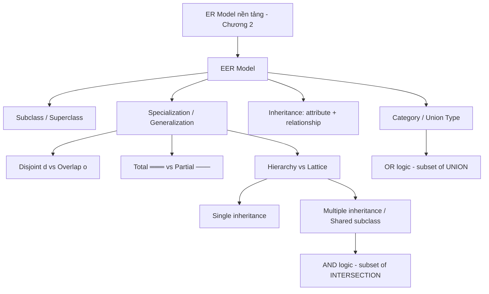

# Chương 3: Mô hình Thực thể-Mối liên kết Mở rộng — *Enhanced Entity-Relationship (EER) Model*

> **Nguồn:** CO2013 Database Systems, HCMUT — Khoa KH&KT Máy tính
> **Giảng viên phụ trách:** TS. Trần Minh Quang
> **Giáo trình:** Elmasri & Navathe, *Fundamentals of Database Systems*, 7th Edition (Chương 8 — EER Model)
> **File PDF gốc:** `Lectures/03_EER Model.pdf`
> **Số slide trong PDF gốc:** **62 slide** (slide 1 = title, slide 59 = Q&A, slides 60–62 = 3 Exercises)
> **Slide "Outline" lặp lại:** slide **2, 3, 5, 11, 19, 38, 49, 58** (8 slide) — đã gộp thành **một** mục lục duy nhất ở §0.4.
> **Slide có diagram chính:** 8, 13, 14, 16, 24, 29, 30, 36, 41, 43, 47.
>
> **Mục tiêu của tài liệu này:** một sinh viên năm 2 ngành CNTT, **đã học xong chương 2 (ER Model)**, đọc một mạch là đủ hiểu EER, vẽ được EER cho miniworld bất kỳ, làm trọn 3 exercises slide gốc, **không cần mở slide gốc** hay đọc Elmasri.

---

## 0. Trước khi bắt đầu

### 0.1. Bạn cần biết gì trước? (Prerequisite)

EER là phần **mở rộng** của ER (chương 2). Nếu chưa nắm chương 2, đọc qua các concept sau:

| Concept ER (chương 2) | Giải thích siêu ngắn |
|---|---|
| **Entity / Entity Type** | Đối tượng cần lưu (vd `EMPLOYEE`) — vẽ bằng hình chữ nhật. |
| **Attribute** | Thuộc tính của entity (vd `Ssn`, `Salary`) — vẽ bằng oval. **Khóa chính** = gạch chân. |
| **Multivalued / Derived Attribute** | Oval 2 vòng (multivalued) / oval nét đứt (derived). |
| **Relationship** | Liên kết giữa entity (vd `WORKS_FOR`) — vẽ bằng hình thoi. |
| **Cardinality 1:1, 1:N, M:N** | Một entity bên này tương ứng bao nhiêu entity bên kia. |
| **Total / Partial Participation** | Đường đôi (total — *bắt buộc tham gia*) vs đường đơn (partial — *có thể không tham gia*). |
| **Weak Entity** | Entity không tự định danh; phụ thuộc entity khác (vd `DEPENDENT` phụ thuộc `EMPLOYEE`). |

Ngoài ra cần biết:
- **OOP** (Java/C++/Python): `class`, `subclass`, `inheritance`, `is-a`. EER mượn nhiều từ OOP.
- **Set theory** (Toán rời rạc): `⊆` (subset), `∪` (union), `∩` (intersection), `∅` (empty set). Slide 55–57 dùng nhiều.

> 💡 **Hiểu đơn giản:** ER cho bạn vẽ COMPANY đơn giản. Khi gặp **bài toán phức tạp** — *"nhân viên có 3 loại Engineer/Secretary/Manager với attribute riêng"*, *"owner xe có thể là Person HOẶC Bank HOẶC Company"* — ER không đủ. Chương 3 thêm 4 vũ khí: **Subclass/Superclass**, **Specialization/Generalization**, **Inheritance**, **Category (Union type)**.

### 0.2. Sau chương này bạn sẽ làm được gì? (Learning Outcomes)

Trích từ đề cương CO2013 (mục L.O.2.1 — *Design a conceptual schema using the entity relationship model and its extended versions*):

1. **Phân biệt** subclass, superclass; hiểu **IS-A relationship**.
2. **Vẽ EER diagram** với ký hiệu chuẩn: 〔d〕 (disjoint), 〔o〕 (overlapping), đường đôi (total), đường đơn (partial), 〔U〕 (category).
3. **Áp dụng Specialization** (top-down) và **Generalization** (bottom-up) để tinh chỉnh schema.
4. **Phân loại 4 kiểu specialization** theo {disjoint/overlapping} × {total/partial}.
5. **Phân biệt** *predicate-defined*, *attribute-defined*, *user-defined* subclass.
6. **Vẽ Hierarchy vs Lattice**, hiểu **single inheritance** vs **multiple inheritance**.
7. **Phân biệt Category (Union type)** vs **Shared Subclass** — đây là điểm hay nhầm và rất hay ra thi.
8. **Đưa ra design choice** — khi nào nên dùng EER feature, khi nào nên gộp lại.
9. **Làm được 3 Exercises slide gốc**: non-profit organization, WV Bank accounts, ngân hàng có chi nhánh.

### 0.3. Lộ trình đọc đề xuất

| TT | Phần | Mức độ | Thời gian | Ghi chú |
|---:|---|---|---:|---|
| 1 | §1–§2 Intro + Subclass/Superclass | **CORE** | 25–30 phút | Nền — phải nắm vững. |
| 2 | §3 Specialization & Generalization | **CORE** | 30–40 phút | Top-down vs bottom-up. |
| 3 | §4 Constraints & Hierarchies | **CORE** | 50–70 phút | **Phần dài nhất** — 4 tổ hợp {d/o}×{total/partial}, hierarchy vs lattice. |
| 4 | §5 Categories (Union Types) | **CORE** | 30–40 phút | **Hay nhầm với Shared Subclass** — phải đọc kỹ. |
| 5 | §6 Design Choices & Formal Definitions | NÂNG CAO | 20–30 phút | Set theory; đọc kỹ khi gặp câu lý thuyết. |
| 6 | Exercises 1, 2, 3 | **CORE** | 60–90 phút | Y format đề thi cuối kỳ. |

**Tổng:** 3–4 giờ đọc lần đầu + 1.5 giờ làm exercises. Đây là **chương dài thứ 2** sau §6 SQL.

### 0.4. Outline chương (gộp 8 slide Outline lặp lại)

Slide 2, 3, 5, 11, 19, 38, 49, 58 đều cùng outline (chỉ highlight section sắp vào). Đã gộp:

> **Outline**
> 1. **Introduction to Enhanced-ER Model**
> 2. **Subclasses, Superclasses, and Inheritance**
> 3. **Specialization and Generalization**
> 4. **Constraints and Characteristics of Specialization and Generalization Hierarchies**
> 5. **Categories**
> 6. **Design Choices, and Formal Definitions**

### 0.5. Concept map của chương



> 📊 **Đọc diagram này thế nào:** ER là nền. EER thêm 4 nhánh concept. Constraint d/o và total/partial là luật nghiệp vụ gắn với specialization. Category (OR) và Shared Subclass (AND) là **2 cách dùng nhiều superclass khác nhau**.

---

## 1. Introduction to Enhanced-ER Model

### 1.1. Tại sao có EER? (Motivation)

Hồi học chương 2, bạn vẽ ER cho COMPANY: `EMPLOYEE`, `DEPARTMENT`, `PROJECT`, `WORKS_ON`, `DEPENDENT`. Mọi nhân viên đều có cùng tập attribute. Nhưng đời thật **không đơn giản như vậy**:

- *Engineer* có `Eng_type`; *Secretary* có `Typing_speed`; *Manager* có relationship riêng `MANAGES PROJECT`.
- *SalariedEmployee* nhận `Salary` cố định; *HourlyEmployee* nhận `Pay_scale`.
- *Owner* xe có thể là **Person HOẶC Bank HOẶC Company**.

Ép vào ER thuần thì:
- Hoặc bảng `EMPLOYEE` có **TẤT CẢ** attribute (`Eng_type`, `Typing_speed`, …) → nhiều cell `NULL`.
- Hoặc tạo 5 entity riêng và **nhân đôi** mọi attribute chung → Data Redundancy.

→ EER ra đời để mô hình hóa "is-a" tự nhiên: *Engineer **is a** Employee*, *Manager **is a** Employee*, *Person **is a** Owner*. Tư duy giống OOP.

### 1.2. Slide 4 — EER thêm gì so với ER?

**Nội dung slide gốc:**

- **Enhanced ER** hoặc **Extended ER (EER) model**
  - *Created to design more accurate database schemas.*
  - *More complex requirements than traditional applications.*
- *EER model includes all modeling concepts of the ER model. **In addition**, EER includes:*
  - **Subclasses** and **superclasses**
  - **Specialization** and **generalization**
  - **Category** or **union type**
  - **Attribute** and **relationship inheritance**
- **EER diagrams** *— Diagrammatic technique for displaying these concepts in an EER schema.*

| Thuật ngữ (EN) | Tiếng Việt | Định nghĩa đầy đủ |
|---|---|---|
| Enhanced ER (EER) model | Mô hình ER mở rộng | ER + subclass/superclass + specialization/generalization + category + attribute/relationship inheritance. |
| EER diagram | Sơ đồ EER | Kỹ thuật biểu diễn trực quan các concept EER. |

> 💡 **Hiểu đơn giản (Java OOP analogy):**
> | OOP | EER tương đương |
> |---|---|
> | `class Employee` | Entity type / Superclass |
> | `class Engineer extends Employee` | Subclass với IS-A relationship |
> | `eng.salary` (kế thừa từ Employee) | Attribute inheritance |
> | `interface Owner = Person \| Company \| Bank` | Category / Union type |

> 💡 **Ví dụ với COMPANY — vì sao cần EER:**
> Nếu để `Typing_speed`, `Eng_type`, `Tgrade` chung trong `EMPLOYEE` → engineer không có `Typing_speed` → NULL; secretary không có `Eng_type` → NULL. EER tách `EMPLOYEE` thành `SECRETARY/ENGINEER/TECHNICIAN/MANAGER` để mỗi loại chỉ giữ attribute thực sự cần.

> 💡 **Hiểu đơn giản:** EER giống nâng cấp từ sơ đồ gia đình đơn giản → hồ sơ nhân sự có vai trò. ER chỉ nói *"đây là người A, người B"*; EER nói thêm *"A là sinh viên kiêm trợ giảng; B là cựu sinh viên kiêm nhân viên"*.

> 📝 **Tóm lại §1:**
> EER = ER + 4 concept mới: Subclass/Superclass, Specialization/Generalization, Category, Attribute/Relationship Inheritance.
>
> **Một câu ghi nhớ:** *EER = ER + tư duy "kế thừa" của OOP, để biểu diễn "X is a Y" tự nhiên.*

> ❓ **Tự kiểm tra §1:**
> 1. EER có chứa toàn bộ concept của ER không? Liệt kê 4 concept mới.
> 2. Vì sao không nhét mọi attribute SECRETARY/ENGINEER/MANAGER vào chung EMPLOYEE?
> 3. Nêu một tình huống COMPANY cần dùng subclass.

---

## 2. Subclasses, Superclasses, and Inheritance

### 2.1. Tại sao có concept này?

Một entity type lớn thường có **nhóm nhỏ có ý nghĩa riêng**. `EMPLOYEE` lớn; `ENGINEER`, `SECRETARY`, `MANAGER` là nhóm nhỏ. Các nhóm nhỏ không tách rời hoàn toàn — engineer vẫn là employee và vẫn có `Ssn`, `Name`, `Salary`. Cần cách:
1. **Giữ phần chung** ở một chỗ (tránh lặp).
2. **Cho phép phần riêng** của từng loại.

### 2.2. Slide 6 — Định nghĩa Subclass / Superclass

**Nội dung slide gốc:**

- **Subtype or subclass** of an entity type
  - *Subgroupings of entities that are meaningful.*
  - *Represented explicitly because of their significance to the database application.*
- **Terms** for relationship between a superclass and any one of its subclasses:
  - Superclass / subclass
  - Supertype / subtype
  - Class / subclass
- *A class/subclass relationship is often called an **IS-A (IS-AN) relationship**.*

| Thuật ngữ (EN) | Tiếng Việt | Định nghĩa |
|---|---|---|
| Subclass / Subtype | Lớp con / Kiểu con | Subset có ý nghĩa của entity type. |
| Superclass / Supertype | Lớp cha / Kiểu cha | Entity type chứa subclass. |
| IS-A relationship | Quan hệ "là một" | Mối nối subclass → superclass. *Engineer **is a** Employee*. |
| Local attribute | Thuộc tính riêng | Attribute chỉ thuộc subclass (vd `Typing_speed` của SECRETARY). |
| Local relationship | Relationship riêng | Relationship chỉ thuộc subclass (vd MANAGER `MANAGES` PROJECT). |

### 2.3. Slide 7 — Ví dụ EMPLOYEE

> *Ex: EMPLOYEE may be further grouped into SECRETARY, ENGINEER, MANAGER, TECHNICIAN, SALARIED_EMPLOYEE, HOURLY_EMPLOYEE, and so on.*
> - Set of entities in each subgroups is a **subset** of the EMPLOYEE entity set.
> - Each is called a **subclass of EMPLOYEE**.
> - **EMPLOYEE is the superclass** for each of these subclasses.

### 2.4. Slide 8 — EER diagram notation

> 📊 **Hình 2.1 — EER diagram cho EMPLOYEE với 3 specialization (slide 8):**
> ```
>             (Fname)  (Minit)  (Lname)
>                 \       |       /
>                       (Name)
>                          |
>     (Ssn) ─────[ EMPLOYEE ]───── (Birth_date)
>                /     |     \
>          (Address)   |      \
>                      |
>     ┌────────────────┴───────────────┐
>     │                │               │
>   〔 d 〕         (chỉ MANAGER)    〔 d 〕
>   /  |  \              │            /   \
>  ⊃   ⊃   ⊃             ⊃           ⊃     ⊃
> SEC TECH ENG       MANAGER     SAL_EMP  HOUR_EMP
>  │   │   │             │           │       │
> Typing  Tgrade  Eng_type    ◇MANAGES   Salary  Pay_scale
> _speed                          │                  │
>                              PROJECT          ◇BELONGS_TO
>                                                    │
>                                              TRADE_UNION
>
> Slide 8 chứa 3 specializations:
>   1) {SECRETARY, TECHNICIAN, ENGINEER} — disjoint
>   2) {MANAGER}                          — đơn lẻ
>   3) {SALARIED_EMPLOYEE, HOURLY_EMPLOYEE} — disjoint
> ```
>
> 📊 **Đọc diagram này thế nào:**
> - 〔d〕 = disjoint (mỗi entity chỉ thuộc 1 subclass trong nhóm).
> - ⊃ = ký hiệu IS-A (subclass nằm trong superclass).
> - Đường thẳng từ 〔d〕 lên EMPLOYEE = nối specialization tới superclass.
> - Mỗi subclass có thể có attribute riêng (`Typing_speed`, `Tgrade`, `Eng_type`, `Salary`, `Pay_scale`) và/hoặc relationship riêng (`MANAGES` cho MANAGER, `BELONGS_TO` cho HOURLY_EMPLOYEE).

### 2.5. Slide 9 — 5 quy tắc về subclass member

**Nội dung slide gốc:**

- *A subclass member is the **same** as the entity in the superclass, but in a **distinct specific role**.*
- *An entity **cannot exist** in the database merely by being a member of a subclass; it **must also be a member of the superclass**.*
- *A member of a superclass can be **optionally** included as a member of some of its subclasses.*
- *It is **not necessary** that every entity in a superclass be a member of some subclass.*
- *Superclass/subclass relationship is **one-to-one (1:1)**.*

| Quy tắc | Diễn giải |
|---|---|
| **R1** | Một entity subclass = cùng entity trong superclass, chỉ thêm "vai trò riêng". |
| **R2** | **Bắt buộc** có trong superclass trước. KHÔNG có Engineer mà không phải Employee. |
| **R3** | **Tùy chọn** thuộc subclass. Một Employee có thể không phải Engineer/Secretary/Manager. |
| **R4** | Không bắt buộc mọi entity superclass phải thuộc 1 subclass nào (xem completeness §4). |
| **R5** | Quan hệ superclass/subclass là **1:1** — một bản ghi Employee tương ứng tối đa 1 bản ghi Engineer (cùng Ssn). |

> 💡 **Hiểu đơn giản (analogy "thẻ sinh viên"):** Bạn là **sinh viên** (superclass). Khi tham gia CLB Tin học, bạn cũng là **thành viên CLB** (subclass). Bạn **vẫn là** sinh viên trước (R2). Có sinh viên không tham gia CLB nào (R3, R4). Một thẻ SV chỉ tương ứng tối đa 1 hồ sơ thành viên CLB (R5).

### 2.6. Slide 10 — Inheritance (Kế thừa)

**Nội dung slide gốc:**

- *Subclass entity **inherits all attributes and relationships** of superclass.*
- *A subclass, with its own specific (or local) attributes and relationships together with all the attributes and relationships it inherits from the superclass, can be considered an **entity type in its own right**.*

| Thuật ngữ | Định nghĩa |
|---|---|
| **Attribute Inheritance** | Subclass tự động "thấy" mọi attribute của superclass. Engineer có `Ssn`, `Fname`, `Salary` (từ Employee) + `Eng_type` (riêng). |
| **Relationship Inheritance** | Subclass cũng kế thừa relationship của superclass. Employee `WORKS_FOR` Department → Engineer cũng `WORKS_FOR` Department. |

> 💡 **Hiểu đơn giản (Java analogy):**
> ```java
> class Employee { String ssn; String fname; double salary; }
> class Engineer extends Employee { String engType; }
> Engineer eng = new Engineer();
> eng.ssn       // inherited
> eng.salary    // inherited
> eng.engType   // local
> ```

> 💡 **Hiểu đơn giản (analogy "xe"):** Subclass/superclass giống "xe" và "xe máy/ô tô/xe tải". Xe nào cũng có biển số, hãng, màu (chung); xe tải có tải trọng, ô tô có số chỗ (riêng). Không bắt xe máy phải có "tải trọng xe tải", cũng không lặp "biển số" ở mọi loại.

> 📝 **Tóm lại §2:**
> - Subclass = subset có ý nghĩa của entity type. Quan hệ với superclass: **IS-A**, **1:1**.
> - Member subclass phải tồn tại trước trong superclass; thuộc subclass là tùy chọn.
> - Subclass **kế thừa** tất cả attribute + relationship của superclass.
>
> **Một câu ghi nhớ:** *Subclass = "tôi LÀ một entity của superclass, nhưng có thêm vai trò/đặc trưng riêng".*

> ❓ **Tự kiểm tra §2:**
> 4. Vì sao một entity không thể tồn tại trong DB chỉ với tư cách subclass mà không phải superclass?
> 5. Tỉ số cardinality giữa superclass và subclass là gì? Vì sao?
> 6. `Typing_speed` nên đặt ở `EMPLOYEE` hay `SECRETARY`? Vì sao?
> 7. Trong slide 8, `MANAGES` là relationship của MANAGER hay EMPLOYEE? Lý do?

---

## 3. Specialization and Generalization

### 3.1. Tại sao có 2 concept này?

Hai chiều **ngược nhau** của cùng một quá trình thiết kế:
- **Specialization** = top-down. Từ superclass `EMPLOYEE`, chia thành subclass.
- **Generalization** = bottom-up. Từ 2 entity riêng `CAR`/`TRUCK`, gộp thành superclass `VEHICLE`.

Kết quả vẽ **giống hệt nhau**; chỉ khác **hướng tư duy**.

### 3.2. Slide 12 — Specialization

**Nội dung slide gốc:**

- **Specialization**
  - *Process of defining **a set of subclasses** of an entity type, called superclass.*
  - *Defined on the basis of some **distinguishing characteristic** of the entities in the superclass.*
  - *May have several specializations of the same entity type based on **different distinguishing characteristics**.*
- **Subclass can have its own:**
  - **Specific attributes** (local attributes)
  - **Specific relationship types**

EMPLOYEE có thể có **NHIỀU specialization** đồng thời:
- Theo Job_type → `{SECRETARY, TECHNICIAN, ENGINEER, MANAGER}`
- Theo Pay_method → `{SALARIED, HOURLY}`

### 3.3. Slide 13 — Ví dụ Specialization

> 📊 **Hình 3.1 — Specialization với defining attribute Job_type (slide 13):**
> ```
>             (Fname)(Minit)(Lname)
>                  \    |    /
>                   (Name)
>                     |
>     (Ssn) ────[ EMPLOYEE ]────(Birth_date)
>                /    |    \
>           (Address) |    (Job_type)
>                     │
>                  Job_type ← defining attribute
>                     │
>                  〔 d 〕  ← disjoint
>                  /  |  \
>          'Secretary' 'Technician' 'Engineer'  ← predicate conditions
>             ⊃     ⊃      ⊃
>         ┌────┐ ┌─────┐ ┌──────┐
>         │SEC │ │TECH │ │ ENG  │
>         └────┘ └─────┘ └──────┘
>           │       │       │
>      (Typing_  (Tgrade) (Eng_type)
>       speed)
> ```

### 3.4. Slide 14 — Instances of Specialization

> 📊 **Hình 3.2 — Instances of specialization (slide 14):**
> ```
>     EMPLOYEE                SECRETARY
>     ┌──────────┐            ┌──────────┐
>     │ e₁ ●─────┼────────────┤ ● e₁     │
>     │ e₂ ●─────┼──┐         │ ● e₄     │
>     │ e₃ ●     │  │         │ ● e₅     │
>     │ e₄ ●─────┼──┼─────────┤   ⋮      │
>     │ e₅ ●─────┼──┘         └──────────┘
>     │ e₆ ●     │            ENGINEER
>     │ e₇ ●─────┼────┐       ┌──────────┐
>     │ e₈ ●─────┼─┐  │       │ ● e₂     │
>     │  ⋮       │ │  └───────┤ ● e₇     │
>     └──────────┘ │          └──────────┘
>                  │          TECHNICIAN
>                  │          ┌──────────┐
>                  └──────────┤ ● e₃     │
>                             │ ● e₈     │
>                             └──────────┘
>
> Quan hệ tập con:
>   SECRETARY  ⊆ EMPLOYEE
>   ENGINEER   ⊆ EMPLOYEE
>   TECHNICIAN ⊆ EMPLOYEE
>
> e₆ thuộc EMPLOYEE nhưng KHÔNG thuộc subclass nào → partial.
> ```

### 3.5. Slide 15 — Generalization

**Nội dung slide gốc:**

- *Reverse process of Specialization.*
- **Generalize** several entity types which have some common features into a single **superclass**.
  - Original entity types are **special subclasses**.
- **Generalization** *— Process of defining a generalized entity type from the given entity types.*

### 3.6. Slide 16 — Ví dụ CAR + TRUCK → VEHICLE

> 📊 **Hình 3.3 — Generalization (slide 16):**
> ```
> (a) Trước:                     (b) Sau khi generalize:
>
>  CAR              TRUCK             (Vehicle_id)(Price)(License_plate_no)
>  Vehicle_id (k)   Vehicle_id (k)               \    |    /
>  License_plate_no License_plate_no            ┌─────────┐
>  Price            Price                       │ VEHICLE │
>  Max_speed        No_of_axles                 └────┬────┘
>  No_of_passengers Tonnage                          │
>                                                  〔 d 〕
>                                                  /     \
>                                                 ⊃       ⊃
>                                            ┌─────┐  ┌──────┐
>                                            │ CAR │  │TRUCK │
>                                            └─────┘  └──────┘
>                                          /       \    /     \
>                                  Max_speed No_of_p No_of_  Tonnage
>                                            assengers axles
> ```

> 💡 **Hiểu đơn giản (top-down vs bottom-up):**
> - **Specialization** = đi từ "động vật" → chia "chó", "mèo", "cá".
> - **Generalization** = thấy "iPhone", "Galaxy", "Pixel" → nhận ra "đều là điện thoại" → đặt tên chung `PHONE`.

### 3.7. Slide 17 — Notation phân biệt

- *Diagrammatic notation **sometimes** used to distinguish between generalization and specialization* — arrow pointing to generalized superclass = generalization; arrows to specialized subclasses = specialization.
- *We **do not use** this notation because it is often **subjective** as to which process is more appropriate.*
- *We advocate **not drawing any arrows** in these situations.*

→ **Quy tắc CO2013:** không vẽ mũi tên hướng. Kết quả EER giống nhau.

### 3.8. Slide 18 — Data Modeling

- *A superclass or subclass represents a **set of entities**.*
- *Shown in **rectangles** in EER diagrams (as are entity types).*
- *Sometimes, all entity sets are simply called **classes**, whether they are entity types, superclasses, or subclasses.*

→ Trong EER, **class** = bất kỳ rectangle nào (entity type / superclass / subclass / category).

> 📝 **Tóm lại §3:**
> - **Specialization** = top-down. **Generalization** = bottom-up. Kết quả vẽ giống nhau.
> - Subclass có thể có **specific attribute + specific relationship**.
> - Một entity type có thể có nhiều specialization đồng thời theo các đặc trưng khác nhau.
>
> **Một câu ghi nhớ:** *Specialization là "chẻ to ra nhỏ"; Generalization là "gom nhỏ lại thành to". Cùng kết quả EER.*

> ❓ **Tự kiểm tra §3:**
> 8. Specialization và Generalization khác nhau ở hướng tư duy thế nào?
> 9. Trong slide 8, EMPLOYEE có **3 specialization** đồng thời. Vô lý không? Vì sao?
> 10. Vẽ EER thể hiện generalization từ 2 entity `STUDENT` (Major_dept) và `EMPLOYEE` (Salary) thành `PERSON` (Ssn, Name).

---

## 4. Constraints and Characteristics of Specialization/Generalization Hierarchies

### 4.1. Tại sao cần constraint?

Một specialization có nhiều **biến thể**:
- *Một entity có thể thuộc nhiều subclass cùng lúc không?* → disjoint vs overlapping.
- *Mọi entity superclass có bắt buộc thuộc subclass nào không?* → total vs partial.
- *Membership được xác định bằng giá trị attribute, hay user tự gán?* → predicate-defined / attribute-defined / user-defined.

Mỗi tổ hợp → schema khác nhau, semantics khác nhau.

### 4.2. Slides 21-25 — 3 cách xác định subclass membership

**Slide 21 — Determine subclass:**

- **Predicate-defined** (or **condition-defined**) subclasses
- **Attribute-defined** specialization
- **User-defined**

**Slide 22 — Predicate-defined subclass:**

- *If we can determine **exactly those entities** that will become members of each subclass by a **condition**, the subclasses are called **predicate-defined**.*
- *Condition is a constraint that determines subclass members.*
- *Display a predicate-defined subclass by writing the **predicate condition** next to the line attaching the subclass to its superclass.*

**Slide 23 — Attribute-defined specialization:**

- *If **all subclasses** in a specialization have membership condition on the **same attribute** of the superclass, specialization is called an **attribute-defined specialization**.*
- *Attribute is called the **defining attribute** of the specialization.*
- *Ex: `JobType` is the defining attribute of the specialization {SECRETARY, TECHNICIAN, ENGINEER} of EMPLOYEE.*

**Slide 25 — User-defined subclass:**

- *If **no condition** determines membership, the subclass is called **user-defined**.*
- *Membership in a subclass is determined by the database users by **applying an operation** to add an entity to the subclass.*
- *Membership is **specified individually** for each entity by the user.*

| Loại | Cách xác định | Ví dụ COMPANY | Khi nào dùng? |
|---|---|---|---|
| **Predicate-defined** | Condition trên attribute superclass | `Salary > 50000` → SENIOR | Luật rõ ràng từ attribute. |
| **Attribute-defined** (case đặc biệt) | TẤT CẢ subclass dùng condition trên CÙNG 1 attribute | `Job_type` chia 3 subclass | Một attribute phân loại toàn bộ nhóm. |
| **User-defined** | User tự gán thủ công | TRADE_UNION_MEMBER | Membership theo quy trình bên ngoài, không suy ra được. |

→ **Phân biệt nhanh:**
- *Predicate-defined* = từng subclass có condition riêng (có thể trên attribute khác nhau).
- *Attribute-defined* = case đặc biệt — TẤT CẢ subclass cùng dùng 1 *defining attribute*.

> 💡 **Ví dụ bổ sung:** Trong thư viện, `BORROWER` có subclass `VIP_MEMBER`. Nếu rule là `total_borrowed_books >= 100` → predicate-defined. Nếu thủ thư tự xét duyệt → user-defined.

### 4.3. Slide 24 — EER notation cho attribute-defined

> 📊 **Hình 4.1 — Attribute-defined specialization on Job_type (slide 24):**
> ```
>            ┌───────────────┐
>            │   EMPLOYEE    │
>            └───────┬───────┘
>                    │
>                  Job_type   ← Defining attribute (ghi cạnh đường nối)
>                    │
>                  〔 d 〕
>                  /  |  \
>         'Secretary' 'Technician' 'Engineer'  ← Predicate condition
>             ⊃     ⊃      ⊃
>          ┌────────┐ ┌──────────┐ ┌────────┐
>          │SECRETARY│ │TECHNICIAN│ │ENGINEER│  ← Predicate-defined subclass
>          └────────┘ └──────────┘ └────────┘
> ```

### 4.4. Slides 26-28 — Disjointness và Completeness Constraints

**Slide 26:**

- *Two basic conditions apply to a specialization/generalization:* **disjointness** *and* **completeness** *constraints.*
- **Disjointness constraint** — May be **disjointed** or **overlap**.
- **Completeness (or totalness) constraint** — May be **total** or **partial**.
- *Disjointness and completeness constraints are **independent**.*

→ 2 ràng buộc **độc lập** → **4 tổ hợp** {d, o} × {total, partial}.

**Slide 27 — Disjointness:**

| Constraint | Ký hiệu | Ý nghĩa |
|---|---|---|
| **Disjoint** | 〔 d 〕 | Mỗi entity superclass thuộc **TỐI ĐA 1** subclass. |
| **Overlapping** | 〔 o 〕 | Một entity có thể thuộc **NHIỀU** subclass cùng lúc. |

**Slide 28 — Completeness:**

| Constraint | Ký hiệu | Ý nghĩa |
|---|---|---|
| **Total** | ═══ (đường đôi) | Mọi entity superclass **PHẢI** thuộc ≥ 1 subclass. |
| **Partial** | ─── (đường đơn) | Có entity superclass **KHÔNG** thuộc subclass nào. |

Cách nhớ nhanh:
- `d` = **d**istinct/**d**isjoint = tách rời.
- `o` = **o**verlap = chồng lắp.

### 4.5. Slide 29 — Ví dụ Disjoint Partial

> 📊 **Hình 4.2 — Disjoint Partial Specialization (slide 29):**
> ```
>            ┌───────────────┐
>            │   EMPLOYEE    │
>            └───────┬───────┘
>                  Job_type
>                    │ ─── (PARTIAL)
>                  〔 d 〕   ← DISJOINT
>                  /  |  \
>          ┌────────┐ ┌──────────┐ ┌────────┐
>          │SECRETARY│ │TECHNICIAN│ │ENGINEER│
>          └────────┘ └──────────┘ └────────┘
> ```
>
> **Đọc:** Mỗi nhân viên thuộc **TỐI ĐA 1** trong 3 subclass (disjoint), và **CÓ THỂ KHÔNG** thuộc subclass nào (partial — vd `MANAGER` thuộc EMPLOYEE nhưng không thuộc 3 subclass này).

### 4.6. Slide 30 — Ví dụ Overlapping Total

> 📊 **Hình 4.3 — Overlapping Total Specialization PART (slide 30):**
> ```
>           (Part_no)   (Description)
>                \         /
>             ┌────────┐
>             │  PART  │
>             └────┬───┘
>                  │ ═══ (TOTAL)
>                〔 o 〕   ← OVERLAPPING
>                /     \
>               ⊃       ⊃
>     ┌─────────────┐  ┌────────────┐
>     │MANUFACTURED │  │  PURCHASED │
>     │    PART     │  │    PART    │
>     └─────────────┘  └────────────┘
>      / | \             /     \
> Drawing Manufacture  Supplier_  List_price
> _no    _date         name
> Batch_no
> ```
>
> **Đọc:** Mỗi `PART` **PHẢI** là MANUFACTURED hoặc PURCHASED hoặc CẢ HAI (total). Một part có thể đồng thời được sản xuất nội bộ và mua từ nhà cung cấp khác (overlapping).

### 4.7. Slide 31 — 4 loại Specialization

**Nội dung slide gốc:**

- *Hence, we have **four types** of specialization/generalization:*
  - **Disjoint, total**
  - **Disjoint, partial**
  - **Overlapping, total**
  - **Overlapping, partial**
- *Note: **Generalization is usually total** because the superclass is derived from the subclasses.*

| Loại | Ký hiệu | Tối đa 1 subclass? | Bắt buộc thuộc ≥ 1? | Ví dụ |
|---|---|:---:|:---:|---|
| **Disjoint, Total** | ═══ + 〔 d 〕 | Có | Có | Mỗi tài khoản ngân hàng phải là **đúng 1**: Savings/Checking/Loan. |
| **Disjoint, Partial** | ─── + 〔 d 〕 | Có | Không | Employee có thể là Sec/Eng/Tech hoặc không thuộc nhóm nào. |
| **Overlapping, Total** | ═══ + 〔 o 〕 | Không | Có | PART phải là manufactured/purchased, có thể cả hai. |
| **Overlapping, Partial** | ─── + 〔 o 〕 | Không | Không | Person có thể là student/employee/alumnus hoặc tạm thời không thuộc nhóm. |

> 💡 **Hiểu đơn giản (analogy "lớp học thêm"):**
> - **Disjoint Total**: bắt buộc mỗi SV chọn đúng 1 chuyên ngành (CS / IT / IS).
> - **Disjoint Partial**: được chọn tối đa 1 lớp năng khiếu (Bóng đá / Bơi / Cầu lông), hoặc không chọn.
> - **Overlapping Total**: bắt buộc tham gia ≥ 1 CLB, có thể tham gia nhiều.
> - **Overlapping Partial**: tham gia CLB nào cũng được, hoặc không.

### 4.8. Slide 32 — Case Study: Identify Superclass-Subclass

| Group | Hệ thống | Hints | Gợi ý thiết kế EER |
|---|---|---|---|
| **A** | Course registration of Bach Khoa University | Students (Grad-Student, undergrad-student), Modules (for grad-student, for undergrad-students) | `STUDENT` = superclass; `GRAD_STUDENT`, `UNDERGRAD_STUDENT` = subclass (disjoint, total). `MODULE` cũng có thể specialize thành `GRAD_MODULE`, `UNDERGRAD_MODULE`. |
| **B** | Library of a University | Materials (Book, Journal, ...), Borrowers (Guest, Member) | `MATERIAL` = superclass; `BOOK`, `JOURNAL` = subclass. `BORROWER` = superclass; `GUEST`, `MEMBER` = subclass. |

### 4.9. Slides 33-34 — Hierarchies vs Lattices

**Slide 33:**

- *A subclass may itself have further subclasses specified on it, forming a **hierarchy** or a **lattice**.*
- **Specialization hierarchy:**
  - *Every subclass participates as a subclass in **only one** class/subclass relationship.*
  - *Results in a **tree** structure or strict hierarchy.*
  - **Single inheritance**.
- **Specialization lattice:**
  - *Subclass can be a subclass in **more than one** class/subclass relationship.*
  - **Multiple inheritance**.

**Slide 34:**

- *In a lattice or hierarchy, a subclass inherits attributes not only of its **direct superclass**, but also of **all its predecessor superclasses**.*
- *A subclass with **more than one superclass** is called a **shared subclass**.*
- *In case of multiple inheritance, if attribute (or relationship) originating in the same superclass inherited more than once via different paths in lattice — included **only once** in shared subclass.*

| Khái niệm | Đặc điểm | Cấu trúc | Inheritance |
|---|---|---|---|
| **Hierarchy** | Mỗi subclass có **1** superclass | **Cây** (tree) | Single |
| **Lattice** | Subclass có thể có **≥ 2** superclass | **Đồ thị có hướng** (DAG) | Multiple |
| **Shared Subclass** | Subclass với ≥ 2 superclass | Nút chung của nhiều nhánh | Multiple |

> 💡 **Hiểu đơn giản (Java analogy):**
> ```
> Hierarchy = Java thuần (chỉ extends 1 class):
>   Employee → Manager → CEO
>
> Lattice = Java có interface (multiple inheritance):
>   class Manager extends Employee implements Engineer, Salaried
> ```

### 4.10. Slides 35-36 — Ví dụ UNIVERSITY Lattice

**Slide 35 — Mô tả miniworld:**

> *Database keeps track of three types of persons: **employees, alumni, and students**. A person can belong to one, two, or all three of these types. Each person has a name, SSN, sex, address, and birth date.*
>
> *Every employee has a salary, and there are **three types of employees: faculty, staff, and student assistants**. Each employee belongs to exactly one of these types. For each alumnus, a record of the degree(s) earned at the university is kept (degree name, year granted, major department). Each student has a major department. Each faculty has a rank, whereas each staff member has a staff position.*
>
> *Student assistants are classified further as either **research assistants or teaching assistants**, with the percent of time recorded. Research assistants have a research project; teaching assistants have a current course.*
>
> *Students are further classified as either **graduate or undergraduate** (with degree program M.S./Ph.D./M.B.A. for graduate, class freshman/sophomore for undergraduate).*

**Slide 36 — EER Lattice diagram:**

> 📊 **Hình 4.4 — Specialization/Generalization Lattice cho UNIVERSITY (slide 36):**
> ```
>            (Name)(Sex)(Address)(Ssn)(Birth_date)
>                       \   |   /
>                       ┌────────┐
>                       │ PERSON │
>                       └───┬────┘
>                           │ ═══ (TOTAL)
>                          〔 o 〕  (OVERLAPPING)
>                          /│ \
>                         ⊃ ⊃  ⊃
>           (Salary)            (Major_dept)
>              │   (Degrees:Year,Degree,Major) │
>          ┌─────────┐  ┌────────┐  ┌────────┐
>          │EMPLOYEE │  │ALUMNUS │  │STUDENT │
>          └────┬────┘  └────────┘  └────┬───┘
>               │ ═══                    │ ═══
>             〔 d 〕                  〔 d 〕
>             /│\                       /  \
>            ⊃ ⊃ ⊃                    ⊃    ⊃
>      ┌─────┐ ┌──────┐ ┌───────────┐  ┌──────────┐ ┌───────────┐
>      │STAFF│ │FACUL.│ │ STUDENT_  │  │GRADUATE_ │ │UNDERGRAD_ │
>      │     │ │      │ │ ASSISTANT │  │STUDENT   │ │STUDENT    │
>      └─────┘ └──────┘ └─────┬─────┘  └──────────┘ └───────────┘
>     (Position)(Rank) (Percent_time)  (Degree_program)  (Class)
>                            │ ═══
>                          〔 d 〕
>                         /     \
>                        ⊃       ⊃
>             ┌────────────────┐  ┌────────────────┐
>             │RESEARCH_       │  │TEACHING_       │
>             │ASSISTANT       │  │ASSISTANT       │
>             └────────────────┘  └────────────────┘
>                  (Project)            (Course)
>
> ⚠ STUDENT_ASSISTANT là SHARED SUBCLASS của EMPLOYEE và STUDENT
>   (kế thừa Salary từ EMPLOYEE và Major_dept từ STUDENT).
> ```
>
> 📊 **Đọc lattice này thế nào:**
> - PERSON → EMPLOYEE/ALUMNUS/STUDENT: 〔o〕 + ═══ — overlapping total (1 person có thể đồng thời là cả 3).
> - EMPLOYEE → STAFF/FACULTY/STUDENT_ASSISTANT: 〔d〕 + ═══ — disjoint total.
> - STUDENT → GRADUATE/UNDERGRADUATE: 〔d〕 + ═══.
> - **STUDENT_ASSISTANT** có **2 superclass**: EMPLOYEE (kế thừa `Salary`) + STUDENT (kế thừa `Major_dept`) → **shared subclass** (multiple inheritance).
> - STUDENT_ASSISTANT chia tiếp thành RESEARCH_ASSISTANT / TEACHING_ASSISTANT.

### 4.11. Slide 37 — Top-down vs Bottom-up

- **Specialization process:**
  - *Start with entity type then define subclasses by **successive specialization**.*
  - **Top-down** conceptual refinement process.
- **Bottom-up** conceptual synthesis:
  - *Involves **generalization** rather than specialization.*

> 💡 **Hiểu đơn giản:** Disjoint/overlap như quy định CLB ở trường — mỗi SV chỉ vào 1 ban (disjoint) vs vừa vào ban học thuật vừa ban truyền thông (overlap). Total/partial như "ai cũng phải tham gia ≥ 1 CLB" vs "tùy chọn".

> 📝 **Tóm lại §4:**
> - 3 cách xác định subclass: **predicate-defined**, **attribute-defined**, **user-defined**.
> - 2 ràng buộc độc lập: **disjointness** {d, o} × **completeness** {═══, ───} → **4 tổ hợp**.
> - **Hierarchy** (cây, single inheritance) vs **Lattice** (DAG, multiple inheritance).
> - **Shared Subclass** = subclass với ≥ 2 superclass (kế thừa từ tất cả).
> - **Generalization thường total** vì superclass được suy từ subclass.
>
> **Một câu ghi nhớ:** *`d/o` trả lời "được vào bao nhiêu nhóm"; `total/partial` trả lời "có bắt buộc vào nhóm không".*

> ❓ **Tự kiểm tra §4:**
> 11. Phân biệt 〔d〕 và 〔o〕. Cho ví dụ thực tế cho mỗi loại.
> 12. Đường đôi vs đơn ý nghĩa khác nhau thế nào?
> 13. Khi nào dùng predicate-defined? user-defined?
> 14. STUDENT_ASSISTANT slide 36 là gì — hierarchy hay lattice? Vì sao?
> 15. *"Generalization thường total"* — đúng hay sai? Giải thích.

---

## 5. Categories (Union Types)

### 5.1. Tại sao có Category?

Đến giờ:
- **1 superclass** → nhiều subclass (đơn cha).
- **Nhiều superclass** → 1 shared subclass — nhưng entity của shared subclass phải tồn tại trong **TẤT CẢ** superclass (giao — `AND`).

Có bài toán đời thật mà subclass là **HỢP** (`OR`) các superclass:
- *Owner xe* = **Person** HOẶC **Bank** HOẶC **Company** — mỗi instance chỉ thuộc **MỘT** superclass.

→ Cần **Category (Union type)**.

### 5.2. Slide 39 — Định nghĩa Category

**Nội dung slide gốc:**

- **Category** or **Union type**
  - *Represents a single superclass/subclass relationship with **more than one superclass**.*
  - *Subclass represents a collection of objects that is a **subset of the UNION** of distinct entity types.*
  - *Attribute inheritance works **more selectively**.*
  - *Category can be **total** or **partial**.*
- *Some modeling methodologies do not have union types.*

| Thuật ngữ | Định nghĩa |
|---|---|
| **Category / Union Type** | Subclass có nhiều superclass (kiểu OR). Member chỉ tồn tại trong **đúng 1** superclass tại 1 thời điểm. |
| **Defining superclass** | Các class nguồn tạo nên union cho category. |

### 5.3. Slide 40 — Ví dụ OWNER

**Nội dung slide gốc:**

- *Example: Database for vehicle registration, vehicle owner can be a **person**, a **bank** (holding a lien on a vehicle) or a **company**.*
  - *Category (subclass) **OWNER** is a subset of the **union** of the three superclasses **COMPANY, BANK, and PERSON**.*
  - *A category member must exist in **only one** of its superclasses.*
- *Note: The difference from **shared subclass**, which is a subset of the **intersection** of its superclasses (shared subclass member must exist **in all** of its superclasses).*

→ **Slide phân biệt đỉnh cao** giữa Category và Shared Subclass:

| Khía cạnh | Category | Shared Subclass |
|---|---|---|
| Tập hợp | **Union (OR)** của các superclass | **Intersection (AND)** của các superclass |
| Member tồn tại ở | **ĐÚNG 1** superclass | **TẤT CẢ** superclass |

### 5.4. Slide 41 — EER Diagram cho 2 Categories

> 📊 **Hình 5.1 — 2 Categories: OWNER và REGISTERED_VEHICLE (slide 41):**
> ```
> (BName)(BAddress)            (CName)(CAddress)
>     \   /         (SSN)(Name)(Address)   \   /
>    ┌─────┐         \    │    /        ┌────────┐
>    │BANK │       ┌──────┐ ↓            │COMPANY │
>    └──┬──┘       │PERSON│              └──┬───┘
>       │          └──┬───┘                 │
>       │   (DriverLicenseNo)               │
>        \         │                       /
>          \       │                     /
>            \   〔 U 〕               /
>             \  /  │  \              /
>              ⊃   ⊃   ⊃    ← IS-A from Union
>             ┌────────┐
>             │ OWNER  │       ← Category 1
>             └───┬────┘
>                 │ M
>              ┌──────┐ (LienOrRegular, PurchaseDate)
>              │ OWNS │
>              └──┬───┘
>                 │ N
>          ┌──────────────────┐
>          │REGISTERED_VEHICLE│  ← Category 2 (LicensePlateNo)
>          └────────┬─────────┘
>                   │
>                 〔 U 〕
>                  /  \
>            (CYear) (TYear)
>              ⊃     ⊃
>           ┌─────┐ ┌──────┐
>           │ CAR │ │TRUCK │
>           └─────┘ └──────┘
>          /|  \    /|   \
>     CMake CModel CStyle TMake TModel Tonnage
>             VehicleId  VehicleId
> ```
>
> 📊 **Đọc diagram này thế nào:**
> - **OWNER** = union của 3 superclass `BANK`, `PERSON`, `COMPANY`.
> - **REGISTERED_VEHICLE** = union của `CAR` và `TRUCK`.
> - 〔 U 〕 = ký hiệu Union notation.
> - Đường đôi từ category lên 〔 U 〕 = total category; đường đơn = partial.
> - `OWNS` là M:N relationship giữa 2 category.

### 5.5. Slide 42 — Total / Partial Category

- *A category can be **total** or **partial**:*
  - **Total**: *Hold the union of **all** entities in its superclasses. Represented by a **double line** connecting the category and the circle.*
  - **Partial**: *Can hold a **subset** of the union. Represented by a **single line**.*
- *The superclasses of a category may have **different key attributes** or the **same key attribute**.*
  - Different keys: OWNER (PERSON.Ssn, BANK.BName, COMPANY.CName).
  - Same key: REGISTERED_VEHICLE (CAR.VehicleId, TRUCK.VehicleId).

### 5.6. Slides 43-46 — Category vs Shared Subclass (so sánh chi tiết)

| Tiêu chí | Category | Shared Subclass |
|---|---|---|
| **Bản chất relationship** | Subclass trong **MỘT** relationship duy nhất | Subclass trong **NHIỀU** relationship phân biệt |
| **Số superclass / relationship** | 1 relationship có nhiều superclass | Mỗi relationship 1 superclass |
| **Logic membership** | **OR** | **AND** |
| **Điều kiện tồn tại** | Member ở **CHỈ 1** superclass | Member ở **TẤT CẢ** superclass |
| **Tập hợp** | Subset của **UNION** | Subset của **INTERSECTION** |
| **Kế thừa** | Kế thừa **chỉ 1** superclass mà entity đang là | Kế thừa **TẤT CẢ** superclass |
| **Ví dụ** | OWNER = COMPANY ∪ BANK ∪ PERSON | ENGINEERING_MANAGER = ENGINEER ∩ MANAGER ∩ SALARIED |

```
Category OWNER:                  Shared Subclass STUDENT_ASSISTANT:

  [BANK] [PERSON] [COMPANY]         [EMPLOYEE]      [STUDENT]
       \    |    /                      \              /
       〔 U 〕                            \            /
          │                          [STUDENT_ASSISTANT]
       [OWNER]
  OWNER = OR (BANK or PERSON or COMPANY)   STUDENT_ASSISTANT = AND (Employee and Student)
```

### 5.7. Slides 47-48 — Specialization vs Union Type

> 📊 **2 cách mô hình hóa cùng kịch bản (slide 47):**
> ```
> Cách 1 — Specialization từ VEHICLE:
>           (Vehicle_id)(Price)(License_plate_no)
>                          │
>                     ┌─────────┐
>                     │ VEHICLE │
>                     └────┬────┘
>                          │ ═══
>                        〔 d 〕
>                       /     \
>                  ┌─────┐  ┌──────┐
>                  │ CAR │  │TRUCK │
>                  └─────┘  └──────┘
>
> Cách 2 — Category REGISTERED_VEHICLE từ CAR ∪ TRUCK:
>        ┌──────┐     ┌──────┐
>        │ CAR  │     │TRUCK │
>        └──┬───┘     └──┬───┘
>            \          /
>             〔 U 〕
>               │
>      ┌──────────────────┐
>      │REGISTERED_VEHICLE│  (LicensePlateNo)
>      └──────────────────┘
> ```

**Slide 48 — Phân biệt:**

| Category REGISTERED_VEHICLE | Superclass VEHICLE |
|---|---|
| Có thể chỉ chứa **một số** car/truck (xe chưa đăng ký không có). | **Mọi** car/truck đều là VEHICLE. |
| Implies **chỉ** car/truck là member, không loại khác. | Specialization có thể partial → VEHICLE còn chứa **motorcycle** và loại khác. |

> 💡 **Hiểu đơn giản:**
> - **Generalization (CAR/TRUCK → VEHICLE)** = "tôi đặt cha cho 2 đứa con — và có thể có thêm con khác".
> - **Category (CAR ∪ TRUCK → REGISTERED_VEHICLE)** = "tôi tạo subclass nhận dữ liệu từ 2 nguồn — chỉ 2 nguồn này".

> 💡 **Hiểu đơn giản (analogy "danh sách ký nhận"):** Category giống danh sách "người được phép ký nhận bưu phẩm" — chủ nhà / người thân / lễ tân. Mỗi người trong danh sách chỉ thuộc **1 vai trò**. Shared subclass giống "sinh viên thực tập" — phải đồng thời là sinh viên + nhân viên thực tập.

> 📝 **Tóm lại §5:**
> - **Category = Union type** = subclass với **NHIỀU superclass** (OR).
> - Member chỉ thuộc **MỘT** superclass tại một thời điểm.
> - Khác **Shared Subclass**: Shared = AND, Category = OR.
> - Total (═══) hoặc Partial (───).
> - Superclass có thể có **key khác nhau**.
>
> **Một câu ghi nhớ:** *Category là "OR đa cha"; Shared Subclass là "AND đa cha".*

> ❓ **Tự kiểm tra §5:**
> 16. Phân biệt Category và Shared Subclass bằng 2 ví dụ thực tế.
> 17. Member của OWNER có thể đồng thời là PERSON và COMPANY không?
> 18. ENGINEERING_MANAGER (shared) có bắt buộc là ENGINEER + MANAGER + SALARIED?
> 19. So sánh slide 47 trên (CAR/TRUCK → VEHICLE) và 47 dưới (→ REGISTERED_VEHICLE). Khi nào dùng cách nào?

---

## 6. Design Choices and Formal Definitions

### 6.1. Slides 50-52 — Design Choices

**Slide 50:**

- *Many specializations and subclasses can be defined to make the conceptual model accurate.*
- *If subclass has **few specific attributes** and **no specific relationships** → can be **merged** into the superclass.*

**Slide 51:**

- *If **all the subclasses** of a specialization have few specific attributes and no specific relationships → can be merged.*
- *Replace with **one or more type attributes** that specify the subclass(es) that each entity belongs to.*

**Slide 52:**

- *Union types and categories should generally **be avoided**.*
- *Choice of disjoint/overlapping and total/partial constraints → driven by **rules in miniworld** being modeled.*

**Checklist quyết định subclass hay type attribute:**

| Câu hỏi | Có → | Gợi ý |
|---|---|---|
| Subclass có local attribute quan trọng? | Có | Tạo subclass. |
| Subclass có local relationship? | Có | Tạo subclass. |
| Subclass chỉ là nhãn phân loại đơn giản? | Có | Dùng type attribute. |
| Các subclass overlap? | Có | Type attribute đơn trị không đủ; cần EER specialization overlap. |
| Cần OR từ nhiều superclass? | Có | Cân nhắc category nhưng slide khuyên tránh nếu có cách đơn giản hơn. |
| Luật miniworld quy định rõ d/o và total/partial? | Có | Ghi rõ trong EER. |

→ Tức là thay vì:
```
EMPLOYEE → {SECRETARY, TECHNICIAN, ENGINEER}  (mỗi cái không có gì đặc biệt)
```
gộp thành:
```
EMPLOYEE(Ssn, Name, Job_type ∈ {'Secretary', 'Technician', 'Engineer'})
```

> 💡 **Hiểu đơn giản (analogy "tủ đồ"):** Design choice giống quyết định có cần ngăn riêng trong tủ không. Hai cái khăn — không cần ngăn "khăn thể thao" riêng. Nhưng nếu khăn thể thao có cách giặt riêng + nơi để riêng + cần quản lý riêng → tách ngăn.

### 6.2. Slides 53-57 — Formal Definitions

**Slide 53 — Class C:**

- *Set or collection of entities.*
- *Includes any of the EER schema constructs of group entities.*
- *Can be entity type, subclass, superclass, or category.*

**Slide 54 — Subclass S:**

- *Inherits all the attributes and relationship of a class C.*
- *Set of entities must always be a subset of the set of entities of the other class C: **S ⊆ C***.
- *C is called the **superclass of S**.*

**Slide 55 — Specialization Z:**

> *Z = {S₁, S₂, …, Sₙ}* is a set of subclasses with same superclass G.
> - *G/Sᵢ is a superclass/subclass relationship, i = 1..n.*
> - *G is called a **generalization** of {S₁, S₂, …, Sₙ}.*
> - **Z is total if**: *S₁ ∪ S₂ ∪ … ∪ Sₙ = G.* Otherwise, **partial**.
> - **Z is disjoint if**: *Sᵢ ∩ Sⱼ = ∅ for i ≠ j.* Otherwise, **overlapping**.

**Slide 56 — Predicate-defined:**

- *Subclass S of C is **predicate defined** if predicate (condition) p on attributes of C is used to specify membership in S; that is, **S = C[p]**, where C[p] is the set of entities in C that satisfy condition p.*
- *A subclass not defined by a predicate is called **user-defined**.*

Ví dụ:
```
ENGINEER = EMPLOYEE[Job_type = 'Engineer']
```

**Slide 57 — Category T:**

> *Class T that is a subset of the union of n defining superclasses D₁, D₂, …, Dₙ, n > 1*:
>
> **T ⊆ (D₁ ∪ D₂ ∪ … ∪ Dₙ)**
>
> *Can have a predicate pᵢ on the attributes of Dᵢ to specify entities of Dᵢ that are members of T.*
>
> *If a predicate is specified on every Dᵢ:* **T = (D₁[p₁] ∪ D₂[p₂] ∪ … ∪ Dₙ[pₙ])**.
>
> **Relationship type**: *Any class can participate in a relationship.*

Ví dụ:
```
OWNER ⊆ (PERSON ∪ BANK ∪ COMPANY)
```

> 📝 **Tóm lại §6:**
> - **Design choice**: subclass ít content → gộp vào superclass với type attribute.
> - **Tránh dùng Category** khi có thể.
> - Constraint d/o và total/partial **dựa theo nghiệp vụ thật**.
> - **Formal definitions** dùng set theory: `S ⊆ C`; `Z` total ⇔ `⋃Sᵢ = G`, disjoint ⇔ `Sᵢ∩Sⱼ = ∅`; `T ⊆ ⋃Dᵢ`.
>
> **Một câu ghi nhớ:** *Càng đơn giản càng tốt — dùng EER feature khi bài toán thật sự cần. Constraint phải bắt nguồn từ nghiệp vụ.*

> ❓ **Tự kiểm tra §6:**
> 20. Khi nào nên gộp subclass vào superclass?
> 21. Phát biểu *"Z = {S₁, …, Sₙ} disjoint ⇔ Sᵢ ∩ Sⱼ = ∅ ∀ i ≠ j"* — giải thích bằng tiếng Việt.
> 22. Viết công thức set theory cho category OWNER với 3 superclass PERSON, BANK, COMPANY.

---

## 7. Bảng Tổng Hợp Thuật Ngữ Chương 3

| STT | Thuật ngữ (EN) | Tiếng Việt | Định nghĩa ngắn | Slide | Ví dụ trên COMPANY/UNIVERSITY |
|---:|---|---|---|---:|---|
| 1 | Enhanced ER (EER) model | Mô hình ER mở rộng | ER + subclass/superclass + spec/gen + category + inheritance | 4 | EMPLOYEE specialize thành ENGINEER, MANAGER |
| 2 | EER diagram | Sơ đồ EER | Diagram biểu diễn EER | 4 | Slide 8 |
| 3 | Subclass / Subtype | Lớp con | Subset có ý nghĩa của entity type | 6, 54 | ENGINEER ⊂ EMPLOYEE |
| 4 | Superclass / Supertype | Lớp cha | Entity type chứa subclass | 6 | EMPLOYEE chứa ENGINEER |
| 5 | IS-A relationship | Quan hệ "là một" | Class/subclass relationship | 6 | SECRETARY IS-A EMPLOYEE |
| 6 | Inheritance | Kế thừa | Subclass nhận attribute/relationship của superclass | 10 | ENGINEER có Ssn, Salary từ EMPLOYEE |
| 7 | Local attribute | Thuộc tính riêng | Attribute chỉ thuộc subclass | 12 | Eng_type của ENGINEER |
| 8 | Local relationship | Relationship riêng | Relationship chỉ thuộc subclass | 12 | MANAGER—MANAGES—PROJECT |
| 9 | Specialization | Đặc biệt hóa | Top-down: chia superclass thành subclass | 12 | EMPLOYEE → {SEC, TECH, ENG} |
| 10 | Generalization | Tổng quát hóa | Bottom-up: gộp entity giống nhau thành superclass | 15 | CAR + TRUCK → VEHICLE |
| 11 | Distinguishing characteristic | Đặc điểm phân biệt | Tiêu chí chia subclass | 12 | Job_type |
| 12 | Defining attribute | Thuộc tính định danh | Attribute trên superclass dùng để xác định subclass | 23 | Job_type |
| 13 | Predicate-defined subclass | Subclass theo điều kiện | Membership = condition trên attribute | 22, 56 | EMPLOYEE[Salary > 50000] = SENIOR |
| 14 | Attribute-defined specialization | Spec theo thuộc tính | Tất cả subclass dùng condition trên cùng 1 attribute | 23 | {SEC, TECH, ENG} chia bởi Job_type |
| 15 | User-defined subclass | Subclass do user | Membership do user gán thủ công | 25 | TRADE_UNION_MEMBER |
| 16 | Disjointness Constraint | Ràng buộc rời nhau | 〔d〕 — entity tối đa 1 subclass | 26, 27 | EMPLOYEE chia Job_type |
| 17 | Overlapping (notation o) | Chồng lấp | 〔o〕 — entity có thể nhiều subclass | 27 | PART → MANUFACTURED + PURCHASED |
| 18 | Completeness / Totalness | Ràng buộc đầy đủ | Total ═══ vs Partial ─── | 26, 28 | Đường đôi vs đơn |
| 19 | Total Specialization | Đặc biệt hóa toàn phần | Mọi entity superclass thuộc ≥ 1 subclass | 28 | PART = MFG ∪ PCH |
| 20 | Partial Specialization | Đặc biệt hóa từng phần | Có entity không thuộc subclass nào | 28, 29 | EMP không là SEC/TECH/ENG |
| 21 | Specialization Hierarchy | Phân cấp | Mỗi subclass có 1 superclass → cây | 33 | Single inheritance |
| 22 | Specialization Lattice | Mạng | Subclass có ≥ 2 superclass → DAG | 33 | UNIVERSITY lattice slide 36 |
| 23 | Single Inheritance | Đơn kế thừa | 1 superclass | 33 | Java extends |
| 24 | Multiple Inheritance | Đa kế thừa | ≥ 2 superclass | 33, 34 | STUDENT_ASSISTANT |
| 25 | Shared Subclass | Lớp con chia sẻ | Subclass với ≥ 2 superclass (intersection — AND) | 34, 43-46 | STUDENT_ASSISTANT |
| 26 | Top-down (specialization) | Top-down | Bắt đầu từ superclass, chia subclass | 37 | EMPLOYEE → 3 subclass |
| 27 | Bottom-up (generalization) | Bottom-up | Bắt đầu từ subclass, gộp superclass | 37 | CAR + TRUCK → VEHICLE |
| 28 | Category / Union Type | Phạm trù / Kiểu hợp | Subclass với nhiều superclass theo OR | 39, 57 | OWNER ⊆ PERSON ∪ BANK ∪ COMPANY |
| 29 | Total Category | Phạm trù toàn phần | T = D₁ ∪ … ∪ Dₙ (đường đôi) | 42 | — |
| 30 | Partial Category | Phạm trù từng phần | T ⊆ D₁ ∪ … ∪ Dₙ (đường đơn) | 42 | REGISTERED_VEHICLE |
| 31 | Class | Lớp | Tổng quát: entity type / subclass / superclass / category | 53 | Mọi rectangle |
| 32 | Type Attribute | Thuộc tính loại | Attribute thay subclass khi gộp lại | 51 | Pay_method thay 2 subclass |

---

## 8. Tổng Kết — Những Điểm Khả Năng Cao Ra Thi

1. **Phân biệt Subclass vs Superclass; IS-A; cardinality 1:1**.
2. **5 quy tắc R1-R5 về subclass member** (slide 9) — đặc biệt R2 *(must be in superclass)* và R5 *(1:1)*.
3. **Specialization vs Generalization** — top-down vs bottom-up, kết quả vẽ giống.
4. **3 cách xác định subclass**: predicate-defined / attribute-defined / user-defined.
5. **4 tổ hợp constraint**: {d, o} × {total, partial}. **Hay ra trắc nghiệm**.
6. **Ký hiệu EER**: 〔d〕, 〔o〕, ═══, ───, 〔U〕, ⊃.
7. **Hierarchy vs Lattice** — single vs multiple inheritance.
8. **Shared Subclass** = ≥ 2 superclass (intersection — AND).
9. **Category (Union Type)** = ≥ 2 superclass (union — OR).
10. **Phân biệt Category vs Shared Subclass** — đỉnh điểm hay nhầm:
    - Category: `T ⊆ (D₁ ∪ … ∪ Dₙ)`, member ở **CHỈ 1** superclass.
    - Shared: `S ⊆ (D₁ ∩ … ∩ Dₙ)`, member ở **TẤT CẢ** superclass.
11. **Vẽ EER cho miniworld** (Exercises 1-3) — bài tập practical.
12. **Design choice**: gộp subclass thành type attribute (slide 50-51).
13. **Generalization thường total** (slide 31).
14. **Formal definitions**: `S ⊆ C`, `S₁∪…∪Sₙ = G`, `Sᵢ∩Sⱼ = ∅`, `T ⊆ D₁∪…∪Dₙ`.

---

## 9. Bảng Tra Nhanh (Quick Reference)

| Khái niệm | Ký hiệu | 1-dòng định nghĩa | Slide |
|---|---|---|---:|
| Subclass | ⊃ (IS-A) | Subset có ý nghĩa của entity type | 6 |
| Superclass | (rectangle) | Entity type chứa subclass | 6 |
| Specialization | top-down | Chia superclass thành subclass | 12 |
| Generalization | bottom-up | Gộp entity giống nhau thành superclass | 15 |
| Disjoint | 〔d〕 | Tối đa 1 subclass | 27 |
| Overlapping | 〔o〕 | Nhiều subclass cùng lúc | 27 |
| Total | ═══ | Mọi entity superclass thuộc ≥ 1 subclass | 28 |
| Partial | ─── | Có entity không thuộc subclass nào | 28 |
| Predicate-defined | condition next to line | Membership = predicate trên attribute | 22 |
| Attribute-defined | defining attribute name | All subclass dùng cùng attribute | 23 |
| User-defined | (no condition) | User gán thủ công | 25 |
| Hierarchy | Tree | Mỗi subclass có 1 superclass | 33 |
| Lattice | DAG | Subclass có thể ≥ 2 superclass | 33 |
| Shared Subclass | (multi-line lên) | AND — subset của intersection | 34 |
| Category | 〔U〕 | OR — subset của union | 39 |
| Type attribute | (column on superclass) | Thay subclass khi nội dung nghèo | 51 |

---

## 10. Sai lầm thường gặp (Common Mistakes)

| # | Sai lầm | Tại sao sai | Cách đúng |
|---|---|---|---|
| 1 | Vẽ EER nhưng không phân biệt 〔d〕 vs 〔o〕 | Slide 27 yêu cầu rõ. Thiếu = ambiguous, không qua audit. | Luôn ghi `d` hoặc `o` trong vòng tròn. |
| 2 | Đường đơn vs đường đôi vẽ giống nhau | Slide 28 dùng đường đôi cho total, đơn cho partial. Vẽ giống = mất thông tin. | Vẽ rõ ═══ cho total, ─── cho partial. |
| 3 | Nhầm Shared Subclass với Category | Shared = AND (intersection); Category = OR (union). | Hỏi: "member có ở TẤT CẢ superclass không?" Có→Shared. Chỉ 1→Category. |
| 4 | Vẽ entity ở nhiều subclass cho disjoint | Disjoint cấm điều này. | Disjoint = tối đa 1 subclass; muốn nhiều → dùng overlap. |
| 5 | Tạo subclass khi không có local attribute/relationship | Slide 50 nói nên gộp vào superclass với type attribute. | Hỏi: "subclass này có gì RIÊNG không?" Không → bỏ subclass, dùng type attribute. |
| 6 | Cho rằng generalization có thể partial | Slide 31: "Generalization is **usually total** because superclass is derived from subclasses." | Generalization mặc định total. Specialization có thể partial. |
| 7 | Dùng category bừa bãi | Slide 52: "Union types and categories should generally **be avoided**." | Chỉ dùng category khi không có cách khác (vd. superclass có key khác nhau). |
| 8 | Quên rằng subclass kế thừa cả relationship | Slide 10: kế thừa **attribute VÀ relationship**. | ENGINEER tự động `WORKS_FOR` Department vì kế thừa từ EMPLOYEE. |
| 9 | Vẽ key attribute ở subclass | Subclass dùng chung key của superclass (vì 1:1, cùng entity). | Key chỉ vẽ ở superclass; subclass không vẽ lại. |
| 10 | Lẫn defining attribute với key attribute | Defining attribute (Job_type) dùng để **chia** subclass; key attribute (Ssn) dùng để **định danh**. | Defining attribute không cần là key. |

---

## 11. Câu Hỏi Ôn Tập (Exercises từ slide gốc)

### Exercise 1 (slide 60) — Non-profit Organization

**Đề bài:**
> *A non-profit organization depends on a number of different types of persons. The organization is interested in: SSN, Name, Address, City, State, Telephone for **all of these persons**. Three types: **employees, volunteers and donors**.*
>
> *Employees have only `Date_Hired`; volunteers have only `Skill`. Donors have a relationship `Donates` with an Item. A donor must have donated **one or more Items**, an Item can only be donated by **one donor**. Item attributes: identity, description.*
>
> *There are persons **other than** employees/volunteers/donors → person **does not have to belong** to one of these groups. A person may also belong to **one or more** of these groups.*

**Phân tích:**
- "Person does not have to belong" → **Partial**.
- "May also belong to one or more" → **Overlapping**.
- → 〔o〕 + ─── (đường đơn).
- DONOR — `Donates` (1:N) — ITEM (item chỉ thuộc 1 donor).
- DONOR phải donate ≥ 1 item → total participation phía DONOR.

**Lời giải EER:**
```
            (Ssn) (Name) (Address) (City) (State) (Telephone)
                       \   |   /
                       ┌────────┐
                       │ PERSON │
                       └────┬───┘
                            │ ───  (PARTIAL)
                          〔 o 〕  (OVERLAPPING)
                          / | \
                         ⊃  ⊃  ⊃
              ┌────────┐ ┌─────────┐ ┌───────┐
              │EMPLOYEE│ │VOLUNTEER│ │ DONOR │
              └───┬────┘ └────┬────┘ └───┬───┘
              (Date_Hired)  (Skill)     │ N (total)
                                        ◇ Donates
                                        │ 1
                                     ┌──────┐
                                     │ ITEM │
                                     └──────┘
                                  (Item_id) (Description)
```

### Exercise 2 (slide 61) — WV Bank Accounts

**Đề bài:**
> *WV Bank has **three different types** of bank accounts. Each customer may have any number of accounts. **All accounts have a unique account number**.*
>
> *Savings: balance, interest_rate, date_opened. Checking (no interest): balance, date_opened. Loans: date_taken, balance_due, interest_rate. Loan accounts assigned to a Loan Officer.*

**Phân tích:**
- 3 loại account, mỗi account thuộc đúng 1 loại → **disjoint**.
- 3 loại tổng quát → **total**.
- → 〔d〕 + ═══.
- ACCOUNT — N:1 — CUSTOMER (customer có nhiều account, account chỉ 1 customer).
- LOAN — N:1 — LOAN_OFFICER.

**Lời giải EER:**
```
   ┌──────────┐                ┌──────────┐
   │ CUSTOMER │ 1───── HAS ────N│ ACCOUNT │
   └──────────┘                 └────┬────┘
                              (Account_no key)
                                     │ ═══ (TOTAL)
                                  〔 d 〕 (DISJOINT)
                                   /  |  \
                                  ⊃   ⊃   ⊃
                  ┌──────────┐ ┌──────────┐ ┌──────────┐
                  │ SAVINGS  │ │CHECKING  │ │   LOAN   │
                  │ ACCOUNT  │ │ ACCOUNT  │ │ ACCOUNT  │
                  └────┬─────┘ └────┬─────┘ └────┬─────┘
              (Balance)     (Balance)     (Loan_date)
              (Interest_rate)(Date_opened) (Balance_due)
              (Date_opened)              (Interest_rate)
                                              │ N
                                              ◇ Assigned_to
                                              │ 1
                                       ┌──────────────┐
                                       │ LOAN_OFFICER │
                                       └──────────────┘
```

### Exercise 3 (slide 62) — Ngân hàng Việt (đề tiếng Việt)

**Đề bài:**
> *Một ngân hàng có các chi nhánh (mã chi nhánh, tên, địa chỉ, ĐT). Nhân viên (mã NV, họ tên, địa chỉ, ĐT, email, ngày bắt đầu, **loại nhân viên**: giao dịch viên, giám sát viên, tư vấn viên, bảo vệ…). Tại 1 thời điểm, nhân viên chỉ làm việc tại 1 chi nhánh.*
>
> *Khách hàng có thể là **cá nhân hoặc doanh nghiệp**. Cá nhân: CMND, họ tên, email, ĐT, địa chỉ. Doanh nghiệp: mã DN, tên DN, tên người đại diện, ĐT, địa chỉ.*
>
> *Mỗi khách hàng có thể mở nhiều tài khoản tiết kiệm; 1 tài khoản chỉ thuộc 1 khách. Tài khoản: mã TK, ngày mở, mở tại chi nhánh nào, ngày đáo hạn, gốc, hiện tại, kỳ hạn, lãi suất, phương thức trả lãi.*
>
> *Giao dịch: ngày giờ, chi nhánh, **loại giao dịch** (rút/gửi/...), số tiền. Mỗi giao dịch được phụ trách bởi **1 giao dịch viên + 1 giám sát viên**.*

**Phân tích:**
- EMPLOYEE → specialize theo *loại nhân viên* — disjoint, total, attribute-defined.
- CUSTOMER → 2 subclass {INDIVIDUAL, BUSINESS} — disjoint, total. **Key khác nhau** (CMND vs Mã DN) → có thể vẫn dùng specialization vì chỉ 2 subclass.

**Lời giải EER:**
```
[BRANCH] (Branch_id, Name, Address, Phone)
   │ 1
   │ Works_at
   │ N
[EMPLOYEE] (Emp_id, Full_name, Address, Phone, Email, Start_date, Emp_type)
   │ ═══
 〔 d 〕 (disjoint, total — attribute-defined trên Emp_type)
  / | | \
 ⊃ ⊃ ⊃ ⊃
[TELLER][SUPERVISOR][CONSULTANT][GUARD]

[CUSTOMER] (Cust_id)
   │ ═══
 〔 d 〕 (disjoint, total)
  /   \
[INDIVIDUAL_CUSTOMER]      [BUSINESS_CUSTOMER]
 (Citizen_id, Full_name,    (Business_id, Business_name,
  Email, Phone, Address)     Representative, Phone, Address)

[CUSTOMER] 1 ─── Owns ─── N [SAVINGS_ACCOUNT]
                          (Acct_id, Open_date, Maturity_date,
                           Initial_principal, Current_balance,
                           Term, Interest_rate, Payment_method)
                              │ N
                              ◇ Opened_at
                              │ 1
                          [BRANCH]

[TRANSACTION] (Trans_id, DateTime, Trans_type, Amount)
     │ N
     ├── Occurs_at ───── 1 [BRANCH]
     ├── On_account ──── 1 [SAVINGS_ACCOUNT]
     ├── Performed_by ── 1 [TELLER]       ← subclass của EMPLOYEE
     └── Approved_by ─── 1 [SUPERVISOR]   ← subclass của EMPLOYEE
```

**Lưu ý:** TRANSACTION có **2 relationship riêng** tới 2 subclass khác nhau của EMPLOYEE — đây là minh họa cho việc relationship có thể gắn vào subclass cụ thể (slide 12 đã nói).

---

## 12. Đáp án Tự kiểm tra

### §1 (câu 1-3)

**1.** EER chứa **toàn bộ** ER (slide 4). 4 concept mới: (a) Subclasses & superclasses, (b) Specialization & generalization, (c) Category / union type, (d) Attribute & relationship inheritance.

**2.** Vì các loại nhân viên có **attribute riêng** (Eng_type, Typing_speed, …) và **relationship riêng** (MANAGER có MANAGES). Ép tất cả vào 1 entity gây nhiều NULL.

**3.** Ví dụ: MANAGER là subclass của EMPLOYEE vì có relationship riêng `MANAGES` với PROJECT. Hoặc HOURLY_EMPLOYEE có `Pay_scale`.

### §2 (câu 4-7)

**4.** Vì subclass = subset có ý nghĩa của superclass — định nghĩa formal `S ⊆ C` (slide 54). Một entity subclass chính là entity superclass với "vai trò khác". Không có trong superclass thì không thể "subset của ai".

**5.** Cardinality 1:1 (slide 9). Một bản ghi superclass tương ứng tối đa 1 bản ghi subclass cùng key. Trong COMPANY: Ssn của EMPLOYEE = Ssn của ENGINEER.

**6.** `Typing_speed` đặt ở `SECRETARY` — chỉ secretary mới cần. Đặt ở EMPLOYEE → mọi engineer/manager/technician đều có cell NULL.

**7.** `MANAGES` là relationship riêng của MANAGER — chỉ MANAGER mới quản lý PROJECT. Nhưng nhờ inheritance, MANAGER cũng có `WORKS_FOR` Department (kế thừa từ EMPLOYEE).

### §3 (câu 8-10)

**8.** Specialization = top-down (chia superclass). Generalization = bottom-up (gom entity giống nhau lên). Hướng tư duy ngược, kết quả vẽ giống.

**9.** Không vô lý. Một entity type có thể được "chẻ" theo **nhiều tiêu chí khác nhau** đồng thời. Slide 8: EMPLOYEE chẻ theo Job_type (3 subclass), theo MANAGER hay không (1 subclass), theo Pay_method (2 subclass). Một nhân viên có thể là SALARIED ENGINEER (thuộc 2 specialization khác nhau).

**10.** EER:
```
   (Ssn) (Name)
       \  /
   ┌────────┐
   │ PERSON │
   └────┬───┘
       〔o〕  (overlapping)
       /  \
      ⊃    ⊃
   ┌──────┐ ┌────────┐
   │STUDENT│ │EMPLOYEE│
   └───┬──┘ └────┬───┘
  (Major_dept)  (Salary)
```

### §4 (câu 11-15)

**11.** 〔d〕 = disjoint (entity tối đa 1 subclass); 〔o〕 = overlapping (có thể nhiều).
- 〔d〕: Job_type categorization của EMPLOYEE.
- 〔o〕: PART vừa MANUFACTURED vừa PURCHASED.

**12.** Đường đôi ═══ = total (mọi entity superclass thuộc ≥ 1 subclass). Đường đơn ─── = partial (có entity không thuộc).

**13.** Predicate-defined: rule rõ ràng từ attribute (vd `Salary > 50000`). User-defined: không có rule, DBA/user tự gán (vd "thành viên CLB" — tham gia tự nguyện).

**14.** STUDENT_ASSISTANT (slide 36) là **lattice + shared subclass** vì có 2 superclass (EMPLOYEE và STUDENT). Multiple inheritance: kế thừa Salary từ EMPLOYEE + Major_dept từ STUDENT.

**15.** **Đúng** (slide 31). Generalization tạo superclass *từ* subclass — superclass = ⋃ subclass → mặc nhiên total. Nếu sau này có entity mới → đưa vào subclass mới chứ không thể "ngoài superclass".

### §5 (câu 16-19)

**16.**
- **Category (OR)**: OWNER xe = PERSON ∪ BANK ∪ COMPANY. Chủ xe là 1 trong 3.
- **Shared Subclass (AND)**: ENGINEERING_MANAGER = ENGINEER ∩ MANAGER ∩ SALARIED. Đồng thời cả 3.

**17.** **KHÔNG**. Slide 40: *"A category member must exist in **only one** of its superclasses"*. OWNER là PERSON HOẶC BANK HOẶC COMPANY. Một entity OWNER cụ thể (vd "Anh Tùng") chỉ có thể là PERSON.

**18.** **CÓ — phải là cả 3**. Slide 45: *Shared subclass member must exist in **all** of its superclasses*. ENGINEERING_MANAGER ⊆ ENGINEER ∩ MANAGER ∩ SALARIED → bắt buộc đồng thời cả 3.

**19.** Slide 48 phân biệt:
- **Specialization (CAR/TRUCK ⊂ VEHICLE)**: dùng khi *mọi* car/truck đều phải là VEHICLE; có thể có thêm motorcycle.
- **Category (REGISTERED_VEHICLE ⊆ CAR ∪ TRUCK)**: dùng khi REGISTERED_VEHICLE *chỉ chứa* car/truck đã đăng ký, không loại khác. Một số car/truck chưa đăng ký → không thuộc.

### §6 (câu 20-22)

**20.** Slide 50-51: gộp khi (a) subclass có ít/không có specific attribute và (b) **không có** specific relationship. Khi đó thay bằng *type attribute* trên superclass (vd `Job_type ∈ {'Secretary', 'Engineer', ...}`).

**21.** "Specialization Z disjoint ⇔ giao của 2 subclass khác nhau bất kỳ là tập rỗng" — không có entity nào thuộc đồng thời ≥ 2 subclass trong specialization. EMPLOYEE → {SEC, ENG, TECH} disjoint ⇔ không có nhân viên nào vừa SEC vừa ENG.

**22.** Theo slide 57:
$$\text{OWNER} \subseteq (\text{PERSON} \cup \text{BANK} \cup \text{COMPANY})$$
Nếu mỗi superclass có predicate riêng:
$$\text{OWNER} = \text{PERSON}[p_1] \cup \text{BANK}[p_2] \cup \text{COMPANY}[p_3]$$

---

## 13. Mối Quan Hệ Với Các Chương Khác — Liên kết Lab/BTL

### Chương trước / sau

| Chương | Liên hệ với chương 3 |
|---|---|
| **Chương 2 — ER Model** | Nền cho EER. EER = ER + 4 concept mới. Mọi notation ER giữ nguyên. |
| **Chương 4 — Relational Mapping** | Dạy 8 quy tắc map ER → Relational. **Step 8** chuyên xử lý EER (specialization, generalization, category) thành relational table. **Hay ra thi tự luận**. |
| **Chương 6 — SQL** | `CREATE TABLE` với `PRIMARY KEY` + `FOREIGN KEY` để cài đặt EER. Constraint có thể implement bằng `CHECK` (predicate-defined) hoặc `TRIGGER` (user-defined). |
| **Chương 7 — FD & Normalization** | Sau khi map EER → relational, kiểm tra chuẩn hóa. Specialization tốt thường đã đảm bảo 3NF. |

### Liên kết với Lab và BTL

| Hoạt động | Phần nào của chương 3 dùng tới |
|---|---|
| **Lab 1, Lab 2** | Sau khi vẽ EER + map sang relational, dùng SQL `CREATE TABLE`. |
| **BTL1** (`BTL1_DB_Lab/`) | **Yêu cầu chính**: vẽ EER cho 1 hệ thống thực — sẽ dùng cả 4 EER feature. **Exercises 1-3** ở slide 60-62 là **mini-version** của BTL. |
| **BTL2** (`BTL2_DB_Lab/`) | Cài đặt EER schema thật trên DBMS. Tương ứng với Step 8 trong chương 4. |

### Concept của chương 3 sẽ "thấy lại" ở đâu

| Concept chương 3 | Tái hiện ở |
|---|---|
| Specialization | Chương 4 — Step 8a/8b/8c/8d (4 cách map specialization sang relational) |
| Category | Chương 4 — Step 8e (cách map category với surrogate key) |
| Inheritance | OOP / ORM frameworks (Hibernate, Django ORM) |
| Disjoint vs Overlapping | SQL `CHECK` constraint (disjoint) hoặc tách bảng (overlapping) |
| Predicate-defined | SQL `CHECK (Job_type = 'Engineer')` |

---

## 14. Phụ lục — Mapping 62 slide → Section trong tài liệu này

| Slide | Nội dung | Section |
|---:|---|---|
| 1 | Chapter title | Header |
| 2, 3, 5, 11, 19, 38, 49, 58 | Outline (8 slide) | §0.4 (gộp) |
| 4 | Introduction to EER | §1.2 |
| 6 | Subclass/Superclass definitions | §2.2 |
| 7 | EMPLOYEE example | §2.3 |
| 8 | EER diagram notation (3 specialization) | §2.4 |
| 9 | 5 quy tắc subclass member | §2.5 |
| 10 | Inheritance | §2.6 |
| 12 | Specialization | §3.2 |
| 13 | Example specialization (EMPLOYEE→SEC/TECH/ENG) | §3.3 |
| 14 | Instances of specialization | §3.4 |
| 15 | Generalization | §3.5 |
| 16 | Example generalization (CAR/TRUCK→VEHICLE) | §3.6 |
| 17 | Notation distinguish (no arrow) | §3.7 |
| 18 | Data modeling | §3.8 |
| 20 | Constraints overview | §4.1 |
| 21 | 3 ways determine subclass | §4.2 |
| 22 | Predicate-defined | §4.2 |
| 23 | Attribute-defined | §4.2 |
| 24 | EER notation attribute-defined | §4.3 |
| 25 | User-defined | §4.2 |
| 26 | Disjointness + Completeness overview | §4.4 |
| 27 | Disjointness Constraint | §4.4 |
| 28 | Completeness Constraint | §4.4 |
| 29 | Disjoint Partial example | §4.5 |
| 30 | Overlapping Total example (PART) | §4.6 |
| 31 | 4 types specialization | §4.7 |
| 32 | Case study (Group A/B) | §4.8 |
| 33 | Hierarchy vs Lattice | §4.9 |
| 34 | Multiple inheritance, Shared subclass | §4.9 |
| 35 | UNIVERSITY miniworld description | §4.10 |
| 36 | UNIVERSITY lattice | §4.10 |
| 37 | Top-down vs Bottom-up | §4.11 |
| 39 | Categories / Union type definition | §5.2 |
| 40 | OWNER example | §5.3 |
| 41 | OWNER + REGISTERED_VEHICLE diagram | §5.4 |
| 42 | Total/Partial Category | §5.5 |
| 43, 44, 45, 46 | Category vs Shared Subclass | §5.6 |
| 47 | Specialization vs Union type diagram | §5.7 |
| 48 | Specialization vs Union type comparison | §5.7 |
| 50, 51, 52 | Design Choices | §6.1 |
| 53 | Class C | §6.2 |
| 54 | Subclass S | §6.2 |
| 55 | Specialization Z | §6.2 |
| 56 | Predicate-defined formal | §6.2 |
| 57 | Category T | §6.2 |
| 59 | Q & A | (slide kết) |
| 60 | Exercise 1 | §11 |
| 61 | Exercise 2 | §11 |
| 62 | Exercise 3 | §11 |

---

## 15. Bảng so sánh nguồn (Prompt 3 audit table)

| Section / Nội dung | A (Claude pass1) | B (CO2013) | Nguồn được chọn |
|---|---|---|---|
| 0.1-0.3 Trước khi bắt đầu | ✅ | ✅ | A+B union |
| 0.5 Concept map Mermaid | ❌ | ✅ | **B** |
| §1-§6 slide-by-slide structure | concept-based | ✅ slide-by-slide | **B** làm khung |
| 5 quy tắc R1-R5 (slide 9) | bảng riêng | text-only | **A** |
| Diagram slide 8 EER notation | ASCII đẹp 3 specialization | ASCII | **A** |
| Diagram slide 36 UNIVERSITY lattice | chi tiết hơn (có constraint per nhánh) | có | **A** |
| 4 tổ hợp constraint + analogy lớp học thêm | có | có | A+B union |
| Bảng Category vs Shared Subclass | 3 chiều chi tiết | 7 hàng | **A∪B union** → 7 hàng đầy đủ |
| 3 Exercises lời giải | hint phân tích | **lời giải đầy đủ + ASCII diagram** | **B** |
| Glossary | 28 hàng không cột COMPANY | 28 hàng có cột | A+B union → 32 hàng có cột |
| TH2 Bảng tra nhanh | ❌ | ❌ | **tự sinh** |
| TH3 Sai lầm thường gặp | ❌ | ❌ | **tự sinh** (10 sai lầm) |
| Phụ lục mapping 62 slide | ❌ | có (slide-by-slide riêng) | **B** rút gọn thành bảng |

---

## 16. Checklist tổng hợp cuối cùng

### ✅ Checklist nội dung

| Hạng mục | A | B | Bản tổng hợp | Yêu cầu |
|---|---:|---:|---:|---|
| Số section đánh số | 6 | 6 | 6 | ≥ max | ✅ |
| Số diagram được mô tả | 11 | 11 | 11 | ≥ max | ✅ |
| Số ví dụ EMPLOYEE/UNIVERSITY/VEHICLE/PART | 12+ | 12+ | 14+ | ≥ max | ✅ |
| Số analogy đời thường | 7 | 5 | 7 | ≥ max | ✅ |
| Số đoạn code (Java OOP, set theory) | 4 | 3 | 4 | ≥ max | ✅ |
| Số công thức set theory | 4 | 4 | 4 | ≥ max | ✅ |
| Số thuật ngữ glossary | 28 | 28 | **32** | ≥ max | ✅ vượt |
| Số câu hỏi tự kiểm tra | 20 | 18 | 22 | ≥ max | ✅ |
| Mapping 62 slide → section | 0 | 62 | 62 | bắt buộc | ✅ |

### ✅ Checklist riêng cho TỰ HỌC

| Hạng mục | Đạt? |
|---|---|
| Có **0.1 Prerequisite** (bảng concept ER) | ✅ |
| Có **0.2 Learning Outcomes** (9 outcome) | ✅ |
| Có **0.3 Lộ trình đọc** | ✅ |
| Có **0.5 Concept map Mermaid** | ✅ |
| Có **Bảng tra nhanh** cuối chương (§9) | ✅ |
| Có **Sai lầm thường gặp** (§10 — 10 sai lầm) | ✅ |
| Có **3 Exercises có lời giải đầy đủ + EER diagram** (§11) | ✅ |
| Có **liên kết Lab/BTL** (§13) | ✅ |
| Mọi concept khó có analogy (Java OOP, thẻ SV, lớp học thêm, danh sách ký nhận, tủ đồ, ...) | ✅ |
| Mọi thuật ngữ lần đầu có VN | ✅ |
| Có **Đáp án Tự kiểm tra** (§12 — 22 đáp án) | ✅ |
| Phụ lục mapping 62 slide → section (§14) | ✅ |
| **Tự đánh giá: SV mất gốc đọc sẽ hiểu được?** | ✅ |

---

> **File này là bản TỔNG HỢP CUỐI CÙNG** cho Chương 3, ghép từ 2 nguồn:
> 1. `_drafts/DB-Chapter3-claude-pass1.md` (bản A — Claude, sau Prompt 1)
> 2. `_drafts/CO2013_Chuong3_EER_Model_full_notes.md` (bản B — nguồn ngoài, slide-by-slide)
>
> Sau finalize, có thể xóa 2 file `_drafts/` (đã merge xong).
