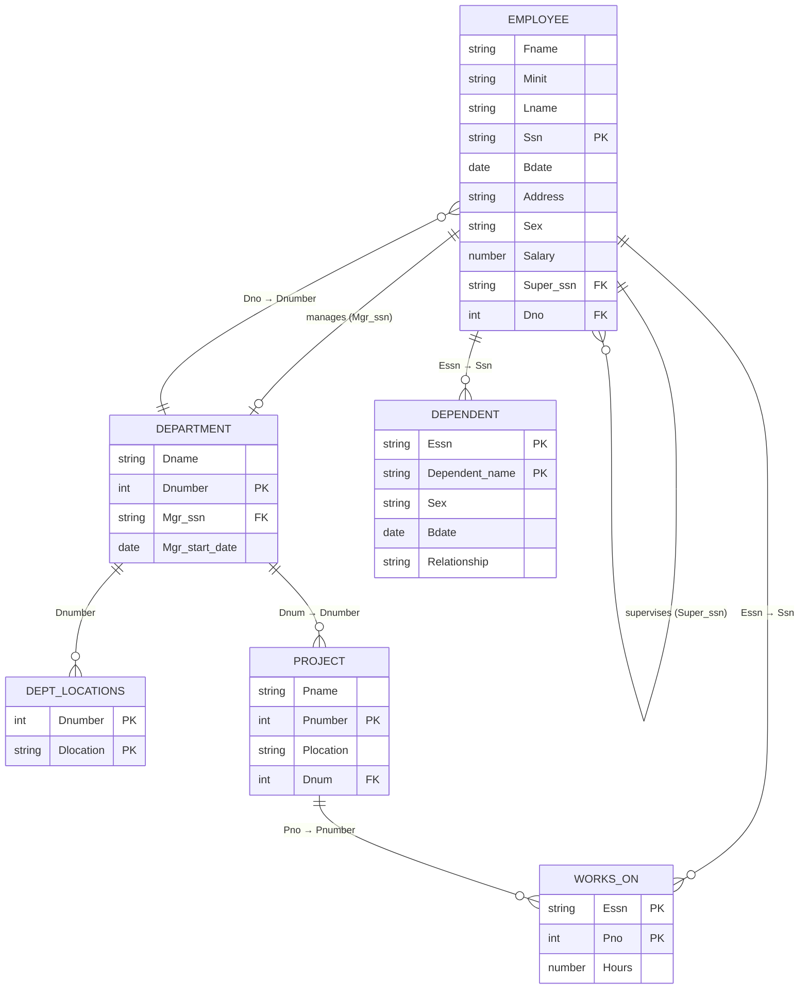

# Chương 5: Đại Số Quan Hệ — Relational Algebra

> **Nguồn:** CO2013 Database Systems, HCMUT — Giảng viên: TS. Trần Minh Quang
> **Giáo trình:** *Fundamentals of Database Systems*, 7th Edition — R. Elmasri & S. B. Navathe, Addison-Wesley, 2017
> **File PDF gốc:** `Lectures/05_Relational Algebra.pdf` — **85 slide**
> **Đã gộp slide Contents lặp:** slide **4, 5, 22, 32, 59, 76, 84** (cùng một mục lục, chỉ khác mục được highlight). Slide 85 là slide Q&A kết chương.

---

## 0. Trước khi bắt đầu

### 0.1. Bạn cần biết gì trước? (Prerequisite)

Chương này đứng **ngay sau** Chương 4 (Relational Data Model & Mapping). Bạn cần đã quen các khái niệm sau — nhắc lại siêu ngắn để bạn không cần mở lại Chương 4:

| Khái niệm | Nhắc lại 2-3 câu | Vì sao cần cho Chương 5? |
|---|---|---|
| **Relation (quan hệ/bảng)** | Bảng có schema cố định + tập tuple. Trong RA, là *set* các tuple — không cho 2 dòng giống hệt nhau. | RA biến đổi *bảng → bảng*. |
| **Tuple (bộ)** | Một dòng = bộ giá trị thuộc các cột. | σ lọc tuple, ÷ kiểm tra tuple với mọi tuple khác. |
| **Attribute (thuộc tính)** | Một cột. Có domain (kiểu dữ liệu) đi kèm. | π chiếu cột, type-compatible kiểm tra cột tương ứng. |
| **Schema vs Instance** | Schema = cấu trúc; Instance = dữ liệu cụ thể tại 1 thời điểm. | Mọi ví dụ chương này chạy trên instance COMPANY. |
| **Primary Key (PK)** | Định danh duy nhất một tuple. | π trên list chứa PK ⇒ không loại tuple. |
| **Foreign Key (FK)** | Cột trỏ đến PK bảng khác. | JOIN ngầm dùng FK = PK. |
| **Set theory (toán rời rạc)** | Hợp `∪`, giao `∩`, hiệu `−`, tích Descartes `×`, tập con `⊆`. | 4 phép trong nhóm "Set Theory Operations". |
| **Boolean expression** | `AND`, `OR`, `NOT` + so sánh `= < > ≤ ≥ ≠`. | Selection condition trong σ và join condition trong ⋈. |

> 💡 **Hiểu đơn giản — Relation là gì:** Hình dung một bảng Excel có header cố định (schema) và các dòng (instance). Khác Excel ở chỗ: trong RA, **không cho 2 dòng giống hệt nhau** (vì là set). SQL thì cho phép trùng (multiset) — đây sẽ là điểm khác biệt quan trọng giữa RA và SQL.

### 0.2. Sau chương này bạn sẽ làm được gì? (Learning Outcomes)

Học xong Chương 5, bạn có thể:

1. **Đọc–hiểu** một biểu thức Đại số quan hệ (RA) bất kỳ và biết nó trả về tập tuple nào.
2. **Viết** biểu thức RA cho các truy vấn cơ bản trên schema COMPANY: lọc, chiếu, kết, gom nhóm, tính tổng / trung bình.
3. **Phân biệt 9 toán tử cốt lõi** + biến thể: σ, π, ρ, ∪, ∩, −, ×, ⋈ (theta / equi / natural), ÷, cộng với 𝓕 (aggregate), OUTER JOIN, OUTER UNION, recursive closure.
4. **Vẽ** Query tree cho một biểu thức RA và đọc ngược lại.
5. **So sánh** Relational Algebra (procedural — *cách lấy*) và Relational Calculus (non-procedural — *cái cần lấy*).
6. **Nối RA ↔ SQL:** mỗi toán tử RA ứng với mệnh đề SQL nào (chuẩn bị Chương 6).

### 0.3. Lộ trình đọc đề xuất

| Section | Mức độ | Thời gian gợi ý | Ghi chú |
|---|---|---|---|
| 0. Trước khi bắt đầu | Bắt buộc | 10' | Đọc 1 lần cho ngữ cảnh |
| 1. Unary (σ, π, ρ) | **CORE** | 30' | Phải nắm chắc — slide 9–21 |
| 2. Set theory (∪, ∩, −, ×) | **CORE** | 25' | Ôn lại set theory toán rời rạc — slide 22–31 |
| 3. Binary (JOIN, DIVISION, Query Tree) | **CORE** | 50' | Phần khó nhất — JOIN có 3 biến thể; slide 32–58 |
| 4. Additional (Aggregate, OUTER JOIN, Recursive) | **CORE** + nâng cao | 30' | Aggregate hay ra thi — slide 59–75 |
| 5. Relational Calculus | NÂNG CAO | 20' | Hiểu khái niệm, không bắt viết phức tạp — slide 76–85 |
| Bảng tra nhanh + Sai lầm + Mini bài tập | Bắt buộc trước thi | 30' | Ôn cuối chương |

**Tổng:** ~3 giờ tự học cho người mất gốc; ~1.5 giờ nếu đã ôn xong Chương 4.

### 0.4. Lược đồ COMPANY dùng xuyên suốt



> 📊 **Đọc diagram này thế nào:** Mỗi box là 1 relation. PK gạch chân, FK đi vào quan hệ tham chiếu. EMPLOYEE.Super_ssn → EMPLOYEE.Ssn là **self-reference** (recursive — sếp của một nhân viên cũng là nhân viên).

#### Instance EMPLOYEE (8 tuple — slide 7)

| Fname | Minit | Lname | Ssn | Bdate | Address | Sex | Salary | Super_ssn | Dno |
|---|---|---|---|---|---|---|---|---|---|
| John | B | Smith | 123456789 | 1965-01-09 | 731 Fondren, Houston, TX | M | 30000 | 333445555 | 5 |
| Franklin | T | Wong | 333445555 | 1955-12-08 | 638 Voss, Houston, TX | M | 40000 | 888665555 | 5 |
| Alicia | J | Zelaya | 999887777 | 1968-01-19 | 3321 Castle, Spring, TX | F | 25000 | 987654321 | 4 |
| Jennifer | S | Wallace | 987654321 | 1941-06-20 | 291 Berry, Bellaire, TX | F | 43000 | 888665555 | 4 |
| Ramesh | K | Narayan | 666884444 | 1962-09-15 | 975 Fire Oak, Humble, TX | M | 38000 | 333445555 | 5 |
| Joyce | A | English | 453453453 | 1972-07-31 | 5631 Rice, Houston, TX | F | 25000 | 333445555 | 5 |
| Ahmad | V | Jabbar | 987987987 | 1969-03-29 | 980 Dallas, Houston, TX | M | 25000 | 987654321 | 4 |
| James | E | Borg | 888665555 | 1937-11-10 | 450 Stone, Houston, TX | M | 55000 | NULL | 1 |

#### Instance DEPARTMENT, DEPT_LOCATIONS, PROJECT, WORKS_ON, DEPENDENT (slide 8)

**DEPARTMENT** (3 tuple):

| Dname | Dnumber | Mgr_ssn | Mgr_start_date |
|---|---|---|---|
| Research | 5 | 333445555 | 1988-05-22 |
| Administration | 4 | 987654321 | 1995-01-01 |
| Headquarters | 1 | 888665555 | 1981-06-19 |

**DEPT_LOCATIONS** (5 tuple):

| Dnumber | Dlocation |
|---|---|
| 1 | Houston |
| 4 | Stafford |
| 5 | Bellaire |
| 5 | Sugarland |
| 5 | Houston |

**PROJECT** (6 tuple):

| Pname | Pnumber | Plocation | Dnum |
|---|---|---|---|
| ProductX | 1 | Bellaire | 5 |
| ProductY | 2 | Sugarland | 5 |
| ProductZ | 3 | Houston | 5 |
| Computerization | 10 | Stafford | 4 |
| Reorganization | 20 | Houston | 1 |
| Newbenefits | 30 | Stafford | 4 |

**WORKS_ON** (16 tuple):

| Essn | Pno | Hours |
|---|---|---|
| 123456789 | 1 | 32.5 |
| 123456789 | 2 | 7.5 |
| 666884444 | 3 | 40.0 |
| 453453453 | 1 | 20.0 |
| 453453453 | 2 | 20.0 |
| 333445555 | 2 | 10.0 |
| 333445555 | 3 | 10.0 |
| 333445555 | 10 | 10.0 |
| 333445555 | 20 | 10.0 |
| 999887777 | 30 | 30.0 |
| 999887777 | 10 | 10.0 |
| 987987987 | 10 | 35.0 |
| 987987987 | 30 | 5.0 |
| 987654321 | 30 | 20.0 |
| 987654321 | 20 | 15.0 |
| 888665555 | 20 | NULL |

**DEPENDENT** (7 tuple):

| Essn | Dependent_name | Sex | Bdate | Relationship |
|---|---|---|---|---|
| 333445555 | Alice | F | 1986-04-05 | Daughter |
| 333445555 | Theodore | M | 1983-10-25 | Son |
| 333445555 | Joy | F | 1958-05-03 | Spouse |
| 987654321 | Abner | M | 1942-02-28 | Spouse |
| 123456789 | Michael | M | 1988-01-04 | Son |
| 123456789 | Alice | F | 1988-12-30 | Daughter |
| 123456789 | Elizabeth | F | 1967-05-05 | Spouse |

---

## Tổng quan — Relational Algebra là gì? (slide 2–3)

- **Relational Algebra** là tập các phép toán cơ bản trên relational model. Mỗi phép nhận 1–2 relation làm input và trả ra **1 relation mới**.
- Tính chất quan trọng nhất: **closed (đóng)** — input là relation, output cũng là relation. Nhờ vậy có thể *nest* các phép vào nhau, tạo thành **relational algebra expression**.
- 4 nhóm toán tử (slide 3):
  1. **Unary:** SELECT (σ), PROJECT (π), RENAME (ρ)
  2. **Set theory:** UNION (∪), INTERSECTION (∩), DIFFERENCE (−), CARTESIAN PRODUCT (×)
  3. **Binary:** JOIN (⋈) + biến thể (theta, equi, natural), DIVISION (÷)
  4. **Additional:** OUTER JOINS, OUTER UNION, AGGREGATE FUNCTIONS (SUM, COUNT, AVG, MIN, MAX)

> 💡 **Hiểu đơn giản — vì sao "closed" quan trọng:** Giống cộng/trừ/nhân/chia số nguyên — input số nguyên, output số nguyên, nên ghép được. Ở đây: input relation, output relation, nên ghép vào nhau thành biểu thức phức như `π_…(σ_…(R) ⋈ S)`.

---

## 1. Unary Relational Operations — Toán tử quan hệ một ngôi

### 1.1. SELECT (σ — sigma) — Lọc tuple theo điều kiện

#### Tại sao có SELECT? (Motivation)

Bạn có 8 nhân viên, nhưng chỉ cần "những ai làm phòng 4". Nếu không có SELECT, bạn phải duyệt tay từng tuple. SELECT làm việc đó *chính thức* trên *quan hệ tổng quát*.

> 💡 **Hiểu đơn giản:** SELECT giống *Filter* trên Excel: bấm vào header cột → chọn điều kiện → ẩn dòng không khớp. Kết quả vẫn có schema giống bảng cũ, chỉ ít hàng hơn.

#### Khái niệm và lý thuyết (slide 9–11)

- σ **denoted by σ (sigma)** — lọc *subset of tuples* dựa trên **selection condition** (điều kiện Boolean).
- **Dạng tổng quát:** `σ_<selection condition>(R)`
  - Tuple thỏa điều kiện → giữ lại; không thỏa → loại.
  - Schema kết quả **giống schema R**.
- Ví dụ slide 9:
  - `σ Dno=4 (EMPLOYEE)` — nhân viên phòng 4.
  - `σ Salary>30000 (EMPLOYEE)` — nhân viên lương > 30 000.

#### Tính chất quan trọng (slide 11)

- **Giao hoán (commutative):** `σ_<c1>(σ_<c2>(R)) = σ_<c2>(σ_<c1>(R))`
- **Cascade rút gọn được:** `σ_<c1>(σ_<c2>(σ_<c3>(R))) = σ_<c1> AND <c2> AND <c3>(R)` — viết lại thành 1 σ với AND.
- **|σ_C(R)| ≤ |R|** — số tuple kết quả ≤ tuple gốc.

> 💡 **Tại sao tính giao hoán quan trọng — query optimizer:** DBMS có thể đổi thứ tự điều kiện để lọc sớm điều kiện *mạnh* (loại nhiều tuple) trước, giảm chi phí.

#### Ví dụ minh họa trên relation R giả định (slide 12)

```
R                   σ_A≤4(R)
| A | B | C |       | A | B | C |
|---|---|---|       |---|---|---|
| 1 | 2 | 3 |       | 1 | 2 | 3 |
| 4 | 5 | 6 |       | 4 | 5 | 6 |
| 1 | 2 | 7 |       | 1 | 2 | 7 |
| 8 | 4 | 5 |
```

Tuple `(8,4,5)` bị loại vì `A=8` không ≤ 4.

#### Ví dụ trên COMPANY

> 💡 **Ví dụ 1.1 — Lọc nhân viên phòng 5 lương > 30 000:**
> `σ Dno=5 AND Salary>30000 (EMPLOYEE)`
>
> **Bước 1:** Lọc Dno=5 → Smith (30 000), Wong (40 000), Narayan (38 000), English (25 000).
> **Bước 2:** Trong đó lọc Salary > 30 000 → **Wong (40 000), Narayan (38 000)**.
> **Kết quả:** 2 tuple.

#### Ví dụ phức tạp — slide 17(a)

> 💡 **Slide 17(a):** `σ (Dno=4 AND Salary>25000) OR (Dno=5 AND Salary>30000) (EMPLOYEE)`
>
> Kết quả 3 tuple: **Wong** (Dno=5, 40 000), **Wallace** (Dno=4, 43 000), **Narayan** (Dno=5, 38 000).

#### Tương đương SQL

```sql
SELECT *
FROM   EMPLOYEE
WHERE  Dno = 5 AND Salary > 30000;
```

`WHERE` trong SQL **chính là** σ trong RA — mệnh đề tương ứng đầu tiên giữa hai ngôn ngữ.

> 📝 **Tóm lại 1.1:**
> - σ_C(R) = filter theo dòng, schema không đổi, |kết quả| ≤ |gốc|.
> - Giao hoán + kết hợp → cascade gộp thành σ AND.
>
> **Một câu ghi nhớ:** "σ là *filter cắt theo chiều ngang*."

> ❓ **Tự kiểm tra 1.1:**
> 1. Viết RA chọn nhân viên nữ (Sex='F') có lương ≥ 25 000.
> 2. So sánh `σ A=1 OR A=4 (R)` và `σ A=1 (R) ∪ σ A=4 (R)` — bằng nhau không?
> 3. Vì sao σ là *filter cắt hàng*, không phải *cắt cột*?

---

### 1.2. PROJECT (π — pi) — Chiếu lấy một số cột

#### Tại sao có PROJECT?

Sau khi đã lọc hàng cần, nhiều khi bạn không cần *toàn bộ 10 cột* mà chỉ cần Fname, Lname, Salary để in báo cáo. PROJECT làm việc cắt cột *chính thức + sạch sẽ*.

> 💡 **Hiểu đơn giản:** PROJECT = ẩn cột trong Excel để in cho gọn. Khác Excel ở chỗ: nếu sau khi ẩn cột mà có 2 dòng giống hệt → RA *bắt buộc gộp* (vì kết quả là set).

#### Khái niệm và lý thuyết (slide 13–15)

- π **denoted by π (pi)** — giữ một số *columns (attributes)*, bỏ cột còn lại. Tạo *vertical partitioning* (phân hoạch dọc).
- **Dạng tổng quát:** `π_<attribute list>(R)`
  - Kết quả chỉ chứa các attribute trong list, **theo đúng thứ tự** trong list.
  - **Loại tuple trùng** (duplicate elimination) — vì set không cho trùng.
- Ví dụ slide 13: `π Lname,Fname,Salary (EMPLOYEE)`.

#### Tính chất (slide 15)

- |π_L(R)| ≤ |R|. **Bằng** nếu L chứa một **key** của R.
- **Không giao hoán:** `π_L1(π_L2(R)) = π_L1(R)` chỉ khi L2 ⊇ L1.

> 💡 **Tại sao không giao hoán:** Bạn không thể chiếu {Salary} trước rồi {Fname, Lname} sau, vì sau bước 1 đã không còn Fname trong bảng. Phải làm theo thứ tự "list nhiều cột trước".

#### Ví dụ minh họa (slide 16)

```
R                       π_A,B(R)
| A | B | C |           | A | B |
|---|---|---|           |---|---|
| 1 | 2 | 3 |           | 1 | 2 |
| 4 | 5 | 6 |           | 4 | 5 |
| 1 | 2 | 7 |           | 8 | 4 |
| 8 | 4 | 5 |
```

Tuple thứ 1 và 3 đều là (1, 2) sau khi bỏ cột C → loại trùng → 3 tuple thay vì 4.

#### Ví dụ slide 17 trên COMPANY

> 💡 **Slide 17(b):** `π Lname,Fname,Salary (EMPLOYEE)` = **8 tuple**.
> *Vì sao đủ 8 tuple, không loại trùng?* Vì bộ (Lname, Fname, Salary) duy nhất trong instance này — không có 2 nhân viên cùng họ tên + lương.

> 💡 **Slide 17(c):** `π Sex,Salary (EMPLOYEE)` = **7 tuple**.
> Sau projection, hai nhân viên (F, 25 000) là Zelaya và English → loại trùng còn 1.

#### Tương đương SQL

```sql
SELECT DISTINCT Lname, Fname, Salary FROM EMPLOYEE;
```

> ⚠️ **Khác biệt cốt lõi RA vs SQL:** RA = set (không trùng). SQL = multiset (trùng được, trừ khi `DISTINCT`). Hay ra đề thi.

> 📝 **Tóm lại 1.2:**
> - π_L(R) = filter theo cột, loại trùng tự động.
> - |kết quả| ≤ |gốc|; bằng khi L chứa key.
> - Không giao hoán.
>
> **Một câu ghi nhớ:** "π là *filter cắt theo chiều dọc*, kèm bước loại trùng bắt buộc."

> ❓ **Tự kiểm tra 1.2:**
> 1. `π_Dno (EMPLOYEE)` có bao nhiêu tuple?
> 2. Vì sao `π_Salary (EMPLOYEE)` có thể có ít tuple hơn |EMPLOYEE|?
> 3. `π_A,B (π_A,B,C (R)) = π_A,B (R)` đúng hay sai?

---

### 1.3. Relational Algebra Expressions — Hai cách viết (slide 18–19)

Có hai cách viết tương đương cho cùng một query phức:

**Cách 1 — Single nested expression:**

```
π Fname,Lname,Salary (σ Dno=5 (EMPLOYEE))
```

**Cách 2 — Sequence with assignment `←`:**

```
DEP5_EMPS  ← σ Dno=5 (EMPLOYEE)
RESULT     ← π Fname,Lname,Salary (DEP5_EMPS)
```

Hai cách hoàn toàn tương đương, *cùng kết quả*. Cách 2 dài hơn nhưng *dễ debug* — bạn nhìn thấy DEP5_EMPS trước khi chiếu xuống RESULT. Trong đề thi tự luận HCMUT, cả 2 đều được chấp nhận.

**Tương đương SQL:**

```sql
SELECT Fname, Lname, Salary FROM EMPLOYEE WHERE Dno = 5;
```

---

### 1.4. RENAME (ρ — rho) — Đổi tên relation và/hoặc cột (slide 20–21)

#### Tại sao có RENAME?

Bạn cần self-join EMPLOYEE với chính nó (vd "tìm cặp nhân viên - sếp"). Cả hai bên đều tên EMPLOYEE và đều có cột Ssn → làm sao phân biệt? Phải đổi tên *một bên*. Đó là việc của ρ.

> 💡 **Hiểu đơn giản:** ρ = `AS` trong SQL. `EMPLOYEE AS E1` đổi tên bảng tạm. ρ tổng quát hơn — đổi cả tên bảng lẫn tên cột.

#### Ba dạng (slide 21)

| Dạng | Ý nghĩa |
|---|---|
| `ρ_S(B1,B2,…,Bn)(R)` | Đổi tên relation thành S, **đồng thời** đổi tên các cột thành B1, …, Bn. |
| `ρ_S(R)` | Chỉ đổi tên relation thành S. |
| `ρ_(B1,B2,…,Bn)(R)` | Chỉ đổi tên cột thành B1, …, Bn. |

#### Ví dụ với COMPANY

```
DEPT ← ρ_(Dname, Dnum, Mgr_ssn, Mgr_start_date)(DEPARTMENT)
```

Đổi `Dnumber` thành `Dnum` → khớp với cột `Dnum` của PROJECT → cho phép NATURAL JOIN sau đó.

**Tương đương SQL:**

```sql
SELECT Dname, Dnumber AS Dnum, Mgr_ssn, Mgr_start_date FROM DEPARTMENT;
```

> 📝 **Tóm lại section 1 — Unary:**
> - σ lọc dòng, π lọc cột, ρ đổi tên.
> - σ giao hoán; π **không**; ρ chỉ đổi nhãn — không đụng dữ liệu.
>
> **Một câu ghi nhớ:** "*σ cắt hàng — π cắt cột — ρ đổi tên.*"

> ❓ **Tự kiểm tra section 1:**
> 1. `σ_Salary>30000(EMPLOYEE)` có giữ schema không? Số tuple thay đổi thế nào?
> 2. Vì sao `π_Sex,Salary(EMPLOYEE)` có thể ít dòng hơn |EMPLOYEE|?
> 3. Viết RA + SQL lấy `Fname`, `Lname` của nhân viên phòng 4.

---

## 2. Set Theory Operations — Toán tử từ Lý thuyết Tập hợp

### 2.0. Vì sao có nhóm này?

Một relation **là một tập** các tuple. Vì vậy mọi phép tập hợp toán học (∪, ∩, −, ×) **áp dụng được** lên relation. Đó chính là 4 toán tử của section này.

> 💡 **Liên kết toán rời rạc:** `A ∪ B = {x | x ∈ A hoặc x ∈ B}`. Ở đây mọi `x` là một tuple. Logic giống hệt, chỉ khác đối tượng.

### 2.1. UNION (∪) — Phép hợp (slide 23–24)

- Binary, ký hiệu `∪`. `R ∪ S` = tập tuple thuộc **R hoặc S hoặc cả hai**.
- **Loại trùng** tự động.
- Hai relation phải **type-compatible** (xem 2.2).

#### Ví dụ slide 24

```
RESULT1 (Ssn)         RESULT2 (Ssn)        RESULT = RESULT1 ∪ RESULT2
123456789             333445555             123456789
333445555             888665555             333445555
666884444                                   666884444
453453453                                   453453453
                                            888665555
```

`333445555` xuất hiện ở cả 2 → chỉ giữ 1 lần. Kết quả 5 tuple.

**Tương đương SQL:**

```sql
SELECT Ssn FROM RESULT1
UNION
SELECT Ssn FROM RESULT2;
```

(SQL `UNION` mặc định loại trùng. `UNION ALL` giữ trùng — KHÁC ngữ nghĩa RA.)

### 2.2. Type Compatibility (slide 25)

Yêu cầu chung cho `∪`, `∩`, `−`:

1. **Cùng số cột.**
2. **Cột thứ i ↔ cột thứ i** có domain tương thích (cùng kiểu hoặc kiểu tương thích).
3. **Tên cột không bắt buộc trùng** — kết quả lấy tên của relation đầu tiên (theo convention).

**Ví dụ hợp lệ:** `π_Ssn(EMPLOYEE) ∪ π_Mgr_ssn(DEPARTMENT)` — đều là 1 cột chứa SSN.
**Ví dụ KHÔNG hợp lệ:** `EMPLOYEE ∪ DEPARTMENT` — 10 cột vs 4 cột.

### 2.3. INTERSECTION (∩) — Phép giao (slide 26)

`R ∩ S` = tập tuple thuộc **cả R và S**. Tên cột kết quả lấy theo R. Cần type-compatible.

> 💡 **Hiểu đơn giản:** Giao 2 danh sách (sinh viên đăng ký môn A) ∩ (sinh viên đăng ký môn B) = SV học cả hai.

```sql
SELECT Ssn FROM RESULT1
INTERSECT
SELECT Ssn FROM RESULT2;
```

### 2.4. SET DIFFERENCE (−) — Phép hiệu / MINUS / EXCEPT (slide 27)

`R − S` = tập tuple **thuộc R nhưng không thuộc S**. Tên cột theo R. Cần type-compatible.

> 💡 **Hiểu đơn giản:** "Trong A, không có trong B." Vd: nhân viên đi làm hôm nay TRỪ nhân viên có lịch họp = nhân viên có thể tiếp khách.

```sql
SELECT Ssn FROM RESULT1
EXCEPT          -- Oracle dùng MINUS
SELECT Ssn FROM RESULT2;
```

### 2.5. Ví dụ tổng hợp ∪, ∩, − (slide 28 — Figure 6.4)

**STUDENT** (7 tuple) | **INSTRUCTOR** (5 tuple) — type-compatible (đều 2 cột tên, dù khác tên cột Fn/Fname):

| (a) STUDENT |  | INSTRUCTOR |  |
|---|---|---|---|
| Susan | Yao | John | Smith |
| Ramesh | Shah | Ricardo | Browne |
| Johnny | Kohler | Susan | Yao |
| Barbara | Jones | Francis | Johnson |
| Amy | Ford | Ramesh | Shah |
| Jimmy | Wang |  |  |
| Ernest | Gilbert |  |  |

| (b) STUDENT ∪ INSTRUCTOR (10 tuple) | (c) STUDENT ∩ INSTRUCTOR (2) | (d) STUDENT − INSTRUCTOR (5) | (e) INSTRUCTOR − STUDENT (3) |
|---|---|---|---|
| Susan Yao + Ramesh Shah + Johnny Kohler + Barbara Jones + Amy Ford + Jimmy Wang + Ernest Gilbert + John Smith + Ricardo Browne + Francis Johnson | Susan Yao, Ramesh Shah | Johnny Kohler, Barbara Jones, Amy Ford, Jimmy Wang, Ernest Gilbert | John Smith, Ricardo Browne, Francis Johnson |

> 📊 **Quan sát:** (d) ≠ (e) → DIFFERENCE **không giao hoán**. Tên cột: (b)–(d) dùng (Fn, Ln) theo STUDENT; (e) dùng (Fname, Lname) theo INSTRUCTOR.

### 2.6. Tính chất ∪, ∩, − (slide 29)

- ∪, ∩ **giao hoán** + **kết hợp** (associative) — viết được dạng n-ary: `R ∪ S ∪ T`.
- − **không giao hoán:** `R − S ≠ S − R`.

### 2.7. CARTESIAN PRODUCT (×) — Tích Descartes (slide 30–31)

#### Tại sao có?

JOIN (sẽ học section 3) chính là *× cộng với σ*. Vì vậy phải hiểu × trước.

> 💡 **Hiểu đơn giản:** Tủ có 4 áo và 2 quần → tích Descartes = mỗi áo ghép mỗi quần = 8 bộ. Không phải bộ nào cũng hợp — JOIN sẽ thêm điều kiện "hợp màu".

#### Định nghĩa

`R(A1,…,An) × S(B1,…,Bm)` = relation Q có **n+m cột** `Q(A1,…,An,B1,…,Bm)` và **|R| × |S| tuple**.

Hai operand **KHÔNG cần** type-compatible.

#### Ví dụ slide 31

```
R              T               R × T (8 tuple, 5 cột)
| A | B | C |  | A | D |       | R.A | B | C | T.A | D |
|---|---|---|  |---|---|       |-----|---|---|-----|---|
| 1 | 2 | 3 |  | 1 | 5 |       |  1  | 2 | 3 |  1  | 5 |
| 4 | 5 | 6 |  | 3 | 7 |       |  1  | 2 | 3 |  3  | 7 |
| 1 | 2 | 7 |                   |  4  | 5 | 6 |  1  | 5 |
| 8 | 4 | 5 |                   |  4  | 5 | 6 |  3  | 7 |
                                |  1  | 2 | 7 |  1  | 5 |
                                |  1  | 2 | 7 |  3  | 7 |
                                |  8  | 4 | 5 |  1  | 5 |
                                |  8  | 4 | 5 |  3  | 7 |
```

Cả R và T đều có cột tên A → phải dùng prefix R.A và T.A.

```sql
SELECT * FROM R CROSS JOIN T;
-- hoặc
SELECT * FROM R, T;
```

> ⚠️ **Cảnh báo thực tế:** `1M × 1M = 10¹² dòng`. Trong production *luôn* theo sau bằng σ → tự nhiên trở thành JOIN.

> 📝 **Tóm lại section 2 — Set theory:**
> - ∪/∩/− cần type-compatible; tên cột kết quả lấy theo R đầu tiên.
> - ∪, ∩ giao hoán + kết hợp; − KHÔNG giao hoán.
> - × ghép mọi cặp tuple, không cần type-compat, |kết quả| = |R| × |S|.
>
> **Một câu ghi nhớ:** "*∪/∩/− coi relation như set; × ghép thô để dành σ lọc.*"

> ❓ **Tự kiểm tra section 2:**
> 1. EMPLOYEE ∪ DEPARTMENT có hợp lệ không? Vì sao?
> 2. Tìm Essn xuất hiện trong WORKS_ON nhưng không trong DEPENDENT — viết RA.
> 3. |EMPLOYEE × DEPARTMENT| với instance trên = bao nhiêu?

---

## 3. Binary Relational Operations — Toán tử Hai ngôi

### 3.1. JOIN (⋈) — Phép kết (slide 33–42)

#### Tại sao có JOIN?

Trong COMPANY, dữ liệu rải ra nhiều bảng: tên nhân viên ở EMPLOYEE, tên phòng ở DEPARTMENT, ai làm dự án nào ở WORKS_ON. Để trả lời "tên manager mỗi phòng" cần **ghép** EMPLOYEE và DEPARTMENT *theo điều kiện liên quan* (Mgr_ssn = Ssn). Đó là JOIN.

> 💡 **Hiểu đơn giản:** JOIN = *VLOOKUP* trong Excel. Có hóa đơn với CustomerID; có bảng khách hàng cũng CustomerID — ghép đúng mã thì biết hóa đơn của ai.

#### Khái niệm (slide 33–34)

- JOIN ký hiệu `⋈`.
- **Tương đương:** `R ⋈_θ S = σ_θ (R × S)` — tích Descartes rồi lọc.
- Lý do gộp thành 1 phép riêng: pattern `× rồi σ` quá phổ biến với mọi DB có > 1 relation.

#### Ví dụ slide 34 — Tên manager mỗi phòng

```
DEPT_MGR ← DEPARTMENT ⋈_Mgr_ssn=Ssn EMPLOYEE
RESULT   ← π_Dname,Lname,Fname (DEPT_MGR)
```

#### Kết quả (slide 38)

| Dname | Dnumber | Mgr_ssn | … | Fname | Minit | Lname | Ssn | … |
|---|---|---|---|---|---|---|---|---|
| Research | 5 | 333445555 | … | Franklin | T | Wong | 333445555 | … |
| Administration | 4 | 987654321 | … | Jennifer | S | Wallace | 987654321 | … |
| Headquarters | 1 | 888665555 | … | James | E | Borg | 888665555 | … |

#### Dạng tổng quát (slide 39)

`R(A1,…,An) ⋈_<join condition> S(B1,…,Bm)`

- `<condition>` có dạng `Ai θ Bj`, với θ ∈ {=, <, >, ≤, ≥, ≠} hoặc Boolean phức.

#### Tính chất (slide 40)

- Schema kết quả = **n + m cột** (giống ×).
- |R ⋈ S| **<** |R| × |S| nói chung — chỉ giữ tuple liên quan.

### 3.2. Theta-Join (slide 41–42)

Trường hợp tổng quát của JOIN — θ là Boolean expression bất kỳ. Khi θ chỉ dùng `=` thuần → gọi là **EQUIJOIN**.

#### Ví dụ slide 42 — Theta-join với `>`

```
R              T               R ⋈_R.A > T.A T (4 tuple)
| A | B | C |  | A | D |       | R.A | B | C | T.A | D |
|---|---|---|  |---|---|       |-----|---|---|-----|---|
| 1 | 2 | 3 |  | 1 | 5 |       |  4  | 5 | 6 |  1  | 5 |
| 4 | 5 | 6 |  | 3 | 7 |       |  4  | 5 | 6 |  3  | 7 |
| 1 | 2 | 7 |                   |  8  | 4 | 5 |  1  | 5 |
| 8 | 4 | 5 |                   |  8  | 4 | 5 |  3  | 7 |
```

R.A=1 không > T.A nào → bị loại. R.A=4 > 1 và 3 → 2 cặp. R.A=8 → 2 cặp.

```sql
SELECT * FROM R JOIN T ON R.A > T.A;
```

### 3.3. EQUIJOIN (slide 43–44)

Theta-join với θ là `=` thuần. Trong kết quả luôn có *một hoặc nhiều cặp cột* có giá trị bằng nhau ở mọi tuple.

#### Ví dụ slide 44

```
R              S               R ⋈_R.A=S.A S (2 tuple)
| A | B | C |  | A | D |       | R.A | B | C | S.A | D |
|---|---|---|  |---|---|       |-----|---|---|-----|---|
| 1 | 2 | 3 |  | 1 | 5 |       |  1  | 2 | 3 |  1  | 5 |
| 4 | 5 | 6 |  | 3 | 7 |       |  1  | 2 | 7 |  1  | 5 |
| 1 | 2 | 7 |
| 8 | 4 | 5 |
```

**Lưu ý:** kết quả giữ cả `R.A` và `S.A` (dù bằng nhau) → đây là điểm khác NATURAL JOIN.

### 3.4. NATURAL JOIN (* hoặc ⋈) (slide 45–50)

#### Tại sao có?

EQUIJOIN giữ 2 cột bằng nhau là *thừa*. NATURAL JOIN sinh ra để **bỏ cột thừa**, **tự** tìm cột cùng tên ở 2 bảng làm join condition.

> 💡 **Hiểu đơn giản:** Hai bản scan cùng mã sinh viên — NATURAL JOIN nói "Hai mã giống nhau rồi, giữ một là đủ."

#### Định nghĩa (slide 45)

- `Q ← R(A,B,C,D) * S(C,D,E)` → join condition ngầm = `R.C=S.C AND R.D=S.D`.
- Kết quả `Q(A,B,C,D,E)` — chỉ 1 bản của mỗi cặp cột chung.
- Yêu cầu: cột phải **cùng tên** ở 2 bảng. Nếu khác tên → ρ trước.

#### Ví dụ slide 46

```
R              T               R * T (2 tuple, 4 cột — bỏ cột thừa A)
| A | B | C |  | A | D |       | A | B | C | D |
|---|---|---|  |---|---|       |---|---|---|---|
| 1 | 2 | 3 |  | 1 | 5 |       | 1 | 2 | 3 | 5 |
| 4 | 5 | 6 |  | 3 | 7 |       | 1 | 2 | 7 | 5 |
| 1 | 2 | 7 |
| 8 | 4 | 5 |
```

#### Slide 47–48 — PROJ_DEPT trên COMPANY

PROJECT có cột `Dnum`, DEPARTMENT có `Dnumber` — *khác tên* → cần ρ trước:

```
DEPT       ← ρ_(Dname, Dnum, Mgr_ssn, Mgr_start_date)(DEPARTMENT)
PROJ_DEPT  ← PROJECT * DEPT
```

| Pname | Pnumber | Plocation | Dnum | Dname | Mgr_ssn | Mgr_start_date |
|---|---|---|---|---|---|---|
| ProductX | 1 | Bellaire | 5 | Research | 333445555 | 1988-05-22 |
| ProductY | 2 | Sugarland | 5 | Research | 333445555 | 1988-05-22 |
| ProductZ | 3 | Houston | 5 | Research | 333445555 | 1988-05-22 |
| Computerization | 10 | Stafford | 4 | Administration | 987654321 | 1995-01-01 |
| Reorganization | 20 | Houston | 1 | Headquarters | 888665555 | 1981-06-19 |
| Newbenefits | 30 | Stafford | 4 | Administration | 987654321 | 1995-01-01 |

#### Slide 49–50 — DEPT_LOCS

DEPARTMENT và DEPT_LOCATIONS đều có cột `Dnumber` → NATURAL JOIN trực tiếp:

```
DEPT_LOCS ← DEPARTMENT * DEPT_LOCATIONS
```

| Dname | Dnumber | Mgr_ssn | Mgr_start_date | Dlocation |
|---|---|---|---|---|
| Headquarters | 1 | 888665555 | 1981-06-19 | Houston |
| Administration | 4 | 987654321 | 1995-01-01 | Stafford |
| Research | 5 | 333445555 | 1988-05-22 | Bellaire |
| Research | 5 | 333445555 | 1988-05-22 | Sugarland |
| Research | 5 | 333445555 | 1988-05-22 | Houston |

Phòng Research (Dnumber=5) có 3 location → 3 dòng.

### 3.5. Complete Set (slide 51)

**`{σ, π, ∪, −, ×}` là complete set** — mọi RA expression khác có thể biểu diễn bằng tổ hợp 5 phép này:

- `R ∩ S = (R ∪ S) − ((R − S) ∪ (S − R))`
- `R ⋈_<θ> S = σ_<θ> (R × S)`

> 💡 **Ý nghĩa thực tiễn:** DBMS implementer chỉ cần code 5 phép cốt lõi. Các phép tiện (∩, ⋈, ÷) là *syntactic sugar* — về biểu đạt không thêm gì.

### 3.6. DIVISION (÷) — Phép chia (slide 52–53)

#### Tại sao có?

Câu hỏi "*làm trên TẤT CẢ project mà Smith làm*" có *universal quantifier* — rất khó với σ/π/⋈. DIVISION sinh ra cho pattern này.

> 💡 **Analogy số học:** 12 ÷ 3 = 4 vì 4 × 3 = 12. Trong RA: T = R ÷ S sao cho T × S ⊆ R, T lớn nhất có thể. Ngữ nghĩa: T = "giá trị xuất hiện trong R *cùng với MỌI giá trị* của S".

#### Định nghĩa (slide 52)

- `R(Z) ÷ S(X) = T(Y)` với `Z = X ∪ Y` (Y = các cột của R không thuộc S).
- Tuple t ∈ T iff với *mọi* tuple t_S ∈ S, có tuple t_R ∈ R sao cho t_R[Y]=t và t_R[X]=t_S.

#### Ví dụ slide 53(a) — Nhân viên làm tất cả project mà Smith làm

**SSN_PNOS** = π_Essn,Pno (WORKS_ON) — 16 tuple (xem instance WORKS_ON ở section 0.4).

**SMITH_PNOS** (Pno mà Smith — Ssn 123456789 — làm):

| Pno |
|---|
| 1 |
| 2 |

**SSNS = SSN_PNOS ÷ SMITH_PNOS:**

| Ssn |
|---|
| 123456789 |
| 453453453 |

Smith có (1, 2). English có (453453453, 1) và (453453453, 2). Wong (333445555) chỉ có Pno=2, thiếu 1 → bị loại.

#### Ví dụ slide 53(b) — Tổng quát

```
R(A,B):  S(A):    T = R ÷ S (Y = {B}):
a1 b1    a1       b1
a2 b1    a2       b4
a3 b1    a3
a4 b1
a1 b2
a3 b2
a2 b3
a3 b3
a4 b3
a1 b4
a2 b4
a3 b4
```

b=b1 cùng a1, a2, a3, a4 → đủ a1, a2, a3 → giữ. b=b2 chỉ a1, a3 → thiếu a2 → loại. b=b3 thiếu a1 → loại. b=b4 đủ → giữ.

#### Tương đương SQL — pattern double NOT EXISTS

```sql
SELECT DISTINCT W1.Essn
FROM   WORKS_ON W1
WHERE  NOT EXISTS (
    SELECT 1 FROM WORKS_ON SMITH
    WHERE  SMITH.Essn = '123456789'
    AND    NOT EXISTS (
        SELECT 1 FROM WORKS_ON W2
        WHERE  W2.Essn = W1.Essn AND W2.Pno = SMITH.Pno
    )
);
```

Logic: "không có Pno mà Smith làm và W1 *không* làm" = "W1 làm trên *mọi* Pno của Smith".

### 3.7. Bảng tổng hợp 10 phép RA (slide 54–55, Table 6.1)

| Operation | Purpose | Notation |
|---|---|---|
| **SELECT** | Lọc tuple thỏa selection condition | `σ_<cond>(R)` |
| **PROJECT** | Giữ một số cột, loại trùng | `π_<list>(R)` |
| **THETA JOIN** | Cặp tuple thỏa join condition tổng quát | `R ⋈_<cond> S` |
| **EQUIJOIN** | Theta join với chỉ phép `=` | `R ⋈_<eq cond> S` |
| **NATURAL JOIN** | Equijoin trên cột cùng tên + bỏ cột trùng | `R * S` hoặc `R ⋈ S` |
| **UNION** | Tuple thuộc R hoặc S | `R ∪ S` |
| **INTERSECTION** | Tuple thuộc cả R và S | `R ∩ S` |
| **DIFFERENCE** | Tuple thuộc R không thuộc S | `R − S` |
| **CARTESIAN PRODUCT** | Mọi cặp tuple | `R × S` |
| **DIVISION** | Pattern "với mọi" | `R(Z) ÷ S(Y)` |

### 3.8. Notation for Query Trees (slide 56–58)

#### Khái niệm

**Query tree** = cây biểu diễn 1 RA expression:
- **Leaf nodes** = input relation.
- **Internal nodes** = phép RA.
- **Root** = kết quả cuối.

Dữ liệu chảy *từ lá lên gốc*.

> 💡 **Hiểu đơn giản:** Sơ đồ dây chuyền sản xuất: nguyên liệu vào ở lá, qua từng "máy" (phép RA), ra sản phẩm ở gốc.

#### Ví dụ slide 58 — Q2

> **Q2:** Với mọi project ở Stafford, liệt kê Pnumber, Dnum, Lname, Address, Bdate của manager phòng.

```
π_Pnumber, Dnum, Lname, Address, Bdate(
    ((σ_Plocation='Stafford'(PROJECT))
        ⋈_Dnum=Dnumber DEPARTMENT)
        ⋈_Mgr_ssn=Ssn EMPLOYEE
)
```

```text
                  π_P.Pnumber, P.Dnum, E.Lname, E.Address, E.Bdate
                                  |
                            ⋈ (3) D.Mgr_ssn = E.Ssn
                            /                        \
                ⋈ (2) P.Dnum = D.Dnumber          (E) EMPLOYEE
                /                       \
   σ (1) P.Plocation = 'Stafford'    (D) DEPARTMENT
                |
           (P) PROJECT
```

**Bước 1:** lọc PROJECT có Plocation='Stafford' → Computerization, Newbenefits.
**Bước 2:** join với DEPARTMENT theo Dnum=Dnumber → cả 2 thuộc Administration (Dnumber=4).
**Bước 3:** join với EMPLOYEE theo Mgr_ssn=Ssn → manager Wallace.
**Cuối cùng:** π chiếu 5 cột.

**Tương đương SQL:**

```sql
SELECT P.Pnumber, P.Dnum, E.Lname, E.Address, E.Bdate
FROM   PROJECT P
JOIN   DEPARTMENT D ON P.Dnum = D.Dnumber
JOIN   EMPLOYEE   E ON D.Mgr_ssn = E.Ssn
WHERE  P.Plocation = 'Stafford';
```

> 💡 **Vì sao DBMS quan tâm query tree:** Optimizer biến đổi cây để chạy nhanh hơn — *push σ xuống gần lá* (giảm tuple sớm), *đổi thứ tự ⋈* (join bảng nhỏ trước).

> 📝 **Tóm lại section 3 — Binary:**
> - JOIN = `σ_θ(R × S)` — ghép tuple liên quan.
> - 3 biến thể: theta (điều kiện bất kỳ), equi (chỉ `=`), natural (cùng tên + bỏ cột trùng).
> - DIVISION = "*làm trên TẤT CẢ*" — pattern double NOT EXISTS trong SQL.
> - Query tree = data flow từ lá lên gốc.
>
> **Một câu ghi nhớ:** "*JOIN nối dữ liệu liên quan; DIVISION kiểm tra liên hệ với toàn bộ tập yêu cầu.*"

> ❓ **Tự kiểm tra section 3:**
> 1. Phân biệt theta-join, equi-join, natural join — cho ví dụ trên COMPANY.
> 2. Vì sao NATURAL JOIN cần cột cùng tên?
> 3. Diễn đạt "tìm tên dự án mà *mọi* nhân viên phòng 5 đều tham gia" — phép nào?

---

## 4. Additional Relational Operations — Phép Mở rộng

### 4.1. Aggregate Functions and Grouping (𝓕) (slide 60–66)

#### Tại sao có?

5 phép cơ bản không tính được "tổng lương", "trung bình giờ làm", "đếm nhân viên" — chúng chỉ *thao tác trên tập tuple*, không *tính giá trị tổng hợp*. Cần phép mới: **Aggregate**.

> 💡 **Hiểu đơn giản:** Aggregate = `=SUM(B2:B100)` trong Excel + GROUP BY trong SQL.

#### Khái niệm (slide 60–61)

- Hàm phổ biến: **SUM, AVERAGE, MAXIMUM, MINIMUM**, và **COUNT** (đếm dòng — không loại trùng).
- Toán tử aggregate: **𝓕** (script F).
- **Dạng tổng quát:** `[grouping attrs] 𝓕_<function list>(R)`

Ví dụ slide 61:

| Biểu thức | Ý nghĩa |
|---|---|
| `𝓕 MAX Salary (EMPLOYEE)` | Lương cao nhất |
| `𝓕 MIN Salary (EMPLOYEE)` | Lương thấp nhất |
| `𝓕 SUM Salary (EMPLOYEE)` | Tổng lương |
| `Dno 𝓕 COUNT Ssn, AVERAGE Salary (EMPLOYEE)` | Group theo Dno, đếm + trung bình |

#### Ví dụ slide 62–64 — Bảng giả định (DNO, Name, Salary)

```
EMPLOYEE                    Dno 𝓕 COUNT Name, SUM Salary (EMPLOYEE)
| DNO | Name | Salary |     | DNO | Count_Name | Sum_Salary |
|-----|------|--------|     |-----|------------|------------|
|  1  |  A   |  1000  |     |  1  |     3      |    4500    |
|  1  |  B   |  1500  |     |  2  |     2      |    4500    |
|  1  |  C   |  2000  |     |  3  |     1      |    3000    |
|  2  |  D   |  2000  |
|  2  |  E   |  2500  |
|  3  |  F   |  3000  |
```

#### Ví dụ slide 65 — Không grouping (toàn bảng = 1 nhóm)

```
𝓕 COUNT Name, SUM Salary (EMPLOYEE)        𝓕 MAX Salary (EMPLOYEE)
| Count_Name | Sum_Salary |                | Max_Salary |
|------------|------------|                |------------|
|     6      |   12000    |                |    3000    |
```

#### Ví dụ slide 66 — Trên COMPANY thực (Figure 6.10)

**(a)** `ρ_R(Dno, No_of_employees, Average_sal) ( Dno 𝓕 COUNT Ssn, AVERAGE Salary (EMPLOYEE) )`:

| Dno | No_of_employees | Average_sal |
|---|---|---|
| 5 | 4 | 33250 |
| 4 | 3 | 31000 |
| 1 | 1 | 55000 |

Phòng 5: (Smith 30k + Wong 40k + Narayan 38k + English 25k)/4 = 33 250.
Phòng 4: (Zelaya 25k + Wallace 43k + Jabbar 25k)/3 = 31 000.

**(c)** Không grouping: `𝓕 COUNT Ssn, AVERAGE Salary (EMPLOYEE)`:

| Count_ssn | Average_salary |
|---|---|
| 8 | 35125 |

#### Tương đương SQL

```sql
SELECT Dno, COUNT(Ssn) AS No_of_employees, AVG(Salary) AS Average_sal
FROM   EMPLOYEE GROUP BY Dno;

-- Không grouping
SELECT COUNT(Ssn), AVG(Salary) FROM EMPLOYEE;
```

### 4.2. Recursive Closure (slide 67)

#### Khái niệm

- Áp dụng cho **recursive relationship** (vd EMPLOYEE.Super_ssn → EMPLOYEE.Ssn).
- Câu hỏi điển hình: "tất cả supervisees của Borg ở *mọi cấp*".
- **RA cơ bản KHÔNG diễn đạt được** — cần looping mechanism.
- **SQL3 standard** có `WITH RECURSIVE`.

> 💡 **Analogy:** "*tất cả con cháu* của ông X trong cây gia phả". RA cơ bản chỉ thấy con trực tiếp; recursive closure thấy hết cấp.

#### SQL3 ví dụ — supervisees của Borg

```sql
WITH RECURSIVE Subordinates AS (
    SELECT Ssn, Fname, Lname, Super_ssn
    FROM   EMPLOYEE WHERE Super_ssn = '888665555'   -- cấp 1
    UNION ALL
    SELECT E.Ssn, E.Fname, E.Lname, E.Super_ssn
    FROM   EMPLOYEE E JOIN Subordinates S ON E.Super_ssn = S.Ssn
)
SELECT * FROM Subordinates;
```

### 4.3. OUTER JOIN — Phép kết ngoài (slide 68–75)

#### Tại sao có?

NATURAL JOIN/EQUIJOIN *vứt* tuple không có cặp khớp. Nếu muốn báo cáo "tất cả nhân viên + tên phòng họ quản lý (NULL nếu không quản lý)" → INNER JOIN làm mất 5 nhân viên không phải manager. **OUTER JOIN** giữ lại, padding bằng NULL.

> 💡 **Hiểu đơn giản:** OUTER JOIN = INNER JOIN + "không bỏ ai".

#### Ba biến thể (slide 69)

| Loại | Ký hiệu | Ngữ nghĩa |
|---|---|---|
| **LEFT OUTER JOIN** | `R ⟕ S` | Giữ mọi tuple bên trái R; nếu không match S → cột S = NULL |
| **RIGHT OUTER JOIN** | `R ⟖ S` | Giữ mọi tuple bên phải S; nếu không match R → cột R = NULL |
| **FULL OUTER JOIN** | `R ⟗ S` | Giữ mọi tuple cả R và S; padding NULL khi cần |

#### Ví dụ slide 70–72 — LEFT OUTER JOIN trên COMPANY

> **Bài toán:** "List tất cả tên nhân viên + tên phòng họ manage (NULL nếu không manage)".

```
TEMP    ← EMPLOYEE ⟕_Ssn=Mgr_ssn DEPARTMENT
RESULT  ← π_Fname, Minit, Lname, Dname (TEMP)
```

| Fname | Minit | Lname | Dname |
|---|---|---|---|
| John | B | Smith | NULL |
| Franklin | T | Wong | Research |
| Alicia | J | Zelaya | NULL |
| Jennifer | S | Wallace | Administration |
| Ramesh | K | Narayan | NULL |
| Joyce | A | English | NULL |
| Ahmad | V | Jabbar | NULL |
| James | E | Borg | Headquarters |

5 nhân viên không quản lý phòng nào → Dname=NULL nhưng *vẫn xuất hiện*.

#### Ví dụ slide 73–75 — Tổng quát

```
R              S
| A | B | C |  | P | Q |
|---|---|---|  |---|---|
| 1 | 2 | 3 |  | 1 | 5 |
| 4 | 5 | 6 |  | 3 | 7 |
| 1 | 2 | 7 |
| 8 | 4 | 5 |
```

**LEFT (slide 73):** R ⟕_R.A=S.P S — giữ mọi R:

| A | B | C | P | Q |
|---|---|---|---|---|
| 1 | 2 | 3 | 1 | 5 |
| 1 | 2 | 7 | 1 | 5 |
| 4 | 5 | 6 | null | null |
| 8 | 4 | 5 | null | null |

**RIGHT (slide 74):** R ⟖_R.A=S.P S — giữ mọi S:

| A | B | C | P | Q |
|---|---|---|---|---|
| 1 | 2 | 3 | 1 | 5 |
| 1 | 2 | 7 | 1 | 5 |
| null | null | null | 3 | 7 |

**FULL (slide 75):** R ⟗_R.A=S.P S — giữ cả 2:

| A | B | C | P | Q |
|---|---|---|---|---|
| 1 | 2 | 3 | 1 | 5 |
| 1 | 2 | 7 | 1 | 5 |
| 4 | 5 | 6 | null | null |
| 8 | 4 | 5 | null | null |
| null | null | null | 3 | 7 |

#### Tương đương SQL

```sql
SELECT … FROM R LEFT  OUTER JOIN S ON R.A = S.P;
SELECT … FROM R RIGHT OUTER JOIN S ON R.A = S.P;
SELECT … FROM R FULL  OUTER JOIN S ON R.A = S.P;
```

> 📝 **Tóm lại section 4 — Additional:**
> - 𝓕 = SUM/AVG/COUNT/MIN/MAX (có/không grouping) — bù đắp khả năng RA cơ bản không tính được.
> - Recursive closure xử lý quan hệ đệ quy — RA cơ bản KHÔNG có; SQL3 dùng `WITH RECURSIVE`.
> - OUTER JOIN giữ tuple không match, padding NULL — tránh mất thông tin.
>
> **Một câu ghi nhớ:** "*Aggregate đếm/cộng; Recursive đi nhiều tầng; OUTER không bỏ ai.*"

> ❓ **Tự kiểm tra section 4:**
> 1. Tính tổng giờ làm (SUM Hours) theo từng project từ WORKS_ON — viết RA + SQL.
> 2. R ⟕ S có bằng S ⟖ R không?
> 3. Khi nào dùng FULL OUTER JOIN trong thực tế?

---

## 5. Brief Introduction to Relational Calculus (slide 76–85)

### 5.0. Vì sao có Relational Calculus?

- **RA = procedural** — bạn nói *cách lấy* (sequence of operations).
- **Calculus = non-procedural** — bạn nói *cái cần lấy* (điều kiện kết quả).
- **SQL chuẩn dựa trên Tuple Calculus** — hiểu calculus = hiểu nguồn gốc cú pháp `SELECT … WHERE …` (giống `{t | COND(t)}`).

> 💡 **Hiểu đơn giản:**
> - RA: "Bước 1 lọc, bước 2 chiếu, bước 3 join…" — chỉ đầu bếp từng bước.
> - Calculus: "Tôi muốn món có thịt bò, không cay, có rau" — đầu bếp tự quyết cách nấu.

### 5.1. So sánh nhanh (slide 77)

| Tiêu chí | Relational Algebra | Relational Calculus |
|---|---|---|
| Tư duy | Procedural | Non-procedural |
| Hỏi | Làm bằng các bước nào? | Kết quả thỏa điều kiện gì? |
| Biểu diễn | Chuỗi σ, π, ⋈ | Công thức logic với biến |
| Gần với | Query plan | Declarative query |

### 5.2. Tuple Relational Calculus (slide 78)

- Biến `t` chạy trên **tuple** (cả 1 dòng) của một relation.
- **Dạng đơn giản:** `{t | COND(t)}` — tập các giá trị t sao cho COND(t) đúng.
- `EMPLOYEE(t)` đọc là "t là tuple thuộc EMPLOYEE".
- `t.FNAME` truy cột FNAME của tuple t.

#### Ví dụ slide 78

> Tìm Fname, Lname của nhân viên lương > 50 000:
> `{t.FNAME, t.LNAME | EMPLOYEE(t) AND t.SALARY > 50000}`

**RA tương đương:** `π_Fname,Lname (σ_Salary>50000 (EMPLOYEE))`

**SQL tương đương:**

```sql
SELECT Fname, Lname FROM EMPLOYEE WHERE Salary > 50000;
```

### 5.3. Quantifiers ∀ và ∃ (slide 79)

- **Existential `∃`** — "tồn tại ít nhất một…"
- **Universal `∀`** — "với mọi…"
- Tuple variable t là **bound** nếu xuất hiện trong `(∀t)` hoặc `(∃t)`; ngược lại là **free** (xuất hiện trong output).

### 5.4. Ví dụ tuple calculus (slide 80–81)

#### Example 1 (slide 80) — Nhân viên phòng 'Research'

```
{t.FNAME, t.LNAME, t.ADDRESS |
   EMPLOYEE(t) AND
   (∃ d) (DEPARTMENT(d) AND d.DNAME='Research' AND d.DNUMBER=t.DNO)}
```

**Diễn giải:**
- `t` free trên EMPLOYEE.
- `d` bound (∃ d) trên DEPARTMENT.
- Điều kiện: tồn tại 1 phòng d có Dname='Research' và Dnumber=t.Dno.

**RA tương đương:** `π_Fname,Lname,Address (σ_Dname='Research' (EMPLOYEE ⋈_Dno=Dnumber DEPARTMENT))`

**SQL tương đương:**

```sql
SELECT E.Fname, E.Lname, E.Address
FROM   EMPLOYEE E JOIN DEPARTMENT D ON E.Dno = D.Dnumber
WHERE  D.Dname = 'Research';
```

#### Example 2 (slide 81) — Nhân viên làm *tất cả* project phòng 5

```
{e.LNAME, e.FNAME |
   EMPLOYEE(e) AND ((∀ x)
   (NOT(PROJECT(x)) OR NOT(x.DNUM=5)
    OR ((∃ w)(WORKS_ON(w) AND w.ESSN=e.SSN AND x.PNUMBER=w.PNO))))}
```

**Diễn giải logic** (P → Q ≡ ¬P ∨ Q):
- Với *mọi* x: nếu x là project phòng 5 → tồn tại w trong WORKS_ON nối e với x.
- Đọc thẳng: "với mọi project x phòng 5, e *đều* làm trên x" → semantic của DIVISION.

**RA tương đương dùng DIVISION:**

```
DEPT5_PROJS  ← π_Pnumber (σ_Dnum=5 (PROJECT))
EMP_PROJS    ← π_Essn,Pno (WORKS_ON)
RESULT_SSNS  ← EMP_PROJS ÷ DEPT5_PROJS
RESULT       ← π_Lname,Fname (EMPLOYEE ⋈_Ssn=Essn RESULT_SSNS)
```

**SQL tương đương — double NOT EXISTS:**

```sql
SELECT E.Lname, E.Fname
FROM   EMPLOYEE E
WHERE  NOT EXISTS (
    SELECT 1 FROM PROJECT P
    WHERE  P.Dnum = 5
    AND    NOT EXISTS (
        SELECT 1 FROM WORKS_ON W
        WHERE  W.Essn = E.Ssn AND W.Pno = P.Pnumber
    )
);
```

### 5.5. Domain Relational Calculus (slide 82–83)

- Biến chạy trên **giá trị** từ domain của một cột (không phải tuple).
- Để tạo relation degree n cần n biến (1 cho mỗi cột).
- **Dạng tổng quát:** `{x1, x2, …, xn | COND(x1, …, xn, xn+1, …, xn+m)}`
- **QBE (Query-By-Example)** dựa trên domain calculus — xem Appendix D giáo trình.

#### Example slide 83 — Bdate, Address của 'John B. Smith'

```
{uv | (∃ q)(∃ r)(∃ s)(∃ t)(∃ w)(∃ x)(∃ y)(∃ z)
      (EMPLOYEE(qrstuvwxyz) AND q='John' AND r='B' AND s='Smith')}
```

Mỗi attribute EMPLOYEE → 1 biến: q=Fname, r=Minit, s=Lname, t=Ssn, **u=Bdate**, **v=Address**, w=Sex, x=Salary, y=Super_ssn, z=Dno. Free = `uv` (output). Bound qua ∃ = 8 biến còn lại.

**RA tương đương:** `π_Bdate,Address (σ_Fname='John' AND Minit='B' AND Lname='Smith' (EMPLOYEE))`

**SQL tương đương:**

```sql
SELECT Bdate, Address
FROM   EMPLOYEE
WHERE  Fname='John' AND Minit='B' AND Lname='Smith';
```

### 5.6. Slide 85 — Q&A

Slide kết chương — không có nội dung lý thuyết mới.

> 📝 **Tóm lại section 5 — Calculus:**
> - RA = "làm thế nào"; Calculus = "kết quả nào thỏa điều kiện".
> - Tuple calculus: biến chạy trên tuple. Domain calculus: biến chạy trên giá trị cột.
> - ∀ = "với mọi" → SQL pattern double NOT EXISTS. ∃ = "tồn tại" → SQL pattern EXISTS.
> - 3 ngôn ngữ (RA, Tuple Calculus, Domain Calculus) **biểu đạt tương đương**.
>
> **Một câu ghi nhớ:** "*RA mô tả công thức biến đổi; Calculus mô tả tập kết quả.*"

> ❓ **Tự kiểm tra section 5:**
> 1. Calculus procedural hay non-procedural?
> 2. Tuple vs Domain calculus khác gì ở loại biến?
> 3. ∀ và ∃ tương ứng SQL pattern nào?

---

## 📌 Bảng Tra Nhanh — Cheatsheet ôn thi

### Toán tử + cú pháp + SQL tương đương

| Toán tử | Ký hiệu | Mục đích | Dạng tổng quát | SQL tương đương | Ví dụ COMPANY |
|---|---|---|---|---|---|
| SELECT | σ | Lọc tuple | `σ_<cond>(R)` | `WHERE` | `σ_Dno=5(EMPLOYEE)` |
| PROJECT | π | Chiếu cột | `π_<list>(R)` | `SELECT DISTINCT` | `π_Lname,Fname(EMPLOYEE)` |
| RENAME | ρ | Đổi tên | `ρ_S(B1,…)(R)` | `AS` | `ρ_(Dnum)(DEPARTMENT)` |
| UNION | ∪ | Hợp set | `R ∪ S` | `UNION` | `π_Ssn(EMP) ∪ π_Mgr_ssn(DEPT)` |
| INTERSECTION | ∩ | Giao set | `R ∩ S` | `INTERSECT` | tuple chung 2 query |
| DIFFERENCE | − | Hiệu set | `R − S` | `EXCEPT`/`MINUS` | tuple R không có S |
| CARTESIAN PRODUCT | × | Tích | `R × S` | `CROSS JOIN`, `FROM R, S` | `EMP × DEPT` |
| THETA JOIN | ⋈_θ | Kết theo Boolean | `R ⋈_θ S` | `JOIN ON …` | `EMP ⋈_Salary>1.5*S.Salary EMP` (self-join >) |
| EQUIJOIN | ⋈_= | Kết bằng | `R ⋈_R.X=S.Y S` | `INNER JOIN ON =` | `DEPT ⋈_Mgr_ssn=Ssn EMP` |
| NATURAL JOIN | * | Equi cột cùng tên + bỏ trùng | `R * S` | `NATURAL JOIN` | `DEPT * DEPT_LOCATIONS` |
| DIVISION | ÷ | "Với mọi" | `R(Z) ÷ S(X)` | double `NOT EXISTS` | `SSN_PNOS ÷ SMITH_PNOS` |
| AGGREGATE | 𝓕 | Tổng hợp | `[grp] 𝓕_<fn>(R)` | `GROUP BY` + agg | `Dno 𝓕_COUNT Ssn(EMP)` |
| LEFT OUTER JOIN | ⟕ | Giữ trái | `R ⟕ S` | `LEFT OUTER JOIN` | `EMP ⟕_Ssn=Mgr_ssn DEPT` |
| RIGHT OUTER JOIN | ⟖ | Giữ phải | `R ⟖ S` | `RIGHT OUTER JOIN` | — |
| FULL OUTER JOIN | ⟗ | Giữ cả 2 | `R ⟗ S` | `FULL OUTER JOIN` | — |

### Tính chất ngắn gọn

| Phép | Giao hoán? | Kết hợp? | Cần type-compat? | |kết quả| so |R| |
|---|---|---|---|---|
| σ | ✅ | n/a | n/a | ≤ |R| |
| π | ❌ | n/a | n/a | ≤ |R| (= nếu list chứa key) |
| ρ | n/a | n/a | n/a | = |R| |
| ∪ | ✅ | ✅ | ✅ | ≤ |R|+|S| |
| ∩ | ✅ | ✅ | ✅ | ≤ min(|R|,|S|) |
| − | ❌ | n/a | ✅ | ≤ |R| |
| × | ✅ | ✅ | ❌ | = |R|·|S| |
| ⋈ | ✅ (INNER) | ✅ | ❌ | ≤ |R|·|S| |
| ÷ | ❌ | ❌ | n/a | tùy |
| ⟕/⟖ | ❌ (R ⟕ S = S ⟖ R) | ❌ | ❌ | ≥ |R| (LEFT) |

### Complete Set & quan hệ giữa các phép

- `{σ, π, ∪, −, ×}` complete.
- `R ∩ S = (R ∪ S) − ((R − S) ∪ (S − R))`
- `R ⋈_θ S = σ_θ (R × S)`

---

## ⚠️ Sai lầm thường gặp

| # | Sai lầm | Vì sao sai | Cách đúng |
|---|---|---|---|
| 1 | Viết `π_Sex,Salary(EMPLOYEE)` rồi đếm 8 tuple | Quên bước loại trùng của π — bộ (F, 25 000) xuất hiện 2 lần (Zelaya & English) → loại còn 1 → 7 tuple | Luôn nhớ: **π loại trùng tự động**. Trong SQL phải dùng `DISTINCT` để khớp |
| 2 | Cho rằng SQL `SELECT` = π của RA | SQL mặc định KHÔNG loại trùng (multiset). RA loại tự động | Dùng `SELECT DISTINCT` để khớp ngữ nghĩa π |
| 3 | Viết `EMPLOYEE ∪ DEPARTMENT` | 10 cột vs 4 cột → không type-compatible | ∪/∩/− cần cùng số cột + domain tương thích |
| 4 | Tin rằng `R − S = S − R` | DIFFERENCE KHÔNG giao hoán | "Tôi có không phải bạn" ≠ "bạn có không phải tôi" |
| 5 | Dùng NATURAL JOIN khi 2 bảng có cột cùng tên *vô tình* | NJ tự nối *mọi* cột cùng tên — kết quả sai nếu cột không cùng nghĩa | Dùng EQUIJOIN/THETA-JOIN với điều kiện rõ; hoặc ρ trước |
| 6 | EQUIJOIN nhưng quên rằng kết quả giữ *cả 2 cột bằng nhau* | EQUIJOIN ≠ NATURAL JOIN | Schema kết quả NJ ít hơn EQ 1 cột mỗi cặp |
| 7 | Viết DIVISION nhưng quên Y = Z − X | Schema kết quả T(Y) chỉ chứa cột R không thuộc S | Tính Y trước khi viết R(Z) ÷ S(X) |
| 8 | Dùng INNER JOIN khi muốn "list tất cả nhân viên + phòng manage (NULL nếu không)" | INNER JOIN bỏ tuple không match → mất 5 nhân viên không phải manager | Dùng LEFT OUTER JOIN |
| 9 | Aggregate KHÔNG có grouping nhưng vẫn group theo các cột khác | `𝓕_COUNT Salary(EMP)` = 1 dòng. Muốn theo phòng phải dùng `Dno 𝓕_COUNT Salary(EMP)` | Cú pháp: cột bên trái 𝓕 = grouping; bên phải = function list |
| 10 | Tin rằng RA *cơ bản* xử lý được recursive closure | RA cơ bản KHÔNG có loop → không lấy supervisees ở mọi cấp | Dùng SQL3 `WITH RECURSIVE` |
| 11 | Coi tuple calculus và RA là 2 **mức biểu đạt** khác nhau | Cả 2 (cộng domain calculus) **biểu đạt tương đương** — chỉ khác cú pháp/tư duy | Cùng query → 3 cách viết |
| 12 | Viết `σ A=1 (R) ∪ σ A=4 (R)` thay vì `σ A=1 OR A=4 (R)` | Cả hai *bằng nhau*, nhưng cách 2 ngắn hơn và optimizer dễ tối ưu hơn | Distributive: σ phân phối qua ∪ |

---

## 🎯 Mini bài tập có lời giải

> **Bài 1 (Dễ):** Viết RA và SQL liệt kê tên (Fname, Lname) các nhân viên *nữ phòng 5*.
>
> <details><summary>Xem lời giải</summary>
>
> **RA:** `π_Fname,Lname (σ_Sex='F' AND Dno=5 (EMPLOYEE))`
>
> **SQL:**
> ```sql
> SELECT DISTINCT Fname, Lname FROM EMPLOYEE WHERE Sex='F' AND Dno=5;
> ```
>
> **Kết quả trên instance:** Joyce English. (Chỉ 1 nhân viên nữ phòng 5.)
> </details>

> **Bài 2 (Trung bình):** Tìm Ssn của các nhân viên *có ít nhất một dependent kiểu 'Spouse'*.
>
> <details><summary>Xem lời giải</summary>
>
> **RA:** `π_Essn (σ_Relationship='Spouse' (DEPENDENT))`
>
> **SQL:**
> ```sql
> SELECT DISTINCT Essn FROM DEPENDENT WHERE Relationship='Spouse';
> ```
>
> **Kết quả:** {333445555 (Wong), 987654321 (Wallace), 123456789 (Smith)} — 3 Ssn.
> </details>

> **Bài 3 (Trung bình):** Cho biết tên (Lname) của *manager mỗi phòng* cùng *tên phòng* họ quản lý — dùng JOIN.
>
> <details><summary>Xem lời giải</summary>
>
> **RA:**
> ```
> DEPT_MGR ← DEPARTMENT ⋈_Mgr_ssn=Ssn EMPLOYEE
> RESULT   ← π_Dname,Lname (DEPT_MGR)
> ```
>
> **SQL:**
> ```sql
> SELECT D.Dname, E.Lname
> FROM DEPARTMENT D JOIN EMPLOYEE E ON D.Mgr_ssn = E.Ssn;
> ```
>
> **Kết quả:** (Research, Wong), (Administration, Wallace), (Headquarters, Borg).
> </details>

> **Bài 4 (Trung bình–Khó):** Đếm số dependent của mỗi nhân viên — group theo Essn, in (Essn, Count).
>
> <details><summary>Xem lời giải</summary>
>
> **RA:** `Essn 𝓕_COUNT Dependent_name (DEPENDENT)`
>
> **SQL:**
> ```sql
> SELECT Essn, COUNT(Dependent_name) AS Num
> FROM DEPENDENT
> GROUP BY Essn;
> ```
>
> **Kết quả:**
> | Essn | Num |
> |---|---|
> | 333445555 | 3 |
> | 987654321 | 1 |
> | 123456789 | 3 |
>
> Lưu ý: nhân viên không có dependent (Wong, Zelaya, Narayan, English, Jabbar, Borg) **không xuất hiện** vì DEPENDENT không có Essn của họ. Nếu muốn họ xuất hiện với 0 → dùng LEFT OUTER JOIN trước.
> </details>

> **Bài 5 (Khó — pattern "với mọi"):** Tìm Ssn của nhân viên đã làm việc trên *tất cả các project* mà phòng 4 quản lý.
>
> <details><summary>Xem lời giải</summary>
>
> **Bước 1 — Set các Pnumber thuộc phòng 4:**
> `DEPT4_PROJS ← π_Pnumber (σ_Dnum=4 (PROJECT))` = {10, 30}
>
> **Bước 2 — Bảng (Essn, Pno) từ WORKS_ON:**
> `EMP_PROJS ← π_Essn,Pno (WORKS_ON)`
>
> **Bước 3 — DIVISION:**
> `RESULT ← EMP_PROJS ÷ DEPT4_PROJS`
>
> **Tính tay:** Cần Essn xuất hiện cùng *cả* Pno=10 và Pno=30.
> - 333445555: làm 10 (✓), không làm 30 → loại.
> - 999887777: làm 30 và 10 → ✓.
> - 987987987: làm 10 và 30 → ✓.
> - 987654321: làm 30, không làm 10 → loại.
> - 888665555: làm 20 (Reorganization, phòng 1), không phòng 4 → loại.
>
> **Kết quả:** {999887777 (Zelaya), 987987987 (Jabbar)} — 2 Ssn.
>
> **SQL — double NOT EXISTS:**
> ```sql
> SELECT DISTINCT W1.Essn FROM WORKS_ON W1
> WHERE NOT EXISTS (
>     SELECT 1 FROM PROJECT P WHERE P.Dnum = 4
>     AND NOT EXISTS (
>         SELECT 1 FROM WORKS_ON W2
>         WHERE W2.Essn = W1.Essn AND W2.Pno = P.Pnumber
>     )
> );
> ```
> </details>

> **Bài 6 (Khó — OUTER JOIN + Aggregate):** Liệt kê tên phòng và *tổng số nhân viên* của phòng đó. Phòng không có nhân viên nào → 0.
>
> <details><summary>Xem lời giải</summary>
>
> **RA (dùng LEFT OUTER JOIN để giữ phòng không có nhân viên):**
> ```
> TEMP   ← DEPARTMENT ⟕_Dnumber=Dno EMPLOYEE
> RESULT ← Dname 𝓕_COUNT Ssn (TEMP)
> ```
>
> **SQL:**
> ```sql
> SELECT D.Dname, COUNT(E.Ssn) AS NumEmp
> FROM   DEPARTMENT D
> LEFT  OUTER JOIN EMPLOYEE E ON D.Dnumber = E.Dno
> GROUP  BY D.Dname;
> ```
>
> **Lưu ý quan trọng:** dùng `COUNT(E.Ssn)` (đếm cột) chứ KHÔNG `COUNT(*)` — `COUNT(*)` đếm dòng, sẽ đếm cả dòng NULL của phòng không có nhân viên (= 1) thay vì 0.
>
> **Kết quả với instance hiện tại:** (Research, 4), (Administration, 3), (Headquarters, 1). Cả 3 phòng đều có nhân viên — chưa thấy hiệu ứng OUTER. Nếu thêm phòng "Marketing" không có nhân viên thì sẽ là (Marketing, 0) thay vì biến mất.
> </details>

> **Bài 7 (Tuple Calculus):** Dịch RA `π_Lname,Salary (σ_Dno=5 AND Salary≥35000 (EMPLOYEE))` sang tuple calculus.
>
> <details><summary>Xem lời giải</summary>
>
> ```
> {t.LNAME, t.SALARY | EMPLOYEE(t) AND t.DNO = 5 AND t.SALARY >= 35000}
> ```
>
> **Diễn giải:**
> - `t` free trên EMPLOYEE.
> - 2 điều kiện AND nhau.
> - Output 2 cột: t.LNAME và t.SALARY.
>
> **Kết quả trên instance:** (Wong, 40 000), (Narayan, 38 000) — 2 tuple.
> </details>

---

## 🔗 Liên kết Lab / BTL

- **Lab 1 / Lab 2** (`Labs/Lab 1.docx`, `Lab 2.docx`): Lab về SQL trên schema COMPANY — dùng RA để debug ngữ nghĩa trước khi viết SQL.
- **Exercises** (`Exercises/6_Exercise_SQL.docx`): bài tập SQL — **mỗi câu** có thể giải bằng RA trước cho chắc semantic.
- **BTL1** (`BTL1_DB_Lab/`): pipeline ER → Relational mapping → SQL queries. Chương 5 là **cầu nối** giữa Relational Schema (đã có sau Chương 4) và SQL (sẽ viết ở Chương 6).
- **BTL2** (`BTL2_DB_Lab/`): truy vấn nâng cao trên CSDL thật — pattern OUTER JOIN, GROUP BY, DIVISION (NOT EXISTS NOT EXISTS) xuất hiện thường xuyên.
- **Phần thi cuối kỳ:** thường có 2–3 câu RA tự luận (vẽ query tree, viết RA, dịch RA ↔ SQL) + trắc nghiệm tính chất các phép.

---

## 📚 Bảng Tổng Hợp Thuật Ngữ Chương 5 (Glossary)

| STT | Thuật ngữ (EN) | Tiếng Việt | Định nghĩa ngắn | Slide # |
|---:|---|---|---|---|
| 1 | Relational Algebra | Đại số quan hệ | Tập phép biến đổi *bảng → bảng* | 2 |
| 2 | Closed property | Tính đóng | Input/output đều là relation | 2 |
| 3 | Relational Algebra Expression | Biểu thức ĐSQH | Chuỗi/nesting các phép RA | 2, 18, 19 |
| 4 | SELECT (σ) | Phép chọn | Lọc tuple thỏa Boolean | 9–12 |
| 5 | Selection condition | Điều kiện chọn | Boolean trên attribute | 10 |
| 6 | PROJECT (π) | Phép chiếu | Giữ một số cột, loại trùng | 13–17 |
| 7 | Vertical partitioning | Phân hoạch dọc | Cách hình dung π | 13 |
| 8 | Duplicate elimination | Loại trùng | Bước hậu kỳ bắt buộc của π | 14 |
| 9 | RENAME (ρ) | Phép đổi tên | Đổi tên relation/attribute | 20–21 |
| 10 | Assignment (←) | Gán | Đặt tên relation trung gian | 19 |
| 11 | UNION (∪) | Phép hợp | t ∈ R hoặc S, loại trùng | 23–25 |
| 12 | INTERSECTION (∩) | Phép giao | t ∈ R và t ∈ S | 26 |
| 13 | SET DIFFERENCE (−) | Phép hiệu | t ∈ R và t ∉ S | 27 |
| 14 | Type compatibility | Tương thích kiểu | Cùng số cột + domain tương ứng | 23, 25 |
| 15 | CARTESIAN PRODUCT (×) | Tích Descartes | Mọi cặp tuple, |R|·|S| dòng | 30–31 |
| 16 | JOIN (⋈) | Phép kết | σ_θ(R × S) | 33–42 |
| 17 | Theta-join | Theta join | JOIN với điều kiện bất kỳ | 41 |
| 18 | EQUIJOIN | Equi-join | JOIN chỉ với `=` | 43–44 |
| 19 | NATURAL JOIN (*) | Kết tự nhiên | EQUIJOIN cột cùng tên + bỏ trùng | 45–50 |
| 20 | Complete set | Tập đầy đủ | {σ,π,∪,−,×} đủ biểu diễn mọi RA | 51 |
| 21 | DIVISION (÷) | Phép chia | "Với mọi" | 52–53 |
| 22 | Query tree | Cây truy vấn | Cây biểu diễn 1 RA expression | 56–58 |
| 23 | Aggregate function (𝓕) | Hàm tổng hợp | SUM, COUNT, AVG, MIN, MAX | 60–66 |
| 24 | Grouping attribute | Thuộc tính nhóm | Cột bên trái 𝓕 | 61–66 |
| 25 | Recursive closure | Bao đóng đệ quy | Query "ở mọi cấp" | 67 |
| 26 | OUTER JOIN | Kết ngoài | INNER JOIN + giữ tuple không match | 68–75 |
| 27 | LEFT OUTER JOIN (⟕) | Kết ngoài trái | Giữ tất cả tuple bên trái | 69, 72–73 |
| 28 | RIGHT OUTER JOIN (⟖) | Kết ngoài phải | Giữ tất cả tuple bên phải | 69, 74 |
| 29 | FULL OUTER JOIN (⟗) | Kết ngoài đầy đủ | Giữ cả 2 bên | 69, 75 |
| 30 | OUTER UNION | Hợp ngoài | (slide ghi homework) | 68 |
| 31 | Relational Calculus | Phép tính quan hệ | Non-procedural query language | 77 |
| 32 | Tuple calculus | Phép tính tuple | Biến chạy trên tuple | 78–81 |
| 33 | Domain calculus | Phép tính domain | Biến chạy trên giá trị cột | 82–83 |
| 34 | Universal quantifier (∀) | Lượng từ phổ quát | "Với mọi" | 79 |
| 35 | Existential quantifier (∃) | Lượng từ tồn tại | "Tồn tại" | 79 |
| 36 | Bound / Free variable | Biến ràng buộc / tự do | Quantified vs xuất hiện trong output | 79 |
| 37 | QBE (Query-By-Example) | — | Giao diện query graphical | 82 |

---

## 📑 Phụ lục A — Slide-by-slide index

| Slide | Nội dung |
|---:|---|
| 1 | Title — Relational Algebra Chapter 5 |
| 2 | Relational Algebra Overview, closed property |
| 3 | Danh sách 4 nhóm toán tử |
| 4, 5 | Contents — section 1 highlight (slide 5) |
| 6 | COMPANY Database Schema |
| 7 | Instance EMPLOYEE |
| 8 | Instance DEPARTMENT, DEPT_LOCATIONS, WORKS_ON, PROJECT, DEPENDENT |
| 9 | SELECT — định nghĩa + 2 ví dụ Dno=4, Salary>30000 |
| 10 | SELECT — dạng tổng quát |
| 11 | SELECT — properties (commutative, cascade) |
| 12 | SELECT — ví dụ σ A≤4(R) |
| 13 | PROJECT — định nghĩa + ví dụ π Lname,Fname,Salary |
| 14 | PROJECT — dạng tổng quát + duplicate elimination |
| 15 | PROJECT — properties (không giao hoán) |
| 16 | PROJECT — ví dụ π A,B(R) |
| 17 | Examples (a) σ + (b) π Lname,Fname,Salary + (c) π Sex,Salary |
| 18 | Relational Algebra Expressions |
| 19 | Single expression vs sequence with `←` |
| 20 | RENAME — định nghĩa |
| 21 | RENAME — 3 dạng |
| 22 | Contents — section 2 highlight |
| 23 | UNION |
| 24 | UNION — ví dụ RESULT1 ∪ RESULT2 |
| 25 | Type compatibility chung |
| 26 | INTERSECTION |
| 27 | SET DIFFERENCE |
| 28 | Figure 6.4 — STUDENT/INSTRUCTOR ∪/∩/− |
| 29 | Properties of UNION/INTERSECT/DIFFERENCE |
| 30 | CARTESIAN PRODUCT |
| 31 | CARTESIAN PRODUCT — ví dụ R × T |
| 32 | Contents — section 3 highlight |
| 33 | JOIN — overview |
| 34 | JOIN — ví dụ DEPT_MGR (manager mỗi phòng) |
| 35 | (Nhắc) COMPANY Schema |
| 36 | (Nhắc) Instance EMPLOYEE + DEPARTMENT |
| 37 | (Nhắc) Instance còn lại |
| 38 | JOIN — kết quả DEPT_MGR |
| 39 | JOIN — dạng tổng quát |
| 40 | JOIN — properties |
| 41 | Theta-join + tương đương σ(R × S) |
| 42 | Theta-join — ví dụ R ⋈_R.A>T.A T |
| 43 | EQUIJOIN — định nghĩa |
| 44 | EQUIJOIN — ví dụ R ⋈_R.A=S.A S |
| 45 | NATURAL JOIN — định nghĩa |
| 46 | NATURAL JOIN — ví dụ R * T |
| 47 | Bối cảnh ρ DEPARTMENT → DEPT |
| 48 | Figure 6.7(a) — PROJ_DEPT |
| 49 | Bối cảnh DEPT_LOCS |
| 50 | Figure 6.7(b) — DEPT_LOCS |
| 51 | Complete set {σ, π, ∪, −, ×} |
| 52 | DIVISION — định nghĩa |
| 53 | DIVISION — ví dụ SSN_PNOS ÷ SMITH_PNOS + R÷S tổng quát |
| 54–55 | Table 6.1 — Operations of Relational Algebra |
| 56 | Notation for Query Trees |
| 57 | (Nhắc) Instance EMPLOYEE/DEPT/PROJECT |
| 58 | Query tree Q2 (Stafford) |
| 59 | Contents — section 4 highlight |
| 60 | Aggregate Functions and Grouping — overview |
| 61 | Functional operator 𝓕 — examples |
| 62 | Aggregate — bảng giả định Step 1 |
| 63 | Aggregate — Step 2 (group by Dno) |
| 64 | Aggregate — Step 3 (compute count + sum) |
| 65 | Aggregate không grouping — COUNT, SUM, MAX |
| 66 | Figure 6.10 — Aggregate trên COMPANY |
| 67 | Recursive closure |
| 68 | OUTER JOIN — overview |
| 69 | LEFT/RIGHT/FULL OUTER JOIN |
| 70 | (Nhắc) Instance EMPLOYEE/DEPT — bài toán LEFT OUTER |
| 71 | LEFT OUTER JOIN — biểu thức |
| 72 | Figure 6.12 — kết quả LEFT OUTER trên COMPANY |
| 73 | Ví dụ tổng quát LEFT OUTER JOIN |
| 74 | Ví dụ tổng quát RIGHT OUTER JOIN |
| 75 | Ví dụ tổng quát FULL OUTER JOIN |
| 76 | Contents — section 5 highlight |
| 77 | Relational Calculus — overview, procedural vs nonprocedural |
| 78 | Tuple Calculus — định nghĩa + ví dụ Salary>50000 |
| 79 | Quantifiers ∀ và ∃, bound/free |
| 80 | Tuple Calculus Example 1 — Research |
| 81 | Tuple Calculus Example 2 — all projects of Dnum=5 |
| 82 | Domain Calculus — overview + QBE |
| 83 | Domain Calculus Example — John B. Smith |
| 84 | Contents — final |
| 85 | Q&A — kết chương |

---

## 🎯 Tổng Kết — Những Điểm Khả Năng Cao Ra Thi

### Trắc nghiệm (15 điểm hay xuất hiện)

1. **σ vs π**: cắt hàng vs cắt cột.
2. **Tính giao hoán:** σ ✅ giao hoán; π ❌; − ❌; ⋈ INNER ✅; OUTER JOIN ❌.
3. **Type compatibility:** ∪/∩/− cần; × và ⋈ KHÔNG cần.
4. **Số tuple kết quả:** |σ_C(R)| ≤ |R|; |π_L(R)| ≤ |R|; |R × S| = |R|·|S|; |R ⋈ S| ≤ |R|·|S|.
5. **π loại trùng tự động;** SQL không loại trừ khi DISTINCT.
6. **Complete set** = {σ, π, ∪, −, ×}.
7. **⋈ ≡ σ_θ(R × S).**
8. **DIVISION ↔ pattern "với mọi"** ↔ SQL `WHERE NOT EXISTS … NOT EXISTS …`.
9. **NATURAL JOIN** bỏ cột trùng; **EQUIJOIN** giữ cả 2.
10. **Aggregate cần phép mới (𝓕)** — RA cơ bản không tính được tổng/đếm.
11. **OUTER JOIN** giữ tuple không match, padding NULL.
12. **Recursive closure** không có trong RA cơ bản; cần SQL3 `WITH RECURSIVE`.
13. **Calculus = non-procedural;** RA = procedural.
14. **3 ngôn ngữ tương đương biểu đạt:** RA ≡ Tuple Calculus ≡ Domain Calculus.
15. **Query tree:** lá = relation, nội = phép, gốc = kết quả; optimizer push σ xuống lá.

### Tự luận (3–4 dạng đề chính)

**Dạng A — Cho schema + đề câu hỏi tự nhiên:** "Tên các nhân viên có ít nhất 1 dependent là Spouse" → viết RA + SQL.

**Dạng B — Cho biểu thức RA, vẽ query tree** + giải thích thứ tự thực thi.

**Dạng C — Chuyển đổi:** RA ↔ SQL ↔ Tuple Calculus.

**Dạng D — DIVISION:** "Tìm X làm trên *tất cả* Y" → viết RA dùng ÷ + SQL double NOT EXISTS.

---

## ✅ Đáp án Tự kiểm tra

### Section 1.1 (SELECT)

1. `σ_Sex='F' AND Salary≥25000 (EMPLOYEE)` → 3 tuple: Zelaya (25 000), Wallace (43 000), English (25 000).
2. **Bằng nhau** — distributive σ qua ∪.
3. σ kiểm tra Boolean trên *từng tuple*, không thay đổi tập cột.

### Section 1.2 (PROJECT)

1. `π_Dno (EMPLOYEE)` = 3 tuple {1, 4, 5} (8 nhân viên thuộc 3 phòng → loại trùng).
2. Có 2 nhân viên cùng lương → loại trùng (vd 25 000 xuất hiện 3 lần — Zelaya, English, Jabbar).
3. **Đúng** — vì list2 = {A, B, C} ⊇ list1 = {A, B}.

### Section 1 (tổng kết)

1. `σ_Salary>30000(EMPLOYEE)` giữ schema EMPLOYEE; số tuple từ 8 → ?  Đếm: Wong 40k, Wallace 43k, Narayan 38k, Borg 55k → 4 tuple.
2. `π_Sex,Salary(EMPLOYEE)`: bộ (Sex, Salary) có thể trùng nên loại còn 7 tuple thay vì 8.
3. RA: `π_Fname,Lname (σ_Dno=4 (EMPLOYEE))`. SQL: `SELECT DISTINCT Fname, Lname FROM EMPLOYEE WHERE Dno=4;`. → 3 tuple: Zelaya, Wallace, Jabbar.

### Section 2

1. `EMPLOYEE ∪ DEPARTMENT` không hợp lệ — 10 cột vs 4 cột → khác số attribute.
2. `π_Essn(WORKS_ON) − ρ_(Essn)(π_Essn(DEPENDENT))` (đổi tên cột nếu cần để type-compatible).
3. |EMP × DEPT| = 8 × 3 = 24.

### Section 3

1. **Theta:** `R ⋈_Salary>40000 EMP`. **Equi:** `EMP ⋈_Dno=Dnumber DEPT` (giữ cả 2). **Natural:** sau khi ρ Dnumber→Dno, `EMP * DEPT` (1 cột Dno).
2. NJ ngầm match cột cùng tên → đó là cách nó tự xác định join condition.
3. **DIVISION** — vì có universal quantifier "*mọi*".

### Section 4

1. RA: `Pno 𝓕_SUM Hours (WORKS_ON)`. SQL:
   ```sql
   SELECT Pno, SUM(Hours) FROM WORKS_ON GROUP BY Pno;
   ```
2. **Có** — R ⟕ S = S ⟖ R (đối xứng theo định nghĩa).
3. Khi cần báo cáo phải giữ *cả 2 bên* — vd "danh sách sinh viên tất cả + môn họ đăng ký, kể cả SV chưa đăng ký môn nào HOẶC môn chưa có SV nào".

### Section 5

1. **Non-procedural.**
2. Tuple cal: biến trên *tuple* (cả dòng); Domain cal: biến trên *giá trị* từng cột.
3. ∀ ↔ double NOT EXISTS; ∃ ↔ EXISTS / IN.

---

## 🔁 Mối Quan Hệ Với Các Chương Khác

- **Chương 4 (Relational Data Model & Mapping) — chương trước:**
  - Cung cấp khái niệm relation, schema, instance, key, FK — *nguyên liệu* cho RA.
  - Mapping ER → Relational tạo schema COMPANY mà chương 5 dùng làm ví dụ.

- **Chương 6 (SQL) — chương sau:**
  - Mỗi phép RA tương ứng 1 mệnh đề SQL: σ ↔ WHERE, π ↔ SELECT (DISTINCT), × ↔ FROM A, B, ⋈ ↔ JOIN ON, ∪ ↔ UNION, ∩ ↔ INTERSECT, − ↔ EXCEPT, 𝓕 ↔ GROUP BY + agg, ⟕/⟖/⟗ ↔ LEFT/RIGHT/FULL OUTER JOIN, ÷ ↔ double NOT EXISTS.
  - **RA là *foundation* để hiểu *vì sao* SQL viết như thế.**

- **Chương 7 (Functional Dependencies & Normalization):**
  - Khi hiểu JOIN (đặc biệt natural join và spurious tuples), bạn sẽ hiểu vì sao decomposition phải *lossless* — đây là chìa khóa của normalization.

- **Chương 8 (Storage & Indexing):**
  - RA là ngôn ngữ optimizer dùng để *biến đổi cây* truy vấn thành kế hoạch thực thi tốt hơn.
  - Index (B+ tree, hash) giúp σ/⋈ chạy nhanh.

- **Liên hệ Lab/BTL:** xem section "Liên kết Lab / BTL" ở trên.

---

## ✅ Checklist Tổng hợp Cuối Cùng

### Nội dung

| Hạng mục | PDF gốc | Bản tổng hợp | Khớp? |
|---|---:|---:|:---:|
| Tổng số slide | 85 | 85 (đã gộp 7 slide Contents) | ✅ |
| ER/EER/Schema diagram | 2 (slide 6, 35) | 1 Mermaid + bảng PK/FK | ✅ |
| Bảng instance/comparison | 9 | 9 + Table 6.1 hợp nhất | ✅ |
| Ví dụ + bài tập mẫu | ~24 | 24 + 7 mini-bài tập có lời giải | ✅ |
| SQL code | 0 (slide gốc) | 25+ đoạn SQL tương đương | ✅ (bổ sung pedagogical) |
| Công thức RA | ~30 | Tất cả + giải thích | ✅ |
| Định nghĩa formal | ~15 | 37 thuật ngữ glossary | ✅ |
| Câu hỏi ôn tập từ slide | 24 (ngầm) | 24 + 7 mini-bài + 15 trắc nghiệm | ✅ |

### Sư phạm

| Hạng mục | Đếm | Yêu cầu | Đạt? |
|---|---:|---|:---:|
| Concept có "Tại sao" (SP-1) | 11 | = số concept lớn | ✅ |
| Ví dụ COMPANY | 30+ | ≥ 1 per concept trừu tượng | ✅ |
| Analogy đời thường (SP-4) | 12+ | ≥ 1 per concept khó | ✅ |
| Block "Tóm lại section" (SP-5) | 11 | = số section đánh số | ✅ |
| Câu hỏi tự kiểm tra | 30+ | ≥ 2 per section | ✅ |
| Scaffolding nối section | ✅ | Bắt buộc | ✅ |
| Thuật ngữ EN + VN | ✅ | Bắt buộc | ✅ |

### Riêng cho TỰ HỌC

| Hạng mục | Đạt? |
|---|:---:|
| 0.1 Prerequisite | ✅ |
| 0.2 Learning Outcomes | ✅ |
| 0.3 Lộ trình đọc | ✅ |
| Bảng tra nhanh cuối chương | ✅ |
| Sai lầm thường gặp | ✅ (12 lỗi) |
| Mini bài tập tự luyện có lời giải | ✅ (7 bài) |
| Liên kết Lab/BTL | ✅ |
| Mọi concept trừu tượng có analogy | ✅ |
| Slide-by-slide index | ✅ |
| **SV mất gốc đọc sẽ hiểu được?** | ✅ |

> 🎯 **Trạng thái:** Bản tổng hợp hoàn chỉnh — đáp ứng mục tiêu vàng của hệ thống prompt: SV năm 2 chưa từng học CSDL có thể đọc một mạch và hiểu toàn bộ Chương 5, làm được bài tập từ slide, sẵn sàng cho lab và thi cuối kỳ.
