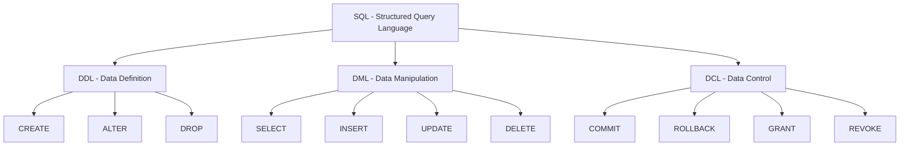
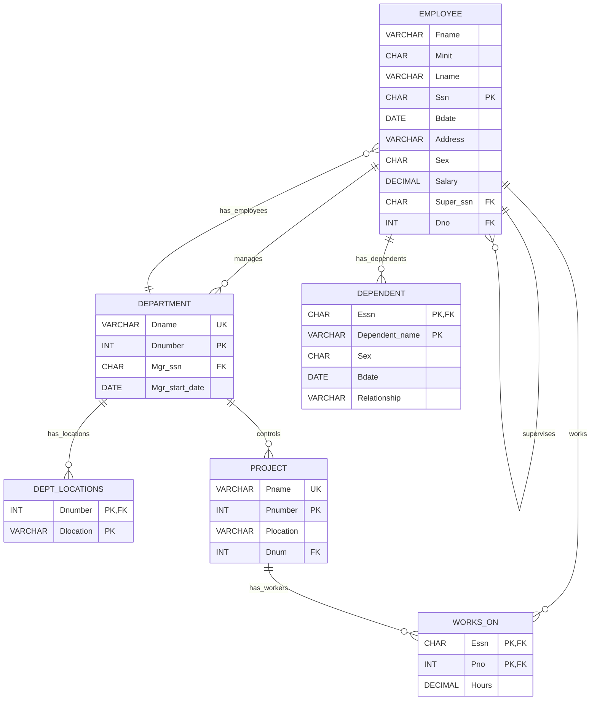
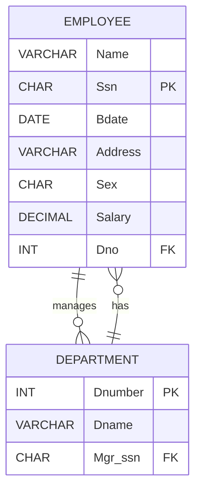
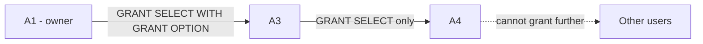

# Chương 6: Ngôn ngữ Truy vấn Có Cấu trúc — Structured Query Language (SQL)

> Nguồn: CO2013 Database Systems, HCMUT — Giảng viên: TS. Trần Minh Quang
> Giáo trình: Elmasri & Navathe, 7th Edition (phần SQL: Chapter 6, 7)
> File PDF gốc: `Lectures/06_SQL.pdf`
> Số slide trong PDF gốc: **114 slide**
> Đã gộp slide Contents lặp lại: **slide 2, 3, 5, 27, 80, 98** đều là slide Contents — gộp chung thành mục lục ở đầu chương.
> COMPANY schema xuất hiện lặp ở **slide 7, 18, 32, 35, 37, 53** — gộp chung thành 1 mô tả + Mermaid + ASCII.
> Tên thuộc tính trong slide đôi khi xen kẽ `Super_ssn`/`SuperSSN`, `Mgr_ssn`/`MgrSSN`, `Ssn`/`SSN`. Bản này giữ nguyên tên đúng theo slide khi trích code; khi nói khái niệm, dùng tên chuẩn COMPANY: `Fname, Minit, Lname, Ssn, Bdate, Address, Sex, Salary, Super_ssn, Dno` (EMPLOYEE), `Dname, Dnumber, Mgr_ssn, Mgr_start_date` (DEPARTMENT), v.v.

---

## 0. Trước khi bắt đầu

### 0.1. Bạn cần biết gì trước? (Prerequisite)

Để hiểu chương 6 (SQL), bạn cần nhớ lại các khái niệm sau từ các chương trước. Nếu chưa học, đọc 2-3 câu sau cũng đủ để bám theo chương này.

| Kiến thức nền | Nhắc lại thật ngắn | Liên hệ với SQL |
|---|---|---|
| **Relation (quan hệ / bảng)** | Bảng 2 chiều có tên, gồm các tuple (hàng) và attribute (cột). | SQL thao tác chủ yếu trên table. |
| **Tuple (bộ / hàng)** | Một dòng dữ liệu. | `INSERT`, `DELETE`, `UPDATE`, `SELECT` xử lý tuple. |
| **Attribute (thuộc tính / cột)** | Một cột của bảng. | `SELECT Salary`, `WHERE Salary > 30000`. |
| **Domain (miền / kiểu)** | Tập giá trị hợp lệ của thuộc tính. | `INT`, `VARCHAR(15)`, `DATE`, `CHECK`. |
| **Primary Key (khóa chính)** | Định danh duy nhất tuple. Không cho NULL. | `PRIMARY KEY (Ssn)`. |
| **Foreign Key (khóa ngoại)** | Cột ở bảng con trỏ tới khóa chính ở bảng cha. | `FOREIGN KEY (Dno) REFERENCES Department(Dnumber)`. |
| **Entity Integrity** | Khóa chính không được NULL. | DBMS tự kiểm tra khi khai báo `PRIMARY KEY`. |
| **Referential Integrity** | Khóa ngoại phải trỏ tới tuple đang tồn tại (hoặc NULL nếu được phép). | `ON DELETE`, `ON UPDATE`, `CASCADE`, `SET NULL`. |
| **Relational Algebra (Chương 5)** | Ngôn ngữ hình thức: σ, π, ⋈, ∪, ∩, −. | `SELECT-FROM-WHERE` là cách SQL hiện thực ý tưởng của RA. |
| **Cartesian Product** | `R × S` = ghép MỌI dòng R với MỌI dòng S. | SQL gọi đây là `FROM R, S` không có điều kiện join. |
| **COMPANY database** | 6 bảng: EMPLOYEE, DEPARTMENT, DEPT_LOCATIONS, PROJECT, WORKS_ON, DEPENDENT. | Schema chạy xuyên suốt mọi ví dụ. |

> 💡 **Hiểu đơn giản:** Nếu ER diagram là bản vẽ thiết kế nhà, relational schema là bản vẽ kỹ thuật, thì **SQL là bộ câu lệnh để xây nhà, sửa nhà, lấy đồ trong nhà, phân quyền ai được vào phòng nào**.

### 0.2. Sau chương này bạn sẽ làm được gì? (Learning Outcomes)

Sau khi đọc xong chương 6, bạn phải có khả năng:

1. **Giải thích** SQL là gì và vì sao SQL là ngôn ngữ chuẩn cho relational database.
2. **Phân biệt** 3 nhóm lệnh: DDL (CREATE/ALTER/DROP), DML (SELECT/INSERT/UPDATE/DELETE), DCL (GRANT/REVOKE/COMMIT/ROLLBACK).
3. **Viết câu lệnh CREATE TABLE** đầy đủ với primary key, foreign key, các loại ràng buộc (NOT NULL, UNIQUE, CHECK, DEFAULT), và 4 referential actions (CASCADE/SET NULL/SET DEFAULT/RESTRICT).
4. **Dùng ALTER/DROP** với CASCADE/RESTRICT cho schema/table/constraint.
5. **Viết truy vấn SELECT** từ đơn giản (1 bảng) đến phức tạp: nhiều bảng (JOIN), subquery, GROUP BY/HAVING, ORDER BY, các phép tập hợp (UNION/EXCEPT/INTERSECT).
6. **Hiểu & sử dụng đúng** các operator: IN, EXISTS, NOT EXISTS, ANY/ALL/SOME, LIKE, IS NULL.
7. **Dùng aggregate** (COUNT/SUM/AVG/MIN/MAX) và phân biệt khi nào dùng WHERE vs HAVING.
8. **Viết JOIN syntax mới** (INNER, NATURAL, LEFT/RIGHT/FULL OUTER) và phân biệt với cú pháp join cũ qua WHERE.
9. **Viết INSERT/UPDATE/DELETE** bao gồm cả INSERT từ SELECT.
10. **Định nghĩa & sử dụng View** (CREATE VIEW), hiểu WITH CHECK OPTION, biết khi nào view là updatable.
11. **Phân biệt** ASSERTION với CHECK và biết tại sao cần ASSERTION.
12. **Cấp & thu hồi quyền** bằng GRANT/REVOKE, hiểu WITH GRANT OPTION và sự lan truyền (cascade) khi REVOKE.
13. **Ánh xạ** câu lệnh SQL ↔ phép toán Relational Algebra tương ứng.

### 0.3. Lộ trình đọc đề xuất

Chương 6 là chương **DÀI NHẤT** và **QUAN TRỌNG NHẤT** của môn — kiến thức trực tiếp cho BTL2, Lab 1+2, và phần lớn đề thi cuối kỳ. Đề xuất chia 4 buổi tự học:

| Buổi | Section | Mức độ | Thời gian |
|---|---|---|---|
| **Buổi 1** | 1 (Intro) + 2 (DDL: CREATE/ALTER/DROP, constraints) | CORE | ~3h |
| **Buổi 2** | 3.1–3.17 (SELECT cơ bản, FROM, WHERE, JOIN qua WHERE, *, DISTINCT, LIKE, NULL, UNION) | CORE | ~4h |
| **Buổi 3** | 3.18–3.37 (Nested queries, IN/EXISTS/ANY/ALL, JOIN syntax mới, OUTER JOIN, Aggregate, GROUP BY, HAVING, ORDER BY) | CORE | ~4h |
| **Buổi 4** | 4 (INSERT/UPDATE/DELETE) + 5 (Assertions & Triggers) + 6 (Views) + 7 (DCL) + tự luyện | CORE cho View; NÂNG CAO cho Trigger/DCL | ~3h |

> 💡 **Mẹo học SQL hiệu quả:** Mỗi query trong chương — **gõ tay lại trên DBMS thật** (PostgreSQL/MySQL/SQL Server) với schema COMPANY. Đọc thôi sẽ quên 80% sau 1 tuần; gõ lại 5 lần sẽ nhớ. Lab 1 và 2 chính là phần thực hành này.

### Mục lục gộp từ các slide Contents (slide 2, 3, 5, 27, 80, 98)

Các slide Contents của chương liệt kê 4 phần chính (slide 98 ghi thêm "Chapter 9 + homework" cho mục 4):

1. **Introduction of Structured Query Language**
2. **DDL: create, drop, alter**
3. **DML: select, insert, update, delete**
4. **DCL: commit, rollback, grant, revoke** *(Chapter 9 + homework)*

---

## 1. Introduction of Structured Query Language

### 1.1. Tại sao cần SQL? (Motivation)

Ở chương mô hình quan hệ, ta đã có các bảng như `EMPLOYEE`, `DEPARTMENT`, `PROJECT`. Nhưng chỉ có bảng trên giấy thì chưa đủ — ta cần một ngôn ngữ để nói với DBMS rằng: "hãy tạo bảng này", "hãy lấy nhân viên phòng Research", "hãy tăng lương", "hãy cấp quyền cho user khác". Nếu mỗi DBMS tự nghĩ ra một ngôn ngữ riêng, người học và lập trình viên sẽ rất khó chuyển đổi giữa các hệ thống. **SQL ra đời (IBM, 1974, tên gốc SEQUEL) như ngôn ngữ chuẩn để định nghĩa, truy vấn, cập nhật và điều khiển relational database**, được chuẩn hóa qua các phiên bản SQL-86 → SQL-92 → SQL:1999 → ... → SQL:2023.

> 💡 **Hiểu đơn giản:** SQL giống như **tiếng Anh** trong thế giới các DBMS. Bạn nói "tôi muốn các nhân viên ở phòng Research", thì Oracle, MySQL, PostgreSQL đều hiểu. Còn Relational Algebra giống **tiếng Latin** — chính xác, đẹp về mặt khoa học, nhưng không ai dùng để nói thường ngày.

### 1.2. SQL là gì? (Slide 4)

> **Structured Query Language (SQL)** là một ngôn ngữ máy tính **chuẩn** dùng cho **quản lý cơ sở dữ liệu quan hệ** (relational database management) và **thao tác dữ liệu** (data manipulation).

**Basic SQL** gồm 3 nhóm:

| Nhóm | Tên đầy đủ | Các câu lệnh | Mục đích |
|---|---|---|---|
| **DDL** | Data Definition Language (Ngôn ngữ Định nghĩa Dữ liệu) | CREATE, ALTER, DROP | Định nghĩa **cấu trúc** — tạo/sửa/xóa bảng, ràng buộc, schema |
| **DML** | Data Manipulation Language (Ngôn ngữ Thao tác Dữ liệu) | SELECT, INSERT, UPDATE, DELETE | **Đọc và sửa** dữ liệu bên trong bảng đã có |
| **DCL** | Data Control Language (Ngôn ngữ Điều khiển Dữ liệu) | COMMIT, ROLLBACK, GRANT, REVOKE | **Phân quyền & quản lý transaction** |

### 1.3. Bản đồ tư duy SQL



> 📊 **Đọc diagram này thế nào:** SQL là gốc. Từ SQL tách thành 3 nhóm. DDL "xây cấu trúc", DML "lấy và sửa dữ liệu", DCL "quyền và kiểm soát". Đề thi thường hỏi phân biệt lệnh nào thuộc nhóm nào.

### 1.4. Ví dụ với COMPANY database

> 💡 **Ví dụ 1.1 — Phân loại câu lệnh SQL**
> Giả sử có COMPANY database. Phân loại các nhu cầu:
>
> | Nhu cầu | Lệnh SQL | Nhóm |
> |---|---|---|
> | Tạo bảng `EMPLOYEE` | `CREATE TABLE Employee (...)` | DDL |
> | Lấy tên nhân viên phòng Research | `SELECT ... FROM ... WHERE ...` | DML |
> | Tăng lương nhân viên phòng 5 | `UPDATE Employee SET Salary = ...` | DML |
> | Cấp quyền đọc bảng | `GRANT SELECT ON Employee TO A3` | DCL |

### 1.5. Analogy

> 💡 **Hiểu đơn giản:** SQL là bộ câu lệnh điều hành một thư viện. **DDL = xây kệ + đặt quy tắc kệ**; **DML = tìm/thêm/xóa/sửa sách**; **DCL = cấp thẻ thư viện + phân quyền mượn sách**.

> 📝 **Tóm lại section 1 — Introduction of SQL:**
> - SQL là **ngôn ngữ chuẩn** cho RDBMS (ra đời từ IBM thập niên 70, chuẩn ISO/ANSI).
> - SQL gồm **3 nhóm**: DDL (cấu trúc), DML (dữ liệu), DCL (quyền/transaction).
> - Chương này đi từ tạo cấu trúc → truy vấn/cập nhật dữ liệu → view → phân quyền.
> **Một câu ghi nhớ:** *SQL là cầu nối giữa mô hình quan hệ trên giấy và database chạy thật trong DBMS.*

> ❓ **Tự kiểm tra section 1:**
> 1. SQL là gì? Vì sao gọi là "chuẩn"?
> 2. `CREATE TABLE` thuộc DDL, DML hay DCL?
> 3. Trong COMPANY database, nếu muốn lấy danh sách nhân viên, em dùng nhóm lệnh nào?

---

## 2. DDL — Data Definition Language

Section 1 vừa giới thiệu SQL có 3 nhóm. Câu hỏi tự nhiên tiếp theo là: **trước khi truy vấn được dữ liệu, làm sao tạo ra cấu trúc bảng và ràng buộc cho database?** Đó là DDL.

### 2.1. Tại sao cần DDL? (Motivation)

Nếu ta chỉ có dữ liệu rời rạc như file Excel không ràng buộc, người dùng có thể nhập `Salary='abc'`, nhập nhân viên không có Ssn, hoặc gán `Dno=999` dù không có department 999. Dữ liệu lúc này rất dễ sai và chương trình phía sau sẽ bị lỗi. **DDL cho phép ta định nghĩa trước hình dạng và luật của database**: bảng gồm cột nào, kiểu dữ liệu gì, cột nào không được rỗng, khóa chính là gì, khóa ngoại trỏ đi đâu.

Ví dụ đời thường: trước khi trường mở cổng đăng ký môn học, trường phải định nghĩa danh mục môn, mã môn, số tín chỉ, môn tiên quyết. Nếu không có "khung luật", sinh viên có thể đăng ký mã môn không tồn tại hoặc nhập số tín chỉ âm.

### 2.2. Slide 6 — DDL là gì?

> Data Definition Language (DDL) cho phép đặc tả:
> - **Kiểu dữ liệu** (data types)
> - **Cấu trúc** (structures)
> - **Các ràng buộc** (data constraints)
>
> Mọi đặc tả được **lưu trong database** (catalog/data dictionary).
>
> DDL gồm:
> - **CREATE**: tạo mới (database, table, index, user, stored query, ...)
> - **ALTER**: sửa đổi đối tượng đã có
> - **DROP**: hủy bỏ đối tượng đã có

> 💡 **Hiểu đơn giản:** Ba lệnh CREATE/ALTER/DROP giống như **xây/sửa/phá** một ngôi nhà.

### 2.3. COMPANY Database — Schema chạy xuyên môn (Slide 7, 18, 32, 35, 37, 53)

#### 2.3.1. Bảng tóm tắt các relation

| Relation | Attributes | Primary Key | Foreign Keys / liên hệ |
|---|---|---|---|
| `EMPLOYEE` | Fname, Minit, Lname, Ssn, Bdate, Address, Sex, Salary, Super_ssn, Dno | Ssn | Super_ssn → EMPLOYEE(Ssn); Dno → DEPARTMENT(Dnumber) |
| `DEPARTMENT` | Dname, Dnumber, Mgr_ssn, Mgr_start_date | Dnumber | Mgr_ssn → EMPLOYEE(Ssn) |
| `DEPT_LOCATIONS` | Dnumber, Dlocation | (Dnumber, Dlocation) | Dnumber → DEPARTMENT(Dnumber) |
| `PROJECT` | Pname, Pnumber, Plocation, Dnum | Pnumber | Dnum → DEPARTMENT(Dnumber) |
| `WORKS_ON` | Essn, Pno, Hours | (Essn, Pno) | Essn → EMPLOYEE(Ssn); Pno → PROJECT(Pnumber) |
| `DEPENDENT` | Essn, Dependent_name, Sex, Bdate, Relationship | (Essn, Dependent_name) | Essn → EMPLOYEE(Ssn) |

#### 2.3.2. ER-style diagram (Mermaid)



#### 2.3.3. ASCII fallback (nếu trình đọc không hỗ trợ Mermaid)

```
EMPLOYEE
+-------+-------+-------+-----+-------+---------+-----+--------+-----------+-----+
| Fname | Minit | Lname | Ssn | Bdate | Address | Sex | Salary | Super_ssn | Dno |
+-------+-------+-------+-----+-------+---------+-----+--------+-----------+-----+
                          (PK)                                  (FK→Ssn)   (FK→Dnumber)

DEPARTMENT                           DEPT_LOCATIONS
+-------+---------+---------+------+ +---------+-----------+
| Dname | Dnumber | Mgr_ssn | Mgr… | | Dnumber | Dlocation |
+-------+---------+---------+------+ +---------+-----------+
            (PK)   (FK→Ssn)             (PK=Dnumber+Dlocation; FK→Dnumber)

PROJECT                              WORKS_ON
+-------+---------+-----------+----+ +------+-----+-------+
| Pname | Pnumber | Plocation |Dnum| | Essn | Pno | Hours |
+-------+---------+-----------+----+ +------+-----+-------+
             (PK)              (FK)    (PK=(Essn,Pno); FK Essn,Pno)

DEPENDENT
+------+----------------+-----+-------+--------------+
| Essn | Dependent_name | Sex | Bdate | Relationship |
+------+----------------+-----+-------+--------------+
  (PK=(Essn,Dependent_name); FK Essn)
```

> 📊 **Đọc diagram này thế nào:**
> - Cột có `PK` (hoặc gạch chân trong slide gốc) là **Primary Key**.
> - `FK` là **Foreign Key** trỏ tới bảng cha (mũi tên trong slide gốc).
> - **EMPLOYEE.Super_ssn → EMPLOYEE.Ssn** là **self-reference** — cấp trên cũng là một nhân viên trong cùng bảng → lý do cần ALIAS khi truy vấn supervisor.
> - DEPT_LOCATIONS có composite PK `(Dnumber, Dlocation)`.

### 2.4. Schema và Catalog (Slide 8)

> **Schema (lược đồ)**: một nhóm các bảng và construct cùng thuộc về **một ứng dụng CSDL**.

```sql
CREATE SCHEMA Schema_Name
AUTHORIZATION Authorization_Identifier;
```

**Ví dụ COMPANY:**
```sql
CREATE SCHEMA Company AUTHORIZATION JSmith;
```

| Dòng | Ý nghĩa |
|---|---|
| `CREATE SCHEMA Company` | Tạo schema tên `Company`. |
| `AUTHORIZATION JSmith` | Đặt `JSmith` làm owner — chỉ owner mới được tạo bảng bên trong hoặc cấp quyền tiếp. |

**Catalog**: một **tập hợp có tên** các schema.

> 💡 **Hiểu đơn giản:** Catalog = "tủ tài liệu lớn". Schema = "ngăn kéo bên trong tủ". Table = "tập hồ sơ bên trong ngăn kéo". Cùng tên bảng có thể tồn tại ở 2 schema khác nhau mà không xung đột.

### 2.5. CREATE TABLE — Cú pháp tổng quát (Slide 9)

```sql
CREATE TABLE [SchemaName.]TableName
{(colName dataType [NOT NULL] [UNIQUE] [PRIMARY KEY]
   [DEFAULT defaultOption]
   [CHECK searchCondition] [,...]}
[PRIMARY KEY (listOfColumns),]
{[UNIQUE (listOfColumns),] [...,]}
{[FOREIGN KEY (listOfFKColumns)
  REFERENCES ParentTableName [(listOfCKColumns)]
  [ON UPDATE referentialAction]
  [ON DELETE referentialAction]] [,...]}
{[CHECK (searchCondition)] [,...] })
```

**Giải thích từng phần:**

| Thành phần | Ý nghĩa |
|---|---|
| `[SchemaName.]TableName` | Tên bảng, có thể có prefix schema. |
| `(colName dataType ...)` | Định nghĩa **mỗi cột**: tên + kiểu + các ràng buộc inline. |
| `PRIMARY KEY (listOfColumns)` | Khóa chính cấp bảng — bắt buộc dùng khi PK gồm ≥ 2 cột. |
| `UNIQUE (listOfColumns)` | Khóa thay thế (alternate/secondary key). |
| `FOREIGN KEY (...) REFERENCES ...` | Khóa ngoại + hành động khi cha bị update/delete. |
| `CHECK (searchCondition)` | Ràng buộc biểu thức Boolean. |

> ⚠️ **Note ngữ pháp BNF:** `[...]` là **tùy chọn** (có thể bỏ); `{...}` là **lặp** (0 hoặc nhiều lần).

### 2.6. CREATE TABLE — Base table vs Virtual relation (Slide 10)

| Loại | Đặc điểm |
|---|---|
| **Base tables (base relations)** | Tạo bằng `CREATE TABLE` → relation và tuple được **thực sự tạo và lưu thành file** bởi DBMS. |
| **Virtual relations** | Tạo bằng `CREATE VIEW` → không lưu vật lý, tính on-the-fly. (Section 6) |

**Foreign Key có thể gây lỗi (slide nhắc):**
- **Circular references** (A trỏ B, B trỏ A) → không thể tạo cả 2 cùng lúc.
- Trỏ tới bảng **chưa tồn tại** → phải tạo bảng cha trước hoặc dùng `ALTER TABLE ADD FOREIGN KEY` sau.

### 2.7. Basic Data Types (Slide 11–12)

| Loại | Cú pháp | Ghi chú |
|---|---|---|
| **Numeric — Integer** | `INTEGER`, `INT`, `SMALLINT` | Số nguyên |
| **Numeric — Floating point** | `FLOAT`, `REAL`, `DOUBLE PRECISION` | Số thực |
| **Numeric — Decimal** (xuất hiện trong CREATE TABLE thực tế) | `DECIMAL(p,d)` | Số thập phân chính xác — `p` chữ số tổng, `d` chữ số sau dấu thập phân. Ví dụ `DECIMAL(10,2)` cho lương. |
| **Character-string — Fixed length** | `CHAR(n)`, `CHARACTER(n)` | Cố định n ký tự, đệm khoảng trắng nếu ngắn hơn |
| **Character-string — Varying length** | `VARCHAR(n)`, `CHAR VARYING(n)`, `CHARACTER VARYING(n)` | Độ dài thay đổi, tối đa n |
| **Bit-string — Fixed length** | `BIT(n)` | Chuỗi bit cố định |
| **Bit-string — Varying length** | `BIT VARYING(n)` | Chuỗi bit độ dài thay đổi |
| **Boolean** | `BOOLEAN` | TRUE / FALSE / **NULL** (3-valued logic!) |
| **Date** | `DATE` | YEAR, MONTH, DAY — `'YYYY-MM-DD'` |
| **Time** | `TIME` | HOUR, MINUTE, SECOND — `'HH:MM:SS'` |
| **Timestamp** | `TIMESTAMP` | DATE + TIME + ≥ 6 chữ số phần thập phân giây. Có thể `WITH TIME ZONE`. |
| **Interval** | `INTERVAL` | Giá trị **tương đối** dùng tăng/giảm date/time/timestamp. Ví dụ `INTERVAL '7' DAY`. |

#### Bảng chọn kiểu dữ liệu cho COMPANY

| Attribute | Kiểu trên slide | Lý do |
|---|---|---|
| Fname, Lname, Dname, Pname | VARCHAR(15) | Tên có độ dài thay đổi |
| Minit, Sex | CHAR | Đúng 1 ký tự |
| Ssn, Super_ssn, Mgr_ssn, Essn | CHAR(9) | SSN cố định 9 ký tự, có thể có số 0 đầu → không dùng INT |
| Bdate, Mgr_start_date | DATE | Ngày tháng |
| Salary | DECIMAL(10,2) | Tiền cần 2 chữ số thập phân chính xác |
| Dno, Dnumber, Pnumber, Pno | INT | Mã số nguyên |
| Hours | DECIMAL(3,1) | Số giờ có thể có phần thập phân như 32.5 |

> 💡 **Hiểu đơn giản — CHAR vs VARCHAR:** `CHAR(10)` luôn lưu đúng 10 ký tự → tốn cố định 10 byte. `VARCHAR(10)` lưu số ký tự thật + 1-2 byte ghi độ dài → tiết kiệm hơn cho dữ liệu biến thiên. Dùng CHAR cho mã có độ dài cố định (CCCD 12 ký tự); dùng VARCHAR cho tên/địa chỉ.

### 2.8. Domains (Slide 13)

**Domain** là một **tên** đặt cho đặc tả thuộc tính. Lợi ích: dễ thay đổi kiểu chung; tăng tính đọc của schema.

```sql
CREATE DOMAIN DomainName AS DataType
[CHECK conditions];
```

**Ví dụ COMPANY:**
```sql
CREATE DOMAIN SSN_TYPE AS CHAR(9);

CREATE DOMAIN D_NUM AS INTEGER
CHECK (D_NUM > 0 AND D_NUM < 21);
```

| Dòng | Ý nghĩa |
|---|---|
| `CREATE DOMAIN SSN_TYPE AS CHAR(9);` | Đặt tên `SSN_TYPE` cho `CHAR(9)`. Dùng được cho mọi cột SSN/Essn/Mgr_ssn/Super_ssn. |
| `CREATE DOMAIN D_NUM AS INTEGER CHECK (D_NUM>0 AND D_NUM<21);` | Domain `D_NUM` chỉ chấp nhận 1..20. |

> 💡 **Hiểu đơn giản:** Domain giống **`typedef int DeptNumber;` trong C** — thay vì viết `INT` ở 50 chỗ thì đặt tên một lần, dùng lại; muốn đổi kiểu, sửa 1 chỗ duy nhất.

### 2.9. Specifying Constraints (Slide 14)

3 nhóm ràng buộc cơ bản:

1. **Key & Referential Integrity** — PRIMARY KEY, UNIQUE, FOREIGN KEY.
2. **Attribute Constraints** — NOT NULL, DEFAULT, CHECK trên 1 thuộc tính.
3. **Constraints on Individual Tuples** — CHECK trên nhiều thuộc tính của cùng 1 dòng.

#### 2.9.1. PRIMARY KEY & UNIQUE (Slide 15)

```sql
-- Cách 1: inline (1 cột)
Dnumber INT PRIMARY KEY

-- Cách 2: cấp bảng (1 hoặc nhiều cột — bắt buộc cho composite PK)
PRIMARY KEY (Dnumber, DLocation)

-- UNIQUE: khóa thay thế
Dname VARCHAR(15) UNIQUE;
```

> 💡 **Phân biệt PRIMARY KEY vs UNIQUE:**
> - **PRIMARY KEY**: 1 mỗi bảng, **không cho NULL**, có index ngầm.
> - **UNIQUE**: nhiều mỗi bảng, **cho phép NULL** (thường 1 NULL, tùy DBMS), có unique index ngầm.

> 💡 **Primary Key ↔ Số CCCD/CMND:** Định danh duy nhất một người trong quốc gia. Trong EMPLOYEE, `Ssn` đóng vai tương tự.

#### 2.9.2. FOREIGN KEY (Slide 16)

```sql
FOREIGN KEY (listOfFKColumns)
REFERENCES ParentTableName [(listOfCKColumns)]
[ON UPDATE referentialAction]
[ON DELETE referentialAction]
```

**4 Referential Triggered Actions** khi cha bị update/delete:

| Action | Ý nghĩa |
|---|---|
| **RESTRICT** (mặc định) | DBMS **từ chối** thao tác trên cha nếu còn con tham chiếu. |
| **CASCADE** | **Lan truyền**: xóa/sửa cha → xóa/sửa luôn con. |
| **SET NULL** | Đặt FK ở con thành NULL (cần cột FK cho phép NULL). |
| **SET DEFAULT** | Đặt FK ở con về giá trị DEFAULT đã khai báo. |

**Ví dụ COMPANY:**
```sql
FOREIGN KEY (Dno) REFERENCES Department(Dnumber)
ON DELETE CASCADE
ON UPDATE CASCADE
```

> 💡 **Foreign Key ↔ Số CCCD ghi trên hợp đồng thuê nhà:** Hợp đồng không lưu toàn bộ hồ sơ người thuê, mà ghi CCCD để trỏ chính xác tới 1 người trong bảng dân cư. Nếu CCCD không tồn tại → hợp đồng vô nghĩa. Tương tự, `Employee.Dno = 5` chỉ hợp lệ nếu `Department.Dnumber = 5` tồn tại.

> ⚠️ **Cẩn thận CASCADE DELETE trong thực tế:** xóa nguyên một phòng KHÔNG nên kéo theo xóa hết nhân viên (vô lý!). CASCADE chỉ phù hợp khi con thực sự **phụ thuộc tồn tại** vào cha (weak entity). Nghiệp vụ thường hợp lý hơn với `SET NULL` hoặc `RESTRICT`.

#### 2.9.3. Attribute Constraints (Slide 17)

```sql
-- NOT NULL: cấm NULL
-- DEFAULT <value>: giá trị mặc định khi INSERT không chỉ định
Dno INT NOT NULL DEFAULT 1

-- CHECK: biểu thức Boolean
Dnumber INT NOT NULL CHECK (Dnumber > 0 AND Dnumber < 21);
```

| Constraint | Ý nghĩa | Ví dụ |
|---|---|---|
| **NOT NULL** | Bắt buộc có giá trị | Nhân viên bắt buộc có Ssn |
| **DEFAULT** | Giá trị mặc nếu không INSERT | `Dno DEFAULT 1` |
| **CHECK** | Biểu thức Boolean trên cột | `Dnumber > 0 AND Dnumber < 21` |

### 2.10. CREATE TABLE COMPANY — Ví dụ đầy đủ (Slide 19–20)

```sql
CREATE TABLE EMPLOYEE
( Fname       VARCHAR(15)    NOT NULL,
  Minit       CHAR,
  Lname       VARCHAR(15)    NOT NULL,
  Ssn         CHAR(9)        NOT NULL,
  Bdate       DATE,
  Address     VARCHAR(30),
  Sex         CHAR,
  Salary      DECIMAL(10,2),
  Super_ssn   CHAR(9),
  Dno         INT            NOT NULL,
  PRIMARY KEY (Ssn) );

CREATE TABLE DEPARTMENT
( Dname           VARCHAR(15)    NOT NULL,
  Dnumber         INT            NOT NULL,
  Mgr_ssn         CHAR(9)        NOT NULL,
  Mgr_start_date  DATE,
  PRIMARY KEY (Dnumber),
  UNIQUE (Dname),
  FOREIGN KEY (Mgr_ssn) REFERENCES EMPLOYEE(Ssn) );

CREATE TABLE DEPT_LOCATIONS
( Dnumber      INT          NOT NULL,
  Dlocation    VARCHAR(15)  NOT NULL,
  PRIMARY KEY (Dnumber, Dlocation),
  FOREIGN KEY (Dnumber) REFERENCES DEPARTMENT(Dnumber) );

CREATE TABLE PROJECT
( Pname       VARCHAR(15)    NOT NULL,
  Pnumber     INT            NOT NULL,
  Plocation   VARCHAR(15),
  Dnum        INT            NOT NULL,
  PRIMARY KEY (Pnumber),
  UNIQUE (Pname),
  FOREIGN KEY (Dnum) REFERENCES DEPARTMENT(Dnumber) );

CREATE TABLE WORKS_ON
( Essn    CHAR(9)        NOT NULL,
  Pno     INT            NOT NULL,
  Hours   DECIMAL(3,1)   NOT NULL,
  PRIMARY KEY (Essn, Pno),
  FOREIGN KEY (Essn) REFERENCES EMPLOYEE(Ssn),
  FOREIGN KEY (Pno)  REFERENCES PROJECT(Pnumber) );

CREATE TABLE DEPENDENT
( Essn             CHAR(9)       NOT NULL,
  Dependent_name   VARCHAR(15)   NOT NULL,
  Sex              CHAR,
  Bdate            DATE,
  Relationship     VARCHAR(8),
  PRIMARY KEY (Essn, Dependent_name),
  FOREIGN KEY (Essn) REFERENCES EMPLOYEE(Ssn) );
```

> 💡 **Quan sát:** EMPLOYEE chưa có FK cho `Super_ssn` và `Dno` ở đoạn code trên — vì DEPARTMENT chưa tồn tại lúc tạo EMPLOYEE và `Super_ssn` self-reference cần bảng tồn tại trước. Thực tế: thêm 2 FK này SAU bằng `ALTER TABLE EMPLOYEE ADD FOREIGN KEY ...`.

> 💡 **Vì sao WORKS_ON là bảng riêng?** Vì biểu diễn quan hệ **M:N** giữa EMPLOYEE và PROJECT. Không thể nhét Pnumber vào EMPLOYEE (1 nhân viên làm nhiều project) hay nhét Ssn vào PROJECT (1 project có nhiều nhân viên) — cần bảng trung gian.

### 2.11. Đặt tên cho Constraint (Slide 21–22)

**Optional** — Dùng keyword `CONSTRAINT`. Tên **duy nhất trong schema**. Dùng để DROP sau hoặc thay thế.

```sql
CREATE TABLE EMPLOYEE
( ...,
  Dno INT NOT NULL DEFAULT 1,
  CONSTRAINT EMPPK
    PRIMARY KEY (Ssn),
  CONSTRAINT EMPSUPERFK
    FOREIGN KEY (Super_ssn) REFERENCES EMPLOYEE(Ssn)
      ON DELETE SET NULL    ON UPDATE CASCADE,
  CONSTRAINT EMPDEPTFK
    FOREIGN KEY (Dno) REFERENCES DEPARTMENT(Dnumber)
      ON DELETE SET DEFAULT  ON UPDATE CASCADE );

CREATE TABLE DEPARTMENT
( ...,
  Mgr_ssn CHAR(9) NOT NULL DEFAULT '888665555',
  ... ,
  CONSTRAINT DEPTPK    PRIMARY KEY (Dnumber),
  CONSTRAINT DEPTSK    UNIQUE (Dname),
  CONSTRAINT DEPTMGRFK
    FOREIGN KEY (Mgr_ssn) REFERENCES EMPLOYEE(Ssn)
      ON DELETE SET DEFAULT  ON UPDATE CASCADE );

CREATE TABLE DEPT_LOCATIONS
( ...,
  PRIMARY KEY (Dnumber, Dlocation),
  FOREIGN KEY (Dnumber) REFERENCES DEPARTMENT(Dnumber)
    ON DELETE CASCADE  ON UPDATE CASCADE );
```

| Tên constraint | Ý nghĩa |
|---|---|
| EMPPK | Employee Primary Key |
| EMPSUPERFK | Employee Super_ssn Foreign Key (tự tham chiếu) |
| EMPDEPTFK | Employee → Department FK |
| DEPTPK / DEPTSK / DEPTMGRFK | Department's PK / Secondary Key (UNIQUE) / Manager FK |

> 💡 **Hiểu đơn giản:** Đặt tên constraint giống **đặt tên file** thay vì để DBMS sinh `constraint_8a3f7d2e`. Sau này muốn `ALTER TABLE Employee DROP CONSTRAINT EMPSUPERFK;` — câu lệnh gọn, dễ debug khi DBMS báo lỗi.

### 2.12. Constraints on Individual Tuples (Slide 23)

`CHECK` ở **mức bảng** kiểm tra các thuộc tính của **cùng 1 tuple**:

```sql
CHECK (Dept_create_date < Mgr_start_date);
```

Ý nghĩa: ngày tạo phòng phải **trước** ngày trưởng phòng nhậm chức.

> 📌 Cho ràng buộc tổng quát hơn (qua nhiều bảng, nhiều dòng) → dùng `CREATE ASSERTION` (Section 5).

### 2.13. DROP Command (Slide 24–25)

| Chế độ | Hành vi |
|---|---|
| **RESTRICT** (mặc định) | Chỉ xóa nếu **không có** object phụ thuộc. An toàn. |
| **CASCADE** | Xóa luôn cả các object phụ thuộc cùng đối tượng này. Nguy hiểm. |

```sql
DROP SCHEMA Company CASCADE;
DROP SCHEMA Company RESTRICT;

DROP TABLE Department CASCADE;
```

> ⚠️ **CẢNH BÁO:** `DROP SCHEMA Company CASCADE;` xóa **TOÀN BỘ** bảng, view, constraint trong schema. Luôn **backup trước** và xác nhận trước khi gõ trên production.

### 2.14. ALTER Command (Slide 26)

```sql
-- Thêm cột
ALTER TABLE Employee ADD Job VARCHAR(15);

-- Xóa cột
ALTER TABLE Employee DROP COLUMN Address CASCADE;

-- Đổi giá trị DEFAULT
ALTER TABLE Department
   ALTER COLUMN Mgr_ssn SET DEFAULT '333445555';

-- Xóa constraint
ALTER TABLE Employee DROP CONSTRAINT Empsuperfk;
```

> 📝 **Tóm lại section 2 — DDL:**
> - **CREATE SCHEMA / CREATE TABLE** định nghĩa cấu trúc + kiểu + khóa + ràng buộc.
> - **Constraints**: PRIMARY KEY, UNIQUE, FOREIGN KEY (4 referential actions), NOT NULL, DEFAULT, CHECK.
> - **CONSTRAINT \<name\>** giúp DROP/ALTER sau này.
> - **DROP** với CASCADE (lan truyền) hoặc RESTRICT (an toàn).
> - **ALTER** để ADD/DROP/ALTER COLUMN, ADD/DROP CONSTRAINT.
> **Một câu ghi nhớ:** *DDL là 3 chữ CAD — Create, Alter, Drop — với keyword CONSTRAINT, CHECK, FOREIGN KEY ON DELETE/UPDATE quyết định ngữ nghĩa.*

> ❓ **Tự kiểm tra section 2:**
> 1. Vì sao `Ssn CHAR(9)` hợp lý hơn `Ssn INT`?
> 2. Phân biệt PRIMARY KEY và UNIQUE — số lượng/bảng và cho phép NULL?
> 3. Nếu `FOREIGN KEY (Dno) REFERENCES Department(Dnumber) ON DELETE SET NULL`, khi xóa 1 dòng trong Department, điều gì xảy ra với cột Dno?
> 4. Sự khác biệt giữa `DROP TABLE T RESTRICT` và `DROP TABLE T CASCADE` là gì?
> 5. Trong `WORKS_ON(Essn, Pno, Hours)`, vì sao PK là `(Essn, Pno)`?
> 6. Vì sao cần đặt tên cho constraint?

---

## 3. DML — SELECT: Truy vấn dữ liệu

Section 2 đã tạo được bảng. Câu hỏi tiếp theo: **làm sao lấy thông tin ra khỏi database?** Đây là phần lớn nhất của chương — SELECT.

### 3.1. Tại sao SELECT là lệnh quan trọng nhất? (Motivation)

Database có giá trị vì ta có thể hỏi nó. "Nhân viên nào thuộc phòng Research?", "Project ở Stafford do ai quản lý?", "Mức lương trung bình mỗi phòng?". Nếu không có SELECT, database chỉ là kho cất dữ liệu, không tạo ra thông tin. **SELECT biến dữ liệu thành câu trả lời.**

### 3.2. SELECT là gì? (Slide 28)

> - SELECT command: **truy hồi thông tin** (retrieve information) từ database.
> - SELECT trong SQL = **SELECT operation** trong Relational Algebra (cùng tên!).
> - SQL cho phép một relation chứa **2 hoặc nhiều tuple giống hệt nhau**.
> - SQL relation là **multi-set (bag) of tuples**, **không phải set** — đây là khác biệt CỐT LÕI so với RA.
> - Có thể ép thành set bằng **PRIMARY KEY**, **UNIQUE**, hoặc **`DISTINCT`** trong query.

| Relational Algebra | SQL |
|---|---|
| Relation là **set** | Table/query result là **bag/multiset** |
| Không có duplicate tuple | Có thể có duplicate tuple |
| Projection tự loại duplicate | SELECT KHÔNG loại duplicate trừ khi `DISTINCT` |

> 💡 **Hiểu đơn giản:** Set = túi không cho 2 quả bóng giống nhau. Multiset/bag = túi cho phép 10 quả giống nhau. SQL mặc định là multiset → truy vấn lương của 3 người cùng lương 25000, ta nhận 3 dòng "25000".

### 3.3. Cú pháp SELECT (Slide 29–31, 50, 72, 78–79)

**Basic form:**
```sql
SELECT  <attribute list>
FROM    <table list>
WHERE   <condition>
```

**Complete form:**
```sql
SELECT  [DISTINCT | ALL]
    {* | [columnExpression [AS newName]] [,...] }
FROM    TableName [alias] [, ...]
[WHERE     condition]
[GROUP BY  columnList]
[HAVING    condition]
[ORDER BY  columnList]
```

| Mệnh đề | Mục đích |
|---|---|
| **SELECT** | Cột nào xuất hiện trong output |
| **FROM** | Bảng nào được dùng |
| **WHERE** | Lọc các **dòng** |
| **GROUP BY** | Gom dòng cùng giá trị cột thành nhóm |
| **HAVING** | Lọc các **nhóm** |
| **ORDER BY** | Sắp xếp output |

> 📊 **Thứ tự thực thi logic** (KHÁC thứ tự viết!):
>
> **FROM → WHERE → GROUP BY → HAVING → SELECT → ORDER BY**
>
> Hiểu đúng thứ tự này giúp: (a) không bối rối khi alias đặt ở SELECT không dùng được trong WHERE; (b) hiểu vì sao HAVING dùng aggregate được mà WHERE thì không.

### 3.4. Basic queries Q0–Q2 (Slide 33–36)

#### Query 0 — SELECT cơ bản 1 bảng (Slide 33)

> Lấy ngày sinh và địa chỉ của nhân viên tên 'John B. Smith'.

```sql
Q0: SELECT  Bdate, Address
    FROM    Employee
    WHERE   Fname = 'John' AND Minit = 'B' AND Lname = 'Smith';
```

| Dòng | Ý nghĩa |
|---|---|
| `SELECT Bdate, Address` | Lấy 2 cột (= projection π trong RA) |
| `FROM Employee` | Nguồn dữ liệu |
| `WHERE ...` | Lọc tuple (= selection σ trong RA) |

**Tương đương Relational Algebra (SELECT-PROJECT):**
`π_{Bdate, Address}(σ_{Fname='John' AND Minit='B' AND Lname='Smith'}(EMPLOYEE))`

> ⚠️ Kết quả SQL có thể chứa **dòng trùng** (nếu có 2 người cùng tên & ngày sinh & địa chỉ).

#### Query 1 — JOIN qua WHERE (Slide 34)

> Lấy tên và địa chỉ của tất cả nhân viên thuộc phòng 'Research'.

```sql
Q1: SELECT  Fname, Lname, Address
    FROM    Employee, Department
    WHERE   Dname = 'Research' AND Dnumber = Dno;
```

| Điều kiện | Loại | Ý nghĩa |
|---|---|---|
| `Dname='Research'` | Selection condition | Chọn phòng Research |
| `Dnumber = Dno` | **Join condition** | Ghép EMPLOYEE với DEPARTMENT |

**Tương đương RA (SELECT-PROJECT-JOIN):**
`π_{Fname, Lname, Address}(σ_{Dname='Research'}(EMPLOYEE ⋈_{Dno=Dnumber} DEPARTMENT))`

> 💡 **Cách "đọc" query nhiều bảng:**
> 1. Bao nhiêu bảng? → n bảng cần **n-1 join conditions**.
> 2. Tìm cặp cột PK–FK để đặt join condition.
> 3. Điều kiện "cứng" (không phải PK–FK) là selection.

#### Query 2 — 3 bảng, 2 JOIN (Slide 36)

> Với mỗi project ở 'Stafford', liệt kê số project, số phòng kiểm soát, và họ-địa chỉ-ngày sinh của trưởng phòng đó.

```sql
Q2: SELECT  Pnumber, Dnum, Lname, Bdate, Address
    FROM    Project, Department, Employee
    WHERE   Dnum = Dnumber
        AND MgrSSN = SSN
        AND Plocation = 'Stafford';
```

| Điều kiện | Ý nghĩa |
|---|---|
| `Dnum = Dnumber` | Nối PROJECT ↔ DEPARTMENT (project thuộc phòng nào) |
| `MgrSSN = SSN` | Nối DEPARTMENT ↔ EMPLOYEE (trưởng phòng là ai) |
| `Plocation = 'Stafford'` | Lọc project ở Stafford |

### 3.5. Ambiguous Attribute Names (Slide 38)

Tên cột giống nhau ở 2 bảng → query phải **qualify** (đặc tả rõ) bằng `TableName.AttributeName`:

```sql
DEPARTMENT.Dnumber  -- cột Dnumber trong DEPARTMENT
DEPT_LOCATIONS.Dnumber  -- cột Dnumber trong DEPT_LOCATIONS
```

Nếu không qualify, DBMS báo `column reference "Dnumber" is ambiguous`.

> 💡 **Hiểu đơn giản:** Trong lớp có 2 bạn tên "An". Khi gọi "An ơi" không rõ An nào. Phải nói "An lớp trưởng" hoặc "An bàn cuối".

### 3.6. Aliases — Tuple variables (Slide 39–40)

Khi cần **dùng 1 bảng 2 lần** (vd self-join), phải đặt alias.

> **Query 3:** Với mỗi nhân viên, lấy tên nhân viên và tên cấp trên trực tiếp.

```sql
Q3a: SELECT  E.Fname, E.Lname, S.Fname, S.Lname
     FROM    Employee E, Employee S
     WHERE   E.SuperSSN = S.SSN;

Q3b: SELECT  E.Fname, E.Lname, S.Fname, S.Lname
     FROM    Employee AS E, Employee AS S
     WHERE   E.SuperSSN = S.SSN;
```

- `E` = nhân viên **được giám sát** (supervisee).
- `S` = nhân viên **giám sát** (supervisor).

**Đổi tên cả cột:**
```sql
Employee AS E(FN, M, LN, SSN, BD, Addr, Sex, Sal, SSSN, DNO)
```

> 💡 **Hiểu đơn giản — self-join:** EMPLOYEE giống 1 lớp học. Lan vừa là "học sinh", vừa có thể là "lớp trưởng" của Hùng. Muốn xem "Hùng và lớp trưởng của Hùng", phải dùng cùng bảng 2 lần — alias `E` cho học sinh, `S` cho lớp trưởng.

### 3.7. Unspecified WHERE — Bỏ WHERE (Slide 41–42)

**Bỏ WHERE = tương đương `WHERE TRUE` = tất cả tuple.**

> **Query 4:** Lấy SSN của tất cả nhân viên.

```sql
Q4: SELECT  SSN  FROM  Employee;
```

**Nhiều bảng + không có join condition = CARTESIAN PRODUCT.**

> **Query 5:** Lấy mọi kết hợp Employee.SSN × Department.Dname.

```sql
Q5: SELECT  SSN, Dname  FROM  Employee, Department;
```

Nếu EMPLOYEE có 8 dòng, DEPARTMENT có 3 dòng → kết quả **24 dòng** (phần lớn vô nghĩa).

> ⚠️ **CẢNH BÁO:** Rất quan trọng để **không bỏ sót** điều kiện chọn và join trong WHERE; nếu không, các quan hệ **sai và rất lớn** có thể bị tạo ra. Trên DB production hàng triệu dòng, query thiếu join có thể **làm chết DBMS**.

### 3.8. Use of ASTERISK `*` (Slide 43)

`*` = **tất cả các thuộc tính**.

```sql
Q6: SELECT * FROM Employee WHERE DNO = 5;

Q7: SELECT *
    FROM   Employee, Department
    WHERE  Dname = 'Research' AND DNO = Dnumber;
```

> ⚠️ **Tránh `SELECT *` trong production:** Bảng có thể thêm cột (vd `password_hash`) — `*` sẽ vô tình lộ. Tốt hơn liệt kê rõ cột.

### 3.9. DISTINCT (Slide 44)

Loại tuple trùng.

```sql
Q8a: SELECT Salary FROM Employee;
-- Có thể: 30000, 25000, 30000, 25000, 40000

Q8b: SELECT DISTINCT Salary FROM Employee;
-- 30000, 25000, 40000
```

### 3.10. Set Operations (Slide 45–46)

| SQL | RA | Ý nghĩa |
|---|---|---|
| `UNION` | ∪ | Gộp 2 tập, **bỏ trùng** |
| `EXCEPT` (Oracle: `MINUS`) | − | Có trong trái, không có trong phải |
| `INTERSECT` | ∩ | Có trong CẢ HAI |

3 điểm quan trọng:
1. Kết quả là **SET** → dòng trùng bị loại tự động.
2. Chỉ áp dụng cho **union-compatible relations** (cùng số cột + kiểu tương thích).
3. Phiên bản giữ trùng: `UNION ALL`, `EXCEPT ALL`, `INTERSECT ALL`.

> **Query 9:** Liệt kê số project liên quan đến nhân viên 'Smith' với vai trò worker HOẶC manager của phòng kiểm soát project.

```sql
Q9: (SELECT  DISTINCT Pnumber
     FROM    Project, Department, Employee
     WHERE   Dnum = Dnumber AND MgrSSN = SSN
             AND Lname = 'Smith')
    UNION
    (SELECT  DISTINCT Pnumber
     FROM    Project, Works_on, Employee
     WHERE   Pnumber = Pno AND ESSN = SSN
             AND Lname = 'Smith');
```

| Vế | Ý nghĩa |
|---|---|
| Trước UNION | Project mà manager họ Smith kiểm soát |
| Sau UNION | Project mà nhân viên họ Smith làm việc |
| UNION | Gộp 2 tập, loại trùng |

> 💡 Đề có chữ **OR** từ 2 nguồn khác nhau → thường dùng `UNION`.

### 3.11. LIKE — Pattern Matching (Slide 47)

| Ký tự | Ý nghĩa |
|---|---|
| `%` | Đại diện chuỗi bất kỳ (kể cả rỗng) |
| `_` | Đại diện đúng 1 ký tự |

```sql
Q10: SELECT * FROM Employee WHERE Address LIKE '%Houston,TX%';

Q11: SELECT * FROM Employee WHERE SSN LIKE '_______88';
```

Q11: SSN 9 ký tự kết thúc bằng `88` → 7 dấu `_` + `88`.

> 💡 **Hiểu đơn giản — LIKE:** `%` ≈ `.*` trong regex; `_` ≈ `.` trong regex. Phải dùng dấu `'...'` cho string.

### 3.12. Arithmetic Operators (Slide 48)

`+`, `-`, `*`, `/`.

> **Query 12:** Hiển thị lương sau tăng 10% cho nhân viên làm trên project 'ProductX'.

```sql
Q12: SELECT  Fname, Lname, 1.1 * Salary AS INC_SAL
     FROM    Employee, Works_on, Project
     WHERE   SSN = ESSN AND PNO = Pnumber
             AND Pname = 'ProductX';
```

- `1.1 * Salary` — phép nhân tạo cột mới.
- `AS INC_SAL` — đặt tên cột kết quả.

### 3.13. NULL & 3-valued logic (Slide 49)

Khi NULL tham gia so sánh → kết quả là `UNKNOWN`, không phải TRUE/FALSE.

**Bảng chân trị AND:**

| AND | True | False | Unknown |
|---|---|---|---|
| **True** | T | F | **U** |
| **False** | F | F | F |
| **Unknown** | **U** | F | **U** |

**Bảng chân trị OR:**

| OR | True | False | Unknown |
|---|---|---|---|
| **True** | T | T | T |
| **False** | T | F | **U** |
| **Unknown** | T | **U** | **U** |

**Bảng chân trị NOT:**

| Input | NOT |
|---|---|
| True | F |
| False | T |
| Unknown | **U** |

**Kiểm tra NULL — phải dùng `IS NULL` / `IS NOT NULL`** (KHÔNG dùng `= NULL` — sẽ luôn cho Unknown):

```sql
SELECT * FROM Employee WHERE SuperSSN IS NULL;
SELECT * FROM Employee WHERE SuperSSN IS NOT NULL;
```

> 💡 **Hiểu đơn giản — tại sao `NULL = NULL` ra Unknown?** NULL nghĩa là "không biết". Hai cái "không biết" có bằng nhau không? **Không biết.** → kết quả `UNKNOWN`.

> ⚠️ **Bẫy NULL thường gặp:** `WHERE Salary != 30000` sẽ KHÔNG trả các nhân viên có `Salary = NULL` (vì `NULL != 30000` → UNKNOWN, không TRUE). Để bao gồm cả NULL: `WHERE Salary != 30000 OR Salary IS NULL`.

> 📝 **Tóm lại section 3.1–3.13 — SELECT cơ bản:**
> - SELECT-FROM-WHERE là 3 mệnh đề tối thiểu.
> - `*` lấy hết cột; `DISTINCT` loại trùng; `AS` đặt tên cột mới.
> - n bảng → n-1 join conditions; quên là Cartesian product.
> - Tên cột trùng → qualify `TableName.col`.
> - Cùng bảng dùng 2 lần → đặt **alias**.
> - **LIKE** với `%` (nhiều ký tự) và `_` (1 ký tự).
> - **NULL** dùng `IS NULL` / `IS NOT NULL`; logic 3 giá trị.
> - **UNION/INTERSECT/EXCEPT** là phép tập hợp (loại trùng).
> **Một câu ghi nhớ:** *Đọc xuôi như tiếng Anh, nhưng DBMS thực thi theo FROM→WHERE→SELECT.*

### 3.14. Nested Queries — Truy vấn lồng (Slide 51)

**Subquery (truy vấn lồng):** một SELECT-FROM-WHERE đầy đủ nằm trong WHERE của query khác.

**IN:** so sánh giá trị v với tập V; TRUE nếu v ∈ V.

> **Query 13:** Lấy tên + địa chỉ của nhân viên phòng 'Research'. (Cách viết bằng subquery)

```sql
Q13: SELECT  Fname, Lname, Address
     FROM    Employee
     WHERE   Dno IN ( SELECT  Dnumber
                      FROM    Department
                      WHERE   Dname = 'Research' );
```

| Phần | Ý nghĩa |
|---|---|
| Subquery (inner) | Tìm Dnumber của phòng Research |
| Outer query | Chọn employee có Dno ∈ tập đó |
| `IN` | Kiểm tra giá trị thuộc tập subquery |

### 3.15. Correlated Nested Queries (Slide 52)

Khi inner query **tham chiếu** một attribute của relation ở outer → 2 query là **correlated**.

> **Query 14:** Lấy tên nhân viên có dependent cùng first name với chính họ.

```sql
Q14: SELECT  E.Fname, E.Lname
     FROM    Employee E
     WHERE   E.SSN IN ( SELECT  ESSN
                        FROM    Dependent
                        WHERE   ESSN = E.SSN
                                AND E.Fname = Dependent_name );
```

Inner query dùng `E.SSN` và `E.Fname` từ outer → **correlated**.

**Cách thực thi (conceptual):** Với MỖI tuple E trong EMPLOYEE, đánh giá lại inner query.

### 3.16. Mọi nested IN có thể viết lại thành single block JOIN (Slide 54)

```sql
Q14a: SELECT  E.Fname, E.Lname
      FROM    Employee E, Dependent D
      WHERE   E.SSN = D.ESSN
              AND E.Fname = D.Dependent_name;
```

Tương đương Q14 nhưng dùng JOIN thay subquery → thường nhanh hơn vì DBMS tối ưu join tốt.

### 3.17. Nested Query với tuple (Slide 55)

> **Query 15:** Lấy SSN của nhân viên có cùng cặp `(project, hours)` với John Smith (SSN='123456789') trên 1 project nào đó.

```sql
Q15: SELECT  DISTINCT ESSN
     FROM    Works_on
     WHERE   (PNO, Hours) IN ( SELECT PNO, Hours
                               FROM   Works_on
                               WHERE  ESSN = '123456789' );
```

`(PNO, Hours)` là tuple 2 thành phần — so khớp đồng thời cả 2.

### 3.18. ANY/SOME/ALL với toán tử so sánh (Slide 56)

Operators có thể kết hợp với `ANY` (= `SOME`) hoặc `ALL`: `=, >, >=, <, <=, <>`.

| Cú pháp | Tương đương |
|---|---|
| `v > ANY (Q)` | v > min(Q) — lớn hơn ít nhất 1 phần tử |
| `v > ALL (Q)` | v > max(Q) — lớn hơn mọi phần tử |
| `v = ANY (Q)` | `v IN (Q)` |

> **Query 16:** Nhân viên có lương lớn hơn lương của TẤT CẢ nhân viên phòng 5.

```sql
Q16: SELECT  *
     FROM    Employee
     WHERE   Salary > ALL ( SELECT  Salary
                            FROM    Employee
                            WHERE   DNO = 5 );
```

### 3.19. EXISTS / NOT EXISTS / UNIQUE (Slide 57–59)

- **`EXISTS(Q)`**: TRUE nếu Q **không rỗng**.
- **`NOT EXISTS(Q)`**: TRUE nếu Q **rỗng**.
- **`UNIQUE(Q)`**: TRUE nếu Q không có tuple trùng.

EXISTS thường dùng với **correlated nested query**.

> **Query 14b:** (Viết lại Q14 dùng EXISTS)

```sql
Q14b: SELECT  Fname, Lname
      FROM    Employee
      WHERE   EXISTS ( SELECT  *
                       FROM    Dependent
                       WHERE   ESSN = SSN
                               AND FName = Dependent_name );
```

> **Query 17:** Nhân viên KHÔNG có dependent nào.

```sql
Q17: SELECT  Fname, Lname
     FROM    Employee
     WHERE   NOT EXISTS ( SELECT  *
                          FROM    Dependent
                          WHERE   SSN = ESSN );
```

> 💡 **Pattern quan trọng — "tìm cái KHÔNG có":** dùng `NOT EXISTS`. Tương tự: "phòng KHÔNG có nhân viên", "sinh viên CHƯA đăng ký môn nào",… đều `NOT EXISTS (SELECT * FROM ... WHERE ...)`.

### 3.20. Enumerated Sets (Slide 60)

`IN` với **tập tường minh**:

```sql
Q18: SELECT  DISTINCT ESSN
     FROM    Works_on
     WHERE   PNO IN (1, 2, 3);
```

Tương đương `WHERE PNO = 1 OR PNO = 2 OR PNO = 3` nhưng gọn hơn.

> 📝 **Tóm lại section 3.14–3.20 — Nested Queries & Operators:**
> - **Nested query** với `IN`, `ANY`, `ALL`, `EXISTS`.
> - **Correlated** = inner tham chiếu outer; **Uncorrelated** = không.
> - **Mọi IN với subquery có thể chuyển thành JOIN** — thường nhanh hơn.
> - **`NOT EXISTS`** là pattern chuẩn để diễn tả "for all" / "không có" / "với mọi".
> - `= ANY` ≡ `IN`; `> ALL` ≡ "lớn hơn max"; `> ANY` ≡ "lớn hơn min".

### 3.21. Joined Relations / JOIN cú pháp mới (Slide 61–62)

**Các loại JOIN:**
- **EQUIJOIN** (join trên `=`)
- **NATURAL JOIN** (tự động join trên cột cùng tên)
- **LEFT/RIGHT/FULL OUTER JOIN**

```sql
Q1a: SELECT  Fname, Lname, Address
     FROM    (Employee JOIN Department ON Dno = Dnumber)
     WHERE   Dname = 'Research';
```

Tương đương Q1 cũ, nhưng tách bạch **join condition (ON)** khỏi **selection (WHERE)** → dễ đọc.

### 3.22. NATURAL JOIN (Slide 63)

- **Không cần** điều kiện join.
- DBMS **tự** áp EQUIJOIN trên **mỗi cặp cột cùng tên** giữa R và S.

> ⚠️ NATURAL JOIN nguy hiểm nếu 2 bảng có cột cùng tên nhưng không có ý nghĩa join mong muốn.

### 3.23. Inner & Outer Join (Slide 64–65)

| Loại | Đặc điểm |
|---|---|
| **INNER JOIN** (mặc định) | Tuple chỉ vào kết quả nếu có matching ở bảng kia. |
| **LEFT OUTER JOIN** | **Mọi tuple TRÁI** phải có trong kết quả. Không match → pad NULL bên phải. |
| **RIGHT OUTER JOIN** | **Mọi tuple PHẢI** phải có. Không match → pad NULL bên trái. |
| **FULL OUTER JOIN** | **Mọi tuple cả 2 bên**. |

> 💡 **Hiểu đơn giản — 4 loại JOIN qua Venn diagram:**
> - INNER = chỉ phần giao
> - LEFT OUTER = vòng tròn trái + giao
> - RIGHT OUTER = vòng tròn phải + giao
> - FULL OUTER = cả 2 vòng tròn

### 3.24. Joined Relations — Examples (Slide 66–68)

> **Q3 — So sánh INNER vs LEFT OUTER:**

```sql
Q3a: SELECT  E.Fname, E.Lname, S.Fname, S.Lname
     FROM    Employee E, Employee S
     WHERE   E.SuperSSN = S.SSN;

Q3c: SELECT  E.Fname, E.Lname, S.Fname, S.Lname
     FROM    ( Employee E LEFT OUTER JOIN Employee S
               ON E.SuperSSN = S.SSN );
```

| Query | Ai xuất hiện? | Ai bị mất? |
|---|---|---|
| Q3a inner | Chỉ employee có supervisor khớp | CEO (không có supervisor) bị loại |
| Q3c LEFT OUTER | **Tất cả** employee bên trái E | Không mất; supervisor name = NULL nếu không có |

> **Q1 dạng JOIN / NATURAL JOIN (Slide 67):**

```sql
Q1a: SELECT  Fname, Lname, Address
     FROM    (Employee JOIN Department ON Dnumber = Dno)
     WHERE   Dname = 'Research';

Q1b: SELECT  Fname, Lname, Address
     FROM    (Employee NATURAL JOIN (Department
                  AS Dept(Dname, Dno, MSSN, MSDate)))
     WHERE   Dname = 'Research';
```

> 💡 **Vì sao Q1b phải rename Department?** Để NATURAL JOIN tự nối, hai bảng phải có cột **cùng tên**. EMPLOYEE có `Dno`, DEPARTMENT có `Dnumber` — khác tên. Bằng `Department AS Dept(Dname, Dno, MSSN, MSDate)`, ta đổi `Dnumber → Dno` (và 2 cột manager) để NATURAL JOIN tự khớp trên `Dno`.

> **Q2 dạng joined table (Slide 68):**

```sql
Q2a: SELECT  Pnumber, Dnum, Lname, Bdate, Address
     FROM    ((Project JOIN Department ON Dnum = Dnumber)
              JOIN Employee ON MGRSSN = SSN)
     WHERE   Plocation = 'Stafford';
```

JOIN từ trái sang phải: PROJECT ⋈ DEPARTMENT trước, kết quả trung gian ⋈ EMPLOYEE.

### 3.25. AGGREGATE FUNCTIONS (Slide 69–70)

5 hàm: **COUNT, SUM, MAX, MIN, AVG**.

```sql
Q19: SELECT  MAX(Salary), MIN(Salary), AVG(Salary)
     FROM    Employee;

Q20: SELECT  COUNT(*) FROM Employee;

Q21: SELECT  COUNT(*)
     FROM    Employee, Department
     WHERE   Dno = Dnumber AND Dname = 'Research';
```

> ⚠️ **Lưu ý NULL với aggregate:** NULL values are **discarded** với aggregate khi áp lên 1 cột. Ví dụ `AVG(Salary)` chỉ tính trên Salary IS NOT NULL.

| Biểu thức | Ý nghĩa |
|---|---|
| `COUNT(*)` | Đếm số dòng (kể cả có NULL) |
| `COUNT(col)` | Đếm số dòng có col IS NOT NULL |
| `COUNT(DISTINCT col)` | Đếm số giá trị phân biệt (không kể NULL) |

### 3.26. GROUP BY (Slide 71–74)

**Quy tắc:**
- Mọi cột trong **SELECT** (mà không phải aggregate) PHẢI có trong **GROUP BY**.
- Aggregate áp **độc lập trên từng nhóm**.
- Nếu cột group có NULL → tạo nhóm riêng cho NULL.

> **Query 22:** Với mỗi phòng, lấy số phòng, số nhân viên, lương trung bình.

```sql
Q22: SELECT     Dno, COUNT(*), AVG(Salary)
     FROM       Employee
     GROUP BY   Dno;
```

**Bảng EMPLOYEE mẫu (slide 74):**

| Fname | Lname | SSN | Salary | DNO |
|---|---|---|---:|---:|
| John | Smith | 123456789 | 30000 | 5 |
| Franklin | Wong | 333445555 | 40000 | 5 |
| Ramesh | Narayan | 666884444 | 38000 | 5 |
| Joyce | English | 453453453 | 25000 | 5 |
| Alicia | Zelaya | 999887777 | 25000 | 4 |
| Jennifer | Wallace | 987654321 | 43000 | 4 |
| Ahmad | Jabbar | 987987987 | 25000 | 4 |
| James | Borg | 888665555 | 55000 | 1 |

**Kết quả Q22:**

| Dno | COUNT(*) | AVG(Salary) |
|---:|---:|---:|
| 5 | 4 | 33250 |
| 4 | 3 | 31000 |
| 1 | 1 | 55000 |

> 💡 **Hiểu đơn giản — GROUP BY:** Có 1 đống thẻ học sinh, mỗi thẻ ghi tên + lớp. GROUP BY Lớp = **xếp thẻ thành các đống theo lớp**. Aggregate = **đếm/tính từng đống**.

> ⚠️ **Lỗi phổ biến:** `SELECT Fname, COUNT(*) FROM Employee GROUP BY Dno;` — **SAI** vì Fname không có trong GROUP BY và cũng không phải aggregate. Phải thêm Fname vào GROUP BY, hoặc dùng `MAX(Fname)`, hoặc bỏ Fname khỏi SELECT.

### 3.27. HAVING (Slide 75–76)

Lọc **nhóm** (sau GROUP BY) — giống WHERE nhưng cho group.

> **Query 23:** Với mỗi project có HƠN 2 nhân viên làm, lấy số project, tên, số nhân viên.

```sql
Q23: SELECT     Pnumber, Pname, COUNT(*)
     FROM       Project, Works_on
     WHERE      Pnumber = Pno
     GROUP BY   Pnumber, Pname
     HAVING     COUNT(*) > 2;
```

| Clause | Lọc cái gì | Aggregate? |
|---|---|---|
| **WHERE** | Từng **dòng** trước group | KHÔNG dùng aggregate |
| **HAVING** | Từng **nhóm** sau group | Dùng được aggregate |

### 3.28. ORDER BY (Slide 77)

```sql
Q24: SELECT     Dname, Lname, Fname, Pname
     FROM       Department, Employee, Works_on, Project
     WHERE      Dnumber = Dno AND SSN = ESSN AND Pno = Pnumber
     ORDER BY   Dname, Lname [DESC|ASC];
```

- ASC (mặc định) tăng dần; DESC giảm dần.
- Multi-column: sort theo cột đầu trước; cùng giá trị → sort tiếp theo cột sau.

> 📝 **Tóm lại section 3.21–3.28 — JOIN, Aggregate, GROUP BY, ORDER BY:**
> - **JOIN syntax mới** tách bạch ON (join) với WHERE (selection).
> - **Inner** loại không match; **LEFT/RIGHT/FULL OUTER** giữ tuple không match, pad NULL.
> - **Aggregate** loại NULL (trừ `COUNT(*)`).
> - **GROUP BY**: cột non-aggregate trong SELECT phải có trong GROUP BY.
> - **HAVING** lọc nhóm; **WHERE** lọc dòng — đừng nhầm.
> - **Thứ tự thực thi:** FROM → WHERE → GROUP BY → HAVING → SELECT → ORDER BY.

> ❓ **Tự kiểm tra section 3:**
> 1. WHERE khác HAVING như thế nào? Tại sao `WHERE COUNT(*) > 2` báo lỗi mà `HAVING COUNT(*) > 2` thì OK?
> 2. Vì sao Q3 dùng `Employee E, Employee S` thay vì chỉ `Employee`?
> 3. Viết SQL: lấy tên nhân viên KHÔNG có supervisor.
> 4. INNER JOIN khác LEFT OUTER JOIN ở điểm nào? Ví dụ COMPANY khi cho kết quả khác?
> 5. `SELECT DISTINCT Dno FROM Employee` và `SELECT Dno FROM Employee GROUP BY Dno` cho cùng tập giá trị; vậy có khác gì về ngữ nghĩa?
> 6. Nếu bạn viết `FROM Employee, Department` mà không có WHERE, output có bao nhiêu dòng nếu EMPLOYEE có 100, DEPARTMENT có 5?

---

## 4. DML — INSERT, DELETE, UPDATE

Section 3 dạy cách **đọc** dữ liệu. Bây giờ học cách **thêm/sửa/xóa** — 3 lệnh ngắn hơn nhưng nhiều **bẫy** (constraint, cascade).

### 4.1. INSERT (Slide 81)

```sql
INSERT INTO TableName (Attribute1, Attribute2, ...)
VALUES (value1, value2, ...);
```

- Values phải khớp **cùng thứ tự** với attribute.
- Không liệt kê attribute → values phải khớp thứ tự cột trong CREATE TABLE.

### 4.2. INSERT — Ví dụ (Slide 82)

> **U1:** Insert đầy đủ values cho 1 nhân viên mới.

```sql
U1: INSERT INTO Employee
    VALUES ('Richard', 'K', 'Marini', '653298653',
            '30-DEC-52', '98 Oak Forest, Katy, TX',
            'M', 37000, '987654321', 4);
```

> **U2:** Insert chỉ FNAME, LNAME, SSN.

```sql
U2: INSERT INTO Employee (Fname, Lname, SSN)
    VALUES ('Richard', 'Marini', '653298653');
```

→ Các cột bỏ qua nhận DEFAULT/NULL.

> ⚠️ Câu chỉ hợp lệ nếu cột bỏ qua cho phép NULL hoặc có DEFAULT. Nếu Dno NOT NULL không default → lệnh lỗi.

### 4.3. INSERT — Lưu ý ràng buộc (Slide 83)

> Chỉ các ràng buộc đặc tả trong DDL mới được DBMS tự động kiểm tra khi update.

→ Quên `NOT NULL` cho Salary → DBMS chấp nhận tuple Salary=NULL mà không phàn nàn.

### 4.4. INSERT từ query (Slide 84)

> **U3/U3A:** Tạo bảng tạm summary và nạp dữ liệu từ query.

```sql
U3: CREATE TABLE Depts_info
    ( Dept_name   VARCHAR(10),
      No_of_emps  INTEGER,
      Total_sal   INTEGER );

U3A: INSERT INTO Depts_info (Dept_name, No_of_emps, Total_sal)
     SELECT     Dname, COUNT(*), SUM(Salary)
     FROM       Department, Employee
     WHERE      Dnumber = Dno
     GROUP BY   Dname;
```

> ⚠️ **Snapshot, không phải view:** sau INSERT, Depts_info **không tự cập nhật** khi EMPLOYEE/DEPARTMENT đổi. Muốn luôn cập nhật → dùng VIEW (Section 6).

### 4.5. DELETE (Slide 85–86)

```sql
DELETE FROM TableName
WHERE Condition;
```

- Xóa từ **1 bảng tại 1 thời điểm** (trừ khi CASCADE FK kích hoạt).
- **Bỏ WHERE = xóa TẤT CẢ** tuple → bảng rỗng (cấu trúc còn).

```sql
U4A: DELETE FROM Employee WHERE Lname = 'Brown';
U4B: DELETE FROM Employee WHERE SSN = '123456789';
U4C: DELETE FROM Employee
     WHERE  Dno IN (SELECT Dnumber FROM Department WHERE Dname = 'Research');
U4D: DELETE FROM Employee;   -- XÓA TẤT CẢ!
```

> ⚠️ **Bẫy nghiêm trọng:** `DELETE FROM Employee;` (không WHERE) xóa sạch bảng. Luôn **test SELECT trước**: chạy `SELECT * FROM Employee WHERE ...` trước, khi chắc lọc đúng mới chuyển sang DELETE.

### 4.6. UPDATE (Slide 87–89)

```sql
UPDATE TableName
SET    Set-Clause
WHERE  Condition;
```

> **U5:** Đổi location và Dnum của project 10 thành 'Bellaire' và 5.

```sql
U5: UPDATE  Project
    SET     Plocation = 'Bellaire', Dnum = 5
    WHERE   Pnumber = 10;
```

> **U6:** Tăng 10% lương cho nhân viên phòng 'Research'.

```sql
U6: UPDATE  Employee
    SET     Salary = Salary * 1.1
    WHERE   Dno IN ( SELECT  Dnumber
                     FROM    Department
                     WHERE   Dname = 'Research' );
```

`Salary = Salary * 1.1`: dùng giá trị **cũ** để tính giá trị mới (không lặp đệ quy).

> 📝 **Tóm lại section 4 — INSERT/DELETE/UPDATE:**
> - **INSERT** thêm tuple; có thể INSERT từ SELECT.
> - **DELETE** thiếu WHERE = xóa toàn bảng (giữ cấu trúc).
> - **UPDATE** sửa cột; SET nói cột nào, WHERE nói dòng nào.
> - Cả 3 đều có thể dùng **subquery** trong WHERE.
> - Mọi câu kiểm tra constraint (PK/FK/CHECK/NOT NULL); vi phạm → DBMS từ chối.
> **Một câu ghi nhớ:** *Luôn tự hỏi "WHERE của mình đã đúng chưa?" trước khi gõ Enter.*

> ❓ **Tự kiểm tra section 4:**
> 1. Khác nhau giữa `DELETE FROM Employee` và `DROP TABLE Employee`?
> 2. Viết UPDATE giảm 5% lương các nhân viên đang làm project 'ProductX'.
> 3. Nếu INSERT 1 tuple EMPLOYEE với Dno=999 (không tồn tại) — chuyện gì xảy ra?

---

## 5. Advanced DDL — Assertions & Triggers

### 5.1. Tại sao cần ASSERTION? (Motivation)

CHECK ở mức tuple (Section 2.12) chỉ kiểm tra giá trị các cột trong **cùng 1 dòng**. Có ràng buộc liên quan **nhiều dòng** hoặc **nhiều bảng** — không thể viết bằng CHECK trên tuple. Ví dụ: "Lương nhân viên không được lớn hơn lương trưởng phòng của họ." → cần **ASSERTION**.

### 5.2. ASSERTION (Slide 90–91)

> ASSERTION biểu diễn các ràng buộc **không vừa các loại cơ bản** của SQL.
> Cú pháp: `CREATE ASSERTION` + tên + `CHECK` + condition.

```sql
CREATE ASSERTION Salary_constraint
CHECK ( NOT EXISTS (SELECT  *
                    FROM    Employee E, Employee M, Department D
                    WHERE   E.Salary > M.Salary AND
                            E.Dno = D.Dnumber AND
                            D.MGRSSN = M.SSN ));
```

> ℹ️ Slide gốc viết `D.Number`; ý đúng theo schema là `D.Dnumber`.

**Đọc câu này:** "KHÔNG TỒN TẠI bộ 3 (E, M, D) sao cho lương E > lương M, E thuộc phòng D, M là trưởng phòng D."

> 💡 **Pattern chuẩn của ASSERTION:** `CHECK (NOT EXISTS (subquery tìm ra trường hợp vi phạm))` — "không được tồn tại trường hợp xấu".

### 5.3. Trigger (Slide 92)

> Trigger đặc tả **hành động** thực hiện khi **sự kiện** xảy ra và **điều kiện** thỏa.
> Chi tiết: học ở Lab.

> 💡 **Hiểu đơn giản — Trigger:** Báo cháy tự động. Sự kiện "phát hiện khói" (INSERT/UPDATE/DELETE) → kiểm tra điều kiện ("nhiệt độ > 60°C") → nếu đúng → thực hiện hành động ("bật chuông"). Trigger DB chạy code SQL/PL khi có thao tác trên bảng.

| | **ASSERTION** | **TRIGGER** |
|---|---|---|
| Vai trò | Thụ động — cấm vi phạm | Chủ động — phản ứng khi sự kiện xảy ra |
| Cú pháp | `CREATE ASSERTION ... CHECK (NOT EXISTS ...)` | `CREATE TRIGGER ... ON ... AFTER/BEFORE ... ` |

---

## 6. Views — Quan hệ ảo

### 6.1. Tại sao có VIEW? (Motivation)

Trong DB lớn, người dùng khác cần thấy **các phần khác** của cùng dữ liệu:
- Nhân sự: họ tên, lương, ngày vào làm.
- Khách hàng: chỉ tên + liên lạc (KHÔNG lương!).
- Phân tích: tổng hợp (số nhân viên/phòng), không cần từng người.

Nếu mỗi nhóm có bảng riêng → trùng lặp, khó đồng bộ. **VIEW = bảng ảo** không lưu vật lý, được tính từ bảng gốc.

### 6.2. View — Khái niệm (Slide 93)

> - View là **bảng "ảo"** dẫn xuất từ các bảng khác.
> - Cho **giới hạn update** (vì có thể không lưu vật lý).
> - Cho **toàn bộ query**.
> - Tiện lợi để biểu diễn các thao tác phức tạp.

> 💡 **Hiểu đơn giản:** View là **kính lọc**. Base table có toàn bộ dữ liệu; view chỉ cho thấy phần cần thiết theo góc nhìn đã định.

### 6.3. View — Cú pháp (Slide 94)

```sql
CREATE VIEW <view name> [(newColumnName[,...])]
AS     <SELECT statement>
[WITH [CASCADED|LOCAL] CHECK OPTION];

DROP VIEW <view name> [RESTRICT | CASCADE];
```

- **WITH CHECK OPTION**: cấm dòng "di chuyển" khỏi view.
- **LOCAL/CASCADED**: cho view derived từ view khác (view hierarchy).

### 6.4. View — Ví dụ cơ bản (Slide 95)

```sql
CREATE VIEW Works_on_new AS
SELECT  Fname, Lname, Pname, Hours
FROM    Employee, Project, Works_on
WHERE   SSN = ESSN AND Pno = Pnumber;

-- Query trên view như trên bảng thường:
SELECT  Fname, Lname FROM Works_on_new WHERE Pname = 'Seena';

DROP VIEW Works_on_new;
```

Tiện lợi: không cần lặp lại 3-bảng-JOIN mỗi lần.

### 6.5. View với WITH CHECK OPTION (Slide 96)

```sql
V1: CREATE VIEW EMP_D5
    AS SELECT  SSN, Fname, Lname, Salary, DNO
       FROM    EMPLOYEE
       WHERE   DNO = 5
    WITH CHECK OPTION;
```

```sql
V2: UPDATE  EMP_D5
    SET     DNO = 4
    WHERE   SSN = '123456789';
```

→ **CẤM!** Nếu cho phép, dòng đó sẽ có DNO=4 ≠ 5 → "biến mất" khỏi view.

```sql
V3: INSERT INTO EMP_D5
    VALUES ('111222333', 'Mary', 'Jane', 1, 40000);
```

→ **CẤM!** Insert dòng DNO=1 sẽ không thuộc view ngay sau insert.

> 💡 **Hiểu đơn giản — WITH CHECK OPTION:** Coi view như "ô cửa sổ" nhìn vào bảng gốc. CHECK OPTION nói: "Mọi thay đổi qua cửa sổ phải vẫn thấy được qua cửa sổ — không cho tạo/sửa dòng khiến nó biến mất khỏi tầm nhìn."

### 6.6. View Update — Khi nào view là updatable? (Slide 97)

**Updatable nếu và chỉ nếu:**
1. **`DISTINCT` không được dùng**.
2. Mọi phần tử trong SELECT là **tên cột** (không phải hằng/biểu thức/aggregate) và không cột nào xuất hiện 2 lần.
3. **FROM chỉ có 1 bảng** (single source).
4. **WHERE không có nested SELECT** tham chiếu bảng trong FROM.
5. **Không có GROUP BY hoặc HAVING**.
6. Mọi dòng thêm qua view không vi phạm constraint của base table.

**Bảng quyết định:**

| Điều kiện view | Updatable? | Lý do |
|---|---|---|
| 1 bảng, chỉ cột thường | ✅ | Map trực tiếp về base |
| Có DISTINCT | ❌ | Không biết update dòng gốc nào |
| Có aggregate (COUNT, AVG, SUM) | ❌ | Mỗi row view = nhiều row gốc |
| Có GROUP BY/HAVING | ❌ | Mỗi row view = 1 group |
| Có join nhiều bảng | Thường ❌ | 1 row view = nhiều base rows |

> 💡 **Vì sao có giới hạn:** Khi view phức tạp (aggregate `SUM(Salary)`), DBMS **không biết** dòng nào của base cần sửa để cập nhật `SUM(Salary)` mới — vì 1 giá trị aggregate đến từ nhiều dòng.

> 📝 **Tóm lại section 5+6 — Assertions, Triggers, Views:**
> - **ASSERTION** = ràng buộc tổng quát qua nhiều bảng/dòng — pattern `CHECK (NOT EXISTS ...)`.
> - **TRIGGER** = hành động tự động khi sự kiện — học chi tiết ở Lab.
> - **VIEW** = bảng ảo; query đầy đủ, update có giới hạn.
> - **WITH CHECK OPTION** chặn row di chuyển khỏi view.
> **Một câu ghi nhớ:** *View là cửa sổ ảo nhìn vào dữ liệu thật — dùng để bảo mật, đơn giản hóa query, và tách biệt nghiệp vụ khỏi cấu trúc bảng gốc.*

> ❓ **Tự kiểm tra section 5–6:**
> 1. View khác base table ở điểm nào?
> 2. `WITH CHECK OPTION` chặn tình huống gì?
> 3. View có GROUP BY có updatable không? Tại sao?
> 4. Phân biệt ASSERTION và TRIGGER.

---

## 7. DCL — Data Control Language (Slide 98–108)

> Phần này thuộc **Chapter 9** + homework. Slide chính giới thiệu sơ.

### 7.1. Tại sao cần DCL? (Motivation)

DB công ty có **hàng trăm user**: DBA, lập trình viên, nhân viên, khách hàng. Mỗi loại cần quyền khác nhau:
- DBA: toàn quyền.
- Lập trình viên: SELECT mọi bảng, INSERT/UPDATE bảng nghiệp vụ.
- Nhân viên thường: SELECT trên view giới hạn.
- Khách hàng: chỉ thấy view sản phẩm.

→ Cần GRANT (cấp) và REVOKE (thu) — đây là DCL.

### 7.2. DCL Overview (Slide 99–100)

**Lệnh:** GRANT, REVOKE.

**Dựa trên 3 đối tượng:**
- **Users**
- **Database objects** (table, view, schema)
- **Privileges**: SELECT, MODIFY (INSERT/UPDATE/DELETE), REFERENCE

**Cú pháp:**
```sql
GRANT  <privilege list>
ON     <database objects>
TO     <user list>;

REVOKE <privilege list>
ON     <database objects>
FROM   <user list>;
```

### 7.3. Propagation — GRANT OPTION (Slide 101)

Khi A cấp quyền trên R cho B:
- **Có WITH GRANT OPTION** → B có thể cấp tiếp quyền đó cho người khác (lan truyền).
- **Không có** → B chỉ dùng, không cấp tiếp.

> 💡 **Hiểu đơn giản:** WITH GRANT OPTION giống như không chỉ cho bạn mượn chìa khóa, mà còn cho phép **photocopy chìa** đưa người khác.

### 7.4. DCL — Examples chi tiết (Slide 102–108)

**Slide 102** — DBA cấp quyền tạo bảng cho A1:

```sql
GRANT CREATETAB TO A1;
-- Hoặc trong SQL2:
CREATE SCHEMA EXAMPLE AUTHORIZATION A1;
```

**Slide 103** — A1 cấp INSERT/DELETE cho A2 (không lan truyền):

```sql
GRANT INSERT, DELETE ON EMPLOYEE, DEPARTMENT TO A2;
```

**Slide 104 — Figure 23.1 — Schema rút gọn cho DCL example:**



**Slide 105** — A1 cấp SELECT cho A3 WITH GRANT OPTION; A3 cấp tiếp cho A4 (không lan truyền):

```sql
GRANT SELECT ON EMPLOYEE, DEPARTMENT
TO A3 WITH GRANT OPTION;

-- Sau đó A3 chạy:
GRANT SELECT ON EMPLOYEE TO A4;
-- A4 không thể propagate vì không có GRANT OPTION
```

**Sơ đồ lan truyền:**



**Slide 106 — REVOKE cascades:**

```sql
REVOKE SELECT ON EMPLOYEE FROM A3;
-- DBMS TỰ ĐỘNG revoke A4 vì A3 đã cấp A4 mà A3 không còn quyền
```

> 💡 **Hiểu đơn giản — propagation revoke:** Chìa khóa được sao chép. A1 đưa chìa cho A3 kèm photocopy (GRANT OPTION). A3 photo chìa đưa A4. Khi A1 lấy lại chìa từ A3, A4 **cũng tự động mất chìa** — vì cả 2 chìa đều bắt nguồn từ A1.

**Slide 107 — Limited SELECT qua VIEW:**

```sql
CREATE VIEW A3EMPLOYEE AS
  SELECT  NAME, BDATE, ADDRESS
  FROM    EMPLOYEE
  WHERE   DNO = 5;

GRANT SELECT ON A3EMPLOYEE TO A3
WITH GRANT OPTION;
```

→ Combo **View + GRANT** — pattern phổ biến để cấp quyền hạn chế theo cột + dòng.

**Slide 108 — Column-level privilege:**

```sql
GRANT UPDATE ON EMPLOYEE (SALARY) TO A4;
```

- **UPDATE/INSERT**: có thể giới hạn cột.
- **SELECT/DELETE**: KHÔNG đặc tả cột (muốn giới hạn cột → dùng VIEW).

> 📝 **Tóm lại section 7 — DCL:**
> - **GRANT** cấp, **REVOKE** thu.
> - **WITH GRANT OPTION** cho phép lan truyền.
> - **REVOKE lan truyền (cascade)**: thu từ A → tự thu từ mọi người A đã cấp.
> - **UPDATE/INSERT** giới hạn cột được; **SELECT/DELETE** thì không (dùng VIEW).
> **Một câu ghi nhớ:** *GRANT cấp – REVOKE thu – WITH GRANT OPTION cho lan truyền – REVOKE cascade thu sạch toàn bộ chuỗi.*

> ❓ **Tự kiểm tra section 7:**
> 1. WITH GRANT OPTION có ý nghĩa gì?
> 2. Nếu A1 revoke quyền từ A3, quyền A3 đã cấp A4 bị ảnh hưởng thế nào?
> 3. Muốn cho A4 chỉ được update cột Salary, câu lệnh là gì?

---

## Bảng Tra Nhanh Chương 6 (cheat sheet)

| Thuật ngữ | Định nghĩa 1 dòng | Ký hiệu/Cú pháp | Ví dụ COMPANY 1 dòng | Slide # |
|---|---|---|---|---:|
| SQL | Ngôn ngữ chuẩn cho RDBMS | — | `SELECT * FROM Employee;` | 4 |
| DDL | Định nghĩa cấu trúc | CREATE/ALTER/DROP | `CREATE TABLE Employee (...);` | 6 |
| DML | Thao tác dữ liệu | SELECT/INSERT/UPDATE/DELETE | `SELECT Fname FROM Employee;` | 4 |
| DCL | Phân quyền | GRANT/REVOKE | `GRANT SELECT ON Employee TO A3;` | 99 |
| Schema | Nhóm bảng cùng app | `CREATE SCHEMA Name AUTH user` | `CREATE SCHEMA Company AUTH JSmith;` | 8 |
| Catalog | Tập schema có tên | — | — | 8 |
| Base table | Bảng vật lý | `CREATE TABLE` | EMPLOYEE | 10 |
| View | Bảng ảo | `CREATE VIEW` | `Works_on_new` | 93 |
| Domain | Tên cho đặc tả cột | `CREATE DOMAIN X AS Type` | `CREATE DOMAIN SSN_TYPE AS CHAR(9);` | 13 |
| Primary Key | Định danh duy nhất | `PRIMARY KEY (col)` | `PRIMARY KEY (Ssn)` | 15 |
| UNIQUE | Khóa thay thế | `UNIQUE (col)` | `UNIQUE (Dname)` | 15 |
| Foreign Key | Trỏ tới PK bảng khác | `FOREIGN KEY (col) REFERENCES T(c)` | `FOREIGN KEY (Dno) REFERENCES Department(Dnumber)` | 16 |
| Referential Action | Hành động khi cha thay đổi | `ON DELETE/UPDATE {RESTRICT\|CASCADE\|SET NULL\|SET DEFAULT}` | `ON DELETE CASCADE` | 16 |
| NOT NULL | Cấm NULL | `col Type NOT NULL` | `Salary DECIMAL(10,2) NOT NULL` | 17 |
| DEFAULT | Giá trị mặc | `col Type DEFAULT v` | `Dno INT DEFAULT 1` | 17 |
| CHECK | Boolean ràng buộc | `CHECK (cond)` | `CHECK (Dnumber > 0)` | 17 |
| CONSTRAINT name | Đặt tên ràng buộc | `CONSTRAINT n PK/FK/CHECK ...` | `CONSTRAINT EMPPK PK (Ssn)` | 21 |
| DROP | Xóa object | `DROP {SCHEMA\|TABLE\|VIEW} N [CASCADE\|RESTRICT]` | `DROP TABLE Department CASCADE;` | 24-25 |
| ALTER | Sửa object | `ALTER TABLE T ADD/DROP/ALTER ...` | `ALTER TABLE Employee ADD Job VARCHAR(15);` | 26 |
| SELECT cơ bản | Truy vấn | `SELECT cols FROM T WHERE cond` | `SELECT Fname FROM Employee WHERE Dno=5;` | 29 |
| Multiset/Bag | Cho phép trùng | — | Kết quả SELECT mặc định | 28 |
| DISTINCT | Loại trùng | `SELECT DISTINCT col` | `SELECT DISTINCT Salary FROM Employee;` | 44 |
| Alias | Bí danh | `Table AS A` hoặc `Table A` | `Employee AS E, Employee AS S` | 39-40 |
| Cartesian Product | FROM thiếu join | — | `FROM Employee, Department` không có WHERE | 42 |
| `*` | Tất cả cột | `SELECT *` | `SELECT * FROM Employee;` | 43 |
| UNION | Hợp tập, loại trùng | `Q1 UNION Q2` | Q9 | 45-46 |
| INTERSECT | Giao tập | `Q1 INTERSECT Q2` | — | 45 |
| EXCEPT | Hiệu tập | `Q1 EXCEPT Q2` | — | 45 |
| LIKE | Khớp mẫu | `WHERE col LIKE 'p%_'` | `Address LIKE '%Houston,TX%'` | 47 |
| NULL | Rỗng/không biết | `IS NULL` / `IS NOT NULL` | `WHERE Super_ssn IS NULL` | 49 |
| 3-valued logic | T/F/Unknown | — | `NULL = NULL → UNKNOWN` | 49 |
| Nested query | Subquery trong WHERE | `WHERE col IN (SELECT ...)` | Q13 | 51 |
| Correlated subquery | Inner ref outer | — | Q14 | 52 |
| IN | Thuộc tập | `WHERE col IN (set)` | `WHERE PNO IN (1,2,3)` | 51, 60 |
| ANY/SOME | Lớn hơn min | `> ANY (subq)` | Q16 (nếu thay ALL→ANY) | 56 |
| ALL | Lớn hơn max | `> ALL (subq)` | `Salary > ALL (...)` | 56 |
| EXISTS | Subquery khác rỗng | `WHERE EXISTS (subq)` | Q14b | 57-58 |
| NOT EXISTS | Subquery rỗng | `WHERE NOT EXISTS (subq)` | Q17 | 59 |
| INNER JOIN | Mặc định | `R JOIN S ON ...` | Q1a | 62, 64 |
| NATURAL JOIN | Tự nối cột cùng tên | `R NATURAL JOIN S` | Q1b | 63 |
| LEFT OUTER JOIN | Giữ tuple trái | `R LEFT OUTER JOIN S ON ...` | Q3c | 64 |
| RIGHT OUTER JOIN | Giữ tuple phải | — | — | 65 |
| FULL OUTER JOIN | Giữ tuple cả 2 | — | — | 65 |
| COUNT/SUM/MAX/MIN/AVG | Aggregate | `AGG(col)` | `AVG(Salary)` | 69 |
| GROUP BY | Gom nhóm | `GROUP BY cols` | Q22 | 71-73 |
| HAVING | Lọc nhóm | `HAVING aggcond` | `HAVING COUNT(*) > 2` | 75-76 |
| ORDER BY | Sắp xếp | `ORDER BY cols [DESC/ASC]` | Q24 | 77 |
| INSERT | Thêm tuple | `INSERT INTO T (cols) VALUES (...)` | U1, U2 | 81-82 |
| INSERT từ SELECT | Thêm từ query | `INSERT INTO T SELECT ...` | U3A | 84 |
| DELETE | Xóa tuple | `DELETE FROM T WHERE ...` | U4A | 85 |
| UPDATE | Sửa tuple | `UPDATE T SET col=v WHERE ...` | U5, U6 | 87-88 |
| ASSERTION | Ràng buộc cấp DB | `CREATE ASSERTION n CHECK (NOT EXISTS ...)` | Salary_constraint | 90-91 |
| Trigger | Phản ứng tự động | (chi tiết ở Lab) | — | 92 |
| CREATE VIEW | Tạo view | `CREATE VIEW V AS SELECT ...` | Works_on_new | 94-95 |
| WITH CHECK OPTION | Cấm row di chuyển khỏi view | `... WITH CHECK OPTION;` | V1 (EMP_D5) | 96 |
| GRANT | Cấp quyền | `GRANT priv ON obj TO user` | `GRANT SELECT ON Employee TO A2;` | 100 |
| REVOKE | Thu quyền | `REVOKE priv ON obj FROM user` | `REVOKE SELECT FROM A3;` | 100 |
| WITH GRANT OPTION | Cho lan truyền | `GRANT ... WITH GRANT OPTION` | Slide 105 | 101, 105 |
| Column-level priv | Giới hạn cột | `GRANT UPDATE ON T(col) TO u` | `GRANT UPDATE ON EMPLOYEE(SALARY) TO A4;` | 108 |

---

## Sai lầm thường gặp (Top 10)

| # | Sai lầm | Tại sao sai | Cách đúng |
|---|---|---|---|
| 1 | `WHERE Salary = NULL` | NULL không so sánh bằng `=`; kết quả luôn UNKNOWN | `WHERE Salary IS NULL` |
| 2 | `SELECT Fname, COUNT(*) FROM Employee GROUP BY Dno;` | Fname không có trong GROUP BY và không phải aggregate | Thêm Fname vào GROUP BY, dùng `MAX(Fname)`, hoặc bỏ Fname |
| 3 | `WHERE COUNT(*) > 2` (lọc nhóm trong WHERE) | WHERE chạy **trước** GROUP BY — chưa có nhóm | Dùng `HAVING COUNT(*) > 2` |
| 4 | `DELETE FROM Employee;` (quên WHERE) | Xóa **toàn bộ** dữ liệu | Luôn test `SELECT * ... WHERE` trước, sau đó DELETE |
| 5 | `FROM Employee, Department` không có WHERE | Sinh Cartesian product, kết quả sai và rất to | Thêm điều kiện join `WHERE Dno = Dnumber` |
| 6 | `SELECT * FROM Employee NATURAL JOIN Department` | EMPLOYEE có `Dno`, DEPARTMENT có `Dnumber` — không cùng tên → kết quả Cartesian | Dùng `JOIN ... ON Dno = Dnumber` hoặc rename cột |
| 7 | Quên alias khi self-join | DBMS không phân biệt được 2 vai trò | `FROM Employee E, Employee S WHERE E.Super_ssn = S.SSN` |
| 8 | Dùng `IN (subquery)` nhưng subquery trả NULL → unexpected behavior | NULL trong tập làm `IN` trả về UNKNOWN | Đảm bảo subquery loại NULL hoặc dùng `EXISTS` |
| 9 | `DROP TABLE T CASCADE` trên production mà không backup | Xóa toàn bộ data + ràng buộc + view phụ thuộc | Luôn backup; dùng RESTRICT để DBMS cảnh báo |
| 10 | View có `GROUP BY` rồi cố UPDATE | View aggregate không updatable | Sửa thẳng trên base table |

---

## Câu Hỏi Ôn Tập (từ slide gốc) — Lời giải đầy đủ

### Exercise 1 (Slide 111) — Viết DDL từ schema mô tả

**EMPLOYEE:** Fname/Lname VARCHAR(15) NOT NULL, Minit CHAR, SSN CHAR(9) NOT NULL PK, Bdate DATE earlier than 1/1/1999, Address VARCHAR(100), Sex CHAR {F/M}, Salary DECIMAL(10,2), SuperSSN CHAR(9) refers EMPLOYEE(SSN), Dno INT NOT NULL default 1 refers DEPARTMENT(Dnumber) ON DELETE SET DEFAULT.

**DEPARTMENT:** Dname VARCHAR(15) NOT NULL UNIQUE, Dnumber INT NOT NULL PK, MgrSSN CHAR(9) NOT NULL default '888665555' refers EMPLOYEE(SSN) ON DELETE SET DEFAULT ON UPDATE CASCADE, MgrStartDate DATE, CreateDate DATE earlier than MgrStartDate.

<details><summary>Xem lời giải</summary>

Vì EMPLOYEE và DEPARTMENT tham chiếu vòng (circular FK), an toàn nhất là tạo bảng trước, sau đó dùng ALTER TABLE thêm FK.

```sql
CREATE TABLE EMPLOYEE
( Fname     VARCHAR(15) NOT NULL,
  Minit     CHAR,
  Lname     VARCHAR(15) NOT NULL,
  SSN       CHAR(9)     NOT NULL,
  Bdate     DATE,
  Address   VARCHAR(100),
  Sex       CHAR,
  Salary    DECIMAL(10,2),
  SuperSSN  CHAR(9),
  Dno       INT         NOT NULL DEFAULT 1,
  CONSTRAINT EMP_PK PRIMARY KEY (SSN),
  CONSTRAINT EMP_BDATE_CHK CHECK (Bdate < DATE '1999-01-01'),
  CONSTRAINT EMP_SEX_CHK CHECK (Sex IN ('F','M'))
);

CREATE TABLE DEPARTMENT
( Dname         VARCHAR(15) NOT NULL,
  Dnumber       INT         NOT NULL,
  MgrSSN        CHAR(9)     NOT NULL DEFAULT '888665555',
  MgrStartDate  DATE,
  CreateDate    DATE,
  CONSTRAINT DEPT_PK PRIMARY KEY (Dnumber),
  CONSTRAINT DEPT_DNAME_UK UNIQUE (Dname),
  CONSTRAINT DEPT_DATE_CHK CHECK (CreateDate < MgrStartDate)
);

ALTER TABLE EMPLOYEE
ADD CONSTRAINT EMP_SUPER_FK
FOREIGN KEY (SuperSSN) REFERENCES EMPLOYEE(SSN);

ALTER TABLE EMPLOYEE
ADD CONSTRAINT EMP_DEPT_FK
FOREIGN KEY (Dno) REFERENCES DEPARTMENT(Dnumber)
ON DELETE SET DEFAULT;

ALTER TABLE DEPARTMENT
ADD CONSTRAINT DEPT_MGR_FK
FOREIGN KEY (MgrSSN) REFERENCES EMPLOYEE(SSN)
ON DELETE SET DEFAULT
ON UPDATE CASCADE;
```

</details>

### Exercise 2 (Slide 112) — 7 câu SELECT

**Câu 1:** Lấy tên các nhân viên thuộc phòng nằm tại Houston.

<details><summary>Xem lời giải</summary>

```sql
SELECT DISTINCT E.Fname, E.Lname
FROM   Employee E, Department D, Dept_locations L
WHERE  E.Dno = D.Dnumber
  AND  D.Dnumber = L.Dnumber
  AND  L.Dlocation = 'Houston';
```
DISTINCT đề phòng phòng có nhiều location dẫn đến dòng trùng.
</details>

**Câu 2:** Lương trung bình của tất cả nữ nhân viên.

<details><summary>Xem lời giải</summary>

```sql
SELECT AVG(Salary) AS Avg_female_salary
FROM   Employee
WHERE  Sex = 'F';
```
</details>

**Câu 3:** Đếm số con trai của John Smith.

<details><summary>Xem lời giải</summary>

```sql
SELECT COUNT(*) AS Number_of_sons
FROM   Employee E, Dependent D
WHERE  E.Ssn = D.Essn
  AND  E.Fname = 'John'
  AND  E.Lname = 'Smith'
  AND  D.Relationship = 'Son';
```
</details>

**Câu 4:** Tên các nhân viên có lương cao nhất công ty.

<details><summary>Xem lời giải</summary>

```sql
SELECT Fname, Lname
FROM   Employee
WHERE  Salary = (SELECT MAX(Salary) FROM Employee);
```
(Có thể có nhiều người cùng lương cao nhất → query này trả về tất cả.)
</details>

**Câu 5:** Số và tên các phòng có số nhân viên nhiều nhất.

<details><summary>Xem lời giải</summary>

```sql
SELECT D.Dnumber, D.Dname
FROM   Department D, Employee E
WHERE  D.Dnumber = E.Dno
GROUP BY D.Dnumber, D.Dname
HAVING COUNT(*) >= ALL
       (SELECT COUNT(*) FROM Employee GROUP BY Dno);
```
</details>

**Câu 6:** Với mỗi phòng có lương trung bình > $30,000, lấy tên phòng và số nhân viên.

<details><summary>Xem lời giải</summary>

```sql
SELECT D.Dname, COUNT(*) AS No_of_employees
FROM   Department D, Employee E
WHERE  D.Dnumber = E.Dno
GROUP BY D.Dnumber, D.Dname
HAVING AVG(E.Salary) > 30000;
```
</details>

**Câu 7:** Với mỗi phòng có hơn 2 nhân viên, lấy số phòng và **số nhân viên có lương > $40,000**.

<details><summary>Xem lời giải</summary>

```sql
SELECT E.Dno,
       SUM(CASE WHEN E.Salary > 40000 THEN 1 ELSE 0 END) AS High_salary_count
FROM   Employee E
GROUP BY E.Dno
HAVING COUNT(*) > 2;
```
Một số DBMS hỗ trợ `COUNT(CASE WHEN Salary > 40000 THEN 1 END)`; cách `SUM(CASE...)` rõ nghĩa và phổ biến.
</details>

### Exercise 3 (Slide 113) — Định nghĩa 4 view

<details><summary>Xem lời giải</summary>

**V1.** Department name, manager name, manager salary cho mỗi phòng:

```sql
CREATE VIEW Dept_Manager_Info AS
SELECT D.Dname,
       E.Fname AS Mgr_Fname,
       E.Lname AS Mgr_Lname,
       E.Salary AS Mgr_Salary
FROM   Department D, Employee E
WHERE  D.Mgr_ssn = E.Ssn;
```

**V2.** Employee name, supervisor name, employee salary cho nhân viên phòng Research:

```sql
CREATE VIEW Research_Emp_Supervisor AS
SELECT E.Fname AS Emp_Fname,
       E.Lname AS Emp_Lname,
       S.Fname AS Sup_Fname,
       S.Lname AS Sup_Lname,
       E.Salary AS Emp_Salary
FROM   Employee E, Employee S, Department D
WHERE  E.Super_ssn = S.Ssn
  AND  E.Dno = D.Dnumber
  AND  D.Dname = 'Research';
```

**V3.** Project name, controlling department name, số nhân viên, tổng giờ/tuần — cho mỗi project:

```sql
CREATE VIEW Project_Summary AS
SELECT P.Pname,
       D.Dname,
       COUNT(W.Essn) AS No_of_employees,
       SUM(W.Hours)  AS Total_hours
FROM   Project P, Department D, Works_on W
WHERE  P.Dnum = D.Dnumber
  AND  P.Pnumber = W.Pno
GROUP BY P.Pnumber, P.Pname, D.Dname;
```

**V4.** Như V3 nhưng chỉ project có **hơn 2 nhân viên** làm:

```sql
CREATE VIEW Project_Summary_More_Than_2 AS
SELECT P.Pname,
       D.Dname,
       COUNT(W.Essn) AS No_of_employees,
       SUM(W.Hours)  AS Total_hours
FROM   Project P, Department D, Works_on W
WHERE  P.Dnum = D.Dnumber
  AND  P.Pnumber = W.Pno
GROUP BY P.Pnumber, P.Pname, D.Dname
HAVING COUNT(W.Essn) > 2;
```

</details>

### Exercise 4 (Slide 114) — View update

View:
```sql
CREATE VIEW DEPT_SUMMARY (D, C, Total_s, Average_s)
AS SELECT Dno, COUNT(*), SUM(Salary), AVG(Salary)
FROM   EMPLOYEE
GROUP BY Dno;
```

<details><summary>Xem lời giải (a–e)</summary>

| Câu | Allowed? | Lý do |
|---|---|---|
| (a) `SELECT *` | ✅ | Query trên view aggregate được phép |
| (b) `SELECT D, C ... WHERE TOTAL_S > 100000` | ✅ | Lọc trên kết quả view được phép |
| (c) Nested query | ✅ | Query nested trên view được phép |
| (d) `UPDATE ... SET D=3 WHERE D=4` | ❌ | View có GROUP BY và aggregate → không updatable |
| (e) `DELETE ... WHERE C > 4` | ❌ | Mỗi row view = 1 group, không phải tuple gốc |

**Query tương ứng trên base relation:**

(a):
```sql
SELECT Dno AS D, COUNT(*) AS C,
       SUM(Salary) AS Total_s, AVG(Salary) AS Average_s
FROM   EMPLOYEE
GROUP BY Dno;
```

(b):
```sql
SELECT Dno AS D, COUNT(*) AS C
FROM   EMPLOYEE
GROUP BY Dno
HAVING SUM(Salary) > 100000;
```

(c):
```sql
SELECT Dno AS D, AVG(Salary) AS Average_s
FROM   EMPLOYEE
GROUP BY Dno
HAVING COUNT(*) > (SELECT COUNT(*) FROM EMPLOYEE WHERE Dno = 4);
```

(d, e): Không có update/delete base tương ứng an toàn vì mỗi row view là 1 group tổng hợp.

</details>

---

## Bài Tập Tự Luyện (5 bài)

> **Bài 1 (dễ):** Liệt kê tên (Fname, Lname) và lương của các nhân viên có lương > 30000, sắp xếp giảm dần theo lương.
>
> <details><summary>Xem lời giải</summary>
>
> ```sql
> SELECT Fname, Lname, Salary
> FROM   Employee
> WHERE  Salary > 30000
> ORDER BY Salary DESC;
> ```
> </details>

> **Bài 2 (trung bình):** Liệt kê tên các nhân viên cùng tên phòng họ làm. **Bao gồm cả** những nhân viên không có phòng (Dno = NULL).
>
> <details><summary>Xem lời giải</summary>
>
> Dùng LEFT OUTER JOIN:
>
> ```sql
> SELECT E.Fname, E.Lname, D.Dname
> FROM   Employee E LEFT OUTER JOIN Department D
>        ON E.Dno = D.Dnumber;
> ```
> Nhân viên có Dno = NULL sẽ có Dname = NULL.
> </details>

> **Bài 3 (khó — Division pattern):** Tìm tên các nhân viên đã làm việc trên **TẤT CẢ** các project do phòng số 5 kiểm soát.
>
> <details><summary>Xem lời giải</summary>
>
> Đây là kiểu "Division" trong RA. Pattern chuẩn: **NOT EXISTS lồng kép**.
>
> "Nhân viên E làm việc trên TẤT CẢ project của phòng 5"
> ⇔ "KHÔNG TỒN TẠI project P thuộc phòng 5 mà E KHÔNG làm việc trên P."
>
> ```sql
> SELECT Fname, Lname
> FROM   Employee E
> WHERE  NOT EXISTS (
>          SELECT *
>          FROM   Project P
>          WHERE  P.Dnum = 5
>            AND  NOT EXISTS (
>                  SELECT *
>                  FROM   Works_on W
>                  WHERE  W.Pno = P.Pnumber
>                    AND  W.Essn = E.Ssn ));
> ```
> </details>

> **Bài 4 (trung bình):** Với mỗi phòng có HƠN 3 nhân viên, lấy tên phòng và lương trung bình.
>
> <details><summary>Xem lời giải</summary>
>
> ```sql
> SELECT D.Dname, AVG(E.Salary) AS AvgSal
> FROM   Department D, Employee E
> WHERE  D.Dnumber = E.Dno
> GROUP BY D.Dname
> HAVING COUNT(*) > 3;
> ```
> </details>

> **Bài 5 (dễ):** Tạo view tóm tắt cho mỗi project: tên project, tổng giờ làm, số nhân viên tham gia.
>
> <details><summary>Xem lời giải</summary>
>
> ```sql
> CREATE VIEW Project_Brief AS
> SELECT P.Pname,
>        SUM(W.Hours)  AS Total_hours,
>        COUNT(W.Essn) AS Num_employees
> FROM   Project P, Works_on W
> WHERE  P.Pnumber = W.Pno
> GROUP BY P.Pname;
> ```
> View này **KHÔNG updatable** vì có aggregate (SUM, COUNT) và GROUP BY.
> </details>

---

## Tổng Kết — Những Điểm Khả Năng Cao Ra Thi

**Trắc nghiệm (~30 phút, 15 câu):**
1. Phân loại lệnh: CREATE/ALTER/DROP = DDL; SELECT/INSERT/UPDATE/DELETE = DML; GRANT/REVOKE = DCL.
2. NULL & 3-valued logic: cho biểu thức Boolean với NULL, kết quả T/F/U?
3. DISTINCT: kết quả có trùng không nếu thêm/bỏ DISTINCT?
4. GROUP BY + HAVING: cột nào được phép trong SELECT?
5. CASCADE vs RESTRICT trong DROP / FOREIGN KEY.
6. INNER JOIN vs OUTER JOIN: tuple nào xuất hiện?
7. EXISTS / NOT EXISTS với correlated subquery — kết quả đúng?
8. UNION vs UNION ALL: loại trùng?
9. View updatable: cho định nghĩa, view có updatable không?
10. Privilege propagation: cho chuỗi GRANT/REVOKE, ai còn quyền gì?

**Tự luận (~60 phút, 3–5 câu):**
1. **CREATE TABLE đầy đủ** cho 1 schema với mọi loại constraint (giống Exercise 1).
2. **5–10 câu SELECT** từ dễ đến khó:
   - 1–2 câu single-table với WHERE.
   - 2–3 câu JOIN nhiều bảng.
   - 1–2 câu GROUP BY + HAVING.
   - 1 câu nested query (IN/EXISTS/ALL).
   - 1 câu OUTER JOIN hoặc UNION.
3. **INSERT/UPDATE/DELETE** kèm subquery — vd tăng lương cho phòng có lương trung bình thấp nhất.
4. **Định nghĩa VIEW** + viết query trên view.
5. **GRANT/REVOKE** chuỗi với GRANT OPTION + giải thích lan truyền.

**Mẹo làm bài:**
- **Đọc kỹ đề** — chú ý từ "tất cả" (cần `NOT EXISTS` hoặc `> ALL`), "có ít nhất 1" (`EXISTS`/`IN`), "không có" (`NOT EXISTS`).
- **Bám đúng schema COMPANY** — nhớ tên cột chính xác.
- **Kiểm tra n-1 join conditions** cho n bảng.
- **Đặt alias** khi self-join.
- Khi gặp câu "for all" → nghĩ ngay đến **NOT EXISTS lồng kép** (Bài 3 tự luyện).

---

## Liên Kết Lab / BTL (TH5)

| Tài liệu | Phần liên quan đến chương 6 |
|---|---|
| **Labs/Lab 1.docx** | Thực hành CREATE TABLE đầy đủ với schema COMPANY hoặc tương đương; INSERT data mẫu; viết SELECT cơ bản. |
| **Labs/Lab 2.docx** | SELECT nâng cao (JOIN, GROUP BY, nested query), UPDATE/DELETE có điều kiện phức tạp, ràng buộc FK ON DELETE CASCADE/SET NULL. |
| **Exercises/6_Exercise_SQL.docx** | Bài tập SQL theo từng dạng — tốt cho luyện tay trước khi thi. |
| **BTL1_DB_Lab/** | Thiết kế ER → ánh xạ → CREATE TABLE chuẩn (DDL của chương 6). |
| **BTL2_DB_Lab/** | Xây ứng dụng có truy vấn — chương 6 là **kiến thức cốt lõi** (SELECT phức tạp, view, trigger, GRANT/REVOKE). |
| **CourseOutline/DCMH.CO2013** | Phần grading: SQL chiếm ~25-30% đề thi cuối kỳ + toàn bộ lab/BTL. |

---

## Bảng Tổng Hợp Thuật Ngữ Chương 6 (Glossary)

| # | EN | VI | Định nghĩa ngắn | Slide |
|---:|---|---|---|---:|
| 1 | SQL | Ngôn ngữ truy vấn có cấu trúc | Ngôn ngữ chuẩn cho RDBMS | 4 |
| 2 | DDL | Ngôn ngữ định nghĩa | Create/Alter/Drop | 4, 6 |
| 3 | DML | Ngôn ngữ thao tác | Select/Insert/Update/Delete | 4 |
| 4 | DCL | Ngôn ngữ điều khiển | Grant/Revoke/Commit/Rollback | 4, 99 |
| 5 | Schema | Lược đồ | Nhóm bảng cùng app | 8 |
| 6 | Catalog | Catalog | Tập schema có tên | 8 |
| 7 | Base table | Bảng cơ sở | Bảng vật lý | 10 |
| 8 | View | Khung nhìn (bảng ảo) | Bảng ảo từ SELECT | 10, 93 |
| 9 | Domain | Miền | Tên cho đặc tả cột | 13 |
| 10 | Constraint | Ràng buộc | Điều kiện dữ liệu phải thỏa | 14 |
| 11 | Primary Key | Khóa chính | Định danh duy nhất | 15 |
| 12 | UNIQUE | Khóa thay thế | Không trùng, cho NULL | 15 |
| 13 | Foreign Key | Khóa ngoại | Tham chiếu PK bảng khác | 16 |
| 14 | RESTRICT | Hạn chế | Chặn nếu còn phụ thuộc | 16, 24 |
| 15 | CASCADE | Lan truyền | Xóa/sửa lan đến phụ thuộc | 16, 24 |
| 16 | SET NULL | Đặt NULL | FK → NULL | 16 |
| 17 | SET DEFAULT | Đặt mặc định | FK → DEFAULT | 16 |
| 18 | NOT NULL | Không rỗng | Bắt buộc có giá trị | 17 |
| 19 | DEFAULT | Mặc định | Giá trị tự dùng | 17 |
| 20 | CHECK | Kiểm tra | Boolean condition | 17, 23 |
| 21 | CONSTRAINT name | Đặt tên ràng buộc | Để DROP/ALTER sau | 21 |
| 22 | DROP | Xóa | Schema/Table/Constraint | 24 |
| 23 | ALTER | Sửa | Add/Drop/Change | 26 |
| 24 | SELECT | Truy vấn | Lấy dữ liệu | 28 |
| 25 | Multiset/Bag | Đa tập | Cho phép trùng | 28 |
| 26 | DISTINCT | Loại trùng | Loại duplicate | 44 |
| 27 | Alias / Tuple variable | Bí danh | Tên tạm cho relation | 39 |
| 28 | Cartesian Product | Tích Descartes | FROM thiếu join | 42 |
| 29 | `*` | Tất cả cột | SELECT all | 43 |
| 30 | UNION | Hợp | Gộp loại trùng | 45 |
| 31 | INTERSECT | Giao | Có ở cả 2 | 45 |
| 32 | EXCEPT | Hiệu | Trái không phải | 45 |
| 33 | LIKE | Khớp mẫu | `%`, `_` | 47 |
| 34 | NULL | Rỗng/không biết | Giá trị đặc biệt | 49 |
| 35 | 3-valued logic | Logic 3 giá trị | T/F/Unknown | 49 |
| 36 | Nested query | Truy vấn lồng | SELECT trong WHERE | 51 |
| 37 | Correlated subquery | Subquery tương quan | Inner ref outer | 52 |
| 38 | IN | Trong tập | Thuộc tập | 51, 60 |
| 39 | ANY / SOME | Có ít nhất 1 | `>` ANY ≡ `> min` | 56 |
| 40 | ALL | Mọi | `>` ALL ≡ `> max` | 56 |
| 41 | EXISTS | Tồn tại | Subquery khác rỗng | 57 |
| 42 | NOT EXISTS | Không tồn tại | Subquery rỗng | 57, 59 |
| 43 | UNIQUE function | UNIQUE | Subquery không trùng | 57 |
| 44 | EQUIJOIN | Join bằng | Join trên `=` | 61 |
| 45 | NATURAL JOIN | Phép nối tự nhiên | Tự nối theo cột cùng tên | 63 |
| 46 | INNER JOIN | Phép nối trong | Mặc định | 64 |
| 47 | LEFT OUTER JOIN | Ngoài trái | Giữ tuple trái | 64 |
| 48 | RIGHT OUTER JOIN | Ngoài phải | Giữ tuple phải | 65 |
| 49 | FULL OUTER JOIN | Ngoài đầy đủ | Giữ cả 2 | 65 |
| 50 | Aggregate | Hàm tổng hợp | COUNT/SUM/MAX/MIN/AVG | 69 |
| 51 | GROUP BY | Gom nhóm | Tuple cùng giá trị → nhóm | 71 |
| 52 | HAVING | Lọc nhóm | Sau GROUP BY | 75 |
| 53 | ORDER BY | Sắp xếp | DESC/ASC | 77 |
| 54 | INSERT | Chèn | Thêm tuple | 81 |
| 55 | DELETE | Xóa | Xóa tuple | 85 |
| 56 | UPDATE | Cập nhật | Sửa tuple | 87 |
| 57 | ASSERTION | Khẳng định | Ràng buộc cấp DB | 90 |
| 58 | Trigger | Kích hoạt tự động | Action khi event | 92 |
| 59 | CREATE VIEW | Tạo view | Bảng ảo | 94 |
| 60 | WITH CHECK OPTION | Tùy chọn kiểm tra | Cấm row migrate | 94, 96 |
| 61 | GRANT | Cấp quyền | Privilege cho user | 100 |
| 62 | REVOKE | Thu quyền | Lấy lại privilege | 100 |
| 63 | GRANT OPTION | Quyền lan truyền | Cho phép cấp tiếp | 101 |
| 64 | Column-level privilege | Quyền cấp cột | UPDATE/INSERT(col) | 108 |

---

## Đáp án Tự kiểm tra

**Section 1:**
1. SQL là ngôn ngữ máy tính **chuẩn** (ISO/ANSI) cho RDBMS — mọi DBMS quan hệ phải hỗ trợ phần lõi SQL chuẩn; "chuẩn" có nghĩa Oracle/MySQL/PostgreSQL/SQL Server đều hiểu cùng một câu SQL cơ bản.
2. `CREATE TABLE` thuộc **DDL** vì định nghĩa cấu trúc.
3. Lấy danh sách nhân viên = `SELECT` → **DML**.

**Section 2:**
1. `Ssn CHAR(9)` hợp lý hơn `INT` vì SSN có thể có số 0 đầu, không dùng để tính toán số học, có độ dài cố định 9 ký tự.
2. PRIMARY KEY: 1 mỗi bảng, **không NULL**, có index ngầm. UNIQUE: nhiều mỗi bảng, **cho NULL** (thường 1 NULL).
3. Khi xóa 1 dòng Department, cột Dno của các Employee thuộc phòng đó được đặt thành **NULL**.
4. RESTRICT từ chối nếu còn phụ thuộc (an toàn). CASCADE xóa luôn cả phụ thuộc (nguy hiểm).
5. Vì 1 employee có thể làm nhiều project, 1 project có nhiều employee → chỉ Essn hoặc chỉ Pno không đủ định danh; cặp (Essn, Pno) định danh 1 dòng "employee X làm project Y".
6. Đặt tên constraint để dễ DROP/ALTER sau, dễ debug khi DBMS báo lỗi.

**Section 3:**
1. WHERE lọc dòng **trước** GROUP BY (chưa có nhóm, không có aggregate). HAVING lọc nhóm **sau** GROUP BY (đã có nhóm, dùng aggregate được). `WHERE COUNT(*) > 2` sai vì lúc đó chưa group nên không có COUNT.
2. Vì Employee xuất hiện 2 vai trò (supervisee và supervisor) trong cùng query → cần 2 alias.
3. `SELECT Fname, Lname FROM Employee WHERE Super_ssn IS NULL;`
4. INNER JOIN loại tuple không match; LEFT OUTER JOIN giữ tuple trái pad NULL. Ví dụ: nhân viên có Dno=NULL — INNER JOIN với Department loại; LEFT OUTER JOIN giữ với Dname=NULL.
5. Tập giá trị giống nhau, hiệu năng thường tương đương (optimizer tối ưu). Khác: GROUP BY còn cho phép thêm aggregate trong SELECT.
6. 100 × 5 = **500 dòng** (Cartesian product).

**Section 4:**
1. DELETE xóa tuple, **giữ cấu trúc**; DROP TABLE xóa cả cấu trúc + dữ liệu, bảng không còn tồn tại.
2. `UPDATE Employee SET Salary = Salary * 0.95 WHERE Ssn IN (SELECT Essn FROM Works_on W, Project P WHERE W.Pno = P.Pnumber AND P.Pname = 'ProductX');`
3. DBMS **từ chối INSERT** vì vi phạm FK (Dno trỏ Dnumber nhưng không có phòng 999) → báo `referential integrity violation`.

**Section 5–6:**
1. View là bảng ảo, không lưu vật lý, được tính từ base table mỗi khi query. Base table lưu dữ liệu thật.
2. WITH CHECK OPTION chặn INSERT/UPDATE qua view nếu hành động làm row không còn thỏa điều kiện view và "biến mất" khỏi view.
3. View có GROUP BY không updatable vì mỗi row view = 1 nhóm nhiều tuple gốc, không map trực tiếp về 1 tuple base.
4. ASSERTION = ràng buộc thụ động (cấm vi phạm); TRIGGER = phản ứng chủ động (làm gì khi sự kiện xảy ra).

**Section 7:**
1. WITH GRANT OPTION cho phép người nhận cấp tiếp quyền cho user khác.
2. Quyền A3 đã cấp A4 **cũng tự động bị thu hồi** — DBMS cascade revoke vì A3 không còn quyền nguồn.
3. `GRANT UPDATE ON EMPLOYEE (SALARY) TO A4;`

---

## Mối Quan Hệ Với Các Chương Khác

- **Chương 5 — Relational Algebra:** SQL là **hiện thực thực tế** của RA. Mỗi SELECT có 1 (hoặc nhiều) cây RA tương đương. Học kỹ RA → hiểu SQL sâu hơn, đặc biệt khi tối ưu hóa.
- **Chương 7 — Functional Dependencies & Normalization:** Sau khi học cách viết SQL trên schema đã có, chương 7 dạy cách **thiết kế schema chuẩn** (1NF/2NF/3NF/BCNF) để tránh dư thừa và update anomalies.
- **Chương 2–4 — ER/EER & Mapping:** DDL trong chương 6 tạo bảng từ kết quả mapping ER/EER. Ví dụ WORKS_ON xuất hiện vì quan hệ M:N giữa EMPLOYEE và PROJECT.
- **Chương 8 — Storage & Indexing:** `CREATE INDEX` cũng thuộc DDL. Hiệu năng SELECT phụ thuộc nhiều vào index.
- **Lab/BTL:** Toàn bộ chương 6 là kiến thức nền cho Lab 1, Lab 2, BTL1 (DDL), BTL2 (DML + view + trigger).

---

## Phụ lục A — Slide-by-slide Coverage Ledger

| Slide | Nội dung | Mục tương ứng |
|---:|---|---|
| 1 | Title — Structured Query Language, Chapter 6 | 1.2 |
| 2, 3, 5, 27, 80, 98 | Contents (gộp) | Mục lục đầu chương |
| 4 | Introduction of SQL, DDL/DML/DCL | 1.2 |
| 6 | DDL definition + CREATE/ALTER/DROP | 2.2 |
| 7 | COMPANY schema diagram | 2.3 |
| 8 | Schema and Catalog | 2.4 |
| 9 | CREATE TABLE syntax | 2.5 |
| 10 | Base tables, virtual relations, FK errors | 2.6 |
| 11 | Basic Data Types | 2.7 |
| 12 | TIMESTAMP, INTERVAL | 2.7 |
| 13 | Domains | 2.8 |
| 14 | Specifying Constraints overview | 2.9 |
| 15 | PRIMARY KEY, UNIQUE | 2.9.1 |
| 16 | FOREIGN KEY, referential actions | 2.9.2 |
| 17 | NOT NULL, DEFAULT, CHECK | 2.9.3 |
| 18 | COMPANY schema diagram (lặp) | 2.3 |
| 19 | CREATE TABLE Employee/Department/Dept_locations | 2.10 |
| 20 | CREATE TABLE Project/Works_on/Dependent | 2.10 |
| 21 | Giving names to constraints | 2.11 |
| 22 | Named constraints code | 2.11 |
| 23 | Tuple constraints using CHECK, assertion mention | 2.12 |
| 24 | DROP schema/table, CASCADE/RESTRICT | 2.13 |
| 25 | DROP table example | 2.13 |
| 26 | ALTER command | 2.14 |
| 28 | SELECT command, multiset/bag | 3.2 |
| 29 | Basic SELECT-FROM-WHERE | 3.3 |
| 30 | Complete SELECT form | 3.3 |
| 31 | Meaning of clauses | 3.3 |
| 32, 35, 37, 53 | COMPANY schema diagram (lặp) | 2.3 |
| 33 | Q0 | 3.4 |
| 34 | Q1 | 3.4 |
| 36 | Q2 | 3.4 |
| 38 | Ambiguous Attribute Names | 3.5 |
| 39 | Aliases Q3a | 3.6 |
| 40 | Aliases Q3b + renaming | 3.6 |
| 41 | Missing WHERE Q4 | 3.7 |
| 42 | Cartesian product Q5 | 3.7 |
| 43 | ASTERISK Q6/Q7 | 3.8 |
| 44 | DISTINCT Q8a/Q8b | 3.9 |
| 45 | Set operations | 3.10 |
| 46 | UNION Q9 | 3.10 |
| 47 | LIKE Q10/Q11 | 3.11 |
| 48 | Arithmetic Q12 | 3.12 |
| 49 | NULL & 3-valued logic | 3.13 |
| 50 | Complete SELECT form (lặp) | 3.3 |
| 51 | Nested query Q13 | 3.14 |
| 52 | Correlated query Q14 | 3.15 |
| 54 | Q14a single block | 3.16 |
| 55 | Nested exercise Q15 | 3.17 |
| 56 | ANY/ALL Q16 | 3.18 |
| 57 | EXISTS/NOT EXISTS/UNIQUE | 3.19 |
| 58 | Q14b EXISTS | 3.19 |
| 59 | Q17 NOT EXISTS | 3.19 |
| 60 | Enumerated Sets Q18 | 3.20 |
| 61 | Joined Relations overview | 3.21 |
| 62 | Joined table Q1a | 3.21 |
| 63 | NATURAL JOIN | 3.22 |
| 64 | Inner join, LEFT OUTER JOIN | 3.23 |
| 65 | RIGHT/FULL OUTER JOIN | 3.23 |
| 66 | Q3a vs Q3c | 3.24 |
| 67 | Q1, Q1a, Q1b (NATURAL JOIN with rename) | 3.24 |
| 68 | Q2a (multiple JOIN) | 3.24 |
| 69 | Aggregate functions Q19 | 3.25 |
| 70 | COUNT Q20/Q21 + NULL note | 3.25 |
| 71 | GROUP BY rules | 3.26 |
| 72 | Complete SELECT form (lặp) | 3.3 |
| 73 | Q22 | 3.26 |
| 74 | Result of Q22 (table) | 3.26 |
| 75 | HAVING clause | 3.27 |
| 76 | Q23 | 3.27 |
| 77 | ORDER BY Q24 | 3.28 |
| 78, 79 | Complete SELECT form + recap | 3.3 |
| 81 | Insert syntax | 4.1 |
| 82 | U1/U2 insert examples | 4.2 |
| 83 | Constraints enforced + insert from query | 4.3 |
| 84 | U3/U3A Depts_info | 4.4 |
| 85 | Delete syntax | 4.5 |
| 86 | U4A-U4D delete examples | 4.5 |
| 87 | Update syntax | 4.6 |
| 88 | U5 update Project | 4.6 |
| 89 | U6 update Salary | 4.6 |
| 90 | Assertions mechanism | 5.2 |
| 91 | Salary assertion | 5.2 |
| 92 | Triggers | 5.3 |
| 93 | Views definition | 6.2 |
| 94 | View syntax, DROP view | 6.3 |
| 95 | Works_on_new view | 6.4 |
| 96 | EMP_D5 WITH CHECK OPTION | 6.5 |
| 97 | Updatable view conditions | 6.6 |
| 99 | SQL for Data Control | 7.2 |
| 100 | GRANT/REVOKE syntax | 7.2 |
| 101 | GRANT OPTION | 7.3 |
| 102 | A1 create base relations | 7.4 |
| 103 | A1 grants insert/delete to A2 | 7.4 |
| 104 | Figure 23.1 schema | 7.4 |
| 105 | A1 grants select with grant option | 7.4 |
| 106 | Revoke cascades | 7.4 |
| 107 | Limited SELECT via view A3EMPLOYEE | 7.4 |
| 108 | Column-specific UPDATE | 7.4 |
| 109 | Summary | (kết thúc) |
| 110 | Q/A slide | (kết thúc) |
| 111 | Exercise 1 | Câu Hỏi Ôn Tập |
| 112 | Exercise 2 (7 sub-questions) | Câu Hỏi Ôn Tập |
| 113 | Exercise 3 (4 views) | Câu Hỏi Ôn Tập |
| 114 | Exercise 4 (view update) | Câu Hỏi Ôn Tập |

---

## CHECKLIST TỔNG HỢP — Tự Audit

### ✅ Checklist nội dung
| Hạng mục | PDF gốc | Output | Khớp |
|---|---:|---:|---|
| Tổng số slide | 114 | 114 (gộp 6 slide Contents) | ✅ |
| ER/Schema diagram (COMPANY + Figure 23.1) | 6 lặp + 1 rút gọn | 1 Mermaid COMPANY + 1 ASCII fallback + 1 Mermaid Figure 23.1 | ✅ |
| Bảng (instance/comparison) | 4 (3 truth tables AND/OR/NOT + Q22 result) | 4 | ✅ |
| Ví dụ + bài tập | Q0–Q24 (24) + U1–U6 (6) + Exercise 1–4 | 24+6+4 với lời giải đầy đủ | ✅ |
| Đoạn SQL code | 50+ | 50+ | ✅ |
| Công thức RA tương đương | Q0, Q1 | đã liên hệ | ✅ |
| Định nghĩa chính thức | ~40+ | 64 entries glossary | ✅ |
| Câu hỏi ôn tập từ slide | Exercise 1–4 | Đã giải đầy đủ trong "Câu Hỏi Ôn Tập" | ✅ |

### ✅ Checklist sư phạm
| Hạng mục | Đếm | Yêu cầu |
|---|---:|---|
| "Tại sao" (SP-1) | 7+ | = số section lớn ✅ |
| Ví dụ COMPANY (SP-3) | 24 query + 6 update + 5 tự luyện = 35 | ≥ 1/concept ✅ |
| Analogy (SP-4) | 12+ | ≥ 1/concept khó ✅ |
| "Tóm lại section" (SP-5) | 7 | = số section ✅ |
| Câu hỏi tự kiểm tra | 24+ | ≥ 6 cả chương ✅ |
| Scaffolding chuyển tiếp | ✅ | bắt buộc ✅ |
| Thuật ngữ EN → VN lần đầu | ✅ | bắt buộc ✅ |

### ✅ Checklist riêng cho TỰ HỌC (TH1–TH5)
| Hạng mục | Đạt? |
|---|---|
| Có 0.1 Prerequisite | ✅ |
| Có 0.2 Learning Outcomes (13 mục) | ✅ |
| Có 0.3 Lộ trình đọc (4 buổi) | ✅ |
| Có "Bảng tra nhanh" cuối chương | ✅ |
| Có "Sai lầm thường gặp" (10 lỗi) | ✅ |
| Có ≥ 3 bài tập tự luyện có lời giải | ✅ (5 bài) |
| Có liên kết Lab/BTL | ✅ |
| Mọi concept trừu tượng có analogy | ✅ |
| **SV mất gốc đọc xong sẽ hiểu được toàn bộ?** | ✅ |

---

# Kết thúc Chương 6 — Structured Query Language

> Khi nắm vững chương này, bạn có thể tự tin viết SQL cho 95% bài tập của môn (Lab, BTL, đề thi). Bước tiếp theo: **Chương 7 — Functional Dependencies & Normalization** để học cách thiết kế schema **tốt** ngay từ đầu (tránh dư thừa và update anomalies).
>
> Nếu chỉ nhớ một điều: *SQL không chỉ là SELECT. SQL gồm định nghĩa cấu trúc (DDL), thao tác dữ liệu (DML), và điều khiển quyền (DCL). Trong đề thi, phần SELECT + JOIN + GROUP BY + nested + view update + constraints là trọng tâm lớn nhất.*
