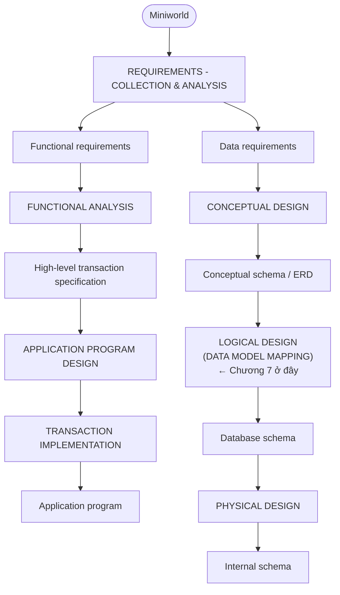

# Chương 7: Phụ Thuộc Hàm và Chuẩn Hóa Quan Hệ — Functional Dependencies & Normalization for Relational DBs

> Nguồn: CO2013 Database Systems, HCMUT — Giảng viên: TS. Trần Minh Quang
> Giáo trình: Elmasri & Navathe, 7th Edition (Chương tương ứng: Chương 15–16)
> File PDF gốc: `Lectures/07_FD_v2.pdf` — **95 trang**
> Đã gộp các slide "Contents" lặp lại (slide 2, 3, 22, 28, 32, 40, 52, 65, 69, 81, 95) thành **một mục lục** ở phần 0.

---

## 0. Trước khi bắt đầu

### 0.1. Bạn cần biết gì trước? (Prerequisite)

Trước khi học chương này, bạn cần "nhớ lại" nhanh các khái niệm nền (đã học ở chương 4):

| Kiến thức nền | Nhắc lại siêu ngắn | Liên hệ với chương 7 |
|---|---|---|
| **Relation, attribute, tuple** | Bảng có cột (attribute) và dòng (tuple). `t[X]` = giá trị tuple t trên tập attribute X. | FD được phát biểu dùng `t[X]`. |
| **Relation schema** | `R(A1, A2, ..., An)` — tên bảng + danh sách cột. | FD ràng buộc trên schema, áp dụng cho mọi instance. |
| **Primary key, Candidate key, Superkey** | Superkey = tập attribute không trùng giữa 2 tuple. Candidate key = superkey *tối thiểu*. Primary key = một candidate key được chọn. | Normal form được định nghĩa qua key. |
| **Foreign key** | Cột ở bảng A trỏ về PK bảng B. | Thiết kế tốt: JOIN qua PK/FK để tránh spurious tuples. |
| **JOIN (chương 5, 6)** | Ghép 2 relation theo cột chung. | Phân rã sai → JOIN sinh dữ liệu giả. |
| **COMPANY schema** | EMPLOYEE, DEPARTMENT, DEPT_LOCATIONS, PROJECT, WORKS_ON, DEPENDENT. | Mọi ví dụ trong chương đều bám COMPANY. |
| **Set theory** | `⊆` tập con, `∪` hợp, `∩` giao, `−` hiệu. | Closure X⁺ và phân loại U_l/U_r/U_b cần. |

> 💡 **Hiểu đơn giản:** Schema vs Instance giống **bản thiết kế nhà** vs **các căn nhà cụ thể đang ở**. Chương 7 chủ yếu kiểm tra bản thiết kế: nếu thiết kế sai, nhà vẫn xây được nhưng ở lâu sẽ bất tiện, sửa chữa tốn công, dễ hỏng.

### 0.2. Sau chương này bạn sẽ làm được gì? (Learning Outcomes)

1. Giải thích vì sao một schema có thể "xấu" dù vẫn lưu được dữ liệu (4 vấn đề: semantics, redundancy, NULL, spurious tuples).
2. Nhận diện 3 loại update anomaly: modification, insertion, deletion.
3. Viết được Functional Dependency (FD) dạng `X → Y` và đọc hiểu ý nghĩa formal.
4. Phân biệt **direct, indirect (transitive), partial** dependency.
5. Áp dụng **Armstrong's inference rules** (IR1, IR2, IR3) và các luật phái sinh.
6. Tính **closure** X⁺ của tập attribute (Algorithm 16.1).
7. Kiểm tra **equivalence** của 2 tập FD (F⁺ = G⁺).
8. Tìm **minimal cover** (Algorithm 16.2).
9. Tìm **candidate keys** bằng Algorithm 1 (Elmasri) và Algorithm 2 (Saiedian).
10. Kiểm tra một quan hệ ở **1NF, 2NF, 3NF, BCNF** và **decompose** lên chuẩn cao hơn.
11. Hiểu hai tính chất quan trọng của decomposition: **non-additive (lossless) join** và **dependency preservation**.
12. Áp dụng **NJB test** cho phân rã binary.

### 0.3. Lộ trình đọc đề xuất

| Mức | Section | Mục tiêu | Thời gian |
|---|---|---|---|
| **CORE 1** | §1 — Vì sao cần Normalization | Hiểu 4 vấn đề thiết kế tệ | 45–60' |
| **CORE 2** | §2–§4 — FD, Closure, Armstrong, Minimal Cover | Tính X⁺, tìm key, suy FD | 90–120' |
| **CORE 3** | §5 — Key finding | Tìm hết candidate keys | 30' |
| **CORE 4** | §6–§7 — 1NF/2NF/3NF/General NF | Phân rã chuẩn hóa | 90–120' |
| **CORE 5** | §8 — BCNF + NJB | Lên chuẩn cao nhất | 45' |
| **EXAM** | §9 + Bài tập tự luyện | Luyện dạng thi | 90–120' |

> Tổng thời gian học chủ động: **~6 giờ**. Đây là chương "đinh" của môn — kỳ thi cuối kỳ HCMUT **hầu như luôn có 1 bài tự luận lớn** về normalization từ 2NF → BCNF.

---

## 1. Vì sao cần Normalization? — Bốn vấn đề của thiết kế "tệ"

### 1.1. Tại sao có concept này? (Motivation)

Ở chương 4, bạn đã biết cách ánh xạ ER → quan hệ. Nhưng cùng một mini-world có thể vẽ ER khác nhau → schema khác nhau. **Schema nào "tốt", schema nào "tệ"? Đo bằng cách nào?**

Nếu không có normalization, hai designer có thể tạo ra 2 schema cùng đúng nghiệp vụ nhưng:
- Lặp dữ liệu khủng khiếp (1 phòng có 100 nhân viên → tên phòng viết 100 lần).
- Sửa dữ liệu hay bị sai (đổi tên trưởng phòng nhưng quên 1/100 hàng → DB **inconsistent**).
- Không thêm được "phòng chưa có nhân viên".
- Khi JOIN lại sinh dữ liệu **không có thật** (spurious).

→ **Normalization** là **formal framework** dùng **Functional Dependencies (phụ thuộc hàm)** và **Keys** để *đo độ tốt* của schema và *biến schema tệ thành tốt* có hệ thống.

> 💡 **Hiểu đơn giản:** Normalization giống như **sắp xếp tủ quần áo**: nhét tất cả áo, quần, vớ vào cùng một ngăn → tủ "tệ" (lục tung mỗi lần lấy đồ). Chia thành ngăn áo, ngăn quần, ngăn vớ → tủ "tốt" (lấy nhanh, không ảnh hưởng đồ khác khi thay đổi). Normalization gom các attribute *thực sự thuộc về nhau* thành cùng một quan hệ.

### 1.2. Bối cảnh: Overview of Database Design Process (Slide 4)

Normalization nằm ở **pha Logical Design** trong quy trình thiết kế CSDL — sau Conceptual Design (ER) và trước Physical Design (file, index).



> 📊 **Đọc diagram này thế nào:** Phần Database Design (phải) chia 4 lớp. Chương 7 nằm ở **Logical Design** — tinh chỉnh schema sau khi đã ánh xạ từ ER. Vẫn thuộc vùng **DBMS-independent** (lý thuyết quan hệ tổng quát).

### 1.3. Bốn tiêu chí "informal" đánh giá schema (Slides 5–7)

Mỗi relation schema gồm các attribute. Cần **đo** *vì sao* cách gom attribute này tốt hơn cách kia. Bốn tiêu chí:

1. **Semantics of attributes** — mọi attribute phải "thuộc cùng một thực thể" về ngữ nghĩa.
2. **Reducing redundant values** — giảm dư thừa → tiết kiệm storage + tránh update anomalies.
3. **Reducing NULL values** — NULL có nhiều diễn giải mơ hồ.
4. **Disallowing spurious tuples** — schema phải sao cho JOIN qua PK/FK không sinh tuple ảo.

### 1.4. Tiêu chí 1: Semantics — "Bảng nói về cái gì?" (Slide 7)

**Better Relations** — mỗi tuple chỉ kể về MỘT thực thể:

*EMPLOYEE*:
| Fname | Lname | Ssn | Bdate | Address | Dnumber |
|---|---|---|---|---|---|
| Smith | John B. | 123456789 | 1965-01-09 | 731 Fondren, Houston, TX | 5 |
| Wong | Franklin T. | 333445555 | 1955-12-08 | 638 Voss, Houston, TX | 5 |
| Zelaya | Alicia J. | 999887777 | 1968-07-19 | 3321 Castle, Spring, TX | 4 |
| Wallace | Jennifer S. | 987654321 | 1941-06-20 | 291 Berry, Bellaire, TX | 4 |
| Narayan | Ramesh K. | 666884444 | 1962-09-15 | 975 Fire Oak, Humble, TX | 5 |
| English | Joyce A. | 453453453 | 1972-07-31 | 5631 Rice, Houston, TX | 5 |
| Jabbar | Ahmad V. | 987987987 | 1969-03-29 | 980 Dallas, Houston, TX | 4 |
| Borg | James E. | 888665555 | 1937-11-10 | 450 Stone, Houston, TX | 1 |

*DEPARTMENT*:
| Dname | Dnumber | Dmgr_ssn |
|---|---|---|
| Research | 5 | 333445555 |
| Administration | 4 | 987654321 |
| Headquarters | 1 | 888665555 |

**Worse Relation** — gom 2 thực thể vào 1 bảng:

*EMP_DEPT*:
| Ename | Ssn | Bdate | Address | Dnumber | Dname | Dmgr_ssn |
|---|---|---|---|---|---|---|
| Smith, John B. | 123456789 | 1965-01-09 | 731 Fondren, Houston, TX | 5 | Research | 333445555 |
| Wong, Franklin T. | 333445555 | 1955-12-08 | 638 Voss, Houston, TX | 5 | Research | 333445555 |
| Zelaya, Alicia J. | 999887777 | 1968-07-19 | 3321 Castle, Spring, TX | 4 | Administration | 987654321 |
| Wallace, Jennifer S. | 987654321 | 1941-06-20 | 291 Berry, Bellaire, TX | 4 | Administration | 987654321 |
| Narayan, Ramesh K. | 666884444 | 1962-09-15 | 975 FireOak, Humble, TX | 5 | Research | 333445555 |
| English, Joyce A. | 453453453 | 1972-07-31 | 5631 Rice, Houston, TX | 5 | Research | 333445555 |
| Jabbar, Ahmad V. | 987987987 | 1969-03-29 | 980 Dallas, Houston, TX | 4 | Administration | 987654321 |
| Borg, James E. | 888665555 | 1937-11-10 | 450 Stone, Houston, TX | 1 | Headquarters | 888665555 |

> 📊 **Đọc diagram này thế nào:** EMP_DEPT mỗi tuple **gom thông tin của 2 thực thể** (1 nhân viên + 1 phòng) → ngữ nghĩa lẫn lộn. (EMPLOYEE + DEPARTMENT) tách rõ — mỗi tuple chỉ "kể" về một thực thể.

### 1.5. Tiêu chí 2: Redundancy + Update Anomalies (Slides 8–12)

**Redundancy:** Trong EMP_DEPT, phòng "Research" có 4 nhân viên → cụm `(5, Research, 333445555)` lặp 4 lần. Phòng "Administration" 3 nhân viên → cụm lặp 3 lần.

**Hậu quả:** Tốn storage, nhưng quan trọng hơn — sinh **update anomalies**:

#### Modification anomaly (Slide 9)
Đổi trưởng phòng Research từ SSN `333445555` → SSN `999887777`: phải update Dmgr_ssn ở **4 tuple** (Smith, Wong, Narayan, English). Quên 1 tuple → DB **inconsistent**.

#### Insertion anomaly (Slide 10)
Tạo phòng "R&D Mới" *trước khi* có nhân viên: KHÔNG thể thêm dòng EMP_DEPT vì SSN (PK) sẽ rỗng. Với schema tách (EMPLOYEE + DEPARTMENT), chỉ cần INSERT 1 dòng DEPARTMENT.

#### Deletion anomaly (Slide 12)
Borg là nhân viên duy nhất của phòng "Headquarters" (Dnumber=1). Xóa dòng Borg → **mất luôn thông tin** dept 1 tồn tại, tên dept, manager dept. Trong thực tế phòng vẫn còn — Borg chỉ nghỉ!

> 💡 **Hiểu đơn giản:** Update anomalies giống như **danh sách lớp dạng "tên SV - tên GVCN"** chứ không tách 2 sổ riêng: đổi GVCN phải sửa 60 dòng; thêm GVCN mới chưa có SV thì không ghi được; lớp giải tán hết SV thì mất luôn tên GVCN. Tách 2 sổ "danh sách SV" và "danh sách GVCN" thì 3 vấn đề biến mất.

### 1.6. COMPANY schema chuẩn (sẽ dùng xuyên suốt) (Slide 11)

Một database state có thể có của COMPANY:

**EMPLOYEE:**
| Fname | Minit | Lname | Ssn | Bdate | Address | Sex | Salary | Super_ssn | Dno |
|---|---|---|---|---|---|---|---|---|---|
| John | B | Smith | 123456789 | 1965-01-09 | 731 Fondren, Houston, TX | M | 30000 | 333445555 | 5 |
| Franklin | T | Wong | 333445555 | 1955-12-08 | 638 Voss, Houston, TX | M | 40000 | 888665555 | 5 |
| Alicia | J | Zelaya | 999887777 | 1968-01-19 | 3321 Castle, Spring, TX | F | 25000 | 987654321 | 4 |
| Jennifer | S | Wallace | 987654321 | 1941-06-20 | 291 Berry, Bellaire, TX | F | 43000 | 888665555 | 4 |
| Ramesh | K | Narayan | 666884444 | 1962-09-15 | 975 Fire Oak, Humble, TX | M | 38000 | 333445555 | 5 |
| Joyce | A | English | 453453453 | 1972-07-31 | 5631 Rice, Houston, TX | F | 25000 | 333445555 | 5 |
| Ahmad | V | Jabbar | 987987987 | 1969-03-29 | 980 Dallas, Houston, TX | M | 25000 | 987654321 | 4 |
| James | E | Borg | 888665555 | 1937-11-10 | 450 Stone, Houston, TX | M | 55000 | NULL | 1 |

**DEPARTMENT:**
| Dname | Dnumber | Mgr_ssn | Mgr_start_date |
|---|---|---|---|
| Research | 5 | 333445555 | 1988-05-22 |
| Administration | 4 | 987654321 | 1995-01-01 |
| Headquarters | 1 | 888665555 | 1981-06-19 |

### 1.7. Tiêu chí 3: NULL values (Slide 13)

NULL có **nhiều diễn giải**:
- Thuộc tính **không áp dụng** cho tuple này.
- Giá trị **chưa biết** (unknown).
- Giá trị **biết nhưng chưa được ghi** (known but absent).

**Vấn đề:** Lãng phí storage; khó hiểu ngữ nghĩa và JOIN ở mức logical; khó tính aggregate (COUNT/SUM có đếm NULL không?).

**Nguyên tắc thiết kế:** Tránh đặt attribute thường xuyên NULL vào base relation. Nếu không tránh được, đảm bảo NULL chỉ áp dụng cho trường hợp **ngoại lệ**, không phải đa số.

> 💡 **Ví dụ COMPANY:** `Super_ssn = NULL` cho James E. Borg vì ông là president (không có supervisor) — hợp lý vì là ngoại lệ. Nhưng nếu bảng có 80% dòng NULL ở 1 cột, đó là dấu hiệu cột không nên ở bảng đó.

### 1.8. Tiêu chí 4: Spurious Tuples — Tuple ảo do JOIN sai (Slides 14–17)

**Spurious tuples** = các tuple **KHÔNG hợp lệ, KHÔNG tồn tại** trong mini-world. Sinh ra khi JOIN các relation từ thiết kế tệ.

**Nguyên tắc:** Schema phải sao cho JOIN với equality trên **PK hoặc FK** đảm bảo không sinh tuple ảo.

#### 1.8.1. Ví dụ phân rã SAI (Slide 14)

Cho schema gốc:
```
EMP_PROJ (SSN, PNumber, Hours, EName, PName, PLocation)
```

Phân rã SAI thành:
```
EMP_LOCS  (EName, PLocation)
EMP_PROJ1 (SSN, PNumber, Hours, PName, PLocation)
```

**Vấn đề:** Khi `EMP_LOCS ⋈ EMP_PROJ1` trên `PLocation`, gặp lỗi vì PLocation **không phải PK, không phải FK** trong cả 2 → sinh spurious tuples.

#### 1.8.2. EMP_PROJ gốc (Slide 15) — có redundancy

| Ssn | Pnumber | Hours | Ename | Pname | Plocation |
|---|---|---|---|---|---|
| 123456789 | 1 | 32.5 | Smith, John B. | ProductX | Bellaire |
| 123456789 | 2 | 7.5 | Smith, John B. | ProductY | Sugarland |
| 666884444 | 3 | 40.0 | Narayan, Ramesh K. | ProductZ | Houston |
| 453453453 | 1 | 20.0 | English, Joyce A. | ProductX | Bellaire |
| 453453453 | 2 | 20.0 | English, Joyce A. | ProductY | Sugarland |
| 333445555 | 2 | 10.0 | Wong, Franklin T. | ProductY | Sugarland |
| 333445555 | 3 | 10.0 | Wong, Franklin T. | ProductZ | Houston |
| 333445555 | 10 | 10.0 | Wong, Franklin T. | Computerization | Stafford |
| 333445555 | 20 | 10.0 | Wong, Franklin T. | Reorganization | Houston |
| 999887777 | 30 | 30.0 | Zelaya, Alicia J. | Newbenefits | Stafford |
| 999887777 | 10 | 10.0 | Zelaya, Alicia J. | Computerization | Stafford |
| 987987987 | 10 | 35.0 | Jabbar, Ahmad V. | Computerization | Stafford |
| 987987987 | 30 | 5.0 | Jabbar, Ahmad V. | Newbenefits | Stafford |
| 987654321 | 30 | 20.0 | Wallace, Jennifer S. | Newbenefits | Stafford |
| 987654321 | 20 | 15.0 | Wallace, Jennifer S. | Reorganization | Houston |
| 888665555 | 20 | NULL | Borg, James E. | Reorganization | Houston |

#### 1.8.3. Kết quả JOIN sai sinh spurious (Slide 17)

Khi `EMP_LOCS ⋈ EMP_PROJ1` trên PLocation:

| Ssn | Pnumber | Hours | Pname | Plocation | Ename | Ghi chú |
|---|---|---|---|---|---|---|
| 123456789 | 1 | 32.5 | ProductX | Bellaire | Smith, John B. | hợp lệ |
| 123456789 | 1 | 32.5 | ProductX | Bellaire | **English, Joyce A.** | ⚠️ SPURIOUS! |
| 123456789 | 2 | 7.5 | ProductY | Sugarland | Smith, John B. | hợp lệ |
| 123456789 | 2 | 7.5 | ProductY | Sugarland | **English, Joyce A.** | ⚠️ SPURIOUS! |
| 666884444 | 3 | 40.0 | ProductZ | Houston | Narayan, Ramesh K. | hợp lệ |
| 666884444 | 3 | 40.0 | ProductZ | Houston | **Wong, Franklin T.** | ⚠️ SPURIOUS! |

**SQL minh họa lỗi:**
```sql
SELECT EP1.Ssn, EP1.Pnumber, EP1.Hours, EP1.Pname, EP1.Plocation, EL.Ename
FROM EMP_PROJ1 AS EP1
JOIN EMP_LOCS AS EL
  ON EP1.Plocation = EL.Plocation;
```

- `ON EP1.Plocation = EL.Plocation`: điều kiện JOIN sai/không đủ mạnh.
- PLocation không phải key — nhiều employee và project cùng location.
- → JOIN nhân chéo tạo nhiều tổ hợp không tồn tại.

> 💡 **Hiểu đơn giản:** Spurious tuples giống như **ghép người và phòng thi chỉ dựa trên "cùng tòa nhà"**. Tòa H6 có 10 lớp thi và 500 SV — ghép như vậy sinh rất nhiều kết quả sai: SV bị gán vào lớp thi không đăng ký.

### 1.9. Tổng kết "Goodness" + Giải pháp (Slides 18–20)

**Goodness measures:**
- Redundant information in tuples
- Update anomalies: modification, deletion, insertion
- Reducing NULL values
- Disallowing spurious tuples

**☞ Giải pháp: Normalization** (Slide 19)
- Formal framework phân tích schema dựa trên **keys** + **FDs**.
- Một loạt **normal form tests**: 1NF, 2NF, 3NF, BCNF, 4NF, 5NF.
- Đảm bảo attribute được gom với PK. Attribute không phụ thuộc trực tiếp PK → tách ra quan hệ mới.

**Hai tính chất quan trọng của decomposition (Slide 20):**
1. **Non-additive (lossless) join** — JOIN không sinh spurious — **BẮT BUỘC, không hi sinh**.
2. **Preservation of functional dependencies** — FD ban đầu vẫn kiểm tra được — **ít nghiêm ngặt hơn, có thể hi sinh**.

> 📝 **Tóm lại section 1:**
> - Schema "tệ" gây 4 vấn đề: lẫn lộn ngữ nghĩa, redundancy (kéo theo 3 anomalies), nhiều NULL, spurious tuples.
> - Normalization = formal framework dùng FD + keys → biến tệ thành tốt qua các normal form.
> - Decomposition phải đảm bảo **non-additive join** (bắt buộc) và **dependency preservation** (nên có).
> **Một câu ghi nhớ:** *"Schema tệ = lặp + lỗi cập nhật + NULL + tuple ảo. Normalization = phân rã có lý thuyết để chữa cả 4."*

> ❓ **Tự kiểm tra section 1:**
> 1. Liệt kê 3 loại update anomalies + ví dụ COMPANY.
> 2. Vì sao non-additive join *quan trọng hơn* dependency preservation?
> 3. JOIN 2 relation trên cột không phải PK/FK gây hiện tượng gì?

---

## 2. Functional Dependencies (FDs) — Định nghĩa và các loại

> Section 1 cho thấy schema tệ gây vấn đề. Bây giờ ta cần *công cụ chính xác* để mô tả "attribute nào quyết định attribute nào" — đó là **Functional Dependency**.

### 2.1. Tại sao có concept này? (Motivation)

Khi nhìn EMP_DEPT, ta cảm nhận "Dnumber quyết định Dname". Nhưng cảm nhận không đủ — cần *ký hiệu hóa* để máy tính (hay người thiết kế) có thể *suy luận tự động*.

**FD** là ký hiệu đó: `X → Y` đọc là "X xác định hàm Y" (X functionally determines Y).

### 2.2. Định nghĩa formal (Slides 23–24)

- FD được dùng để xác định **formal measures** của "goodness" của design.
- FD và keys định nghĩa **normal forms**.
- FD là **constraint** xuất phát từ **ý nghĩa và quan hệ giữa các attribute**.
- **Quan trọng:** FD **không thể** suy ra tự động từ một *thể hiện* r — phải được **người hiểu ngữ nghĩa** định nghĩa **tường minh**.

**Định nghĩa:** Tập attribute X **functionally determines** tập attribute Y nếu giá trị của X xác định một giá trị duy nhất cho Y.

$$\boxed{X \rightarrow Y}$$

`X → Y` đúng nếu khi 2 tuple bất kỳ có cùng giá trị X, chúng PHẢI có cùng giá trị Y.

**Công thức:** Với mọi 2 tuple t₁, t₂ trong mọi instance r(R):
$$\text{If } t_1[X] = t_2[X], \text{ then } t_1[Y] = t_2[Y]$$

| Ký hiệu | Ý nghĩa |
|---|---|
| `R` | Relation schema |
| `r(R)` | Một instance cụ thể của R |
| `X, Y` | Tập attribute |
| `t1[X]` | Giá trị tuple t1 trên các attr thuộc X |
| `X → Y` | "Biết X là biết Y duy nhất" |

#### SQL kiểm tra vi phạm FD

SQL không "chứng minh" FD đúng về ngữ nghĩa, chỉ kiểm tra instance hiện tại có vi phạm không:

```sql
-- Mẫu chung kiểm tra X → Y
SELECT X, COUNT(DISTINCT Y) AS y_count
FROM R
GROUP BY X
HAVING COUNT(DISTINCT Y) > 1;
```

- Nếu query rỗng → instance hiện tại không vi phạm.
- Designer vẫn phải dựa vào **ngữ nghĩa miniworld** để khẳng định FD là luật lâu dài.

> 💡 **Hiểu đơn giản:** FD `X → Y` giống như **luật "biết số CCCD là biết tên"**: không bao giờ có 2 người cùng CCCD khác tên. CCCD "xác định" tên. `SSN → ENAME` nghĩa là "biết SSN là chắc chắn biết tên".

### 2.3. Ví dụ FD trên COMPANY (Slide 25)

**1) SSN → EName** — số an sinh xã hội xác định tên nhân viên:
```sql
SELECT Ssn, COUNT(DISTINCT Fname || ' ' || Lname) AS name_count
FROM EMPLOYEE
GROUP BY Ssn
HAVING COUNT(DISTINCT Fname || ' ' || Lname) > 1;
```

**2) PNumber → {PName, PLocation}** — số project xác định tên + location:
```sql
SELECT Pnumber,
       COUNT(DISTINCT Pname) AS pname_count,
       COUNT(DISTINCT Plocation) AS ploc_count
FROM PROJECT
GROUP BY Pnumber
HAVING COUNT(DISTINCT Pname) > 1 OR COUNT(DISTINCT Plocation) > 1;
```

**3) {SSN, PNumber} → Hours** — cặp nhân viên-project xác định số giờ làm/tuần:
```sql
SELECT Essn, Pno, COUNT(DISTINCT Hours) AS hours_count
FROM WORKS_ON
GROUP BY Essn, Pno
HAVING COUNT(DISTINCT Hours) > 1;
```

### 2.4. Quan hệ giữa FD và Key (Slide 26)

**Quan trọng:** Nếu K là **key** của R, thì K **functionally determines** *tất cả* attribute trong R:
$$K \rightarrow R$$

**Lý do:** Không có 2 tuple phân biệt cùng K → vế "if t₁[K]=t₂[K]" không bao giờ xảy ra → FD `K → bất cứ gì` đều thỏa "vacuously".

### 2.5. Direct, Indirect, Partial Dependencies (Slides 28–30)

#### 2.5.1. Direct dependency / Fully functional dependency (Slide 28)

**Tất cả** attribute trong R phải **fully functionally dependent** vào PK.

Ví dụ `EMPLOYEE(**SSN**, Name, BDate, Address, DNO)`:
```
SSN → {Name, BDate, Address, DNO}
```

```
EMPLOYEE
┌─────┬──────┬───────┬─────────┬─────┐
│ SSN │ Name │ BDate │ Address │ DNO │
└──┬──┴──────┴───────┴─────────┴─────┘
   │     ▲      ▲       ▲       ▲
   └─────┴──────┴───────┴───────┘
   SSN xác định tất cả attr (trực tiếp)
```

#### 2.5.2. Indirect / Transitive dependency (Slide 29)

Giá trị attribute KHÔNG được xác định trực tiếp bởi PK — mà gián tiếp qua attribute khác.

Ví dụ `EMP_DEPT(**SSN**, Name, BDate, Address, DNO, DName)`:
```
SSN → DNO  và  DNO → DName  ⟹  SSN → DName (transitive)
```

```
EMP_DEPT
┌─────┬──────┬───────┬─────────┬─────┬───────┐
│ SSN │ Name │ BDate │ Address │ DNO │ DName │
└──┬──┴──────┴───────┴─────────┴──┬──┴───┬───┘
   │     ▲      ▲       ▲         │      ▲
   └─────┴──────┴───────┴─────────┘      │
                                          │
                                  DNO → DName (transitive!)
```

Đây là **dấu hiệu vi phạm 3NF**.

#### 2.5.3. Partial dependency (Slide 30)

- **Composite determinant:** Cần *nhiều hơn 1* attribute để xác định attribute khác. Ví dụ `{SSN, PNumber}` trong EMP_PROJ.
- **Partial dependency:** Attribute KHÔNG phụ thuộc *toàn bộ* composite determinant — chỉ một *phần*.

Ví dụ `EMP_PROJ(**SSN, PNumber**, Hours, EName, PName, PLocation)` với PK = {SSN, PNumber}:
```
{SSN, PNumber} → Hours              (full)
SSN            → EName              (partial — chỉ cần SSN)
PNumber        → {PName, PLocation} (partial — chỉ cần PNumber)
```

```
EMP_PROJ
┌─────┬─────────┬───────┬───────┬───────┬───────────┐
│ SSN │ PNumber │ Hours │ EName │ PName │ PLocation │
└──┬──┴────┬────┴───┬───┴───┬───┴───┬───┴────┬──────┘
   │       │        ▲       ▲       ▲        ▲
   └───────┴────────┘       │       │        │
   FD1: {SSN,PNumber} → Hours
   │                        │       │        │
   └─FD2: SSN → EName───────┘       │        │
                                     │        │
           FD3: PNumber → PName, PLocation ──┘
```

Partial dependency là **dấu hiệu vi phạm 2NF**.

> 💡 **Hiểu đơn giản:** Partial dependency giống như **hóa đơn có khóa (Mã KH, Mã SP)**. *Số lượng mua* phụ thuộc cả khách và sản phẩm (full). Nhưng *tên khách* chỉ phụ thuộc mã KH (partial); *tên SP* chỉ phụ thuộc mã SP (partial). Nhét tất vào bảng chi tiết hóa đơn → lặp dữ liệu.

> 📝 **Tóm lại section 2:**
> - FD `X → Y`: biết X là biết Y (mọi cặp tuple cùng X phải cùng Y).
> - FD được designer xác định từ **semantics nghiệp vụ**, KHÔNG suy ra từ data.
> - Key K → tất cả attribute trong R.
> - 3 loại đặc biệt: **Direct/full** (vi phạm = không có), **Indirect/transitive** (→ vi phạm 3NF), **Partial** (→ vi phạm 2NF).
> **Một câu ghi nhớ:** *"FD là ngôn ngữ chính thức của ràng buộc; Direct/Transitive/Partial là 3 'cá tính' của nó với key."*

> ❓ **Tự kiểm tra section 2:**
> 1. Cho EMPLOYEE(SSN, Name, Salary, DNO) PK=SSN. Liệt kê FD và phân loại.
> 2. FD `Salary → SSN` có hợp lệ trong COMPANY không? Vì sao?
> 3. Phân biệt **composite determinant** và **partial dependency**.

---

## 3. Inference Rules — Quy tắc suy luận FD

### 3.1. Motivation

Khi designer ghi tập FD F = {f1, ..., fn}, từ F có thể *suy ra* nhiều FD khác. Ví dụ: `SSN → DNO` và `DNO → DName` ⟹ `SSN → DName`. Việc suy luận quan trọng vì:
- Cần biết toàn bộ FD đúng để kiểm tra normal form chính xác.
- Cần thuật toán tính closure X⁺.

**Armstrong's Inference Rules** (1974) là bộ 3 luật cơ bản — **đầy đủ và đúng đắn** (sound and complete).

### 3.2. Armstrong's Inference Rules (Slide 33)

- **IR1. (Reflexive — phản xạ):** Nếu `Y ⊆ X` thì `X → Y`.
- **IR2. (Augmentation — thêm bổ sung):** Nếu `X → Y` thì `XZ → YZ`. (Notation: XZ = X ∪ Z)
- **IR3. (Transitive — bắc cầu):** Nếu `X → Y` và `Y → Z` thì `X → Z`.

> 💡 **Hiểu đơn giản:**
> - **IR1:** Y ⊆ X thì X "đã chứa" Y → tự động xác định Y. Ví dụ: `{SSN, Name} → SSN`.
> - **IR2:** Nếu `SSN → Name`, thêm Z vào cả 2 vế: `{SSN, Address} → {Name, Address}`. "Biết SSN+Address thì chắc chắn biết Name+Address".
> - **IR3:** Bắc cầu logic A→B→C nên A→C.

### 3.3. Derived Rules (Slide 34)

Suy ra được từ IR1–IR3:

- **Decomposition:** `X → YZ` ⟹ `X → Y` và `X → Z`.
- **Union:** `X → Y` và `X → Z` ⟹ `X → YZ`.
- **Pseudotransitivity:** `X → Y` và `WY → Z` ⟹ `WX → Z`.

#### Chứng minh ngắn của 3 luật phái sinh

**Decomposition** (X → YZ ⟹ X → Y):
1. X → YZ (giả thiết)
2. YZ → Y (IR1, Y ⊆ YZ)
3. X → Y (IR3 từ 1,2)

**Union** (X → Y và X → Z ⟹ X → YZ):
1. X → Y
2. X → Z
3. X → XY (IR2 augment X)
4. XY → YZ (IR2 augment Y vào X→Z)
5. X → YZ (IR3 từ 3,4)

**Pseudotransitivity** (X → Y, WY → Z ⟹ WX → Z):
1. X → Y
2. WX → WY (IR2 augment W)
3. WY → Z
4. WX → Z (IR3 từ 2,3)

### 3.4. Closure F⁺ và X⁺ (Slide 35)

- **F⁺** = tập tất cả FD suy ra được từ F.
- **X⁺** = tập tất cả attribute mà X xác định.

**Ý nghĩa thực tế của X⁺:**
- Nếu X⁺ chứa tất cả attribute của R → X là **superkey**.
- Nếu thêm vào đó không subset thực sự nào của X có closure = R → X là **candidate key**.

### 3.5. Algorithm 16.1 — Tính X⁺ (Slide 36)

```
X⁺ := X;
repeat
    oldX⁺ := X⁺;
    for each functional dependency Y → Z in F do
        if X⁺ ⊇ Y then X⁺ := X⁺ ∪ Z;
until (X⁺ = oldX⁺);
```

**Cách hoạt động:**
1. Khởi tạo X⁺ = X (IR1).
2. Lặp: với mỗi `Y → Z` trong F, nếu X⁺ chứa Y thì thêm Z (vì X⁺ → Y → Z).
3. Dừng khi X⁺ không đổi.

### 3.6. Ví dụ tính X⁺ (Slide 37)

Cho **F = { AB → C, A → DE, B → M, M → GH, D → IJ }**:

| X | X⁺ | Cách tính |
|---|---|---|
| {A, B} | {A, B, C, D, E, M, G, H, I, J} | AB→C, A→DE, B→M, M→GH, D→IJ — chứa tất cả → superkey |
| {A} | {A, D, E, I, J} | A→DE, D→IJ |
| {B} | {B, M, G, H} | B→M, M→GH |
| {M} | {M, G, H} | M→GH |
| {D} | {D, I, J} | D→IJ |

### 3.7. Exercise (Slide 38)

> **Bài tập 3.1:** Cho R(A, B, C, D, E) với F:
> 1. AB → C
> 2. CD → E
> 3. DE → B
>
> Tìm `{A, B}⁺` và `{A, B, D}⁺`.
>
> **Giải {A, B}⁺:**
> - Start: {A, B}
> - AB → C: {A, B} ⊇ {A,B} ✓ → {A, B, C}
> - CD → E: cần D, chưa có → bỏ qua
> - DE → B: cần D, E, chưa có → bỏ qua
> - **Kết quả:** `{A, B}⁺ = {A, B, C}`
>
> **Giải {A, B, D}⁺:**
> - Start: {A, B, D}
> - AB → C: ⊇ {A,B} ✓ → {A, B, C, D}
> - CD → E: ⊇ {C, D} ✓ → {A, B, C, D, E}
> - DE → B: ⊇ {D, E} ✓ → B đã có
> - **Kết quả:** `{A, B, D}⁺ = {A, B, C, D, E} = R` → **superkey**!
>
> **Tại sao đúng:** Khi closure = R, X xác định tất cả → superkey. Có thể tối thiểu hoá để tìm candidate key.

> 📝 **Tóm lại section 3:**
> - Armstrong IR1/IR2/IR3 — sound + complete.
> - Derived: Decomposition, Union, Pseudotransitivity.
> - X⁺ tính bằng Algorithm 16.1; X⁺ = R ⟺ X là superkey.
> **Một câu ghi nhớ:** *"3 luật Armstrong → tính X⁺ → biết superkey hay không."*

> ❓ **Tự kiểm tra section 3:**
> 1. Phát biểu IR1, IR2, IR3 bằng lời.
> 2. Cho F = {A→B, B→C, C→A}. Tính {A}⁺, {B}⁺, {C}⁺. Nhận xét?
> 3. {X}⁺ = R ⟹ X là gì? Để X là candidate key cần thêm gì?

---

## 4. Equivalence và Minimal Cover

### 4.1. Motivation

Hai designer có thể viết tập FD trông khác nhưng *cùng mô tả* một ràng buộc → cần **equivalence**.

Tập FD có thể chứa **luật thừa** → cắt bỏ → **minimal cover** — input chuẩn cho thuật toán normalization.

### 4.2. Equivalence (Slide 41)

- F và G **equivalent** ⟺ `F⁺ = G⁺`.
- F **covers** G ⟺ `G⁺ ⊆ F⁺` (mọi FD suy từ G cũng suy từ F).
- F và G equivalent ⟺ F covers G **và** G covers F.

**Thuật toán kiểm tra F covers G:**
- Với mỗi `X → Y` trong G, tính X⁺ theo F.
- Nếu X⁺ ⊇ Y với *mọi* FD trong G → F covers G.

**Ví dụ:**
- F = {A → C, AC → D, E → AD, E → H}
- G = {A → CD, E → AH}

**F covers G:**
- `A → CD` trong G: {A}⁺ theo F = {A, C, D} ⊇ {C, D} ✓
- `E → AH` trong G: {E}⁺ theo F = {E, A, D, H, C} ⊇ {A, H} ✓

**G covers F:**
- `A → C`: {A}⁺ theo G = {A, C, D} ⊇ {C} ✓
- `AC → D`: {A, C}⁺ theo G = {A, C, D} ⊇ {D} ✓
- `E → AD`: {E}⁺ theo G = {E, A, H, C, D} ⊇ {A, D} ✓
- `E → H`: ⊇ {H} ✓

⟹ F ≡ G.

### 4.3. Minimal Cover (Slides 42–43)

**Tập F là minimal** nếu thỏa **3 điều kiện**:
1. Mọi FD có **một attribute duy nhất** ở vế phải (single RHS).
2. Không thể **xóa FD** nào mà vẫn equivalent với F.
3. Không thể **thay X → A** bằng `Y → A` với `Y ⊊ X` mà vẫn equivalent.

**Tính chất:**
- Mọi tập FD có *ít nhất một* minimal set tương đương.
- Có thể **nhiều** minimal set khác nhau equivalent.
- **Không có thuật toán đơn giản** tổng quát — phải thử.
- Khi synthesize quan hệ, giả định bắt đầu từ minimal set.

### 4.4. Algorithm 16.2 — Tìm Minimal Cover (Slide 44)

```
1. Set F := E.
2. Replace each X → {A1, A2, ..., An} in F
   by n FDs X → A1, X → A2, ..., X → An.
   (Tách RHS — đáp ứng đk 1)

3. For each X → A in F
       for each B in X
           if { {F − {X → A}} ∪ { (X − {B}) → A } } ≡ F
               then replace X → A with (X − {B}) → A.
   (Rút LHS — đáp ứng đk 3)

4. For each remaining X → A in F
       if {F − {X → A}} ≡ F
           then remove X → A.
   (Bỏ FD thừa — đáp ứng đk 2)
```

### 4.5. Ví dụ Minimal Cover (Slide 45)

> **Ví dụ 4.1:** E = {B → A, D → A, AB → D}. Tìm minimal cover.
>
> **Bước 1 — RHS đơn:** Tất cả đã đơn ✓
>
> **Bước 2 — Rút LHS** của AB → D:
> - Thử bỏ A → `B → D`. Có B → A nên từ B suy A, kết hợp AB → D → B → D hợp lệ.
> - Vậy A thừa trong AB → D. Thay → B → D.
>
> Trung gian: E = {B → A, B → D, D → A}.
>
> **Bước 3 — Bỏ FD thừa:**
> - `B → A`: nếu bỏ, từ {B → D, D → A} qua transitive cũng có B → A → *thừa*. Bỏ.
>
> **Kết quả:** `E_min = {B → D, D → A}`.

### 4.6. Exercise homework (Slide 46)

> **Bài tập 4.2:** E = {A → B, ABCD → I, IJ → G, IJ → H, ACDJ → GI}. Tìm minimal cover.
>
> **Bước 1 — Tách RHS:** A→B, ABCD→I, IJ→G, IJ→H, ACDJ→G, ACDJ→I.
>
> **Bước 2 — Rút LHS:**
> - `ABCD → I`: A → B nên B thừa → `ACD → I`.
> - `ACDJ → I`: ACD → I đã đủ → ACDJ → I *thừa* (sẽ bỏ ở bước 3).
> - `ACDJ → G`: ACD → I + IJ → G ⟹ ACDJ → G — thừa.
>
> **Bước 3 — Bỏ FD thừa:**
> - `ACDJ → I` thừa (ACD → I đã có).
> - `ACDJ → G` thừa.
>
> **Kết quả:** `F_min = { A → B, ACD → I, IJ → G, IJ → H }`.

> 📝 **Tóm lại section 4:**
> - F ≡ G ⟺ F⁺ = G⁺.
> - Minimal cover = 3 điều kiện: RHS đơn, không FD thừa, không attribute thừa LHS.
> - Algorithm 16.2: tách RHS → rút LHS → bỏ FD thừa.
> **Một câu ghi nhớ:** *"Minimal cover = tập FD gọn không thừa, input chuẩn của normalization."*

> ❓ **Tự kiểm tra section 4:**
> 1. Hai điều kiện cần để F equivalent với G?
> 2. F = {A → B, B → C, A → C} có minimal không?
> 3. Vì sao trong minimal cover yêu cầu RHS đơn?

---

## 5. Key-finding Algorithms (Slides 82–87)

### 5.1. Key và Superkey — Nhắc lại (Slide 82)

- **Superkey** SK: không có 2 tuple phân biệt nào cùng SK.
- **Key** K: superkey *minimal* — không bỏ thêm attribute nào mà vẫn là superkey.
- K → mọi attribute trong R.

### 5.2. Algorithm 1 — Tìm MỘT key (Slides 83–84) — Elmasri & Navathe

```
Input: Relation R và tập FD F.
Output: Một key K của R.

1. Set K := tất cả attribute trong R.
2. For each attribute A in K {
       compute (K − A)⁺ with respect to F;
       if (K − A)⁺ chứa tất cả attribute của R then
           set K := K − {A}
   };
```

**Ý tưởng:** Bắt đầu K = toàn R (chắc chắn superkey). Lần lượt thử bỏ A — nếu K\{A} vẫn superkey, A "thừa" → bỏ.

**Hạn chế:** Chỉ tìm **MỘT** candidate key — phụ thuộc *thứ tự* xét.

### 5.3. Algorithm 2 — Tìm TẤT CẢ candidate keys (Slides 85–87) — Saiedian & Spencer

**Phân loại attribute:**
- **U** = tất cả attribute của R.
- **U_l** = attribute chỉ xuất hiện ở **vế trái** (Left only) của FD trong F.
- **U_r** = attribute chỉ xuất hiện ở **vế phải** (Right only).
- **U_b** = attribute xuất hiện ở **cả hai vế** (Both).

**Tính chất:**
- `U_l ∩ U_r = ∅, U_l ∩ U_b = ∅, U_r ∩ U_b = ∅` (rời nhau)
- `U_l ∪ U_r ∪ U_b = U` (phủ hết)
- A ∈ U_l ⟹ A **phải có** trong mọi candidate key.
- A ∈ U_r ⟹ A **KHÔNG bao giờ** trong candidate key.

> 💡 **Trực giác:** Attribute "left only" là attr "không ai xác định nó được" → key phải chứa. Attribute "right only" được xác định bởi attr khác → không cần đưa vào key.

**Pseudocode:**
```
1. Determine U_l, U_r, U_b.
2. If (U_l)⁺ = U under F:
       U_l forms the only key, STOP.
   Else: go to step 3.
3. Consider every subset U_bi of U_b:
       For each U_bi, if (U_l ∪ U_bi)⁺ = U under F:
           K_i = (U_l ∪ U_bi) is a candidate key.
   (*) Nếu K_i là candidate key, không cần check U_bj ⊃ U_bi.
```

### 5.4. Ví dụ minh họa Algorithm 2

> **Ví dụ 5.1:** R(A, B, C, D, E, F) với F = { A,B,C → E,F; B → E; E → D }.
>
> **Bước 1:** Phân loại:
> - LHS: {A, B, C, E}; RHS: {E, F, D}
> - U_l = {A, B, C}; U_r = {F, D}; U_b = {E}
>
> **Bước 2:** `(U_l)⁺ = {A, B, C}⁺`:
> - + ABC → EF: {A, B, C, E, F}
> - + E → D: {A, B, C, D, E, F} = U ✓
>
> → `(U_l)⁺ = U` ⟹ **{A, B, C}** là candidate key duy nhất.

### 5.5. So sánh 2 Algorithm

| Tính chất | Algorithm 1 | Algorithm 2 |
|---|---|---|
| Tác giả | Elmasri & Navathe | Saiedian & Spencer |
| Output | 1 candidate key | TẤT CẢ candidate keys |
| Cách | Loại bỏ từng attr từ R | Phân loại U_l/U_r/U_b |
| Phức tạp | Tuyến tính | Mũ theo \|U_b\| (worst case) |
| Khi dùng | Cần 1 key nhanh | Cần đầy đủ (general 2NF/3NF) |

> 📝 **Tóm lại section 5:**
> - Algorithm 1: bóc dần từ R → 1 candidate key.
> - Algorithm 2: phân loại attribute → tìm hết candidate keys.
> - U_l⁺ = U ⟹ U_l là key duy nhất, dừng sớm.
> **Một câu ghi nhớ:** *"Phân loại left/right/both — tìm key như giải đố."*

> ❓ **Tự kiểm tra section 5:**
> 1. Vì sao attribute "right only" không bao giờ là phần của candidate key?
> 2. Algorithm 1 trả về 1 key — sao biết đó là candidate key chứ không chỉ superkey?
> 3. R(A, B, C, D) với F = {A→B, B→C, C→D}. Tìm tất cả candidate keys.

---

## 6. Normalization — 1NF, 2NF, 3NF (Slides 46–66)

### 6.1. Tại sao có concept này?

Bây giờ ta dùng FD + key + closure để định nghĩa các **normal forms** — mức độ "tốt" của một quan hệ:
- **1NF** giải quyết: attribute đa trị / nested.
- **2NF** giải quyết: partial dependency.
- **3NF** giải quyết: transitive dependency.
- **BCNF** giải quyết: bất kỳ FD nào có LHS không phải superkey.

### 6.2. Normalization là gì? (Slide 46)

- **Normalization:** Quá trình **decomposing** quan hệ "tệ" bằng cách tách attribute thành các quan hệ nhỏ hơn.
- **Normal form:** Dùng keys + FDs để **chứng nhận** một schema ở chuẩn nào.
- Designer **KHÔNG nhất thiết** phải normalize đến cao nhất (3NF, BCNF, 4NF) — đôi khi denormalize có lợi cho hiệu suất đọc.

### 6.3. Prime / Nonprime attribute (Slides 48–49)

- **Prime attribute (thuộc tính nguyên tố):** Thành viên của **ít nhất một** candidate key.
- **Nonprime attribute:** KHÔNG là thành viên của bất kỳ candidate key nào.

> 💡 **Ví dụ COMPANY:**
> - EMPLOYEE(**Ssn**, Fname, Salary, Dno): Prime = {Ssn}; Nonprime = {Fname, Salary, Dno}.
> - WORKS_ON(**Ssn, Pno**, Hours): Prime = {Ssn, Pno}; Nonprime = {Hours}.

### 6.4. 1NF — First Normal Form (Slides 51–57)

#### 6.4.1. Định nghĩa (Slide 51)

**1NF:** Mỗi giao của row × column trong relation chỉ có **một giá trị duy nhất** (atomic). KHÔNG có:
- Composite attribute (thuộc tính phức hợp).
- Multivalued attribute (đa trị).
- Nested relation (quan hệ lồng).

1NF là **một phần của định nghĩa formal** relation trong basic (flat) relational model.

> 💡 **Hiểu đơn giản:** 1NF giống **luật "mỗi ô spreadsheet chỉ chứa 1 giá trị"**: không viết "Bellaire, Sugarland, Houston" trong cùng một ô Dlocations.

#### 6.4.2. Ví dụ 1NF với multivalued (Slide 52)

**Trước 1NF:**
| Dname | Dnumber | Dmgr_ssn | Dlocations |
|---|---|---|---|
| Research | 5 | 333445555 | {Bellaire, Sugarland, Houston} |
| Administration | 4 | 987654321 | {Stafford} |
| Headquarters | 1 | 888665555 | {Houston} |

**Sau 1NF (tách dòng):** PK mới = {Dnumber, Dlocation}
| Dname | Dnumber | Dmgr_ssn | Dlocation |
|---|---|---|---|
| Research | 5 | 333445555 | Bellaire |
| Research | 5 | 333445555 | Sugarland |
| Research | 5 | 333445555 | Houston |
| Administration | 4 | 987654321 | Stafford |
| Headquarters | 1 | 888665555 | Houston |

**Hoặc thiết kế tốt hơn (chuẩn COMPANY) — tách bảng:**
- `DEPARTMENT(Dname, Dnumber, Mgr_ssn, Mgr_start_date)`
- `DEPT_LOCATIONS(Dnumber, Dlocation)` ← bảng riêng cho location

#### 6.4.3. Ví dụ 1NF với nested relation (Slides 53–54)

**Trước 1NF (nested):**
```
EMP_PROJ
[SSN] [ENAME] [PROJS]
              [PNUMBER] [HOURS]
```

**Sau 1NF (tách bảng):**
- `EMP_PROJ1(Ssn, Ename)`
- `EMP_PROJ2(Ssn, Pnumber, Hours)`

#### 6.4.4. EMP_PROJ flat sau 1NF — chuẩn bị 2NF (Slides 55–57)

```
EMP_PROJ(SSN, PNumber, Hours, EName, PName, PLocation)
```

FDs:
1. `SSN, PNumber → Hours`     (full)
2. `SSN → EName`               (partial — chỉ cần SSN)
3. `PNumber → PName, PLocation` (partial)

→ Đã ở 1NF nhưng vẫn có partial dependencies → cần 2NF.

> 📝 **Tóm lại 1NF:**
> - 1NF cấm: composite, multivalued, nested.
> - Chữa: tách dòng (multivalued) hoặc tách bảng (nested).
> - 1NF là *yêu cầu tối thiểu* của relational model.

### 6.5. 2NF — Second Normal Form (Slides 59–61)

#### 6.5.1. Định nghĩa (Slide 59)

**2NF:** Mọi **nonprime attribute** phải **fully functionally dependent** vào primary key.

→ Giải quyết **partial dependency** ở 1NF.

**2NF normalized:** Phân rã và tạo quan hệ mới cho **mỗi partial key** + attribute phụ thuộc nó. Giữ quan hệ với PK gốc + attribute phụ thuộc đầy đủ.

> 💡 **Lưu ý:** Định nghĩa 2NF "primary-key-based" chỉ áp dụng cho quan hệ 1 candidate key. Quan hệ nhiều candidate keys dùng định nghĩa general (Section 7).

#### 6.5.2. Ví dụ EMP_PROJ → 2NF (Slide 60)

**Trước:** `EMP_PROJ(SSN, PNumber, Hours, EName, PName, PLocation)` — FD2, FD3 là partial.

**Sau 2NF:**

| Relation | Attributes | Key | FD giữ |
|---|---|---|---|
| `EP1` | SSN, PNumber, Hours | {SSN, PNumber} | {SSN, PNumber} → Hours |
| `EP2` | SSN, EName | SSN | SSN → EName |
| `EP3` | PNumber, PName, PLocation | PNumber | PNumber → PName, PLocation |

Mỗi quan hệ KHÔNG còn partial dependency → **đạt 2NF**.

#### 6.5.3. Vấn đề còn lại sau 2NF (Slide 61)

EMP_DEPT(Ename, Ssn, Bdate, Address, Dnumber, Dname, Dmgr_ssn) đã ở 2NF (PK đơn = Ssn → không có partial). Nhưng vẫn có:
```
Ssn → Dnumber → (Dname, Dmgr_ssn)   ← transitive!
```

Cụm `(Dname, Dmgr_ssn)` lặp lại với từng nhân viên cùng phòng → cần 3NF.

> 📝 **Tóm lại 2NF:**
> - 2NF = 1NF + mọi nonprime fully dependent PK.
> - Vi phạm: PK composite + nonprime chỉ phụ thuộc 1 phần PK.
> - Chữa: tách (partial key + attr phụ thuộc) thành quan hệ con.

### 6.6. 3NF — Third Normal Form (Slides 63–65)

#### 6.6.1. Định nghĩa (Slide 63)

**3NF:** R ở 3NF nếu:
1. R ở 2NF, **VÀ**
2. KHÔNG có nonprime attribute A nào **transitively dependent** trên PK.

**NOTE quan trọng:**
- Trong `X → Y` và `Y → Z`, với X là PK: vấn đề **CHỈ KHI Y KHÔNG phải candidate key**.
- Khi Y *là* candidate key, transitive dependency *không có vấn đề*.

**Ví dụ:** EMP(SSN, Emp#, Salary). `SSN → Emp#` và `Emp# → Salary`. Emp# *cũng là candidate key* → OK, không vi phạm 3NF.

#### 6.6.2. 3NF Normalization (Slide 64)

Xác định *tất cả* transitive dependencies. Mỗi transitive dependency tạo thành **một quan hệ mới**, với:
- **Nonprime attribute** tham gia transitive dep,
- Attribute "quyết định" (determinant) làm key quan hệ mới.

#### 6.6.3. Ví dụ EMP_DEPT → 3NF (Slide 65)

**Trước:** `EMP_DEPT(Ename, Ssn, Bdate, Address, Dnumber, Dname, Dmgr_ssn)` với transitive Ssn → Dnumber → (Dname, Dmgr_ssn).

**Sau 3NF:**

| Relation | Attributes | Key | Ý nghĩa |
|---|---|---|---|
| `ED1` | Ename, Ssn, Bdate, Address, Dnumber | Ssn | Thông tin employee + FK Dnumber |
| `ED2` | Dnumber, Dname, Dmgr_ssn | Dnumber | Thông tin department |

`Dname, Dmgr_ssn` không còn lặp ở từng employee → đạt 3NF.

### 6.7. Bảng tổng kết NF dựa trên PK (Slide 66)

| Normal Form | Test | Remedy (Normalization) |
|---|---|---|
| **First (1NF)** | Không có multivalued attribute hoặc nested relation. | Tạo quan hệ mới cho mỗi multivalued/nested. |
| **Second (2NF)** | Với quan hệ có PK gồm nhiều attribute, không có nonkey attribute phụ thuộc một phần PK. | Phân rã, tạo quan hệ mới cho mỗi partial key + attribute phụ thuộc. Giữ quan hệ chứa PK gốc + attr phụ thuộc đầy đủ. |
| **Third (3NF)** | Không có nonkey attribute xác định bởi nonkey attribute khác (không có transitive dep của nonkey trên PK). | Phân rã, tạo quan hệ chứa nonkey attribute xác định nonkey khác. |

> 📝 **Tóm lại 3NF:**
> - 3NF = 2NF + không có nonprime transitively dependent PK.
> - Vi phạm: nonprime A "đi qua" nonprime B để phụ thuộc PK.
> - Chữa: tách (B, attr_phụ_thuộc_B) thành quan hệ con; B làm FK ở quan hệ chính.
> - **Ngoại lệ:** B *cũng là candidate key* → không vi phạm.

> ❓ **Tự kiểm tra section 6:**
> 1. LIBRARY_BOOK(ISBN, Title, AuthorID, AuthorName). FD: ISBN → AuthorID, AuthorID → AuthorName. Vi phạm 3NF không?
> 2. Sau ED1, ED2 — chỉ ra PK + FK của mỗi.
> 3. Vì sao 3NF cho phép "transitive qua candidate key" mà BCNF cấm?

---

## 7. General Normal Form Definitions (Slides 67–73)

### 7.1. Motivation

Định nghĩa 2NF, 3NF ở trên chỉ dựa **primary key đơn**. Quan hệ có nhiều **candidate keys** cần định nghĩa tổng quát hơn.

### 7.2. Định nghĩa General (Slides 67–68)

**Prime attribute:** Thành viên của *bất kỳ* candidate key nào. Partial/full/transitive dependency được xét **với mọi candidate key**.

**2NF (general):** R ở 2NF nếu **mọi nonprime attribute A** fully functionally dependent trên **mọi key** của R.

**3NF (general):** R ở 3NF nếu với mọi FD `X → A` đúng trong R, thì **hoặc**:
- **(a)** X là **superkey** của R, **HOẶC**
- **(b)** A là **prime attribute** của R.

> 💡 **3NF "dễ thở hơn" BCNF:** 3NF cho phép FD có LHS không phải superkey nếu RHS là prime. BCNF nghiêm: LHS phải là superkey.

### 7.3. Ví dụ LOTS (Slides 69–72)

**LOTS(Property_id#, County_name, Lot#, Area, Price, Tax_rate)**

**Candidate keys:** {Property_id#}, {County_name, Lot#}.
**Prime:** Property_id#, County_name, Lot#. **Nonprime:** Area, Price, Tax_rate.

**FDs:**
- FD1: `Property_id# → County_name, Lot#, Area, Price, Tax_rate`
- FD2: `{County_name, Lot#} → Property_id#, Area, Price, Tax_rate`
- FD3: `County_name → Tax_rate`
- FD4: `Area → Price`

**Phân tích:**
- FD3: County_name (prime) → Tax_rate (nonprime). Tax_rate phụ thuộc *một phần* của candidate key {County_name, Lot#} → **vi phạm 2NF general**.
- FD4: Area (nonprime) → Price (nonprime). → Price *transitively* phụ thuộc trên CK qua nonprime → **vi phạm 3NF**.

#### Phân rã LOTS → 2NF (Slide 70)

```
LOTS1(Property_id#, County_name, Lot#, Area, Price)
LOTS2(County_name, Tax_rate)
```

LOTS1 còn FD4 (Area → Price) → vẫn vi phạm 3NF.

#### Phân rã LOTS1 → 3NF (Slide 72)

```
LOTS1A(Property_id#, County_name, Lot#, Area)
LOTS1B(Area, Price)
```

**Cây phân rã hoàn chỉnh:**
```
LOTS                           1NF
├── LOTS1                      2NF
│   ├── LOTS1A                 3NF
│   └── LOTS1B                 3NF
└── LOTS2                      3NF
```

> ❓ **Tự kiểm tra section 7:**
> 1. Trong LOTS, vì sao Tax_rate vi phạm 2NF general nhưng *không* vi phạm 2NF PK-based nếu PK = {Property_id#}?
> 2. Định nghĩa "Prime attribute" — ví dụ trong LOTS.
> 3. Phát biểu 3NF general bằng lời.

---

## 8. BCNF — Boyce-Codd Normal Form (Slides 75–80)

### 8.1. Motivation

3NF (general) cho phép FD `X → A` đúng nếu X superkey *hoặc* A prime. BCNF cấm hoàn toàn nhánh (b), chỉ chấp nhận X là superkey. Đây là chuẩn **chặt nhất** dựa trên FD.

### 8.2. Định nghĩa BCNF (Slide 75)

**BCNF:** R ở BCNF nếu khi `X → A` đúng trong R, **X PHẢI là superkey** của R.

> 💡 **So sánh BCNF vs 3NF:**
> - **3NF:** X superkey **OR** A prime.
> - **BCNF:** X superkey **ONLY**.
> ⟹ BCNF ⊊ 3NF (mọi quan hệ BCNF cũng ở 3NF, không ngược lại).

### 8.3. LOTS1A với FD5 → BCNF (Slide 76)

Giả sử thêm `FD5: Area → County_name`.

Trong LOTS1A(Property_id#, County_name, Lot#, Area):
- FD5 (Area → County_name): Area có là superkey? {Area}⁺ = {Area, County_name} ≠ LOTS1A → KHÔNG → **vi phạm BCNF**.
- Nhưng County_name *là prime* → 3NF OK.

**BCNF decomposition:**
```
LOTS1AX(Property_id#, Area, Lot#)
LOTS1AY(Area, County_name)
```

**Lưu ý:** FD2 ({County_name, Lot#} → Property_id#) **bị MẤT** trong phân rã này — hi sinh **dependency preservation** để đạt BCNF.

### 8.4. Ví dụ kinh điển TEACH (Slides 77–78)

**TEACH(Student, Course, Instructor)** với:
- FD1: `{Student, Course} → Instructor`
- FD2: `Instructor → Course`

**Instance:**
| Student | Course | Instructor |
|---|---|---|
| Narayan | Database | Mark |
| Smith | Database | Navathe |
| Smith | Operating Systems | Ammar |
| Smith | Theory | Schulman |
| Wallace | Database | Mark |
| Wallace | Operating Systems | Ahamad |
| Wong | Database | Omiecinski |
| Zelaya | Database | Navathe |
| Narayan | Operating Systems | Ammar |

**Candidate keys:** {Student, Course}, {Student, Instructor}.
**Prime:** Student, Course, Instructor (đều thuộc một CK).

**Phân tích BCNF:**
- FD1: vế trái = CK → OK.
- FD2: Instructor không superkey ({Instructor}⁺ = {Instructor, Course} ≠ TEACH) → **vi phạm BCNF**. Nhưng Course là prime → 3NF OK.

**Ba khả năng phân rã:**
1. {Student, Instructor} và {Student, Course}
2. {Course, Instructor} và {Course, Student}
3. **{Instructor, Course} và {Instructor, Student}** ← thường chọn

**Cả 3 đều mất FD1.** Lựa chọn 3 là *tốt nhất* vì JOIN lại không sinh spurious (nonadditive).

> 💡 **Tradeoff:** Khi BCNF và dependency preservation xung đột → **ưu tiên lossless/non-additive join**. Designer có thể chọn ở lại 3NF để giữ FD.

### 8.5. Algorithm 16.5 — Phân rã BCNF (Slide 79)

```
1. Set D := {R};
2. While ∃ Q ∈ D không ở BCNF:
   {
       choose Q in D không BCNF;
       find FD X → Y in Q vi phạm BCNF;
       replace Q in D by (Q − Y) và (X ∪ Y);
   };
```

### 8.6. NJB Test — Nonadditive Join cho Binary Decomposition (Slide 80)

**NJB Test:** D = {R1, R2} của R có **lossless/nonadditive join property** với respect to F *iff*:
- `((R1 ∩ R2) → (R1 − R2)) ∈ F⁺`, **HOẶC**
- `((R1 ∩ R2) → (R2 − R1)) ∈ F⁺`.

**Ý nghĩa:** Phần "giao" của 2 quan hệ phải xác định ít nhất một bên — không thì JOIN sinh spurious.

> 💡 **Áp dụng NJB cho LOTS1A → LOTS1AX, LOTS1AY:**
> - R1 ∩ R2 = {Area}; R1 − R2 = {Property_id#, Lot#}; R2 − R1 = {County_name}.
> - FD5: Area → County_name = ((R1∩R2) → (R2−R1)) ∈ F⁺ ✓ → **nonadditive**.

> 📝 **Tóm lại section 8:**
> - BCNF: mọi FD `X → A` phải có X là superkey.
> - BCNF ⊊ 3NF (chặt hơn).
> - Phân rã BCNF có thể mất dependency preservation → cân nhắc giữa BCNF và 3NF.
> - NJB cho binary: giao phải xác định ít nhất một bên.
> **Một câu ghi nhớ:** *"BCNF: mọi mũi tên FD phải xuất phát từ một (super)key — không ngoại lệ."*

> ❓ **Tự kiểm tra section 8:**
> 1. Phân biệt BCNF vs 3NF qua ví dụ TEACH.
> 2. Khi nào designer nên giữ ở 3NF, không lên BCNF?
> 3. Phát biểu NJB cho binary — vì sao đảm bảo nonadditive?

---

## 9. Bài tập từ slide (Slides 90–95)

### 9.1. Exercise 1 — R(A,B,C,D,E,F)

**Đề:** F = { ABC → EF, B → E, E → D }. Tìm key. Phân rã 2NF, 3NF, BCNF.

**Giải:**

**Bước 1 — Tìm key:**
- LHS: {A, B, C, E}; RHS: {E, F, D}
- U_l = {A, B, C}; U_r = {F, D}; U_b = {E}
- `(U_l)⁺ = {A,B,C}⁺` = {A,B,C} + EF (ABC→EF) + D (E→D) = R ✓
- → Candidate key duy nhất: **{A, B, C}**.

**Prime:** A, B, C. **Nonprime:** D, E, F.

**Bước 2 — 2NF:** FD2 (B → E): E nonprime, B là *một phần* của PK {A,B,C} → **vi phạm 2NF**.

Phân rã:
- R1(B, E, D) với key B
- R2(A, B, C, F) với key {A, B, C}

**Bước 3 — 3NF:** Trong R1, có B → E → D (transitive) → vi phạm 3NF.

Phân rã tiếp:
- R1a(B, E)
- R1b(E, D)
- R2(A, B, C, F)

**Bước 4 — BCNF:**
- R1a(B, E): B là key → BCNF ✓
- R1b(E, D): E là key → BCNF ✓
- R2(A, B, C, F): {A, B, C} là key → BCNF ✓

→ Đã đạt BCNF.

### 9.2. Exercise 2 — R(A..J)

**Đề:** F = { AB → C, A → DE, B → F, F → GH, D → IJ }. Tìm key. Phân rã 2NF, 3NF.

**Giải:**

**Tìm key:** Attribute không xuất hiện RHS: {A, B}. {A, B}⁺:
- + AB→C: {A,B,C}; + A→DE: +D,E; + B→F: +F; + F→GH: +G,H; + D→IJ: +I,J
- = {A, B, C, D, E, F, G, H, I, J} = R ✓
- → Candidate key duy nhất: **{A, B}**.

**Prime:** A, B. **Nonprime:** còn lại.

**Vi phạm 2NF:** A → DE và B → F (chỉ phụ thuộc một phần PK).

**Phân rã 3NF (cuối cùng):**
- R1(A, B, C)
- R2(A, D, E)
- R3(D, I, J)   ← tách D → IJ
- R4(B, F)
- R5(F, G, H)   ← tách F → GH

### 9.3. Exercise 3 — R(A,B,C,D,E,F) — CHÚ Ý

**Đề:** F = { AD → B, AB → E, C → D, B → C, AC → F }. Tìm key. Phân rã 2NF, 3NF.

**Giải:**

**Tìm key:**
- LHS: {A, B, C, D}; RHS: {B, E, D, C, F}
- U_l = {A}; U_r = {E, F}; U_b = {B, C, D}
- {A}⁺ = {A} — không phủ R.
- Thử thêm subset U_b:
  - {A,B}⁺: B→C, C→D, AD→B (đã có), AB→E, AC→F → R ✓ → **{A,B} CK**.
  - {A,C}⁺: C→D, AD→B, AB→E, AC→F → R ✓ → **{A,C} CK**.
  - {A,D}⁺: AD→B, B→C, AB→E, AC→F → R ✓ → **{A,D} CK**.
- **Candidate keys:** {A,B}, {A,C}, {A,D}.

**Prime:** A, B, C, D. **Nonprime:** E, F.

**Kiểm tra 2NF (general):**
- AB → E: AB là CK → OK.
- AC → F: AC là CK → OK.
- AD → B: B là prime → OK (không partial của nonprime).
- B → C: cả 2 đều prime → không phải nonprime phụ thuộc partial.
- C → D: cả 2 đều prime → OK.

→ **R đã đạt 2NF.**

**Kiểm tra 3NF (general):** Với mọi FD `X → A`, X superkey hoặc A prime?
- AD → B: AD superkey → OK.
- AB → E: AB superkey → OK.
- AC → F: AC superkey → OK.
- B → C: B không superkey ({B}⁺ = {B,C,D,F nếu có,...} chưa phủ R), nhưng **C là prime** → OK.
- C → D: C không superkey, **D là prime** → OK.

→ **R đã đạt 3NF.** Không cần tách!

**BCNF?** Với B → C: B không superkey → **vi phạm BCNF**. Tương tự C → D. → Để đạt BCNF cần phân rã thêm (có thể mất dependency).

### 9.4. Exercise 4 — R(A,B,C,D,E,F)

**Đề:** F = { A → B, C → AD, AF → CE }. Tìm key. Phân rã 2NF, 3NF, BCNF.

**Giải:**

**Tìm key:**
- LHS: {A, C, F}; RHS: {B, A, D, C, E}
- U_l = {F}; U_r = {B, D, E}; U_b = {A, C}
- {F}⁺ = {F} — không phủ.
- {A, F}⁺: A→B, AF→CE, C→AD → R ✓ → **{A,F} CK**.
- {C, F}⁺: C→AD, A→B, AF→CE → R ✓ → **{C,F} CK**.

**Candidate keys:** {A, F}, {C, F}.
**Prime:** A, C, F. **Nonprime:** B, D, E.

**Vi phạm 2NF:**
- A → B: B nonprime phụ thuộc một phần PK {A, F} → vi phạm.
- C → D: D nonprime phụ thuộc một phần PK {C, F} → vi phạm.

**Phân rã 2NF:**
- R1(A, B)
- R2(C, A, D)
- R3(A, F, C, E)

**3NF:** Trong R3, FD `C → A` (từ C → AD): A là prime → OK.

→ Đã đạt 3NF.

**BCNF:** Trong R3, `C → A`: C không superkey của R3 ({C}⁺ trong R3 = {C, A} ≠ R3) → vi phạm BCNF.

Phân rã BCNF:
- R1(A, B)
- R2(C, A, D)
- R3(C, F, E)   ← {C, F} → E

### 9.5. Exercise 5 — BOOK (Slide 94)

**Đề:** `BOOK(Book_title, Author_name, Book_type, List_price, Author_affil, Publisher)` với:
1. Book_title → Publisher, Book_type
2. Book_type → List_price
3. Author_name → Author_affil

**Yêu cầu:** (a) R đang ở NF nào? (b) Phân rã đến không thể tiếp.

**Giải:**

**Tìm key:**
- LHS: {Book_title, Book_type, Author_name}; RHS: {Publisher, Book_type, List_price, Author_affil}
- U_l = {Book_title, Author_name}; U_r = {Publisher, List_price, Author_affil}; U_b = {Book_type}
- {Book_title, Author_name}⁺ = + Publisher,Book_type + List_price + Author_affil = R ✓
- → Candidate key duy nhất: **{Book_title, Author_name}**.

**Prime:** Book_title, Author_name. **Nonprime:** còn lại.

**NF hiện tại:**
- 1NF? Giả định mọi attribute atomic → ✓
- 2NF? Book_title → Publisher,Book_type là partial (Publisher, Book_type nonprime phụ thuộc một phần PK) → **vi phạm 2NF**.
- → BOOK đang ở **1NF**.

**Phân rã đầy đủ (3NF/BCNF):**
- `BOOK_AUTHOR(Book_title, Author_name)`
- `BOOK_INFO(Book_title, Publisher, Book_type)`
- `BOOK_TYPE(Book_type, List_price)`
- `AUTHOR(Author_name, Author_affil)`

Mỗi quan hệ đạt 3NF và BCNF.

### 9.6. Exercise 6 — BOOK common-sense (Slide 95)

**Đề:** `BOOK(Book_Name, Author, Edition, Year)`. Candidate keys là gì?

| Book_Name | Author | Edition | Copyright_Year |
|---|---|---|---|
| DB_fundamentals | Navathe | 4 | 2004 |
| DB_fundamentals | Elmasri | 4 | 2004 |
| DB_fundamentals | Elmasri | 5 | 2007 |
| DB_fundamentals | Navathe | 5 | 2007 |

**Phân tích:** Cùng book có nhiều author, nhiều edition. Một (Book_Name, Edition) → 1 Year.

**Candidate key hợp lý:** `{Book_Name, Author, Edition}`.

(Year nonprime phụ thuộc {Book_Name, Edition} → partial → vi phạm 2NF. Trong thực tế nên dùng surrogate key/ISBN.)

---

## Bảng Tra Nhanh — Tổng Hợp Thuật Ngữ Chương 7

| Thuật ngữ | Định nghĩa 1 dòng | Ký hiệu/Cú pháp | Ví dụ COMPANY |
|---|---|---|---|
| Functional Dependency (FD) | Biết X chắc chắn biết Y | X → Y | Ssn → Ename |
| Closure F⁺ | Tất cả FD suy ra từ F | F⁺ | — |
| Closure X⁺ | Tất cả attr mà X xác định | X⁺ | {Ssn}⁺ = mọi attr EMPLOYEE |
| Direct (full) dependency | RHS phụ thuộc đầy đủ PK | PK → A | Ssn → Salary |
| Transitive dependency | A → B → C nên A → C qua trung gian | X → Y → Z | Ssn → Dno → Dname |
| Partial dependency | RHS chỉ phụ thuộc 1 phần composite PK | (X,Y) but X → Z | {Ssn,Pno}: Ssn → Ename |
| IR1 Reflexive | Y ⊆ X ⟹ X → Y | — | {Ssn, Ename} → Ssn |
| IR2 Augmentation | X → Y ⟹ XZ → YZ | — | Ssn→Ename ⟹ Ssn,Dno→Ename,Dno |
| IR3 Transitive | X→Y, Y→Z ⟹ X→Z | — | Ssn→Dno, Dno→Dname ⟹ Ssn→Dname |
| Decomposition rule | X→YZ ⟹ X→Y và X→Z | — | — |
| Union rule | X→Y, X→Z ⟹ X→YZ | — | — |
| Pseudotransitivity | X→Y, WY→Z ⟹ WX→Z | — | — |
| Equivalence | F⁺ = G⁺ | F ≡ G | — |
| Cover | G⁺ ⊆ F⁺ | F covers G | — |
| Minimal cover | F gọn nhất tương đương | 3 đk: RHS đơn, không thừa FD, không thừa LHS | — |
| Superkey | Không 2 tuple cùng SK | t₁[SK] ≠ t₂[SK] | {Ssn}, {Ssn,Ename} |
| Candidate key | Superkey tối thiểu | — | {Ssn} |
| Prime attribute | Thành viên ít nhất 1 CK | — | Ssn (trong EMPLOYEE) |
| Nonprime attribute | Không thuộc CK nào | — | Salary, Bdate |
| 1NF | Mỗi ô 1 giá trị atomic | — | DEPT_LOCATIONS chuẩn |
| 2NF | 1NF + không partial dep | mọi nonprime full FD vào mọi key | EP1, EP2, EP3 sau phân rã |
| 3NF | 2NF + không transitive nonkey | ∀ X→A: X superkey HOẶC A prime | ED1, ED2 sau phân rã |
| BCNF | ∀ FD X→A: X PHẢI superkey | — | LOTS1AX, LOTS1AY |
| Nonadditive join | JOIN không sinh spurious | NJB test | — |
| Dependency preservation | FD gốc kiểm tra được trên các quan hệ con | có thể hi sinh ở BCNF | TEACH mất FD1 |
| Spurious tuple | Tuple sinh từ JOIN sai | — | EMP_LOCS ⋈ EMP_PROJ1 |
| Update anomaly | Lỗi modification/insertion/deletion | — | EMP_DEPT đổi manager |

---

## Sai Lầm Thường Gặp khi Học Chương 7

| Sai lầm | Tại sao sai | Cách đúng |
|---|---|---|
| "Quan hệ có PK đơn thì luôn ở 2NF" — quên xét general 2NF với nhiều CK | 2NF general xét **mọi** candidate key. PK đơn nhưng có CK composite vẫn có thể vi phạm. | Tìm hết CK trước (Algorithm 2), rồi áp định nghĩa general. |
| "Mỗi FD vi phạm thì tách ngay 1 quan hệ riêng" | Có thể tạo dư thừa quan hệ. Nên gom các FD có cùng vế trái. | Áp Algorithm 16.5 hoặc 3NF Synthesis (gom FD cùng LHS). |
| Nhầm transitive: "Bất kỳ X→Y→Z đều xấu" | Khi Y là CK, transitive *không phải* vấn đề (slide 63). | Chỉ tách khi Y *không phải* CK. |
| Quên thuộc tính chỉ xuất hiện LHS là **bắt buộc** trong mọi CK | Bỏ sót CK hoặc nhầm thành CK sai. | Phân loại U_l ngay đầu — U_l ⊆ mọi CK. |
| Nhầm `K → R` với "K là PK" | K là *superkey* trong cả 2 đều đúng, nhưng K → R không tự động minimal. | Kiểm tra minimal: bỏ 1 attr ra K thì closure có còn = R không? |
| Tính X⁺ thiếu vòng lặp | Quên rằng các FD vừa thêm có thể kích hoạt FD mới. | Lặp đến khi X⁺ không đổi (Algorithm 16.1). |
| Nhầm "BCNF tốt nhất" → luôn ép lên BCNF | BCNF có thể mất dependency preservation (TEACH). | Cân nhắc giữa 3NF + giữ FD vs BCNF + có thể mất FD. |
| Áp dụng NJB cho phân rã >2 quan hệ | NJB chỉ cho **binary**. | Với >2 quan hệ dùng "chase algorithm" hoặc kiểm tra từng cặp binary. |
| Quên Decomposition rule khi áp Minimal Cover | RHS không đơn → Algorithm 16.2 không chạy đúng. | Bước 1 luôn là tách RHS thành đơn attribute. |
| Phân rã 1NF cho multivalued nhưng quên mở rộng PK | PK cũ không còn unique sau khi nhân dòng. | PK mới = PK cũ ∪ multivalued attribute (hoặc tách bảng riêng). |

---

## Tổng Kết — Những Điểm Khả Năng Cao Ra Thi

Đây là chương **đinh** của môn — kỳ thi cuối kỳ HCMUT hầu như luôn có:

1. **Tính X⁺ (Closure):** Cho R + F, tính X⁺. Trình bày từng bước áp FD.
2. **Tìm Candidate Key:** Dùng Algorithm 2 (phân loại U_l/U_r/U_b).
3. **Minimal Cover:** Tách RHS → rút LHS → bỏ FD thừa.
4. **Kiểm NF + Phân rã:** Cho R, F. (a) R ở NF nào? (b) Phân rã đến 3NF/BCNF.
5. **Equivalence của 2 tập FD:** Tính X⁺ cho mỗi FD bên kia.
6. **NJB test:** Phân rã {R1, R2} của R + F. Lossless?
7. **Lý thuyết:** 3 anomaly, partial vs transitive, 3NF vs BCNF (TEACH).

**Mẹo làm bài tự luận normalization:**
1. Tìm **tất cả** candidate key TRƯỚC khi xét NF.
2. Xác định prime/nonprime.
3. Duyệt từng FD trong F, áp định nghĩa NF *general*:
   - 2NF: FD có LHS là *thật sự một phần* CK + RHS có nonprime?
   - 3NF: FD có LHS *không phải* superkey *và* RHS có nonprime?
   - BCNF: FD có LHS *không phải* superkey?
4. Mỗi FD vi phạm → tách (LHS + RHS) thành quan hệ con.
5. Giữ một quan hệ chứa CK gốc làm "trục".

---

## Bài Tập Tự Luyện (Có Lời Giải)

> **Bài 1 (Dễ — Tính closure):** Cho R(A, B, C, D) với F = {A → B, B → C, C → D}. Tính {A}⁺ và xác định {A} có là CK của R không.
>
> <details><summary>Xem lời giải</summary>
>
> Áp Algorithm 16.1:
> - Start: {A}
> - A → B: thêm B → {A, B}
> - B → C: thêm C → {A, B, C}
> - C → D: thêm D → {A, B, C, D} = R ✓
>
> **{A}⁺ = R** → {A} là superkey. Vì A là 1 attribute đơn → không thể giảm bớt → {A} là **candidate key**.
> </details>

> **Bài 2 (Trung bình — Tìm minimal cover):** Cho F = {AB → CD, A → C, B → D, AB → E}. Tìm minimal cover.
>
> <details><summary>Xem lời giải</summary>
>
> **Bước 1 — Tách RHS:**
> - AB → C, AB → D, A → C, B → D, AB → E.
>
> **Bước 2 — Rút LHS:**
> - `AB → C`: thử bỏ A → `B → C`? Tính {B}⁺ theo tập trừ {AB → C} = {A→C, B→D, AB→E}: {B}⁺ = {B, D}. Không có C → không thay được.
> - Thử bỏ B → `A → C`? {A}⁺ = {A, C} — đã có A → C trong F! Vậy `AB → C` thừa (suy ra từ A → C augment).
> - `AB → D`: thử bỏ A → `B → D`? Đã có B → D. Vậy AB → D thừa.
> - `AB → E`: cần giữ vì không có cách khác sinh E.
>
> **Bước 3 — Bỏ FD thừa:**
> - AB → C: thừa (do A → C).
> - AB → D: thừa (do B → D).
>
> **Kết quả:** `F_min = { A → C, B → D, AB → E }`.
> </details>

> **Bài 3 (Trung bình — Kiểm tra NF + Phân rã):** Cho `STUDENT_COURSE(StudentID, StudentName, CourseID, CourseName, Grade)` với:
> - StudentID → StudentName
> - CourseID → CourseName
> - {StudentID, CourseID} → Grade
>
> Đây là NF nào? Phân rã đến 3NF.
>
> <details><summary>Xem lời giải</summary>
>
> **Tìm CK:** {StudentID, CourseID}⁺ phủ tất cả → CK duy nhất.
> **Prime:** StudentID, CourseID. **Nonprime:** StudentName, CourseName, Grade.
>
> **Kiểm 2NF:**
> - `StudentID → StudentName`: StudentName nonprime phụ thuộc một phần PK → **vi phạm**.
> - `CourseID → CourseName`: tương tự vi phạm.
>
> → Đang ở **1NF**.
>
> **Phân rã 2NF/3NF:**
> - `STUDENT(StudentID, StudentName)`
> - `COURSE(CourseID, CourseName)`
> - `ENROLLMENT(StudentID, CourseID, Grade)`
>
> Mỗi quan hệ đạt 3NF (và BCNF).
> </details>

> **Bài 4 (Khó — BCNF với mất FD):** Cho R(A, B, C) với F = {AB → C, C → B}. Kiểm tra 3NF, BCNF. Nếu vi phạm BCNF, phân rã + nhận xét về dependency preservation.
>
> <details><summary>Xem lời giải</summary>
>
> **Tìm CK:**
> - {AB}⁺ = {A, B, C} = R ✓ → **{AB} là CK**.
> - {AC}⁺: C → B nên + B = {A, B, C} = R ✓ → **{AC} là CK**.
>
> **Prime:** A, B, C (đều thuộc một CK). **Nonprime:** không có.
>
> **3NF:** Mọi RHS đều là prime → **đạt 3NF**.
>
> **BCNF:**
> - AB → C: AB là superkey → OK.
> - C → B: C có superkey không? {C}⁺ = {C, B} ≠ R → KHÔNG → **vi phạm BCNF**.
>
> **Phân rã BCNF (theo Algorithm 16.5):**
> - Tách C → B: R1(A, C), R2(C, B).
>
> **Nhận xét dependency preservation:**
> - R1: chứa A, C — không có FD trong F nào nằm gọn trong R1.
> - R2: chứa C, B — chứa C → B ✓.
> - **FD `AB → C` BỊ MẤT** — không nằm gọn trong R1 hay R2.
>
> Đây là ví dụ kinh điển: BCNF đạt được nhưng mất FD. Designer có thể chọn giữ R ở 3NF để bảo toàn AB → C.
> </details>

> **Bài 5 (Khó — Tổng hợp):** Cho R(A, B, C, D, E) với F = {A → BC, CD → E, B → D, E → A}. (a) Tìm tất cả CK. (b) R ở NF nào? (c) Phân rã đến BCNF nếu cần.
>
> <details><summary>Xem lời giải</summary>
>
> **(a) Tìm CK:**
> - LHS: {A, B, C, D, E}; RHS: {B, C, D, E, A}
> - U_l = ∅; U_r = ∅; U_b = {A, B, C, D, E} (tất cả ở cả 2 vế).
> - Phải thử subset của U_b.
> - {A}⁺: A→BC, B→D, CD→E → {A,B,C,D,E} = R ✓ → **{A} CK**.
> - {B}⁺: B→D — chỉ {B, D}. Không phủ.
> - {C}⁺: chỉ {C}. Không phủ.
> - {D}⁺: chỉ {D}.
> - {E}⁺: E→A, A→BC, B→D → R ✓ → **{E} CK**.
> - {B, C}⁺: B→D, CD→E, E→A → R ✓ → **{BC} CK**.
> - Các superset của {A}, {E}, {BC} không cần check.
>
> **Candidate keys:** {A}, {E}, {BC}.
>
> **(b) Prime:** A, B, C, E. **Nonprime:** D.
>
> **2NF (general):** Nonprime D có phụ thuộc một phần của CK nào không?
> - {BC} là composite CK. B → D — D phụ thuộc một phần {BC} → **vi phạm 2NF general**.
>
> → R ở **1NF**.
>
> **(c) Phân rã 2NF/3NF/BCNF:**
> Áp Algorithm 16.5. FD vi phạm BCNF: tất cả FD có LHS không phải superkey trong R sau phân rã.
> Một cách phân rã hợp lý:
> - R1(B, D) — chứa B → D
> - R2(C, D, E) — chứa CD → E
> - R3(A, B, C) — chứa A → BC
> - R4(E, A) — chứa E → A (có thể gộp vào R3 nếu giữ A là CK)
>
> Kiểm tra BCNF cho mỗi: trong R1 B là key; trong R2 CD là key; v.v. Sinh viên kiểm tra chi tiết.
> </details>

---

## Câu Hỏi Ôn Tập (từ slide gốc)

1. R(A, B, C, D, E) với AB → C, CD → E, DE → B. Tính {A,B}⁺, {A,B,D}⁺. *(Slide 38)*
2. E = {B → A, D → A, AB → D}. Minimal cover. *(Slide 45)*
3. Homework: E = {A → B, ABCD → I, IJ → G, IJ → H, ACDJ → GI}. Minimal cover. *(Slide 46)*
4. R = {A, B, C, D, E, F}, ABC → EF, B → E, E → D. Key + 2NF/3NF/BCNF. *(Slide 90)*
5. R = {A..J}, 5 FD. Key + 2NF/3NF. *(Slide 91)*
6. R = {A..F}, 5 FD. Key + 2NF/3NF. *(Slide 92)*
7. R = {A..F}, 3 FD. Key + 2NF/3NF/BCNF. *(Slide 93)*
8. BOOK relation. NF hiện tại + phân rã. *(Slide 94)*
9. BOOK(Book_Name, Author, Edition, Year). Possible candidate keys. *(Slide 95)*

---

## Đáp án Tự kiểm tra

### Section 1
1. *Modification:* đổi manager phòng Research từ SSN1 → SSN2 phải update Dmgr_ssn ở 4 tuple Smith/Wong/Narayan/English. *Insertion:* không thể thêm phòng "R&D" chưa có nhân viên vì SSN sẽ NULL (PK không cho NULL). *Deletion:* xóa Borg → mất luôn thông tin phòng Headquarters (tên + manager).
2. Non-additive join đảm bảo dữ liệu khôi phục đúng — nếu mất, JOIN tạo dữ liệu RÁC (spurious). Dependency preservation chỉ ảnh hưởng việc kiểm tra ràng buộc (có thể kiểm qua JOIN dù tốn hơn). Dữ liệu sai là không cứu được.
3. Sẽ sinh **spurious tuples** — tuple không tồn tại trong mini-world, do JOIN nhân chéo các tuple có cùng giá trị cột chung mà cột đó không phải PK/FK.

### Section 2
1. Direct: Ssn → Name, Ssn → Salary, Ssn → DNO. Transitive: không (vì PK đơn và chỉ 1 mức). Partial: không (PK đơn).
2. `Salary → Ssn` không hợp lệ — 2 nhân viên có thể cùng lương nhưng khác SSN. Lương không xác định người.
3. Composite determinant = *vế trái* gồm nhiều attribute. Partial dependency = tình huống *RHS chỉ phụ thuộc một phần* composite determinant đó.

### Section 3
1. IR1: Y ⊆ X thì X xác định Y (hiển nhiên). IR2: nếu X xác định Y, thêm Z vào 2 vế FD vẫn đúng. IR3: X→Y, Y→Z thì X→Z.
2. {A}⁺ = {A, B, C} (qua A→B→C). {B}⁺ = {B, C, A}. {C}⁺ = {C, A, B}. Cả 3 = R → cả 3 là candidate keys (chu trình FD).
3. X là superkey. Để X là candidate key: không subset thực sự nào của X có closure = R.

### Section 4
1. F covers G và G covers F.
2. Không minimal — `A → C` suy ra từ `A → B` + `B → C` (transitive). Bỏ `A → C` vẫn equivalent.
3. RHS đơn cho phép kiểm tra điều kiện 2 và 3 độc lập trên từng cặp (LHS, RHS_atomic).

### Section 5
1. Attribute "right only" được xác định bởi attr khác → trong closure của bất kỳ tập có thể tạo ra nó, ta thêm được nó → A không cần đứng trong key. Nếu A trong key, bỏ A ra closure vẫn = R → A thừa.
2. Bước 2 đã loại bỏ tối đa: mọi attribute còn lại "không bỏ được" (bỏ thì closure không còn = R) → K minimal → candidate key.
3. R(A, B, C, D) với A→B→C→D. {A}⁺ = R → {A} là CK duy nhất (vì A → tất cả qua transitive, các attr khác không xác định ngược lại A).

### Section 6
1. Có vi phạm 3NF. ISBN → AuthorID → AuthorName: AuthorID nonprime, AuthorName nonprime → transitive qua nonprime.
2. ED1(Ename, **Ssn**, Bdate, Address, Dnumber↑) với Ssn = PK, Dnumber = FK trỏ ED2.Dnumber. ED2(**Dnumber**, Dname, Dmgr_ssn) với Dnumber = PK.
3. 3NF cho "A prime" vì A nằm trong CK → redundancy có giới hạn. BCNF cấm để đảm bảo *không có* lặp do FD ngoài key.

### Section 7
1. Nếu PK = {Property_id#}, không có composite → không "một phần PK" để vi phạm theo PK-based. Nhưng CK thứ hai {County_name, Lot#} composite — Tax_rate chỉ phụ thuộc County_name → vi phạm 2NF general.
2. Prime trong LOTS: Property_id#, County_name, Lot# (thuộc 1 trong 2 CK).
3. R ở 3NF nếu với mọi FD đúng trong R, vế trái là superkey *hoặc* vế phải là attribute prime.

### Section 8
1. TEACH(Student, Course, Instructor) với CK {Student, Course} và {Student, Instructor}. `Instructor → Course`: Instructor không superkey, Course là prime → 3NF OK, BCNF vi phạm.
2. Khi phân rã BCNF làm mất FD quan trọng (như TEACH mất {Student, Course} → Instructor) và việc kiểm tra FD đó qua JOIN tốn kém. Designer giữ 3NF để dependency preservation.
3. Với D = {R1, R2}, lossless ⟺ giao R1 ∩ R2 phải xác định *ít nhất một* trong 2 phần riêng (R1 − R2 hoặc R2 − R1). Lý do: giao là "khóa nối" — nếu nó xác định 1 bên, JOIN ta khôi phục đúng; nếu không, JOIN sinh spurious.

---

## Mối Quan Hệ Với Các Chương Khác

- **Chương trước (Chương 6 — SQL):** Bạn học SQL để CRUD dữ liệu. Chương 7 đảm bảo schema bạn CRUD "tốt" — tránh anomaly khi UPDATE/INSERT/DELETE.
- **Chương sau (Chương 8 — Data Storage & Indexing):** Sau khi schema chuẩn hóa, chọn index/file organization phù hợp. Normalization giảm dữ liệu, index tăng tốc query. **Schema tốt trước, index sau.**
- **Liên hệ chương 4 (Relational Mapping):** Chương 4 cho schema ban đầu từ ER. Chương 7 là "lớp tinh chỉnh".
- **Liên hệ chương 5 (Relational Algebra):** Phép JOIN, PROJECTION dùng để mô tả nonadditive join và phân rã.

### Liên kết Lab / BTL

- **Lab 1 (`Labs/Lab 1.docx`):** Thực hành ER + mapping → cần kiểm tra schema mapping ở 3NF/BCNF.
- **Lab 2 (`Labs/Lab 2.docx`):** SQL nâng cao — schema chuẩn hóa giúp JOIN đúng (không spurious).
- **BTL1 (`BTL1_DB_Lab/`):** Yêu cầu vẽ ER/EER + relational schema. Normalization thường được yêu cầu chứng minh schema cuối là 3NF/BCNF.
- **BTL2 (`BTL2_DB_Lab/`):** Implementation — schema phải ổn định, không anomaly khi nhiều người dùng đồng thời.
- **Exercises (`Exercises/6_Exercise_SQL.docx`):** SQL exercise dùng schema chuẩn hóa.

---

> ✅ **Đã merge từ 2 nguồn:** Bản A (Claude pass1 — pedagogical depth, exercises chi tiết) + Bản B (ChatGPT-style notes — SQL templates, Mermaid diagram, slide transcript references).
> ✅ **Đã thêm:** Bảng tra nhanh, Sai lầm thường gặp, 5 bài tập tự luyện có lời giải collapsible, liên kết Lab/BTL.
> ✅ **Mục tiêu vàng:** Sinh viên năm 2 chưa từng học CSDL đọc bản này một mạch là hiểu được toàn bộ chương 7 — KHÔNG cần mở slide gốc, KHÔNG cần đọc Elmasri.
