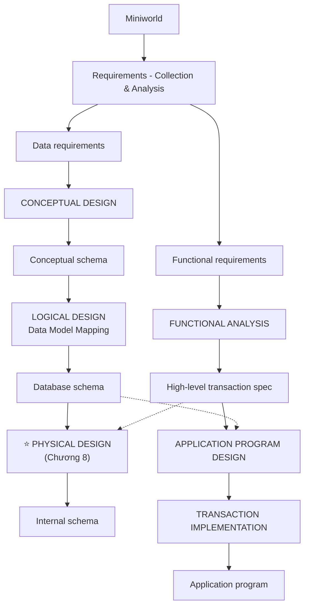

# Chương 8: Lưu Trữ Dữ Liệu và Cấu Trúc Chỉ Mục cho Tập Tin — Data Storage and Indexing Structures for Files

> Nguồn: CO2013 Database Systems, HCMUT — Giảng viên: TS. Trần Minh Quang
> Giáo trình: Elmasri & Navathe, 7th Edition (Chương 16, 17, 18 — Disk Storage, File Organizations, Indexing)
> Số trang PDF gốc: **89 trang** (số slide hiển thị tới 96 — các slide đáp án 86, 87, 88, 90, 92, 94 không có trong PDF)
> Đã gộp slide "Contents" lặp lại: slide 3, 4, 11, 18, 21, 31, 44, 49, 72, 78, 84 — tất cả đều là slide mục lục, chỉ khác phần highlight section đang vào → gộp thành **một** mục lục duy nhất ở section 0.3.

---

## 0. Trước khi bắt đầu

### 0.1. Bạn cần biết gì trước? (Prerequisite)

Chương 8 là chương **"chui xuống dưới mui xe"** của hệ CSDL — từ tầng quan hệ trừu tượng xuống tầng vật lý thật. Các kiến thức cần "nhớ lại":

| Đã học từ | Concept | Chương này dùng để làm gì? |
|---|---|---|
| Cấu trúc dữ liệu | Binary Search Tree, độ cao log₂(n) | Tổng quát hoá thành B-tree, B+-tree. |
| Cấu trúc dữ liệu | Hash Table | Chương này gọi là *external hashing* khi áp dụng cho file trên đĩa. |
| Cấu trúc dữ liệu | Linear vs Binary search | Chi phí O(n) vs O(log₂ n) — đo bằng "số block accesses". |
| Hệ điều hành | Block, Buffer | HĐH đọc/ghi đĩa theo *khối*, không theo byte. |
| Hệ điều hành | File system | File = chuỗi byte/record trên đĩa. |
| Chương 4 (Relational) | Primary Key, Foreign Key | Vẫn là trục để lập chỉ mục — Ssn, Dnumber. |
| Chương 6 (SQL) | `CREATE INDEX`, `SELECT ... WHERE` | Chương 8 trả lời "DBMS làm gì phía dưới câu SQL đó". |
| Chương 7 (FD & Normalization) | Decomposition, BCNF | Chuẩn hoá tốt → ít redundancy → cần index để JOIN nhanh. |

> 💡 **Big picture:** Quy trình thiết kế CSDL chia 2 nhánh — **Application Design** (Functional Analysis → App Program Design → Transaction Implementation) và **Database Design** (Conceptual ER → Logical mapping → **Physical Design**). Chương 1–7 đi từ Conceptual đến Logical. **Chương 8 chính là PHYSICAL DESIGN** — tầng cuối trước khi xuống đĩa thật.



### 0.2. Sau chương này bạn sẽ làm được gì? (Learning Outcomes)

1. **Mô tả** kiến trúc đĩa cứng: track, sector, cylinder, block, read/write head, seek time, rotational delay, double buffering.
2. **Tính** record size `R`, blocking factor `bfr`, số khối file `b` cho file fixed-length records (unspanned/spanned).
3. **So sánh** 3 loại file organization: Heap (unordered), Sorted (ordered), Hashed — biết khi nào dùng cái nào.
4. **Phân biệt** Primary / Clustering / Secondary Index: số entry, dense vs sparse, có dùng block anchor hay không.
5. **Tính chi phí truy vấn** (số block accesses) khi không/có index — linear search, binary search, index search, multilevel.
6. **Hiểu** vì sao single-level index không đủ → cần multilevel → cần B-tree/B+-tree.
7. **Phân biệt** B-tree vs B+-tree về vị trí data pointer và số level.
8. **Biết** RAID 0–6 khác nhau ở chỗ nào, khi nào dùng RAID nào; khái niệm SAN vs DAS.
9. **Làm** các bài tập tính disk capacity, block transfer time, index size, block accesses — dạng rất hay ra thi.

### 0.3. Lộ trình đọc đề xuất

| Section | Nội dung | Mức độ | Thời gian |
|---|---|---|---|
| 1.1 | Disk Storage Devices | **CORE** | 20 phút |
| 1.2 | Files of Records (Records, Blocking) | **CORE** | 20 phút |
| 1.3 | Operations on Files | Nhẹ | 10 phút |
| 1.4 | Unordered / Ordered / Hashed Files | **CORE** | 40 phút |
| 1.5 | RAID & SAN | Nâng cao (hay ra trắc nghiệm) | 25 phút |
| 2.1 | Single-level Ordered Indexes (Primary / Clustering / Secondary) | **CORE — TRỌNG TÂM THI** | 60 phút |
| 2.2 | Multilevel Indexes | **CORE** | 25 phút |
| 2.3 | B-Trees & B+-Trees | **CORE — TRỌNG TÂM THI** | 40 phút |
| Bài tập | Tính bfr, b, block accesses, multilevel, disk timing | **BẮT BUỘC LUYỆN** | 60 phút |

> **Mục lục gốc từ slide (gộp 11 slide Contents):**
> 1. **Data Storage**
>    - 1.1 Disk Storage Devices
>    - 1.2 Files of Records
>    - 1.3 Operations on Files
>    - 1.4 Unordered Files & Ordered Files & Hashed Files
>    - 1.5 RAID Technology and Storage Area Networks
> 2. **Indexing Structures for Files**
>    - 2.1 Types of Single-level Ordered Indexes
>    - 2.2 Multilevel Indexes
>    - 2.3 Dynamic Multilevel Indexes Using B-Trees and B+-Trees

---

## 1. Data Storage — Lưu Trữ Dữ Liệu

### 1.0. Motivation tổng — Vì sao có cả section 1?

Đến chương 7 bạn đã biết: database COMPANY gồm các quan hệ EMPLOYEE, DEPARTMENT… nhưng *chúng nằm ở đâu* trong máy tính thật?

- **Không thể** giữ toàn bộ DB trong RAM: 100k nhân viên ≈ GB; ngân hàng/Facebook tới TB → PB. RAM tỉ byte không đủ và quá đắt.
- **Phải** lưu xuống **secondary storage** (HDD/SSD): dung lượng lớn, giá rẻ, **persistent** (không mất khi mất điện).
- Nhưng đĩa **chậm hơn RAM ~10⁵ lần** → mọi công thức trong chương này đo bằng "số block đọc đĩa", không phải CPU cycle.

> 💡 **Analogy xuyên chương:** Database = một **thư viện** khổng lồ.
> - Sách = records. Kệ = blocks. Phòng/dãy kệ = file. Bảng tin = index.
> - Bạn không ôm hết sách (RAM giới hạn) — lấy 1 kệ vào bàn (load block vào buffer), đọc xong trả lại.

---

### 1.1. Disk Storage Devices — Thiết Bị Lưu Trữ Đĩa (Slide 5–10)

#### 1.1.1. Khái niệm gốc

Đĩa cứng (magnetic disk) là **secondary storage device** được ưa thích nhờ:
- **Dung lượng cao** (GB → TB).
- **Giá rẻ** trên mỗi GB.
- **Persistent** (giữ data khi mất điện).

**Cách dữ liệu được lưu vật lý:**
- Data lưu dưới dạng **magnetized areas** (vùng từ hoá) trên **disk surface**.
- Một **disk pack** = nhiều magnetic disk gắn chung 1 *spindle* (trục) quay.
- Mỗi mặt đĩa chia thành các vòng tròn đồng tâm gọi là **track**.
  - **Track capacity** điển hình: 4 – 50 KB.

#### 1.1.2. Anatomy của disk pack (Slide 6)

> 📊 **Hình 1.1 — Anatomy ổ đĩa:**
> ```
> (a) Single disk:                  (b) Disk pack:
>      Track                            Spindle (trục)
>       │                                  │
>       ▼                              ════╪════ ← surface 0
>     ╭─────╮                          ────│──── ← surface 1
>    ╱       ╲ ← Read/write head       ════╪════ ← surface 2
>   │    ●    │ <── Arm                ────│──── ← ...
>    ╲       ╱                              ▲
>     ╰─────╯                         Actuator movement
>        ▲                            ← một "Cylinder" = tập các
>    Actuator                            track CÙNG bán kính trên
>                                        TẤT CẢ các mặt
> ```

> 📊 **Đọc diagram thế nào:**
> - **Track**: 1 vòng tròn đồng tâm trên 1 mặt đĩa.
> - **Read/write head**: đầu đọc/ghi — mỗi mặt đĩa có 1 head riêng.
> - **Arm**: cánh tay giữ head; tất cả arm di chuyển *đồng bộ* khi actuator dịch ra/vào.
> - **Spindle**: trục quay chung của tất cả các mặt đĩa.
> - **Cylinder**: KHÔNG phải vật lý — là tập tất cả track *cùng bán kính* trên các mặt khác nhau. Vì head di chuyển đồng bộ → đọc nguyên cylinder không tốn seek thêm.

#### 1.1.3. Sector và Block (Slide 7–9)

Một track được chia thành các phần nhỏ gọi là **sector** (cung) hoặc **block** (khối).

| Thuật ngữ | Tính chất | Giá trị điển hình |
|---|---|---|
| **Sector** | Cung vật lý của track | — |
| **Block** | Đơn vị transfer giữa đĩa và RAM | B = 512 – 4096 bytes |
| **Block size B** | Cố định cho mỗi hệ thống | 512 / 1024 / 4096 B |

**Toàn bộ block** được transfer giữa đĩa và main memory — không đọc theo byte, không đọc theo record, mà luôn theo **block nguyên**.

> 💡 **Hiểu đơn giản:** Block giống **hộp pizza 8 miếng**: muốn 1 miếng vẫn phải gọi cả hộp. CSDL cũng vậy — muốn đọc 1 record vẫn phải tải nguyên block chứa nó.

#### 1.1.4. Địa chỉ block vật lý và thời gian truy cập (Slide 10)

**Địa chỉ block vật lý** gồm 3 thành phần:
1. **Cylinder number** (tập các track cùng bán kính).
2. **Track number** / **surface number** trong cylinder.
3. **Block number** trong track.

Đọc/ghi 1 block tốn thời gian vì phải đợi:
| Đại lượng | Ý nghĩa | Điển hình HDD |
|---|---|---|
| **Seek time s** | Dịch arm tới đúng cylinder | ~30 ms |
| **Rotational delay rd** | Đợi block quay đến dưới head | 4–12 ms (tuỳ rpm) |
| **Block transfer time btt** | Truyền thật 1 block | 0.1–1.25 ms |

**Double buffering** — dùng 2 buffer xen kẽ để tăng tốc transfer các block kề nhau (đọc block A xong, vừa xử lý A vừa preload block B).

> 💡 **Analogy seek + rotational delay:** Bạn muốn nghe bài 7 trong CD. Phải (1) bấm "track 7" → đầu đọc dịch tới (**seek**); (2) đợi CD quay tới 0:00 (**rotational delay**); (3) bắt đầu phát (**transfer**). Nghe liên tiếp track 8 sau track 7 → không seek, không đợi quay → tinh thần *double buffering*.

> 📝 **Tóm lại 1.1 — Disk Storage Devices:**
> - Đĩa cứng = nhiều disk pack quay chung 1 spindle; mỗi mặt chia thành track; mỗi track chia thành block (B = 512–4096 B).
> - Cylinder = các track cùng bán kính → đọc cùng cylinder không tốn seek thêm.
> - Đọc/ghi luôn theo BLOCK NGUYÊN.
> - Chi phí 1 lần truy cập block = seek + rotational delay + transfer.
> - **Một câu ghi nhớ:** *Đĩa cứng = ổ pizza quay; muốn ăn miếng nào cũng phải gọi cả hộp về bàn.*

> ❓ **Tự kiểm tra 1.1 (3 câu):**
> 1. Phân biệt **track**, **sector**, **block**, **cylinder**. Cái nào là vật lý, cái nào là ảo?
> 2. Vì sao block size B được fix cứng chứ không cho user chọn tự do?
> 3. File COMPANY 1000 block xếp liên tục cùng 1 cylinder vs rải rác 100 cylinder — cái nào đọc nhanh hơn?

---

### 1.2. Files of Records — Tập Tin của các Bản Ghi (Slide 12–17)

#### 1.2.1. Motivation

Quan hệ EMPLOYEE có 30,000 dòng, mỗi dòng ~150 byte. Câu hỏi tự nhiên:
- 30,000 dòng đó nhồi vào block thế nào?
- Mỗi dòng có format gì để biết Fname đến đâu, Salary đến đâu?
- Nếu một dòng dài hơn 1 block thì sao?

#### 1.2.2. Records (Slide 12–13)

- **Fixed-length records** vs **Variable-length records**.
- Record chứa các **field** (trường) — mỗi field có *value* thuộc 1 *kiểu* (amount, date, time, age, …).
- Field bản thân có thể *fixed* (Sex 1 byte, Birth_date 8 byte) hoặc *variable* (Address 10–100 byte).
- Mix variable-length field → cần **separator character** hoặc **length field** để hệ thống parse được record.

> 📊 **Hình 1.3 — Ba dạng record (Slide 13):**
> ```
> (a) Fixed-length, 6 field, 71 byte:
>     │  Name (30) │Ssn(9)│Sal(4)│Job(4)│Department(20)│Hire_dt│
>     byte 1       31     40     44     48              68     71
>
> (b) Mixed (2 variable + 3 fixed):
>     │Smith,John │123456789│XXXX│XXXX│Computer       │
>      Name(var)   Ssn(fix)  Sal  Job  Dept(var)
>
> (c) Fully variable, self-describing với 3 separator:
>     │Name=Smith,John│Ssn=123456789│DEPARTMENT=Computer│X│
>      `=`: tên field=giá trị;  `▌`: ngăn cách field;  `X`: kết record
> ```

> 📊 **Đọc thế nào:** Dạng (a) parse cực nhanh nhưng lãng phí (Lê vẫn ăn 30 byte). (b) tiết kiệm chỗ nhưng tốn separator. (c) self-describing như JSON/XML, tốn nhất nhưng không cần biết schema trước.

#### 1.2.3. Blocking và Spanned Records (Slide 14–15)

| Thuật ngữ (EN) | Tiếng Việt | Định nghĩa |
|---|---|---|
| **Blocking** | Việc gộp khối | Lưu một số record trong cùng 1 block trên đĩa. |
| **Blocking factor (bfr)** | Hệ số khối | Số record trên mỗi block. |
| **Spanned record** | Bản ghi vắt khối | Record vượt 1 block → trải qua nhiều block. |
| **Unspanned record** | Bản ghi không vắt | Không record nào vắt qua 2 block. |

> 📊 **Hình 1.4 — Unspanned vs Spanned:**
> ```
> (a) Unspanned (3 record vừa khít, dư trống):
>   Block i  : │ Rec 1 │ Rec 2 │ Rec 3 │░░░│
>   Block i+1: │ Rec 4 │ Rec 5 │ Rec 6 │░░░│
>
> (b) Spanned (Rec 4 vắt qua, P là pointer "phần còn lại"):
>   Block i  : │ Rec 1 │ Rec 2 │ Rec 3 │ Rec 4 │ P │
>                                                 └──┐
>   Block i+1: │ Rec 4 (rest) │ Rec 5 │ Rec 6 │ Rec 7 │ P │
> ```

#### 1.2.4. Files of Records (Slide 16–17)

- Một **file** = *chuỗi record* (sequence of records).
- **File descriptor / file header**: lưu schema (field names, kiểu) + địa chỉ block của file trên đĩa.
- Record lưu trong các **disk block**. **bfr** = số record trung bình trên 1 block.
- Cách cấp phát block: **contiguous** (liên tục) | **linked** (mỗi block trỏ block kế) | **indexed** (1 bảng index riêng nắm danh sách block).
- File fixed-length → thường *unspanned*. File variable-length → thường *spanned* + cần separator + field type.

#### 1.2.5. Công thức kim chỉ nam (dùng RẤT NHIỀU)

Với file fixed-length, **unspanned**, gọi R = record size, B = block size, r = tổng số record:

$$ \boxed{\;bfr = \lfloor B/R \rfloor \quad\text{và}\quad b = \lceil r/bfr \rceil\;} $$

Với file **spanned**: bfr ≈ B/R, b ≈ r/bfr (không cần làm tròn).

> 💡 **Hiểu đơn giản:** `⌊ ⌋` = làm tròn xuống (floor): `⌊3.7⌋ = 3` — 4 record không đủ chỗ thì chỉ nhét 3. `⌈ ⌉` = làm tròn lên (ceiling): `⌈3.1⌉ = 4` — phải mở thêm block thứ 4 cho 1 record dư.

> 💡 **Ví dụ 1.1 — EMPLOYEE 30k record:**
> R=116 byte, B=512 byte, r=30,000, unspanned.
> - bfr = ⌊512/116⌋ = ⌊4.41⌋ = **4** records/block.
> - b = ⌈30,000/4⌉ = **7500** blocks.
> - Mỗi block chứa 4×116=464 byte, dư 48 byte trống.

> 📝 **Tóm lại 1.2:** Record = tập field; file = chuỗi record nhồi vào block; `bfr=⌊B/R⌋`, `b=⌈r/bfr⌉`.

> ❓ **Tự kiểm tra 1.2 (3 câu):**
> 1. B=1024, R=300, r=10,000, unspanned → bfr, b, % lãng phí mỗi block?
> 2. Khi nào nên dùng spanned, khi nào unspanned?
> 3. DEPENDENT có 5000 record, R=60, B=512 → file chiếm bao nhiêu block?

---

### 1.3. Operations on Files (Slide 19–20)

| Operation | Mô tả slide | Liên hệ SQL |
|---|---|---|
| **OPEN** | Mở file, gắn 1 *pointer* trỏ tới *current file record* | DBMS mở file khi bắt đầu query |
| **FIND** | Tìm record đầu tiên thỏa điều kiện X, biến thành current | `SELECT … WHERE …` |
| **FINDNEXT** | Tìm record kế tiếp thỏa X | Vòng lặp duyệt kết quả |
| **READ** | Đọc current record vào biến chương trình | Truyền data lên app |
| **INSERT** | Chèn record mới, biến thành current | `INSERT INTO …` |
| **DELETE** | Xóa current — thường *đánh dấu* (mark) "không còn valid" | `DELETE FROM …` |
| **MODIFY** | Thay đổi giá trị một số field của current | `UPDATE … SET …` |
| **CLOSE** | Đóng file | Kết thúc query |
| **REORGANIZE** | Tổ chức lại: xoá hẳn record marked-deleted, đổi sắp xếp | `VACUUM` của PostgreSQL |
| **READ_ORDERED** | Đọc block theo thứ tự của 1 field cụ thể | `ORDER BY field` |

> 💡 **Vì sao DELETE chỉ đánh dấu (mark)?** Xóa vật lý ở giữa file → phải dịch chuyển toàn bộ record phía sau → cực đắt. Mark-and-delete chỉ set 1 byte cờ "deleted=true"; REORGANIZE định kỳ mới dồn lại. Đó là lý do Exercise slide 40 có dòng *"An additional byte is used as a deletion marker"* — chính là cờ này: R = 115 byte data + 1 byte marker = 116 byte.

> 📝 **Tóm lại 1.3:** SQL là ngôn ngữ logic; file operations là việc DBMS thật sự làm dưới disk. DELETE thường là *logical* — record vẫn nằm đó cho đến REORGANIZE.

> ❓ **Tự kiểm tra 1.3 (2 câu):**
> 1. Vì sao DELETE không xóa record ngay mà chỉ đánh dấu?
> 2. Phân biệt FIND vs FINDNEXT — khi nào dùng cái nào?

---

### 1.4. Unordered, Ordered, Hashed Files (Slide 22–30)

3 chiến lược tổ chức file cơ bản — *ảnh hưởng trực tiếp đến chi phí truy vấn*:
1. **Unordered (Heap)** — quăng record vào đâu cũng được.
2. **Ordered (Sorted/Sequential)** — sắp theo 1 field (Ssn tăng dần).
3. **Hashed** — dùng h(K) quyết định bucket nào.

#### 1.4.1. Unordered Files / Heap (Slide 22)

- Còn gọi **heap** / **pile** file. Insert record mới vào **cuối file** — chỉ đọc block cuối, thêm, ghi lại.
- **Linear search** qua toàn bộ record để tìm 1 record: trung bình **b/2 blocks** → rất tốn.
- Insert cực **efficient**. Đọc theo thứ tự 1 field → phải **sort file lại** trước.

> 💡 **Analogy:** Heap = **đống quần áo trên ghế**: vứt thêm rẻ; tìm chiếc xanh phải bới hết.

#### 1.4.2. Ordered Files / Sequential (Slide 23)

- Record giữ **sorted** theo **ordering field** (vd Ssn).
- Insert **expensive**: phải chèn đúng vị trí. Workaround: giữ 1 **overflow file** (= *transaction file*) *unordered* riêng cho record mới; **định kỳ merge** với file ordered chính.
- **Binary search** dùng được trên *ordering field value*: trung bình **log₂(b)** block accesses.
- Đọc record theo thứ tự ordering field → **rất hiệu quả** (đọc tuần tự).

> 📊 **Hình 1.5 — File EMPLOYEE ordered theo NAME (Slide 24):**
> ```
>  block 1: Aaron,Ed → Abbott,Diane → ... → Acosta,Marc
>  block 2: Adams,John → Adams,Robin → ... → Akers,Jan
>  block 3: Alexander,Ed → ... → Allen,Sam
>  ...
>  block n: Wright,Pam → ... → Zimmer,Byron
> ```
> → Đảm bảo *cuối block i* < *đầu block i+1*. Binary search "Allen,Sam": so block giữa → chia đôi → log₂(n) bước.

#### 1.4.3. Bảng Average Access Times (Slide 25 — Table 17.2)

| Type of Organization | Access / Search Method | Average Blocks to Access a Specific Record |
|---|---|---|
| Heap (unordered) | Sequential scan (linear search) | **b/2** |
| Ordered | Sequential scan | **b/2** |
| Ordered | **Binary search** | **log₂ b** |

> 💡 **Bẫy:** Ordered + sequential scan vẫn là b/2 — phải DÙNG binary search mới hưởng lợi log₂ b. Cũng vậy: nếu file ordered theo Ssn nhưng tìm theo Salary → vẫn linear search.

#### 1.4.4. Hashed Files — External Hashing (Slide 26)

- **External Hashing**: hashing áp dụng cho disk file.
- File block chia thành **M bucket** đánh số bucket₀, …, bucket_{M−1}. Thường 1 bucket = 1 (hoặc vài) disk block.
- Một field được chọn làm **hash key** (vd Ssn). Record có K được lưu trong bucket `i = h(K)`.
- Search **rất hiệu quả** trên hash key — 1 lần tính h(K) + 1 block access (nếu không collision).
- **Collision**: record mới hash vào bucket đã đầy → giữ **overflow file** chứa record vượt; có thể **link** các overflow record cùng bucket.

> 📊 **Hình 1.6 — Cấu trúc Hashed File (Slide 27):**
> ```
>   Bucket directory                 Disk blocks
>    ┌─────┐
>  0 │  ●──┼──→ [block bucket 0]
>  1 │  ●──┼──→ [block bucket 1]
>  2 │  ●──┼──→ [block bucket 2]
>    │ :   │
>  M-1│ ●──┼──→ [block bucket M-1]
>    └─────┘
> ```
> Để tìm record Ssn=12345: tính h(12345)=k → tra directory[k] → đọc 1 block đó → tìm record trong block.

#### 1.4.5. Ví dụ Open Addressing (Slide 28)

> 💡 **Ví dụ 1.2 — h(K) = K mod 7:**
> Bảng ban đầu (chỉ số 0..6):
> ```
>     0   1   2   3   4   5   6
>    │   │ 1 │   │ 3 │ 11│   │ 6 │
> ```
> **Insert 8:** h(8)=1 → ô 1 có 1 → thử ô 2 (trống) → đặt 8 vào ô 2.
> **Insert 15:** h(15)=1 → 1→2→3→4→5 (trống) → đặt 15 vào ô 5.
> **Insert 13:** h(13)=6 → ô 6 có 6 → wrap về 0 (trống) → đặt 13 vào ô 0.
> Kết quả: `[13, 1, 8, 3, 11, 15, 6]`.

#### 1.4.6. 3 phương pháp Collision Resolution (Slide 29)

1. **Open Addressing**: thử các vị trí kế tiếp đến khi tìm thấy ô trống.
2. **Chaining**: thêm pointer field; record collision đặt vào overflow location, pointer của bucket gốc trỏ tới.
3. **Multiple hashing**: dùng h₂ khi h₁ collision; nếu vẫn collision → open addressing hoặc h₃.

> 📊 **Hình 1.7 — Chaining (Slide 30):**
> ```
>   Main buckets                      Overflow buckets
>   ┌─────────────┐
>  0│ 340 │ 460 │ NULL│ ─── NULL
>  1│ 321 │ 761 │ 91 │●─┐
>   └─────────────┘  │   ┌──────────────────┐
>                    └──→│ 981 │ Rec ptr   ●┼─┐
>                        │ 182 │ Rec ptr   ●┼─┤
>                        └──────────────────┘ │
>   ┌─────────────┐                           │
>  2│ 22 │ 72 │ 522│ ●──→ ┌──────────────────┐│
>   └─────────────┘       │ 652 │ Rec ptr ←──┼┘
>                         └──────────────────┘
> ```

> 💡 **Hiểu nhanh 3 cách:**
> - **Open addressing** = nhà bên cạnh ("ai đến chỗ tôi thì đi qua bên cạnh").
> - **Chaining** = nhà phụ ("nhà tôi đầy thì sang nhà phụ").
> - **Multiple hashing** = tìm theo họ → trùng thì tìm theo tên (h₂ thay h₁).

#### 1.4.7. So sánh ba kiểu file

| Tiêu chí | Heap | Ordered | Hashed |
|---|---|---|---|
| Insert | Rất nhanh, thêm cuối. | Chậm vì phải giữ thứ tự (workaround: overflow file). | Nhanh nếu bucket chưa đầy. |
| Search theo key chính xác | Chậm (b/2). | Nhanh (log₂ b) nếu key = ordering field. | Rất nhanh (1 access) nếu không collision. |
| Search theo **range** | Chậm. | **Rất tốt** nếu range theo ordering field. | **Không tốt** cho range. |
| Đọc theo thứ tự | Phải sort. | Rất tốt. | Không tự nhiên theo thứ tự. |
| Vấn đề chính | Tìm chậm. | Insert/delete khó. | Collision/overflow. |

> 📝 **Tóm lại 1.4:** *Heap nhanh ghi chậm đọc; Ordered nhanh đọc chậm ghi; Hashed nhanh nhất cho equality lookup nhưng vô dụng cho range query.*

> ❓ **Tự kiểm tra 1.4 (3 câu):**
> 1. EMPLOYEE 10,000 record, b=2500. Tìm Ssn='12345': heap linear bao nhiêu? ordered binary bao nhiêu? hashed bao nhiêu (no collision)?
> 2. Vì sao hashed file *không phù hợp* cho `WHERE Salary BETWEEN 20000 AND 50000`?
> 3. Phân biệt open addressing và chaining.

---

### 1.5. RAID Technology và Storage Area Networks (Slide 32–39)

#### 1.5.1. Motivation

CPU/RAM nhanh lên 10⁶ lần kể từ 1990, nhưng đĩa chỉ ~10 lần → đĩa thành **bottleneck**. Một đĩa có failure rate ~1%/năm; 100 đĩa → kỳ vọng 1 đĩa hỏng/năm. Cần *parallelism* (tăng tốc) + *redundancy* (chịu lỗi) → **RAID**.

#### 1.5.2. RAID concept (Slide 32–33)

- **RAID** = *Redundant Arrays of Inexpensive Disks* (sau đổi thành *Independent*).
- **Data striping** (rải dữ liệu) — dùng **parallelism** để cải thiện hiệu năng. Phân phối data *trong suốt* qua nhiều đĩa để xuất hiện như 1 đĩa lớn nhanh.

> 📊 **Hình 1.8 — Data Striping:** File A → A₁, A₂, A₃, A₄ trên Disk 0, 1, 2, 3 (đọc song song → tốc độ x4 lý thuyết).

#### 1.5.3. RAID 0–6 (Slide 34–36)

Khác nhau dựa trên **granularity striping** và **pattern redundancy**:

| Level | Striping | Redundancy | Min disks | Chịu lỗi | Khi dùng |
|---|---|---|---|---|---|
| **RAID 0** | Block | KHÔNG | 2 | 0 disk fail | Cache, scratch — tốc độ |
| **RAID 1** | Mirror | 100% (gương) | 2 | 1 disk fail | Logs, critical apps — dễ rebuild nhất |
| **RAID 2** | Bit | Hamming codes (detection + correction) | 7+ | 1 disk fail | Hiếm dùng thực tế |
| **RAID 3** | Byte | Single parity disk (controller biết đĩa hỏng) | 3+ | 1 disk fail | Streaming media — transfer rate cao |
| **RAID 4** | Block | Single parity disk | 3+ | 1 disk fail | Hiếm (RAID 5 hơn) |
| **RAID 5** | Block | Parity **rải đều** trên tất cả đĩa | 3+ | 1 disk fail | Server doanh nghiệp — phổ biến |
| **RAID 6** | Block | P + Q (Reed-Solomon) | 4+ | **2 disk fail** | Backup quan trọng |

> 📊 **RAID 5 vs RAID 4:** Cả 2 đều block-level striping. **RAID 4** có *1 đĩa parity riêng* → parity disk thành bottleneck khi ghi. **RAID 5** *rải parity* lên mọi đĩa → mỗi disk vừa data vừa parity → không bottleneck → ghi nhanh hơn.

> 💡 **Use of RAID (Slide 37):** Phổ biến hiện nay = Level 0 (striping), Level 1 (mirroring), Level 5 (extra drive for parity). Design decision RAID gồm: level, số đĩa, parity scheme, cách nhóm đĩa.

#### 1.5.4. Storage Area Networks (SAN) (Slide 38–39)

- **SAN**: online storage peripherals cấu hình như **node trên mạng tốc độ cao**, gắn/tháo khỏi server *rất linh hoạt*.
- **Ưu điểm:**
  - **Flexible many-to-many** giữa server-storage qua fiber channel hub & switch.
  - **Tới 10 km** giữa server và storage qua fiber optic.
  - **Better isolation** — thêm thiết bị không gián đoạn.
- **Nhược:** Khó khi kết hợp lựa chọn từ nhiều vendor; chuẩn quản lý đang phát triển.

> 💡 **Analogy SAN vs DAS:** **DAS** (Direct Attached Storage) = kho hàng nằm sát văn phòng — chỉ văn phòng đó dùng. **SAN** = mạng đường ray riêng nối nhiều văn phòng đến nhiều kho — bất kỳ văn phòng nào cũng chở hàng từ bất kỳ kho nào.

> 📝 **Tóm lại 1.5:** *RAID 0 cho tốc độ, RAID 1 cho gương, RAID 5 cho cân bằng, RAID 6 cho an toàn 2 lớp; SAN cho phép storage là node mạng linh hoạt.*

> ❓ **Tự kiểm tra 1.5 (3 câu):**
> 1. Phân biệt RAID 4 và RAID 5.
> 2. Vì sao RAID 0 nhanh nhất khi ghi nhưng không phù hợp cho production-critical?
> 3. SAN khác DAS ở điểm gì?

---

## 2. Indexing Structures for Files

### 2.0. Scaffolding — Vì sao cần Section 2?

Ở 1.4 bạn thấy: ordered file + binary search lấy log₂(b) — với b=10,000 → ~14 access. Tốt, nhưng:
- **Vấn đề 1**: Binary search cần file *ordered theo đúng field tìm*. Lúc tìm Name, lúc tìm Salary → không thể sort theo 2 thứ cùng lúc.
- **Vấn đề 2**: Binary search trên *file dữ liệu thật* phải nhảy block, tốn seek.

→ **Giải pháp**: tạo 1 *file phụ* nhỏ chỉ chứa `<field_value, pointer to record>` — gọi là **index file**. Nhỏ hơn → sort nhanh → binary search trên nó nhanh.

### 2.1. Indexes as Access Paths (Slide 45–48)

#### 2.1.1. Khái niệm (Slide 45)

- **Single-level index** = **auxiliary file** giúp tìm record trong data file *hiệu quả hơn*.
- Index thường định nghĩa trên **1 field** (có thể nhiều) → **indexing field**.
- Dạng cơ bản: file gồm các entry `<field value, pointer to record>` **ordered theo field value**.
- Index gọi là **access path** trên field đó.

> 📊 **Hình 2.1 — Index file và data file (Slide 46):**
> ```
>   Index file               Data file (indexing field = ID)
>   ┌──────┬──────┐         ┌─────┬────┬────┬──────┐
>   │Value │BlkPtr│         │ ID  │Name│DoB │Salary│...
>   │  1   │  ●───┼────→    │  1,2,3                │ ← block 1
>   │  4   │  ●───┼─────→   │  4,6,7                │ ← block 2
>   │  8   │  ●───┼──────→  │  8,9,10               │ ← block 3
>   │ 12   │  ●───┼───────→ │ 12,13,15              │ ← block 4
>   └──────┴──────┘
> ```
> Index nhỏ hơn nhiều: data có 5+ field; index chỉ 2 → ăn ít block hơn → binary search trên index nhanh hơn.

#### 2.1.2. Tính chất Index (Slide 47)

- Index *chiếm ít block hơn data file* vì entry nhỏ hơn.
- **Binary search trên index** trả về pointer tới record.
- Index có thể là:
  - **Dense index**: 1 index entry cho *MỖI search key value* (mỗi record).
  - **Sparse / nondense index**: chỉ có entry cho *một số* search value.

> 💡 **Hiểu đơn giản:**
> - **Dense** = mục lục từ điển: MỖI từ đều có entry → tra "abandon" thấy ngay.
> - **Sparse** = mục lục tiểu thuyết: chỉ có entry mỗi *chương* → tra "trang 73" thấy chương 4 (bắt đầu trang 70) → mở chương 4 → lật tiếp.

#### 2.1.3. Ví dụ Dense Index — Slide 48

> 💡 **Ví dụ 2.1 — Dense index trên SSN:**
> EMPLOYEE(NAME, SSN, ADDRESS, JOB, SAL, …). R=150, B=512, r=30,000. V_SSN=9, P_R=7 (record pointer).
>
> **Bước 1 — Data file:** bfr=⌊512/150⌋=**3**; b=⌈30,000/3⌉=**10,000** blocks.
>
> **Bước 2 — Dense index entry:** Rᵢ = V_SSN + P_R = 9+7 = **16** byte; bfrᵢ = ⌊512/16⌋ = **32** entries/block.
>
> **Bước 3 — Số block index** (dense → 1 entry/record): bᵢ = ⌈30,000/32⌉ = **938** blocks.
>
> **Bước 4 — Chi phí search:** ⌈log₂ 938⌉ + 1 = **10 + 1 = 11** block accesses.
>
> **Bước 5 — So sánh:**
> - Linear search: b/2 = **5000**.
> - Binary search trên data ordered: ⌈log₂ 10,000⌉ = **14**.
> - Dense index: **11** — cải thiện ~455 lần so với linear.
>
> **+1 đến từ đâu?** ⌈log₂ bᵢ⌉ là số block đọc *trong index*. Sau khi tìm thấy pointer, phải đọc thêm 1 *data block* chứa record thật.

---

### 2.2. Types of Single-level Ordered Indexes (Slide 50–71)

**3 loại** (slide 50): **Primary** | **Clustering** | **Secondary**.

#### 2.2.1. Primary Index (Slide 51–53)

- Defined trên **ordered data file** theo **key field**.
- **Một index entry cho MỖI BLOCK** của data file — entry chứa *first record* của block (gọi **block anchor**). (Có scheme tương tự dùng *last record*.)

> 📊 **Hình 2.2 — Primary Index trên ID:**
> ```
>   Primary index            Data file (ordered by ID, key)
>   ┌──────┬──────┐         ┌─────────────────────────────┐
>   │  1   │  ●───┼─────→   │ 1, 2, 3                     │ ← anchor=1
>   │  4   │  ●───┼─────→   │ 4, 6, 7                     │ ← anchor=4
>   │  8   │  ●───┼─────→   │ 8, 9, 10                    │ ← anchor=8
>   │ 12   │  ●───┼─────→   │ 12, 13, 15                  │ ← anchor=12
>   └──────┴──────┘
> ```
> Tìm ID=7: binary search index → 7 giữa 4 và 8 → block 2 → đọc block 2 (4, 6, 7) → tìm 7.

**Tính chất (Slide 53):**
- **Number of index entries** = *số block* của data file.
- **Dense or Nondense?** → **Nondense** (1 entry/block).
- **Insert/Update/Delete?** Đắt vì data file phải giữ sorted → có thể dịch chuyển nhiều record.

> 💡 **Vì sao Primary Index Nondense?** 1 entry trỏ tới *block anchor* — record đầu block, không phải tới từng record. Trong 1 block có 3 record (4,6,7) nhưng index chỉ giữ anchor "4".

#### 2.2.2. Clustering Index (Slide 54–57)

- Defined trên **ordered data file** theo **non-key field** → **clustering field**.
- **Một index entry cho MỖI distinct value** của field — trỏ tới **first data block** chứa value đó.

> 📊 **Hình 2.3 — Clustering Index trên Dept_No (non-key):**
> ```
>   Clustering index         Data file (ordered by Dept_No)
>   ┌──────┬──────┐         ┌──────────────────────┐
>   │ 1    │  ●───┼─→ block với Dept_No=1: │1,1,2│
>   │ 2    │  ●───┼─→ block đầu chứa 2:    │2,2,2│
>   │ 3    │  ●───┼─→ ... :                │2,3,3│
>   │ 4    │  ●───┼─→                      │4,4,5│
>   │ 5    │  ●───┼─→
>   └──────┴──────┘
> ```
> Dept_No=2 xuất hiện ở nhiều record (trải nhiều block) nhưng chỉ 1 entry "2" trong index → trỏ block đầu → đọc tiếp các block kề nhau.

**Cải tiến (Slide 56):** mỗi distinct value *bắt đầu một block mới* — không trộn các value khác nhau cùng block; cuối mỗi nhóm có pointer linked sang nhóm sau.

**Tính chất (Slide 57):**
- **Number of index entries** = *số distinct value* của indexing field.
- **Dense or Nondense?** → **Nondense**.
- **QUAN TRỌNG:** Một file CHỈ có thể có **TỐI ĐA 1 Primary Index HOẶC 1 Clustering Index, KHÔNG ĐƯỢC CẢ HAI** — vì cả hai đòi data file ordered, mà file chỉ ordered được theo *một* field.

#### 2.2.3. Secondary Index (Slide 58–67)

- Cung cấp **secondary means of accessing** một file.
- Data file **UNORDERED** trên indexing field.
- Indexing field có thể là **secondary key** (unique) hoặc **nonkey** (duplicate).
- Index là **ordered file** với 2 trường: (1) indexing field; (2) block pointer hoặc record pointer.
- Một file có thể có **NHIỀU secondary index** (khác Primary/Clustering — chỉ 1).

##### Secondary Index on KEY field (Slide 59–60)

> 📊 **Hình 2.4 — Secondary Index on key (data UNORDERED):**
> ```
>   Secondary index (ordered)    Data file (unordered)
>   ┌──────┬──────┐              5, 13, 8  ← block 1
>   │  3   │  ●───┼─→ record     6, 15, 3  ← block 2
>   │  4   │  ●───┼─→ record     9, 21, 11 ← block 3
>   │  5   │  ●───┼─→ record     4, 23, 18 ← block 4
>   │  6   │  ●───┼─→ ...
>   │  8   │  ●───┼─→
>   │  ⋮   │  ⋮   │
>   │ 23   │  ●───┼─→
>   └──────┴──────┘
>   → mỗi entry trỏ thẳng tới record (record pointer)
> ```

**Tính chất (Slide 60):**
- **Entries** = số record data file.
- **Dense** (bắt buộc — data unordered, không có anchor để sparse).

##### Secondary Index on NON-KEY field (Slide 61) — 3 option

**Option 1: Duplicate entries** cùng K(i), 1 entry/record → **DENSE**.

> 📊 Index có 13 entry (cho 13 record), sort theo Phòng: 1,1,2,2,2,2,3,4,4,5,5,5,5.

**Option 2: List of pointers** `<P(i,1), …, P(i,k)>` trong entry K(i) → **NONDENSE** nhưng *variable-length entry* → khó quản lý, khó binary search.

**Option 3 (PHỔ BIẾN NHẤT):** 1 entry/distinct value + **extra level of indirection** (block trung gian chứa danh sách pointer) → **NONDENSE**, fixed-length entry.

> 📊 **Hình 2.7 — Option 3:**
> ```
>   Index            Mức trung gian          Data file
>   ┌────┬────┐      (blocks of record ptrs)
>   │ 1  │ ●──┼─→    ┌──────────────┐
>   │ 2  │ ●──┼─→    │ ●→record 1   │
>   │ 3  │ ●──┼─→    │ ●→record 2   │
>   │ 4  │ ●──┼─→    │   ⋮         │
>   │ 5  │ ●──┼─→    └──────────────┘
>   └────┴────┘
> ```
> Tìm Phòng=2: index → block trung gian của 2 → trong đó có nhiều pointer → mỗi record Phòng=2.

#### 2.2.4. Summary — Bảng tổng hợp (Slide 70 — Table 18.2)

| Type of Index | Number of (First-level) Index Entries | Dense / Nondense | Block Anchoring on Data File |
|---|---|---|---|
| **Primary** | Number of **blocks** in data file | Nondense | **Yes** |
| **Clustering** | Number of **distinct** index field values | Nondense | Yes/no ᵃ |
| **Secondary (key)** | Number of **records** in data file | **Dense** | No |
| **Secondary (nonkey)** | Number of records ᵇ hoặc number of distinct field values ᶜ | Dense or Nondense | No |

> ᵃ Yes nếu mỗi distinct value bắt đầu block mới; no nếu không.
> ᵇ Option 1. ᶜ Option 2, 3.

**Phân loại theo "Data file ordered trên indexing field?" (Slide 68):**
- File **ordered** → **Primary** (nếu key) | **Clustering** (nếu non-key).
- File **unordered** → **Secondary** (cả key và non-key).

> 💡 **Mẹo nhớ:** "**P**rimary và **C**lustering" → *Nondense* (file ordered → có block anchor để sparse). "**S**econdary on key" → *Dense* (data unordered → phải có entry cho mỗi record).

#### 2.2.5. Ví dụ Primary Index — Slide 71

> 💡 **Ví dụ 2.2 — Primary Index trên SSN (file ordered theo key):**
> EMPLOYEE: R=150, B=512, r=30,000. V_SSN=9, **block pointer P=6 byte** (khác Ví dụ 2.1 dùng record pointer 7!).
>
> - **Data:** bfr=3, b=10,000.
> - **Primary index entry:** Rᵢ = 9+6 = **15** byte; bfrᵢ = ⌊512/15⌋ = **34** entries/block.
> - **Số entry primary = số BLOCK** = 10,000 → bᵢ = ⌈10,000/34⌉ = **295** blocks.
> - **Search:** ⌈log₂ 295⌉ + 1 = 9 + 1 = **10** block accesses.
> - **So với dense (Ví dụ 2.1):** 11. Primary tốn ít block hơn (295 vs 938) vì *1 entry/block* thay vì *1 entry/record* → primary index *sparse* nhanh hơn dense.

> 📝 **Tóm lại 2.2:** *Primary cho key đã sort; Clustering cho non-key đã sort; Secondary cho mọi trường hợp khác — và bao nhiêu Secondary cũng được.*

> ❓ **Tự kiểm tra 2.2 (4 câu):**
> 1. Tại sao Primary nondense còn Secondary on key dense?
> 2. Vì sao 1 file *không thể* có cả Primary và Clustering cùng lúc?
> 3. Để tăng tốc `SELECT * FROM EMPLOYEE WHERE Dno=5` nên tạo loại index nào? Vì sao?
> 4. EMPLOYEE 30,000 record, file unordered → tạo dense secondary index trên Ssn (V=9, P=7, B=512). Tính bᵢ.

---

### 2.3. Multilevel Indexes (Slide 73–77)

#### 2.3.1. Motivation

Ví dụ 2.2: index có 295 block, log₂ 295 ≈ 9 access. Với r=100 triệu → index hàng nghìn block, mỗi access là 1 seek. Cách giảm xuống 2–3 access?

**Insight:** Index *bản thân nó là ordered file* → tạo *index cho file index* → **multilevel index**.

#### 2.3.2. Khái niệm (Slide 73)

- File index gốc = **first-level index**; index trỏ tới index = **second-level**.
- Lặp lại: third, fourth, …, **top level cho đến khi tất cả entry của top level vừa khít trong MỘT block**.
- Có thể tạo cho **bất kỳ loại first-level index** (primary, secondary, clustering) miễn first-level có **> 1 block**.

> 📊 **Hình 2.8 — Two-level primary index, kiểu ISAM (Slide 74):**
> ```
>   Top level (2nd)   Base level (1st)        Data file
>   ┌────┬──┐         ┌────┬──┐               ┌──┬──┐
>   │ 2  │●─┼──────→  │ 2  │●─┼─→             │ 2│ 5│
>   │35  │●─┼─┐       │ 8  │●─┼─→             │ 8│12│
>   │55  │●─┼─┼┐      │15  │●─┼─→             │15│21│
>   │85  │●─┼─┼┼┐     │24  │●─┼─→             │24│29│
>   └────┴──┘ │││     └────┴──┘               ...
>             │└→     ┌────┬──┐
>             │       │35  │●─┼─→             │35│36│
>             │       │39  │●─┼─→             │39│41│
>             │       │44  │●─┼─→             │44│46│
>             │       │51  │●─┼─→             │51│52│
>             │       └────┴──┘
>             ...                            (Indexed Sequential Access Method)
> ```
>
> Tìm key=39: (1) top: 39 giữa 35 và 55 → đi base bắt đầu "35"; (2) base: 39 giữa 39 và 44 → đi data block bắt đầu "39"; (3) data: tìm 39 trong block. → **3 block accesses** (1 top + 1 base + 1 data) — giảm so với single-level.

> 💡 **Hiểu đơn giản:** Multi-level index = **mục lục đa cấp**: cuốn từ điển có (1) cánh gà ABC ngoài bìa (top), (2) mục lục đầu chương (base), (3) trang định nghĩa (data).

#### 2.3.3. Hạn chế multilevel tĩnh (Slide 75)

- Multi-level là một dạng **search tree**.
- **NHƯỢC ĐIỂM**: Insert/delete index entry là vấn đề nghiêm trọng vì **mỗi level là ordered file** → mỗi insert ở first-level có thể trigger update cascading lên top level.

→ Cần cấu trúc mới: **B-tree / B+-tree** (section 2.4).

#### 2.3.4. Search Tree node (Slide 76–77)

Một node của search tree **order q** chứa q-1 key values K₁ < K₂ < … < K_{q-1} và q tree pointers P₁, P₂, …, P_q. Pᵢ trỏ tới subtree chứa giá trị X thoả `K_{i-1} < X < Kᵢ` (K₀ = −∞, K_q = +∞).

> 📊 **Hình 2.10 — Search tree of order p=3 (Slide 77):**
> ```
>                    ┌────┬───┬────┐
>                    │ ●  │ 5 │ ●  │
>                    └─┬──┴───┴──┬─┘
>             ┌────────┘         └────────┐
>             ▼                           ▼
>      ┌──┬───┬────┐              ┌──┬───┬──┬───┬──┐
>      │● │ 3 │NULL│              │● │ 6 │● │ 9 │● │
>      └─┬┴───┴────┘              └─┬┴───┴─┬┴───┴─┬┘
>        ▼                          ▼      ▼      ▼
>     ┌──┬───┐                   ┌──┬──┐ ┌──┬───┐ ┌────┐
>     │1 │NULL│                   │7 │8 │ │12│NULL│ │NULL│
>     └──┴───┘                   └──┴──┘ └──┴───┘ └────┘
> ```

> 📝 **Tóm lại 2.3:** Multilevel index = mục lục đa cấp; search rất nhanh (3–4 access) nhưng insert đau đầu vì phải giữ ordered ở mọi level — đó là động lực cho B-tree/B+-tree.

> ❓ **Tự kiểm tra 2.3 (3 câu):**
> 1. First-level 295 block, bfrᵢ=34. Two-level có bao nhiêu block ở level 2? Tổng chi phí search?
> 2. Vì sao multilevel cần giải thuật phức tạp khi insert/delete?
> 3. Multilevel index có thể tạo trên loại first-level nào? Có điều kiện gì?

---

### 2.4. Dynamic Multilevel Indexes — B-Trees và B+-Trees (Slide 79–83)

#### 2.4.1. Motivation (Slide 79)

- Hầu hết multilevel index dùng **B-tree** hoặc **B+-tree** vì giải quyết vấn đề insert/delete.
- Tinh thần: **để chỗ trống trong mỗi node (= 1 disk block)** để chứa entry mới sau này.
- Biến thể của search tree cho phép insert/delete hiệu quả. Mỗi node = 1 disk block. Mỗi node giữ **half-full đến full** → đảm bảo cây không lệch, performance ổn định.

#### 2.4.2. Insert / Delete (Slide 80)

| Tình huống | Hành vi |
|---|---|
| Insert vào node chưa full | Rất hiệu quả — chỉ thêm vào đúng vị trí. |
| Insert vào node full | **Split** thành 2 node. Splitting có thể **propagate** lên các level trên. |
| Delete, node không trở thành less than half full | Hiệu quả. |
| Delete làm node less than half full | Phải **merge** với neighbor. |

> 💡 **Analogy split & merge:** Tủ sách quy định "không trống quá nửa, không vượt giới hạn". Nhồi quá → mua tủ mới chia đôi (split). Trống quá → gộp tủ kế bên (merge).

#### 2.4.3. B-tree vs B+-tree (Slide 81)

| Tiêu chí | B-tree | B+-tree |
|---|---|---|
| **Vị trí data pointer** | Tồn tại ở **MỌI level** | Chỉ ở **leaf-level nodes** |
| **Số level cho cùng số search value** | Nhiều hơn | **Ít hơn** (fanout lớn hơn) |
| **Range query** | Khó (phải duyệt cây) | **Dễ** — leaf có **P_next** nối linked list |
| **Internal node chứa** | Search values + data pointers + tree pointers | **CHỈ** search values + tree pointers |
| **Leaf node chứa** | Search + data + tree pointers | Search + data pointers + **P_next** |

> 💡 **Vì sao B+-tree ít level hơn B-tree?** Node internal B-tree mang data pointer cho mỗi key → entry to → ít search value/node. Node internal B+-tree không có data pointer → entry nhỏ → nhiều search value/node → fanout lớn → cây thấp hơn.

#### 2.4.4. B-Tree Structures (Slide 82)

> 📊 **Hình 2.11(a) — B-tree node:**
> ```
>   ┌──┬───┬───┬──┬───┬───┬─────────┬──┐
>   │P₁│K₁│Pr₁│P₂│K₂│Pr₂│   ...   │P_q│
>   └──┴───┴───┴──┴───┴───┴─────────┴──┘
>     │                                │
>     ▼ subtree X<K₁                   ▼ subtree X>K_{q-1}
> ```
> Mỗi search key Kᵢ đi kèm **data pointer Prᵢ** ngay trong node. → Data có thể tìm thấy ở node giữa đường, không cần xuống leaf.

#### 2.4.5. B+-Tree Nodes (Slide 83)

> 📊 **Hình 2.11 — B+-tree nodes:**
>
> **(a) Internal node** với q-1 search values, q tree pointers (KHÔNG có data pointer):
> ```
>   ┌──┬───┬──┬───┬──────┬────┬──┐
>   │P₁│K₁│P₂│K₂│ ...   │K_{q-1}│P_q│
>   └──┴───┴──┴───┴──────┴────┴──┘
>      ▼              ▼              ▼
>    X ≤ K₁     K_{i-1} < X ≤ Kᵢ   K_{q-1} < X
> ```
>
> **(b) Leaf node** với q-1 search values + q-1 data pointers + P_next:
> ```
>   ┌────┬────┬────┬────┬────┬─────┬────────┬───────┐
>   │K₁Pr₁│K₂Pr₂│ ...│KᵢPrᵢ│ ... │K_{q-1}Pr_{q-1}│P_next│
>   └────┴────┴────┴────┴────┴─────┴────────┴───────┘
>      │     │           │            │           │
>      ▼     ▼           ▼            ▼           ▼
>    Data  Data        Data         Data    → next leaf
> ```

> 💡 **Hiểu đơn giản:**
> - **Internal node** = bảng chỉ dẫn ngoài cửa thư viện ("phòng 1: 0–999; phòng 2: 1000–1999") — không có sách thật.
> - **Leaf node** = bảng chỉ dẫn trong phòng ("kệ 1: số 0–9 → vị trí; kệ 2: số 10–19 → vị trí") + cuối phòng có biển "Sang phòng kế" (P_next).
>
> **Lợi ích P_next:** `WHERE Salary BETWEEN A AND B` → tìm leaf chứa A → duyệt linked list cho đến B → cực nhanh.

> 📝 **Tóm lại 2.4:** *B+-tree là multilevel index có "khoản trống dự phòng" trong mỗi block + leaf nối chuỗi → vừa nhanh insert vừa nhanh range query — index thực tế nhất, dùng trong PostgreSQL, MySQL InnoDB.*

> ❓ **Tự kiểm tra 2.4 (3 câu):**
> 1. Vì sao mỗi node B-tree được giữ "half-full đến full"?
> 2. Range query `Salary BETWEEN 30000 AND 50000` chạy trên B-tree vs B+-tree — cái nào nhanh hơn? Vì sao?
> 3. Trong B+-tree, vì sao internal node KHÔNG có data pointer giúp cây thấp hơn?

---

## Bảng Tra Nhanh — 1 Trang Ôn Thi

### Công thức "kim chỉ nam"

| Đại lượng | Công thức | Ghi chú |
|---|---|---|
| Blocking factor | `bfr = ⌊B/R⌋` | floor (làm tròn xuống) |
| Số block file | `b = ⌈r/bfr⌉` | ceil (làm tròn lên) |
| Linear search (heap) | trung bình **b/2** | worst case b |
| Binary search (ordered file) | **⌈log₂ b⌉** | chỉ áp dụng theo ordering field |
| Hashed search (no collision) | **1 block** | bucket directory thường trong RAM |
| Index entry size (sparse, block ptr) | `Rᵢ = V + P` | P = block pointer (vd 6 byte) |
| Index entry size (dense, record ptr) | `Rᵢ = V + P_R` | P_R = record pointer (vd 7 byte) |
| Index blocking factor | `bfrᵢ = ⌊B/Rᵢ⌋` | |
| Single-level index search | **⌈log₂ bᵢ⌉ + 1** | +1 để đọc data block |
| Multilevel two-level | **L + 1** | L = số level (3 nếu top fit 1 block + 1 base + 1 data) |
| Block access time | `s + rd + btt` | seek + rotational delay + block transfer time |
| Rotational delay (avg) | `(1 revolution time) / 2` | rpm 2400 → rd=12.5 ms |
| Transfer rate (useful) | `useful_bytes_per_track / rotation_time` | Appendix B |

### 3 loại Index — bảng tra nhanh

| | Primary | Clustering | Secondary (key) | Secondary (nonkey) |
|---|---|---|---|---|
| Data file ordered? | Yes (theo key) | Yes (theo non-key) | No | No |
| Field is key? | Yes | No | Yes | No |
| # entries | # blocks | # distinct values | # records | # records hoặc # distinct |
| Dense / Sparse | **Nondense** | **Nondense** | **Dense** | Dense / Nondense |
| Block anchor? | Yes | Yes/No | No | No |
| Max per file | **1** (cùng với Clustering) | **1** (cùng với Primary) | **Nhiều** | **Nhiều** |
| Ví dụ COMPANY | Index trên `EMPLOYEE(Ssn)` khi file sort theo Ssn | Index trên `EMPLOYEE(Dno)` khi file sort theo Dno | Index trên `EMPLOYEE(Ssn)` khi file unordered | Index trên `EMPLOYEE(Salary)` |

### RAID 0–6 — bảng tra nhanh

| Level | Striping | Redundancy | Disk fail tolerance | Note |
|---|---|---|---|---|
| 0 | Block | KHÔNG | 0 | Tốc độ tối đa, mất 1 disk = mất data |
| 1 | Mirror | 100% | 1 | Logs, critical apps |
| 2 | Bit | Hamming (3 parity) | 1 | Hiếm dùng |
| 3 | Byte | Single parity | 1 | Transfer rate cao |
| 4 | Block | Single parity disk | 1 | Hiếm (parity disk = bottleneck) |
| 5 | Block | Parity rải đều | 1 | **Phổ biến nhất** cho server |
| 6 | Block | P + Q (Reed-Solomon) | **2** | Backup quan trọng |

---

## Sai Lầm Thường Gặp

| # | Sai lầm | Tại sao sai | Cách đúng |
|---|---|---|---|
| 1 | Tính `bfr = B/R` không làm tròn | Tạo phân số → vô nghĩa cho số record/block | `bfr = ⌊B/R⌋` (floor) |
| 2 | Tính `b = r/bfr` không làm tròn | Bỏ sót record dư | `b = ⌈r/bfr⌉` (ceil) |
| 3 | Tính dense index entry size với block pointer P | Dense trỏ tới *record*, không phải block | Dùng `Rᵢ = V + P_R` (record pointer) |
| 4 | Tính primary index entry size với record pointer P_R | Primary trỏ block anchor → block pointer | Dùng `Rᵢ = V + P` (block pointer) |
| 5 | Cho rằng có thể có cả Primary và Clustering trên 1 file | Cả 2 đòi data file ordered, file chỉ ordered 1 field | Chỉ 1 (Primary HOẶC Clustering); nhưng có thể có nhiều Secondary kèm |
| 6 | Cho rằng Secondary on key là Nondense | Data file unordered → không có anchor để sparse | **Bắt buộc Dense** |
| 7 | Quên +1 khi tính chi phí search qua index | log₂(bᵢ) là chi phí *trong index* — còn phải đọc data block | `⌈log₂ bᵢ⌉ + 1` |
| 8 | Cho rằng Hashed file tốt cho range query | h(K) làm 2 key kề nhau hash vào 2 bucket bất kỳ | Hashed *cực tốt cho equality*, *vô dụng cho range* |
| 9 | Cho rằng B-tree và B+-tree giống nhau | B-tree có data pointer ở mọi level; B+-tree chỉ ở leaf + P_next | B+-tree tốt hơn cho range query và có fanout lớn hơn |
| 10 | Tính `btt` bằng raw bytes per track | Slide HCMUT theo Appendix B dùng useful capacity | `tr = useful_bytes / rotation_time`, `btt = B / tr` |

---

## Câu Hỏi Ôn Tập (từ slide gốc — 5 Exercise)

### Exercise 1 (Slide 40–43) — bfr, b, binary search

File r=30,000 EMPLOYEE fixed-length. Fields: Name(30)+SSN(9)+Department_code(9)+Address(40)+Phone(10)+Birth_date(8)+Sex(1)+Job_code(4)+Salary(4)+deletion marker(1). B=512, P=6, P_R=7.

1. **R = ?**
   - R = 30+9+9+40+10+8+1+4+4+1 = **116 bytes**.

2. **bfr và b (unspanned)?**
   - bfr = ⌊512/116⌋ = **4** records/block.
   - b = ⌈30,000/4⌉ = **7500** blocks.

3. **File ordered by SSN — block accesses (binary search)?**
   - ⌈log₂ 7500⌉ = **13** block accesses.

### Exercise 2 (Slide 89, 91) — Primary Index trên SSN

Same file. File ordered by SSN, build primary index trên SSN.

4a. **Index blocking factor bfrᵢ?**
   - Rᵢ = V_SSN + P = 9 + 6 = 15 byte → bfrᵢ = ⌊512/15⌋ = **34** entries/block.

4b. **Số entries và số index blocks?**
   - # entries = # blocks data = **7500**.
   - bᵢ = ⌈7500/34⌉ = **221** blocks.

4c. **Block accesses?**
   - ⌈log₂ 221⌉ + 1 = 8 + 1 = **9** block accesses.

### Exercise 3 (Slide 93) — Two-level Multilevel

5a. **Total blocks of second-level index?**
   - Second-level = primary trên first-level (221 block, bfrᵢ=34). # entries = 221 → b₂ = ⌈221/34⌉ = **7** blocks.

5b. **Block accesses (two-level)?**
   - ⌈log₂ 7⌉ + 1 (first) + 1 (data) = 3 + 1 + 1 = **5** block accesses.
   - *(Nếu top level chỉ 7 block — fit 1 block thì chỉ 1 top + 1 base + 1 data = 3 accesses; đề "two-level" thường tính theo cách trên = 5.)*

### Exercise 4 (Slide 95) — Disk parameters

Disk: B=512, gap G=128, 20 blocks/track, 400 tracks/surface, 15 double-sided disks, p=2400 rpm, s=30 msec.

**a) Track total + useful capacity:**
- Useful = 20 × 512 = **10,240 byte (10 KB)**.
- Total = 20 × (512+128) = 20 × 640 = **12,800 byte (12.5 KB)**.

**b) Cylinders:** **400** (mỗi surface có 400 tracks).

**c) Cylinder capacity:** 15 × 2 = 30 surfaces → Useful = 30 × 10,240 = **307,200 B (300 KB)**; Total = 30 × 12,800 = **384,000 B (375 KB)**.

**d) Disk pack capacity:** Useful = 400 × 307,200 = **122,880,000 B ≈ 117 MB**; Total = 400 × 384,000 = **153,600,000 B ≈ 146 MB**.

**e) tr, btt, rd, btr:**
- 2400 rpm = 40 rev/sec → 1 rev = 1000/40 = **25 msec**.
- tr = 10,240 / 25 = **409.6 byte/msec** (useful).
- **btt = B / tr = 512 / 409.6 = 1.25 msec** (Appendix B). Tương đương: btt = 25 × (512/10,240) = 1.25 msec.
- **rd = 25 / 2 = 12.5 msec**.
- Bulk transfer rate btr ≈ 409.6 byte/msec ≈ 0.4 MB/sec.

**f) Single block locate + transfer:** **s + rd + btt = 30 + 12.5 + 1.25 = 43.75 msec**.

**g) 20 random vs 20 consecutive (double buffering):**
- Random: 20 × 43.75 = **875 msec**.
- Consecutive: 30 + 12.5 + 20 × 1.25 = **67.5 msec**.
- Consecutive nhanh hơn **~13 lần**.

### Exercise 5 (Slide 96) — STUDENT file

r=20,000, fixed-length. Fields: Name(30)+Ssn(9)+Address(40)+PHONE(10)+Birth_date(8)+Sex(1)+Major_dept_code(4)+Minor_dept_code(4)+Class_code(4)+Degree_program(3)+deletion marker(1). Disk như Exercise 4.

**a) R:** 30+9+40+10+8+1+4+4+4+3+1 = **114 bytes**.

**b) bfr & b:** bfr = ⌊512/114⌋ = **4**. b = ⌈20,000/4⌉ = **5000** blocks.

**c) Linear search avg time:**
- (i) **Contiguous + double buffering** (b/2 = 2500 block): 30 + 12.5 + 2500 × 1.25 = **3167.5 msec**.
- (ii) **Non-contiguous (random)**: 2500 × 43.75 = **109,375 msec ≈ 109 sec**.

**d) Binary search (file ordered by Ssn):**
- ⌈log₂ 5000⌉ = **13** block accesses.
- Time = 13 × 43.75 = **568.75 msec**.

---

## Mini Bài Tập Tự Luyện (kèm Lời Giải)

> **Bài tập tự luyện 1 (dễ):** File DEPARTMENT có r=200, R=80 byte, B=512. Tính bfr, b.
>
> <details><summary>Xem lời giải</summary>
>
> - bfr = ⌊512/80⌋ = 6 records/block.
> - b = ⌈200/6⌉ = ⌈33.33⌉ = 34 blocks.
> - Mỗi block chứa 6×80=480 byte data + 32 byte trống.
> </details>

> **Bài tập tự luyện 2 (trung bình):** File EMPLOYEE r=30,000 unordered (heap). Tạo *secondary index trên Salary* (V_Salary=8 byte, P_R=7 byte, B=512). Salary là non-key (duplicate values), giả sử có 5,000 distinct Salary values. Dùng Option 1 (duplicate entries, dense). Tính bᵢ và chi phí search.
>
> <details><summary>Xem lời giải</summary>
>
> - Rᵢ = V + P_R = 8 + 7 = 15 byte.
> - bfrᵢ = ⌊512/15⌋ = 34 entries/block.
> - Option 1: # entries = # records = 30,000 → bᵢ = ⌈30,000/34⌉ = 883 blocks.
> - Chi phí search 1 Salary value: ⌈log₂ 883⌉ + 1 = 10 + 1 = 11 block accesses (cho record đầu tiên).
> - Lưu ý: với non-key, có thể có nhiều record cùng Salary → phải đọc thêm các entry kề trong index và data block tương ứng.
> </details>

> **Bài tập tự luyện 3 (trung bình):** Same EMPLOYEE 30,000 record. Disk như Exercise 4 (s=30, rd=12.5, btt=1.25). Tính tổng thời gian thực hiện query `SELECT * FROM EMPLOYEE WHERE Ssn='123456789'` trong 3 tình huống:
> (a) heap, file random;
> (b) file ordered by Ssn — binary search;
> (c) ordered + primary index trên Ssn (bᵢ=221).
>
> <details><summary>Xem lời giải</summary>
>
> - **(a) Heap, random blocks:** b/2 × 43.75 = 3750 × 43.75 ≈ **164,062.5 msec ≈ 164 sec**. *(Quá chậm, không chấp nhận được.)*
> - **(b) Binary search trên ordered file:** 13 × 43.75 ≈ **568.75 msec**. *(Khá tốt.)*
> - **(c) Primary index:** (8+1) × 43.75 ≈ **393.75 msec**. *(Nhanh nhất — và còn nhanh hơn nữa nếu index nằm sẵn trong cache RAM.)*
> </details>

> **Bài tập tự luyện 4 (khó):** Một B+-tree order p được dùng làm index trên Ssn. Block size B=512, tree pointer = 6 byte, search key V=9 byte, data pointer P_r=7 byte. Tính:
> (a) Order p của internal node (số tree pointer tối đa);
> (b) Order p_leaf của leaf node (số (K, P_r) pair tối đa, biết leaf còn 1 P_next = 6 byte).
>
> <details><summary>Xem lời giải</summary>
>
> - **(a) Internal node:** chứa p tree pointer + (p-1) search keys → `p × 6 + (p-1) × 9 ≤ 512` ⇒ `15p − 9 ≤ 512` ⇒ `p ≤ 34.7` ⇒ **p = 34**.
> - **(b) Leaf node:** chứa p_leaf cặp (K, P_r) + 1 P_next → `p_leaf × (9+7) + 6 ≤ 512` ⇒ `16 × p_leaf ≤ 506` ⇒ `p_leaf ≤ 31.6` ⇒ **p_leaf = 31**.
> - Vì internal entry nhỏ hơn → fanout 34 > 31, cây sẽ thấp.
> </details>

> **Bài tập tự luyện 5 (khó — thường ra thi tự luận):** EMPLOYEE 100,000 records, R=200, B=1024, P=8 (block ptr), P_R=10 (record ptr). File ordered theo Ssn. Tạo *primary index* trên Ssn (V_Ssn=9). Sau đó tạo *multilevel index*. Cần bao nhiêu level để top fit 1 block? Tổng block accesses?
>
> <details><summary>Xem lời giải</summary>
>
> - **Data file:** bfr = ⌊1024/200⌋ = 5; b = ⌈100,000/5⌉ = 20,000 blocks.
> - **First-level primary:** Rᵢ = 9+8 = 17; bfrᵢ = ⌊1024/17⌋ = 60; entries = 20,000 → b₁ = ⌈20,000/60⌉ = 334 blocks.
> - **Second-level:** entries = 334 → b₂ = ⌈334/60⌉ = 6 blocks.
> - **Third-level (top):** entries = 6 → b₃ = ⌈6/60⌉ = 1 block → DỪNG (fit 1 block).
> - Số level = 3.
> - **Tổng block accesses:** 1 (top) + 1 (b₂) + 1 (b₁) + 1 (data) = **4 block accesses**.
> - So với single-level binary search trên primary: ⌈log₂ 334⌉ + 1 = 9 + 1 = 10 → multilevel giảm từ 10 xuống 4.
> </details>

---

## Bảng Tổng Hợp Thuật Ngữ Chương 8 (Glossary)

| # | Thuật ngữ (EN) | Thuật ngữ (VI) | Định nghĩa ngắn | Slide # |
|---|---|---|---|---|
| 1 | Disk pack | Khối đĩa | Nhiều đĩa từ chia sẻ chung 1 spindle | 5 |
| 2 | Track | Rãnh | Vòng tròn đồng tâm trên mặt đĩa | 5 |
| 3 | Sector | Cung | Cung tròn của 1 track | 7 |
| 4 | Cylinder | Trụ ảo | Tập tracks cùng bán kính trên các mặt | 10 |
| 5 | Block | Khối | Đơn vị transfer giữa đĩa và RAM (512–4096 B) | 9 |
| 6 | Block size (B) | Kích thước khối | Số byte/block, cố định | 9 |
| 7 | Seek time (s) | Thời gian dịch | Thời gian arm dịch tới đúng cylinder | 10 |
| 8 | Rotational delay (rd) | Trễ quay | Thời gian đợi block dưới head | 10 |
| 9 | Block transfer time (btt) | Thời gian truyền khối | Thời gian thật để truyền block | 10 |
| 10 | Double buffering | Đệm đôi | Dùng 2 buffer xen kẽ để tăng tốc | 10 |
| 11 | Record | Bản ghi | 1 dòng dữ liệu = tập field | 12 |
| 12 | Field | Trường | 1 cột trong record | 12 |
| 13 | Fixed-length record | Bản ghi cố định | Mọi record cùng kích thước | 12 |
| 14 | Variable-length record | Bản ghi biến đổi | Record khác nhau kích thước | 12 |
| 15 | Separator character | Ký tự ngăn cách | Để parse field variable | 12 |
| 16 | Blocking | Gộp khối | Nhồi nhiều record vào 1 block | 14 |
| 17 | Blocking factor (bfr) | Hệ số khối | Số record/block | 14 |
| 18 | Spanned record | Bản ghi vắt | Record trải qua nhiều block | 14 |
| 19 | Unspanned record | Bản ghi không vắt | 1 record không qua 2 block | 14 |
| 20 | File descriptor / header | Đầu file | Lưu schema và địa chỉ block | 16 |
| 21 | Heap (pile) file | File chồng | File unordered, insert ở cuối | 22 |
| 22 | Linear search | Tìm tuyến tính | Quét tuần tự, O(b/2) | 22 |
| 23 | Sequential file | File tuần tự | File ordered | 23 |
| 24 | Ordering field | Field sắp xếp | Field dùng để sort file | 23 |
| 25 | Binary search | Tìm nhị phân | O(log₂ b) trên ordered file | 23 |
| 26 | Overflow file | File tràn | Heap phụ cho ordered file | 23 |
| 27 | External hashing | Băm ngoài | Hashing cho disk file | 26 |
| 28 | Bucket | Thùng | 1 đơn vị lưu trong hashed file | 26 |
| 29 | Hash function h(K) | Hàm băm | Map key → bucket number | 26 |
| 30 | Collision | Đụng độ | 2 key hash vào cùng bucket | 26 |
| 31 | Open addressing | Địa chỉ mở | Resolution: thử vị trí kế | 28 |
| 32 | Chaining | Xích | Resolution: linked list overflow | 29 |
| 33 | Multiple hashing | Băm đa | Resolution: dùng h₂ khi h₁ collision | 29 |
| 34 | RAID | Mảng đĩa dư | Redundant Arrays of Inexpensive/Independent Disks | 32 |
| 35 | Data striping | Rải dữ liệu | Phân phối data qua nhiều đĩa | 33 |
| 36 | RAID 0 | — | Striping không parity | 34 |
| 37 | RAID 1 | — | Mirroring | 34 |
| 38 | RAID 5 | — | Block striping + distributed parity | 35 |
| 39 | RAID 6 | — | P+Q (Reed-Solomon), chịu 2 disk fail | 36 |
| 40 | SAN | Mạng lưu trữ | Storage Area Networks | 38 |
| 41 | Index | Chỉ mục | File phụ tăng tốc tìm record | 45 |
| 42 | Indexing field | Field chỉ mục | Field mà index xây trên | 45 |
| 43 | Access path | Đường truy cập | Index = path tới record | 45 |
| 44 | Dense index | Chỉ mục dày | 1 entry/record | 47 |
| 45 | Sparse / Nondense index | Chỉ mục thưa | 1 entry/block hoặc 1 entry/distinct | 47 |
| 46 | Primary Index | Chỉ mục chính | Trên ordered file + key | 51 |
| 47 | Block anchor | Mỏ neo khối | Record đầu mỗi block | 51 |
| 48 | Clustering Index | Chỉ mục gom nhóm | Trên ordered file + non-key | 54 |
| 49 | Clustering field | Field gom nhóm | Field non-key dùng sort file | 54 |
| 50 | Secondary Index | Chỉ mục thứ cấp | Trên unordered file | 58 |
| 51 | Multilevel index | Chỉ mục đa cấp | Index của index | 73 |
| 52 | First-level / Top-level | Cấp 1 / Đỉnh | Cấp gốc / Cấp top fit 1 block | 73 |
| 53 | ISAM | — | Indexed Sequential Access Method | 74 |
| 54 | Search tree | Cây tìm kiếm | Multi-level index dạng cây | 75 |
| 55 | Order p | Bậc p | Mỗi node có tối đa p tree pointers | 77 |
| 56 | B-tree | Cây B | Dynamic, data ptr ở mọi level | 79 |
| 57 | B+-tree | Cây B+ | Data ptr CHỈ ở leaf, leaf linked qua P_next | 81 |
| 58 | Internal node | Nút nội | Node không phải leaf | 83 |
| 59 | Leaf node | Nút lá | Node cuối | 83 |
| 60 | P_next | Con trỏ kế | Pointer sang leaf kế tiếp (B+-tree) | 83 |

---

## Tổng Kết — Những Điểm Khả Năng Cao Ra Thi

### Trắc nghiệm
1. **Phân biệt 3 loại index** (Primary / Clustering / Secondary) — bảng 18.2.
2. **bfr và b** từ R, B, r.
3. **Block accesses** cho linear (b/2), binary (log₂ b), index (log₂ bᵢ + 1), multilevel (số level).
4. **RAID levels** — RAID 0/1/5/6 đặc trưng.
5. **B-tree vs B+-tree** — vị trí data pointer.
6. **Dense vs Sparse** — định nghĩa, ứng dụng.
7. **External hashing** — collision resolution.

### Tự luận
1. Tính chi phí truy vấn (số block accesses) với/không có index.
2. Xây primary index: tính bfrᵢ, bᵢ, block accesses.
3. Multilevel index: tính số level, chi phí search.
4. Vẽ index entry table cho data file cho trước.
5. So sánh ưu/nhược hashed vs ordered vs heap.

### Bẫy hay gặp (đã liệt kê chi tiết ở "Sai Lầm Thường Gặp")
- Lẫn lộn **block pointer (P=6)** vs **record pointer (P_R=7)** trong tính kích thước index entry.
- Quên làm tròn: `bfr = ⌊B/R⌋` (xuống), `b = ⌈r/bfr⌉` (lên).
- Quên **+1** khi tính search qua index (đọc thêm data block).
- Secondary on key bắt buộc **DENSE**.
- Primary và Clustering: chỉ 1 trên mỗi file; Secondary thì nhiều bao nhiêu cũng được.

---

## Đáp án Tự Kiểm Tra

### Section 1.1
1. **Track** (vật lý) = vòng tròn đồng tâm. **Sector** (vật lý) = cung của track. **Block** (logic, thường = 1 sector) = đơn vị transfer. **Cylinder** (logic) = tập track cùng bán kính trên các mặt.
2. DBMS biết trước kích thước transfer → đơn giản hoá buffer management, đảm bảo I/O atomic. Cho user chọn tự do sẽ phá hỏng mọi assumption.
3. File trên 1 cylinder duy nhất nhanh hơn nhiều — 1 seek ban đầu rồi đọc tuần tự. File trên 100 cylinder phải seek 100 lần. So sánh Ex4(g): consecutive 67.5ms vs random 875ms.

### Section 1.2
1. R=300, B=1024, r=10,000: bfr = ⌊1024/300⌋ = 3; b = ⌈10,000/3⌉ = 3334. % lãng phí = 124/1024 ≈ **12.1%**.
2. **Spanned**: R lớn (gần/vượt B), variable-length, tận dụng tối đa đĩa quan trọng hơn parsing. **Unspanned**: fixed-length, B≫R, tốc độ parse quan trọng.
3. R=60, B=512: bfr=8, b=⌈5000/8⌉ = **625 blocks**.

### Section 1.3
1. Xóa vật lý cần dịch chuyển nhiều record → cực đắt. Đánh dấu chỉ cập nhật 1 bit. REORGANIZE định kỳ mới xóa vật lý.
2. **FIND**: tìm từ đầu file (record đầu thoả). **FINDNEXT**: tiếp từ current. Dùng FIND mở đầu vòng lặp, FINDNEXT trong lặp.

### Section 1.4
1. b=2500. **Heap linear**: 1250. **Ordered binary**: ⌈log₂ 2500⌉ = 12. **Hashed (no collision)**: 1.
2. Hashed dùng h(K) → 2 key kề nhau (Salary 25000 và 25001) hash ra 2 bucket *bất kỳ*, không kề nhau → range query phải scan toàn bộ buckets. Hashed *cực tốt cho equality*, *vô dụng cho range*.
3. **Open addressing**: collision → tìm ô trống *kế tiếp* trong cùng bảng. **Chaining**: collision → đặt vào overflow location riêng, set pointer từ bucket gốc.

### Section 1.5
1. **RAID 4 vs RAID 5**: cả 2 đều block-level striping. RAID 4 có **1 đĩa parity riêng** (bottleneck khi ghi). RAID 5 **rải parity** lên tất cả → không bottleneck.
2. RAID 0 chỉ striping, không parity → mất bất kỳ 1 disk = mất toàn bộ data. Production-critical không chấp nhận risk này.
3. **DAS**: storage gắn trực tiếp 1 server qua SATA/SAS — chỉ server đó dùng. **SAN**: storage là node trên mạng fiber channel, nhiều server cùng truy cập, gắn/tháo linh hoạt, tách xa tới 10 km.

### Section 2.2
1. **Primary nondense** vì file ordered → có block anchor đại diện cả block. **Secondary on key dense** vì data file unordered → không có anchor có nghĩa; phải có entry cho mỗi record.
2. Vì cả 2 đòi data file *ordered* trên indexing field, mà file chỉ ordered theo *một* field (không thể đồng thời sort theo Ssn và Dno).
3. Nếu file đã ordered theo Dno → **Clustering Index trên Dno** (1 entry/distinct Dno, hiệu quả vì record cùng Dno nằm cạnh nhau). Nếu file ordered theo Ssn → **Secondary Index trên Dno** (Option 3 nondense).
4. Dense secondary on Ssn: Rᵢ = 9+7 = 16. bfrᵢ = 32. bᵢ = ⌈30,000/32⌉ = **938 blocks**.

### Section 2.3
1. Two-level: level 2 = ⌈295/34⌉ = ⌈8.68⌉ = **9 blocks**. Search ≈ 1 (top) + 1 (base) + 1 (data) = **3 access** nếu top fit 1 block; hoặc ⌈log₂ 9⌉ + 1 + 1 = 4 + 1 + 1 = 6 nếu phải binary search top.
2. Mỗi level là ordered file → insert vào giữa cần dịch chuyển record. Worse: phải maintain consistency cascading qua các level. Mỗi insert ở first-level có thể trigger update ở second-level nếu block đầy/anchor đổi.
3. Multilevel có thể tạo trên **bất kỳ loại** first-level (Primary, Clustering, Secondary). **Điều kiện**: first-level phải có > 1 block.

### Section 2.4
1. Để (a) đảm bảo cây balanced (cao log_q b), (b) fanout đủ lớn → cây thấp, (c) cho phép insert mà không restructure ngay (còn chỗ trống half-full → full).
2. **B+-tree nhanh hơn rõ rệt**. Leaf nodes của B+-tree có P_next → tạo linked list → tìm 30000 ở leaf → duyệt linked list cho đến 50000 → 1 lần descend cây + scan leaves. B-tree không có P_next → phải duyệt cây nhiều lần cho mỗi key trong range.
3. Entry trong internal node B+-tree chỉ có (K, tree_pointer) — nhỏ. So với B-tree internal (K, data_pointer, tree_pointer) — to hơn. Cùng block size, B+-tree fit nhiều entry hơn → fanout q lớn hơn → cây thấp hơn.

---

## Mối Quan Hệ Với Các Chương Khác và Liên Hệ Lab/BTL

### Chương trước (Chương 7 — FD & Normalization)
- Chương 7 dạy *thiết kế bảng đúng* (3NF, BCNF) để giảm redundancy.
- Chương 8 trả lời: sau khi đã có bảng đúng, **lưu xuống đĩa và truy vấn nhanh thế nào**.
- Kết nối: Normalization tốt → ít redundancy → query phức tạp hơn (cần JOIN) → cần index để tránh JOIN chậm.

### Chương sau (Query Processing & Transactions — học sau CO2013)
- Sau Chương 8, học **Query Optimization** (DBMS lựa chọn index/scan/join algorithm).
- **Transactions, Concurrency, Recovery** — Chương 8 cung cấp nền: block, double buffering, log file (RAID 1 cho log), B+-tree cho concurrent access.

### Liên hệ Lab / BTL

| Lab/BTL | Dùng kiến thức Chương 8 ở đâu? |
|---|---|
| **Lab 1** (thiết kế bảng, insert data) | Hiểu *bfr* để ước lượng dung lượng table. Lúc tạo PRIMARY KEY trong `CREATE TABLE`, DBMS tự tạo Primary Index. |
| **Lab 2** (viết SQL queries) | `EXPLAIN PLAN` cho thấy DBMS dùng index nào — biết Chương 8 giúp đọc kế hoạch. Tối ưu query bằng cách tạo Secondary Index hợp lý trên field hay query (vd `Salary`, `Dno`). |
| **BTL1** (`BTL1_DB_Lab/`) — ER → Mapping → SQL | Lúc tạo bảng có thể thêm `CREATE INDEX idx_emp_dno ON EMPLOYEE(Dno);` — đó chính là Secondary Index. Phải biết: nếu Dno đã được ordered (Clustering), thì index khác kiểu. |
| **BTL2** (`BTL2_DB_Lab/`) — DB lớn hơn, performance | PostgreSQL/MySQL B-tree index thật **chính là** kiến trúc Section 2.4 trong chương này. `CREATE INDEX … USING btree` mặc định = B+-tree. Hashed index có sẵn (`USING hash`) nhưng *không hỗ trợ range query* — đúng như Section 1.4.6. |

### Câu cuối — Ý nghĩa thực tiễn
Sau khi học Chương 8, bạn có thể giải thích vì sao cùng query `SELECT * FROM EMPLOYEE WHERE Ssn=?` chạy mili-giây trên 1 triệu hàng (vì có B+-tree index trên Ssn), nhưng `SELECT * FROM EMPLOYEE WHERE LOWER(Name) LIKE '%john%'` quét cả bảng (LIKE prefix `%…` không dùng được B+-tree).

---

## Câu hỏi/giả thiết còn mở (cần xác minh khi đi học)

- **Công thức `btt`**: tài liệu này dùng `btt = B / tr` với `tr` tính theo **useful capacity** (Elmasri Appendix B) → `btt = 1.25 msec` cho disk Exercise 4. Nếu giảng viên HCMUT yêu cầu dùng **raw capacity** (`tr = 512 byte/msec`), thì `btt = 1.0 msec` và mọi đáp án Ex4/Ex5 cần điều chỉnh tương ứng. Hỏi giảng viên hoặc tham khảo lời giải trong slide để xác nhận.
- **Two-level Exercise 3** (slide 93): đề chỉ ghi "If we make it into a multilevel index (two levels)" — lời giải có thể là 3 access (nếu coi top level fit 1 block và đọc tuần tự) hoặc 5 access (binary search top level). Bản tổng hợp này dùng 5 — kiểm tra lại với slide đáp án nếu giảng viên cung cấp.
